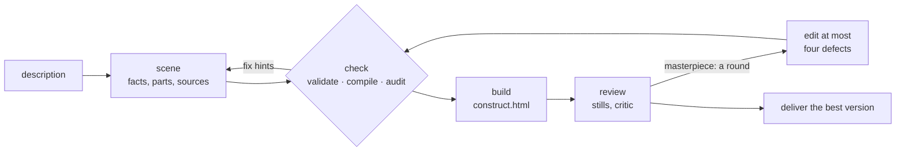

# Construct

**Holographic constructs any AI agent can build, from a description, honestly.** An agent
writes a short declarative scene; Construct checks it, compiles it and renders it as an
animated holographic model in one self-contained web page.

<p align="center">
  <a href="https://rtmandreyev.github.io/construct/examples/sainte-chapelle/"></a>
  <a href="https://rtmandreyev.github.io/construct/examples/toyota-land-cruiser-fj62/"></a>
  <a href="https://rtmandreyev.github.io/construct/examples/duomo-di-milano/"></a>
</p>
<p align="center"><sub>Sainte-Chapelle · Toyota Land Cruiser FJ62 · Duomo di Milano, each built by Claude Opus in masterpiece mode. <a href="https://rtmandreyev.github.io/construct/">Open the gallery</a> to orbit them, replay the assembly and read the labels.</sub></p>

```
description  ──►  scene (JSON)  ──►  check  ──►  build  ──►  review
                  facts, parts,      validate,   one page,    stills; in masterpiece mode,
                  their sources      audit       WebGL2       rounds judged by a critic
```

- **Any agent, any model.** Claude Code, Hermes, any MCP client, any OpenAI-compatible endpoint, or by hand.
- **Honest about what is known.** Every fact is verified, user supplied, inferred or decorative, and the construct shows which.
- **One house style.** Models never choose colours, so every construct looks like it belongs with the rest.
- **Repairs itself.** Every problem comes back with a JSON path, a code and a fix hint.
- **No dependencies.** Python's standard library and a browser; no API keys or network service inside Construct.

## What it does

1. **You ask in plain words**, in your agent: *"make a construct of a Leica M3"*. The skill picks a
   mode (fast or masterpiece), tells you which and why, and looks the subject up when it is a
   named one.
2. **The model writes a scene**: the facts it knows, each with its certainty and source, and the
   parts, built from a closed vocabulary of shapes (lofts, lathes, towers, facades, shells), with
   how they assemble, open and move.
3. **Construct checks it.** It validates the scene, compiles it deterministically and audits it:
   nothing floating, no claim stronger than its evidence, nothing too thin or too small to read.
   The model repairs until the check is clean.
4. **Construct builds it**: one `construct.html` you can open anywhere, offline.
5. **The construct is reviewed.** Stills from every view; for a named subject, an independent
   critic compares them with reference photos. In masterpiece mode that review becomes rounds of
   judged improvement, each one reported to you.

## See it in practice

<p align="center"><a href="https://rtmandreyev.github.io/construct/"></a></p>

Every example was made by an AI agent with Construct, in fast or masterpiece mode, by Claude
Opus, GPT-6.1 Sol or DeepSeek.

**[Open the examples gallery →](https://rtmandreyev.github.io/construct/)** · each scene and its
hero image are in [examples/](examples/).

## How it works

A scene is data, never code: the model describes what the thing is, and the compiler and viewer
decide how it looks. In masterpiece mode the review becomes a loop judged by a fresh critic.



- **Provenance on every part.** Facts and parts carry their certainty, and the provenance view
  (press **P**) colours each part by how it is known. Unknown facts are left out, never guessed.
- **An audit that runs to zero.** Floating parts, overclaimed evidence, unreadable detail and
  bare surfaces are all reported with a path and a fix.
- **An independent critic.** A fresh model that never saw the authoring compares the renders
  with the reference photos and ranks the defects. Only the critic can call a construct "good".
- **Masterpiece rounds.** Each round fixes at most four defects; the critic then picks the better
  of the new version and the best so far, shown unlabelled. A win is kept, a loss reverted, so
  the best version is always on disk, and every round ends with a short report.
- **What it does not do.** No imported meshes, CAD or photogrammetry; one periodic motion per part;
  hidden lines show faintly through solids and glass is never tinted, by design of the house style.

The full description is in **[docs/USING.md](docs/USING.md)** and **[docs/ABOUT.md](docs/ABOUT.md)**.

## Install

```sh
git clone https://github.com/rtmandreyev/construct.git
cd construct
python3 construct_hologram/package.py --out dist    # builds the Claude Code and Hermes skills
```

| Host | How to add it |
| --- | --- |
| Claude Code | `claude --plugin-dir dist/claude-code/construct` for one session, or copy `dist/claude-code/construct/skills/construct` into `.claude/skills/` |
| Hermes | Copy `dist/hermes/construct` into `~/.hermes/skills/` (or a project's `.hermes/skills/`, then `hermes skills trust`) |
| Any MCP client | Add `{"mcpServers": {"construct": {"command": "python3", "args": ["/path/to/construct/construct_hologram/server.py"]}}}` |
| Any OpenAI-compatible model | `python3 construct_hologram/cli.py author "..." --base-url ... --model ... --key-env ... --out scene.json` |
| By hand | The command line below; no model needed |

## Quick start

In your agent, ask in plain words: *"make a construct of a 1970s desk fan"*, or *"a masterpiece of
the Sydney Opera House"*. By hand:

```sh
C=construct_hologram/cli.py
python3 $C params book --variant paperback --output book.json   # fill in the facts you know
python3 $C check book.json             # audit: PASS, or paths and fix hints
python3 $C build book.json --out out   # out/construct.html: open it in any browser
python3 $C review book.json --out out  # out/review/*.png: stills to judge it by
```

In a construct: drag to orbit, scroll to zoom, **R** replays the assembly, **L** shows labels,
**P** shows how each part is known, **1**–**6** change the view.

## Modes

Say a mode in your request, or say nothing and the skill picks one and tells you why before it
starts.

| Mode | What it does | When it stops | Rough cost | Use it for |
| --- | --- | --- | --- | --- |
| **fast** | One pass with self-review | About 10 minutes (30 for a richer subject) | Cents with DeepSeek | Generic subjects, simple objects, quick requests |
| **masterpiece** | Rounds judged by an independent critic, each version compared with the best so far | Two rounds without a win, 12 rounds, or 2 hours of active work | Up to 2 hours of frontier-model tokens | A named car, landmark or building whose likeness matters |
| **unbounded** | The same rounds, with no cap and no time limit | Only after two rounds without a win | Many rounds and hours, a high token cost | Only when you ask for it by name |

The skill never picks unbounded on its own: the critic finds an improvement almost every round,
so it can run for hours. Every round is reported, so you can stop it whenever you like.

## Models

- **Named subjects in masterpiece mode** (a car model, a landmark): GPT-6.1 Sol or Claude Opus.
  A smaller model given such a subject says so and recommends them.
- **Simpler objects in fast mode:** DeepSeek does as well as those on objects such as a tape deck,
  a watch or a camera.
- **Small free models** (MiniMax, Inkling, Nemotron) are not recommended: in about half of their
  runs they did not save a scene, and they made scale errors.

## Requirements

- Python 3.10 or newer. Nothing else to install: no packages, no virtual environment.
- For review stills, a Chromium-family browser you already have (Chrome, Chromium, Edge, Brave).
- For video, ffmpeg.
- Tested on macOS; review capture on Linux and Windows is untested.

## Documentation

- [docs/USING.md](docs/USING.md): every entry point, step by step, with a worked example
- [docs/ABOUT.md](docs/ABOUT.md): what Construct is and where its method comes from
- [docs/ARCHETYPES.md](docs/ARCHETYPES.md): the parameter archetypes (cases, books, guitars, synth, vessels, vehicles)
- [docs/TERRAIN.md](docs/TERRAIN.md): places, peaks and routes from elevation data you supply
- [docs/EVALUATION.md](docs/EVALUATION.md): cross-model results, and how to score your own model
- [CONTRACT.md](CONTRACT.md): the `construct/0.2` scene and geometry format, for apps
- [examples/](examples/): the example scenes, and how to rebuild the gallery
- [CHANGELOG.md](CHANGELOG.md) and [PUBLISHING.md](PUBLISHING.md)

## Contributing

See [CONTRIBUTING.md](CONTRIBUTING.md). Run the tests with
`python3 -m unittest discover -s construct_hologram -t . -p 'test_*.py'`. Security reports:
[SECURITY.md](SECURITY.md).

## License

[MIT](LICENSE) — Copyright (c) 2026 Artyom Andreyev.

Construct's working method is inspired by [Anatomy](https://github.com/wheresryan22/anatomy)'s
truth-first construction (MIT); it shares the method, not code. Product, vehicle and place names
in the examples belong to their owners: each example is an independent reconstruction from
public references, not an official model. See [NOTICE](NOTICE).
