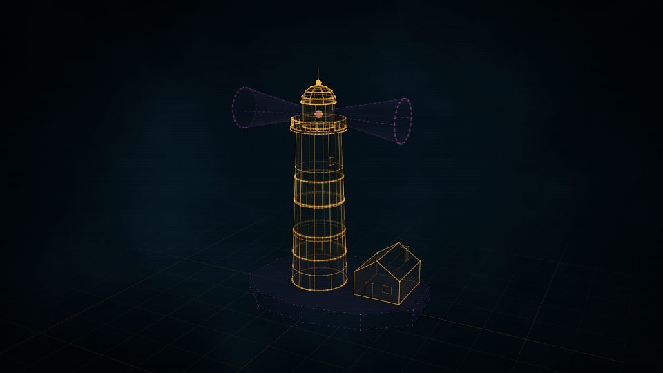

# Construct

**Holographic constructs any AI agent can build: from a description, honestly.**

[](LICENSE)
[](CHANGELOG.md)
[](docs/USING.md#requirements)
[](NOTICE)

<table>
<tr>
<td width="33%"><a href="https://rtmandreyev.github.io/construct/examples/sainte-chapelle/"></a></td>
<td width="33%"><a href="https://rtmandreyev.github.io/construct/examples/toyota-land-cruiser-fj62/"></a></td>
<td width="33%"><a href="https://rtmandreyev.github.io/construct/examples/duomo-di-milano/"></a></td>
</tr>
<tr>
<td align="center"><b>Sainte-Chapelle</b><br><sub>masterpiece · Claude Opus</sub></td>
<td align="center"><b>Toyota Land Cruiser FJ62</b><br><sub>masterpiece · Claude Opus</sub></td>
<td align="center"><b>Duomo di Milano</b><br><sub>masterpiece · Claude Opus</sub></td>
</tr>
</table>

<p align="center"><a href="https://rtmandreyev.github.io/construct/"></a></p>

<p align="center"><a href="https://rtmandreyev.github.io/construct/"><b>See all 23 examples live</b></a> · open any construct to orbit it, replay its assembly and read its labels</p>

Construct is an agent skill and toolkit that turns a description of a real or fictional thing
into an animated holographic model: line light over smoked glass, built part by part on screen,
with every fact and part marked by how it is known. An AI model writes a short declarative
scene (or fills in an archetype's parameters); Construct validates it, audits it, compiles it
and renders it into one self-contained web page. No graphics code, no API keys, no network
service: Python's standard library and any browser.

- **Any agent, any model.** Claude Code, Hermes, any MCP client, any OpenAI-compatible endpoint,
  or by hand.
- **Honest about what is known.** Every fact is verified (with a source), user supplied,
  inferred or decorative, and the construct shows which. Unknown facts are left out, never
  guessed.
- **One house style.** Models never choose colours, so a construct by a small model sits next to
  one by a frontier model.
- **Repairs itself.** Every problem comes back with a JSON path, a code and a fix hint.

**Contents:** [Quick start](#quick-start) · [Three modes](#three-modes) ·
[Recommended models](#recommended-models) · [How it works](#how-it-works) · [Examples](#examples) ·
[Documentation](#documentation) · [Limitations](#limitations) · [License and credits](#license-and-credits)

## Quick start

```sh
git clone https://github.com/rtmandreyev/construct.git
cd construct
python3 construct_hologram/package.py --out dist     # builds the Claude Code and Hermes skills
```

| Where | How |
|---|---|
| **Claude Code** | `claude --plugin-dir dist/claude-code/construct` for one session, or copy `dist/claude-code/construct/skills/construct` into `.claude/skills/`. Then ask in plain words: *"make a construct of a Leica M3"*. |
| **Hermes** | Copy `dist/hermes/construct` into `~/.hermes/skills/` (or a project's `.hermes/skills/`, then `hermes skills trust`). Ask in plain words. |
| **Any MCP agent** | `{"mcpServers": {"construct": {"command": "python3", "args": ["/path/to/construct/construct_hologram/server.py"]}}}`: read-only tools to check, expand, compile and look up limits. |
| **Any OpenAI-compatible model** | `python3 construct_hologram/cli.py author "a can of porter" --params --base-url https://api.deepseek.com/v1 --model deepseek-chat --key-env DEEPSEEK_API_KEY --out can.json` (also OpenRouter, OpenAI, Ollama, llama.cpp, LM Studio). |
| **By hand, no model** | `params` → `check` → `build` → `review` (below). |

Requirements: Python 3.10 or newer. Review stills need a Chromium-family browser you already
have (Chrome, Chromium, Edge, Brave); video needs ffmpeg. Nothing is downloaded or installed.

```sh
C=construct_hologram/cli.py
python3 $C params book --variant paperback --output book.json   # fill in the facts you know
python3 $C check book.json             # audit: PASS, or paths and fix hints
python3 $C build book.json --out out   # out/construct.html: open it in any browser
python3 $C review book.json --out out  # out/review/*.png: stills to judge it by
```

## Three modes

Say a mode in your request, or say nothing: the skill picks one and tells you before it starts
(which mode, why, roughly how long and what it costs, and how to switch).

| mode | what it does | when it stops | rough cost | use it for |
|---|---|---|---|---|
| **fast** | one pass with self-review | about 10 minutes (30 for a richer subject) | cents with DeepSeek | generic subjects ("a watch", "a car"), simple objects, quick requests |
| **masterpiece** | rounds judged by an independent critic, each version compared with the best so far | 2 rounds without a win, 12 rounds, or 2 hours of active work | up to 2 hours of frontier-model tokens | a named car, landmark or building whose likeness matters |
| **unbounded** | the same rounds, with no cap and no time limit | only after 2 rounds without a win | many rounds and hours, a high token cost | only when you ask for it by name |

The skill never picks unbounded on its own: the critic finds an improvement almost every round,
so it can run for hours. Every round is reported, so you can stop it whenever you like. In blind
comparisons no visible gain showed after about 12 rounds, which is why masterpiece stops there.
The older tier names still work (quick, standard and showcase mean fast).

## Recommended models

- **Hard named subjects in masterpiece mode** (a car model, a landmark): GPT-6.1 Sol or Claude
  Opus. A smaller model given such a subject says so and recommends them.
- **Simpler objects in fast mode:** DeepSeek does as well as those, on objects such as a tape
  deck, a watch or a camera.
- **Small or free models** (MiniMax, Inkling, Nemotron) are not recommended: in about half of
  their runs they failed to save a scene at all, and they made scale errors.

## How it works

```
request ─▶ research ─▶ scene (JSON) ─▶ check ─────────────▶ build ─────────▶ review
           (named      facts, parts,   validate, compile,    one self-        renders and an
            subjects)  sources         audit; fix hints      contained page   independent critic
```

1. **Scene.** The model writes what the thing is made of: facts with their certainty and
   sources, parts built from a closed vocabulary of shapes (lofts, lathes, towers, facades,
   shells...), and how it assembles, opens and moves.
2. **Check.** Construct validates the scene, compiles it deterministically and audits it: no
   floating parts, no claim stronger than its evidence, nothing too thin or tiny to read. Every
   problem names its JSON path and a fix, and the model repairs until it is clean.
3. **Build.** One `construct.html`: plain WebGL2, no dependencies, works offline.
4. **Review.** Stills from every view; for a named subject, an **independent critic** (a fresh
   model that never saw the authoring) compares them with reference photos and ranks the
   defects. Only the critic can call a construct "good" or "outstanding".

**The masterpiece loop** (`construct rounds`) repeats review and repair in small, judged rounds:

- the author fixes at most four defects per round, tagging each edit;
- one fresh critic judges the new version on its own, then picks the better of the new version
  and the best so far, shown unlabelled and in random order;
- a version that wins is kept, and one that loses is reverted, so the best is always on disk;
- after every round a short report says what the critic asked for, what changed, whether it
  won, and how long it took; the run can be paused and resumed at any time.



The provenance view (press **P**) shows how every part is known. The audit proves a construct
is valid and honest; likeness is judged by the critic, and can be measured against a traced
reference outline with `construct compare`.

## Examples

Twenty-three constructs made by Claude Opus, GPT-6.1 Sol and DeepSeek, from the Sainte-Chapelle
to a Yamaha concert grand, in fast or masterpiece mode. Open the **[live gallery](https://rtmandreyev.github.io/construct/)**, or see
[examples/](examples/) for each scene and its hero image.

## Documentation

- [docs/USING.md](docs/USING.md): every entry point, step by step, with a worked example
- [docs/ABOUT.md](docs/ABOUT.md): what Construct is and where its method comes from
- [docs/ARCHETYPES.md](docs/ARCHETYPES.md): the parameter archetypes (cases, books, guitars, synth, vessels, vehicles)
- [docs/TERRAIN.md](docs/TERRAIN.md): places, peaks and routes from elevation data you supply
- [CONTRACT.md](CONTRACT.md): the `construct/0.2` scene and geometry format, for apps
- [docs/EVALUATION.md](docs/EVALUATION.md): cross-model results, and how to score your own model
- [CONTRIBUTING.md](CONTRIBUTING.md) · [CHANGELOG.md](CHANGELOG.md) · [PUBLISHING.md](PUBLISHING.md)

## Limitations

- A closed procedural vocabulary: no imported meshes, CAD, photogrammetry or booleans.
- One periodic motion per part; articulations nest, periodic motions do not.
- Hidden lines show faintly through solid parts, glass cannot be tinted, and stills show the
  closed pose: that is the house style.
- Terrain reads ESRI ASCII grids and XYZ exports (convert GeoTIFF first), the globe GeoJSON.
- Tested on macOS; review capture on Linux and Windows is untested.

## License and credits

MIT licensed: see [LICENSE](LICENSE) and [NOTICE](NOTICE).

Construct's working method is inspired by **Anatomy's truth-first construction method**
([wheresryan22/anatomy](https://github.com/wheresryan22/anatomy), MIT): true numbers first, a
parts list before geometry, an audit run to zero, rendered images read before delivery, and
never copying a reference image. Construct shares the method, not code. Its holographic look
grew out of the same author's earlier Measured Light holograms.

Product, vehicle and place names in the examples belong to their owners. Each example is an
independent reconstruction from public references, not an official model; the scenes cite
their sources, and no reference photograph is included.
