# Construct

**Construct is a tool for AI agents that turns everything that can be found out about a thing into one exact,
checked description of it: its named parts at their real sizes, how they fit together, open and move, and how
each one is known, measured or guessed.** An agent does the research and writes the description; Construct
checks it and builds from it, the same description always into the same result. Put constructs together and they
make a **world**: a room, a street, a whole game level, where every construct is still whole, with its own parts,
sources and joints, so you can move, reuse or open any of it.

**Describe a thing, or show a place. Get a hologram, a 3D model, a print, a kit, or a whole world.** You ask any AI
agent in plain words, and it builds an animated model in lines of light, the **Measured Light** style, as one web
page you can open anywhere, honest about what is known. The same construct becomes a 3D model with named parts and
working joints, a print, a model kit, a CAD file or a film. Give it one picture of a place and it builds the place,
zero-shot: [Stortorget](examples/worlds/stortorget/), Stockholm's old square from a single photograph, stands almost
exactly as the photograph shows it; [Rain Harbour](examples/worlds/rain-harbour/) is a playable game level from one
concept picture. Then rearrange it by hand in Hermes, with no AI at all.

<p align="center">
  <a href="https://rtmandreyev.github.io/construct/examples/sainte-chapelle/"></a>
  <a href="https://rtmandreyev.github.io/construct/examples/kestrel/"></a>
  <a href="https://rtmandreyev.github.io/construct/examples/toyota-land-cruiser-fj62/"></a>
</p>
<p align="center">
  <a href="https://rtmandreyev.github.io/construct/worlds/villa-savoye-lived-in/"></a>
  <a href="https://rtmandreyev.github.io/construct/worlds/the-shed/">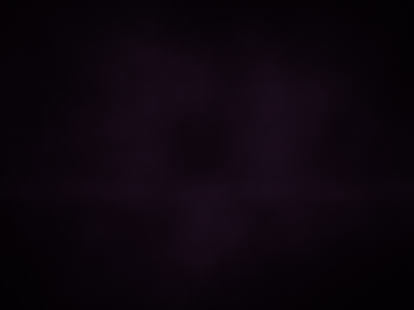</a>
  <a href="https://rtmandreyev.github.io/construct/worlds/stortorget/"></a>
</p>
<p align="center"><sub><b>Constructs</b> (top): the Sainte-Chapelle and the Toyota Land Cruiser FJ62 by Claude Opus 5.5, KESTREL, an
invented ice tug, by GPT-6.1 Sol, each in masterpiece mode. <b>Worlds</b> (below): the Villa Savoye, lived in, and the
shed and the things around it, made of constructs from the gallery; Stortorget at Christmas, made by GPT-6.1 Sol from
one photograph. <a href="https://rtmandreyev.github.io/construct/">Open the gallery</a> to orbit them, replay the
assembly and read the labels; <a href="docs/for/invent-from-what-exists.md">how KESTREL was made</a>,
<a href="examples/worlds/stortorget/">how Stortorget was made</a>.</sub></p>

- **Construct for Hermes.** A native Hermes plugin: ask for a thing in plain words and the construct appears live in the chat, with its 3D model, kit and NetLogo runs beside it, and place your constructs together into worlds. `hermes plugins install rtmandreyev/construct#hermes/construct` ([what it does](hosts/hermes/construct/README.md), [Villa Savoye in Hermes, step by step](docs/for/hermes-walkthrough.md), [worlds, step by step](docs/for/worlds-walkthrough.md)).
- **Whole places, still in pieces.** A world made from one picture keeps every construct separate: move a car, turn a tower, swap the signs, open a door on its hinge, export it to Blender or Godot, reuse a building in another level ([Rain Harbour, before and after](examples/worlds/rain-harbour/#changed-by-hand)).
- **Any agent, any model.** Claude Code, Hermes, any MCP client or any OpenAI-compatible endpoint, or by hand.
- **Honest about what is known.** Every part says how it is known, its size and its shape apart, every guess in a shade of how firmly it is held.
- **One house style.** Models never choose the colours, so every construct looks like it belongs with the rest.
- **It repairs itself.** Every problem comes back with where it is and how to fix it.
- **Nothing to install.** Python's standard library and a browser; no API keys or network service inside Construct.

## Find your path

| You… | Construct gives you | Start here |
| --- | --- | --- |
| ***Everyday*** | | |
| want a model of **anything you can describe** | A thing you describe, as a construct you can turn, replay and share | [Make a construct](docs/for/anyone.md) |
| want a **digital copy of something you own** | Your chair, guitar, camera or heirloom in 3D from your photos and whatever its maker publishes, showing what was measured and what was guessed | [Copy your thing](docs/for/copy-your-thing.md) |
| are planning a change to your **home or garden** | Your shed, room or garden as a model to try the change on first: a deck, shelves, an extension, a new layout. A planning model, not a survey | [Try it on a copy](docs/for/home-and-garden.md) |
| want to customise or restore a **vehicle** | Your car, bike or scooter from its published sizes and your photos, your parts told apart from the factory's: try wheels or a new colour, plan a restoration, make a model of it | [Your vehicle](docs/for/your-vehicle.md) |
| need a part that is **missing or broken** | A knob, bracket or cover drawn to the thing it fits, as a print or a CAD file someone can make | [Make the part](docs/for/replace-a-part.md) |
| want **a place from a photo**: a square, a street, a building, your neighbourhood | One photograph is enough to start (Stortorget, from one); more pictures make it closer, up to a digital twin, house by house, each part saying how it is known | [Stortorget, start to finish](examples/worlds/stortorget/) |
| want **your things together in one place** | Your house with your furniture, your car and scooter under it, a ship over the roof: whole constructs placed at real size, arranged by asking or by hand | [Worlds, step by step](docs/for/worlds-walkthrough.md) |
| want a **model kit of your own thing** | Your scooter, house or guitar as a kit to print, glue and paint, with a booklet ([one to open](https://rtmandreyev.github.io/construct/examples/vespa-gs150/kit/assembly.html)) | [A kit of your own](docs/for/a-kit-of-your-own.md) |
| want to **show someone what you mean** | A model a builder, a fabricator or a friend can turn and measure, and a file for their own tools | [Show what you mean](docs/for/show-what-you-mean.md) |
| ***Professionals and creators*** | | |
| are a **maker** with a printer or CAD | A construct as one checked print at your printer's largest size (Tompion's clock: 21 cm on a desktop printer, 10½ hours in PrusaSlicer), a model kit with plates, a booklet and its steps in 3D ([five to open](https://rtmandreyev.github.io/construct/#kits)), and true CAD shapes in FreeCAD and STEP | [Print, kit, CAD](docs/for/makers.md) |
| create **new ships, creatures or places** for a game, film or story | New things designed from real ones: a construct, a 3D model with working parts, a film ([see KESTREL](https://rtmandreyev.github.io/construct/examples/kestrel/), an invented ice tug) | [New things from real ones](docs/for/invent-from-what-exists.md) |
| have **software or a documented system** you wish were a physical product | Its documented functions mapped to controls, displays and the parts inside, what the documents fix kept apart from what is designed (one worked example: a software synthesizer as a 61-key instrument) | [Documentation → product](docs/for/documentation-to-product.md) |
| are a **game developer** | Props in named parts at their real size, with doors and lids on working hinges in Godot, FBX for Unity and Unreal; models of what your game needs instead of stock ones; a whole level from one concept picture ([Rain Harbour](examples/worlds/rain-harbour/): 21 constructs placed 50 times, a hero car, one command to a Godot map) | [Into a game engine](docs/for/game-developers.md) |
| are a **3D artist** | A construct or a whole world in Blender with its build, joints, metal and finish on sliders, painted from a small material map ([the Villa Savoye](examples/villa-savoye/), 396 parts, and [the Villa lived in](https://rtmandreyev.github.io/construct/worlds/villa-savoye-lived-in/), a world of 13, rendered in Cycles); OBJ in quads to model over; FBX and USD | [Into Blender](docs/for/3d-artists.md) |
| work in **film and motion** | A construct that assembles across your track, pausing, surging and flaring with the music, shimmering with a vocal stem ([three films](https://rtmandreyev.github.io/construct/#films)); keyed reveals in Blender; a world's named views as shots | [Film mode](docs/for/film-and-motion.md) |
| are an **educator or researcher** | An agent-based model's run drawn as a construct, compared, printed, filmed | [Models come alive](docs/for/educators-and-researchers.md) |
| work in a **museum or archive** | Reconstructions where every part says how it is known (measured, traced, seen in a photo, designed), sources cited and the critic's verdict kept: [Tompion's clock](https://rtmandreyev.github.io/construct/examples/tompion-year-going-clock/) from the Royal Collection's record, [Stortorget](examples/worlds/stortorget/) house by house | [Honest reconstructions](docs/for/museums-and-archives.md) |
| are a **developer** | A scene contract that is data, a check that returns each problem with its path and a fix, the same scene always built the same; a command line, an MCP server, skills, and a Hermes plugin with thirteen tools (`construct_world`, `construct_export`…) | [Build on it](docs/for/developers.md) |

## New in 1.3

Every change with pictures and the commands to try it: **[What's new in 1.3, a walkthrough](docs/NEW-IN-1.3.md)**.

- **Worlds.** Whole constructs placed together in one scene, each still itself: your chair, clock and synthesizer in
  your house, your cars under it, a ship over the roof; a street, a market square, a game level. The world's audit
  says what overlaps, what runs into the house it stands in, and what stands where a door opens. Six ship to start
  from. [Worlds, step by step](docs/for/worlds-walkthrough.md) · [the format](docs/WORLDS.md)
- **A world from a picture, in masterpiece mode.** Attach a photo or a concept picture: Hermes plans the pieces,
  builds each new construct in its own masterpiece rounds with a fresh critic, places them at real size, then runs
  the world itself through rounds against the picture. Two made this way, each from one picture:
  [Rain Harbour](examples/worlds/rain-harbour/), a game level, and [Stortorget](examples/worlds/stortorget/),
  Stockholm's old square at Christmas.
- **Arranged by hand in Hermes.** Arrange on a world's card: drag a construct onto any floor, table or roof, turn
  it, lift it; add one from the library; save, with no model turn. A Worlds tab, groups of your own, previews. The
  plugin ships 24 constructs (16 in 1.2.1) and all six worlds, the two from pictures with their artwork. A level
  made from one prompt can be remade by hand: [Rain Harbour, before and after](examples/worlds/rain-harbour/#changed-by-hand).
- **More ways out.** FBX, USD and USDZ (through Blender), a Godot game map whose doors swing, and the Blender
  add-on imports a world. Every construct now finishes with its own material map, which every export uses by
  default, and its artwork (signs, labels, screens) exports as textures in glTF and OBJ.
- **Sturdier masterpiece rounds**, from two long runs: ties recorded, artwork kept in checkpoints, references
  carried from round to round, more time on request (`rounds extend`), colour judged in the solid view.

## New in 1.2

Every change with pictures and the commands to try it: **[What's new in 1.2, a walkthrough](docs/NEW-IN-1.2.md)**.

- **Construct for Hermes.** A native Hermes plugin: ask for a thing in plain words, and the construct appears live in
  the chat; the 3D model turns in it, a kit steps through in 3D, exports are read back and summarised, long work runs
  in the background. `hermes plugins install rtmandreyev/construct#hermes/construct` ([what it does](hosts/hermes/construct/README.md)).
  Tested on Villa Savoye, from the request to a printable kit: [step by step →](docs/for/hermes-walkthrough.md)
- **New things from real ones.** [KESTREL](docs/for/invent-from-what-exists.md), an invented 120 m ice tug, from
  its brief to its joints in Godot: the studies it reasoned from, thirteen masterpiece rounds, then a more detailed
  version that kept all 256 parts and added 242. Both in the gallery, Apache-2.0, with every brief.
- **Documentation → product.** A software synthesizer's 354-page manual made into a 61-key instrument concept in one
  64-minute session, with the prompt and the documents it wrote, and plainly what it showed and what it did not.
  [The walkthrough →](docs/for/documentation-to-product.md)
- **Designed to a requirement.** A designed part names the requirement it realises (what you asked for, or what a
  document says it does) and stays honestly designed; a new design is captioned ORIGINAL DESIGN.
- **Checked harder.** A part that would tip over (`tips`), a pillar through a window (`crosses-glass`), a solid
  left open (`open`), a number in the text that no longer matches its fact (`stale-number`), and pokes confirmed
  four times finer.
- **A critic that stands apart.** Sealed critic packets with only the renders, the references and your request; a
  blind verdict cannot be rewritten.
- **Cleaner 3D, bigger constructs.** Solids wound outward, so Blender's normals and booleans agree; up to 1,024
  parts and 48,000 lines; glued joints inside joints for Godot; kit boards that lie flat.

## New in 1.1

Every feature with pictures and the commands to try it: **[What's new in 1.1, a walkthrough](docs/NEW-IN-1.1.md)**.
And one construct taken through all of it, step by step: **[A longcase clock, end to end](docs/END-TO-END.md)**.

- **Your own formats.** Adapters: what a construct holds, where to read it and the rules that keep an adapter
  honest, with a template that writes a parts sheet and an STL per part. [Write your own →](docs/ADAPTERS.md)
- **Honest in finer shades.** A part's size and its shape known apart, every guess in a shade of how firmly it is
  held. Press **P**.
- **See it as a solid.** Press **S** in any construct; `check --fit` names what pokes through or floats.
- **Contact you can trust.** `check` follows support through the solids, not their boxes: a part that only seems
  to rest on another, or hangs on a wire-thin strut, is named with the gap and the part to rest it on. Found from a
  desk fan two models built; it closed three gaps in the gallery.
- **Cleaner 3D.** Smoother solids, OBJ that subdivides cleanly, triangle quality reports, for Blender and any
  3D program.
- **Ready for game engines.** Glued pieces with working hinges for Godot, pieces that break apart and settle,
  colliders, seeded variants.
- **CAD.** True CAD shapes in FreeCAD, with their joints, and STEP for any CAD program.
- **Prints.** One checked print at the largest size your printer takes, voxel or exact, with engraved line art.
- **Model kits.** A construct as a kit to print, glue and paint: numbered plates, a booklet drawn as a kit sheet,
  the same steps in 3D, every piece printable on its own. A first version, not yet built by a person.
- **Models come alive.** A NetLogo extension: one command in NetLogo turns a run into a construct, with a replay
  bar, a legend and a *How to read it* panel, in views chosen for the data. Runs side by side for a lesson, a
  printable worksheet, CSV and *Cite this run*; a run as a film or a 3D model in Blender, or as plates you can
  stack. 388 of the Models Library's 445 models record with no edits.

## Examples

**Worlds.** Rain Harbour and Stortorget were each made in Hermes from one picture and one request, zero-shot. Rain
Harbour, a game level from a concept picture: 21 constructs placed 50 times, every sign in real English and Chinese, a drivable hero car.
Stortorget, from one photograph of Stockholm's old square: eight real houses researched one by one, one market stall
placed 41 times, the tree, standing almost exactly as the photograph shows them. The Villa Savoye, lived in, is
your own constructs together: the house with its furniture, a Braun, a Revox, a Leica, SERUM, an FJ62 and a DB5
under the pilotis, KESTREL far off over the roof. [Worlds, step by step →](docs/for/worlds-walkthrough.md)

<p align="center">
  <a href="examples/worlds/rain-harbour/"></a>
</p>
<p align="center">
  <a href="examples/worlds/stortorget/">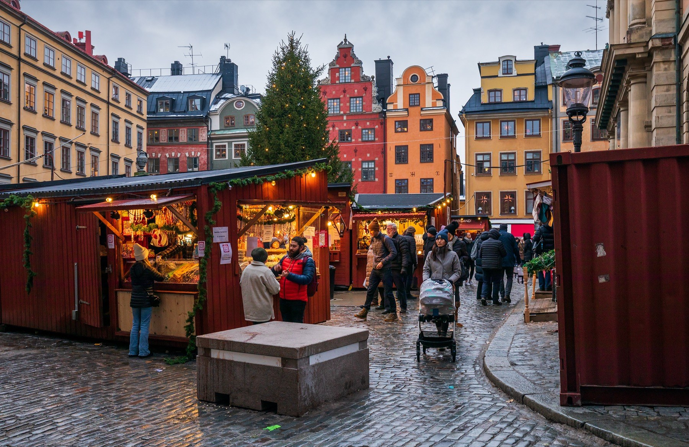</a>
  <a href="examples/worlds/stortorget/">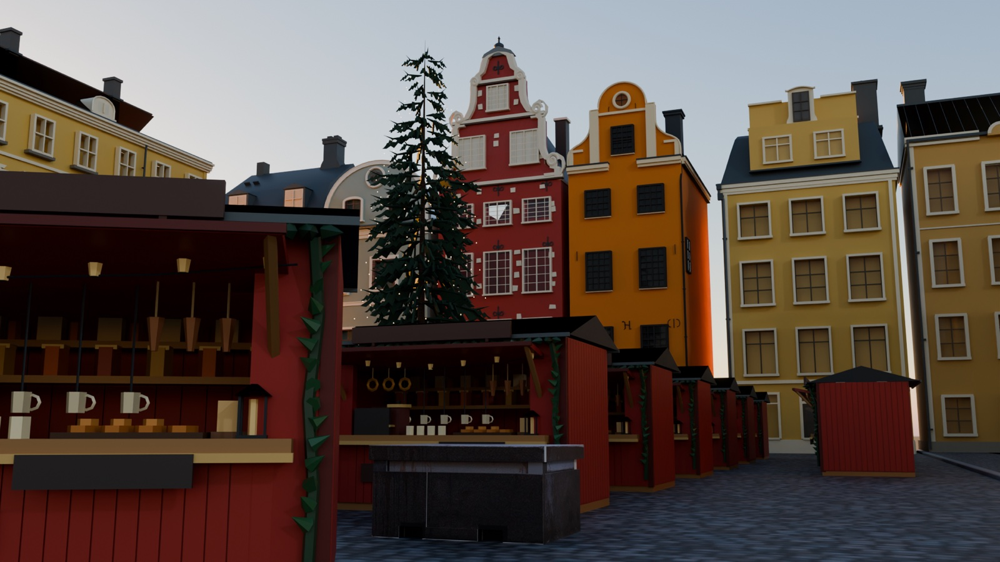</a>
</p>
<p align="center"><sub>Left, the one photograph Stortorget was asked from (Ximonic, CC BY-SA 4.0); right, the world made from
it, rendered from the same place.</sub></p>
<p align="center">
  <a href="https://rtmandreyev.github.io/construct/worlds/villa-savoye-lived-in/">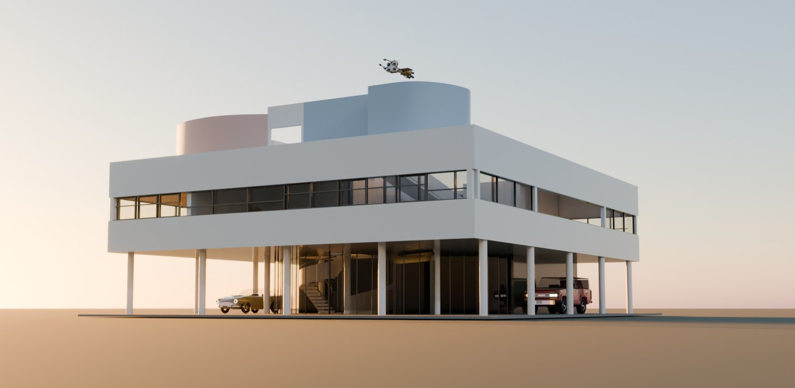</a>
  <a href="https://rtmandreyev.github.io/construct/worlds/villa-savoye-lived-in/">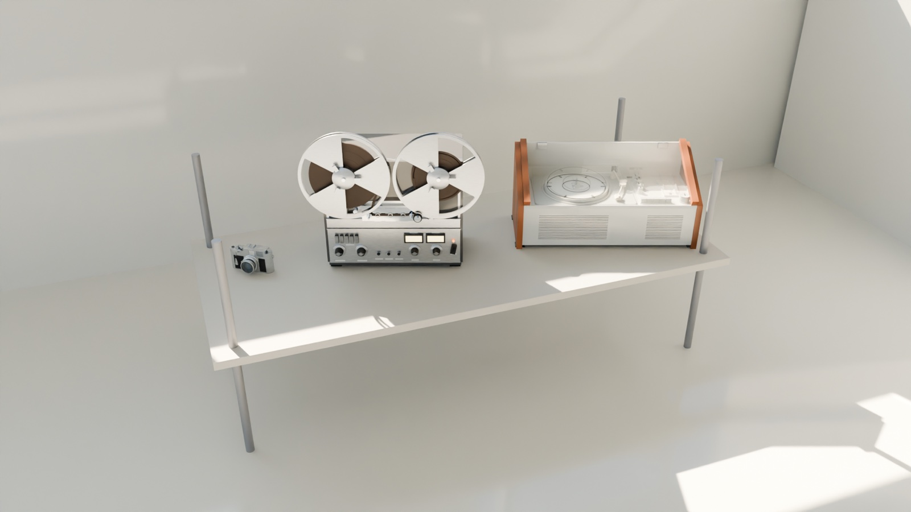</a>
</p>
<p align="center"><sub>Every world as it ships, imported into Blender with Construct's add-on, each construct finished
with its own material map.</sub></p>

**Provenance and solids.** The Duomo di Milano in provenance shades (**P**): verified sizes in cyan, traced shapes in blue,
every guess a deeper amber the more firmly it is held; and the same Duomo as a solid (**S**), as a modelling program shows it. [Museums and archives →](docs/for/museums-and-archives.md)

<p align="center">
  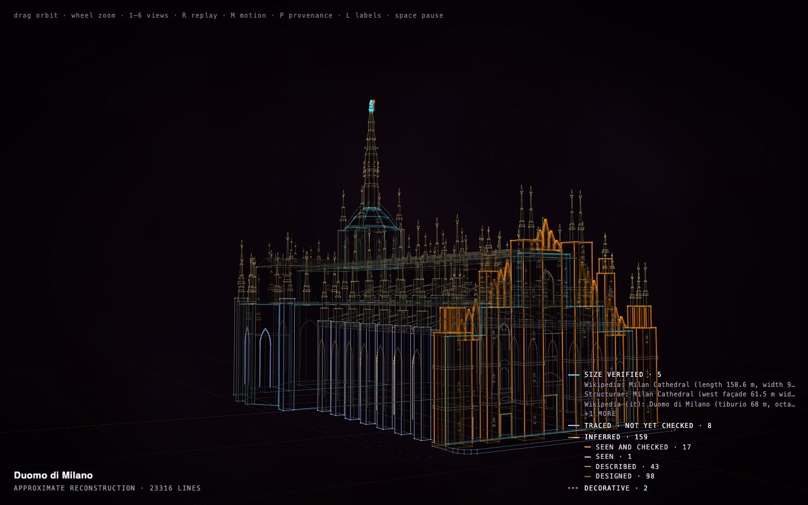
  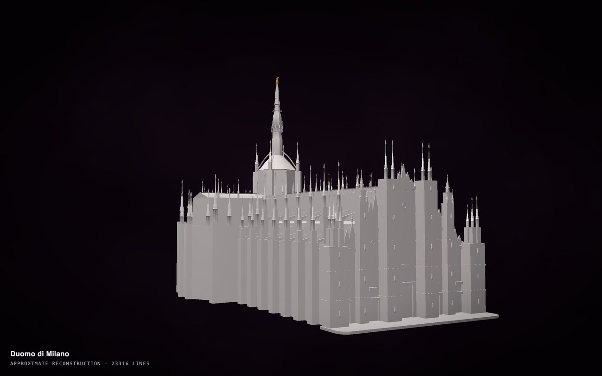
</p>

**Film mode.** A construct assembling across a piece of music. [Film and motion →](docs/for/film-and-motion.md)

<p align="center">
  <a href="https://rtmandreyev.github.io/construct/films/james-webb-space-telescope/">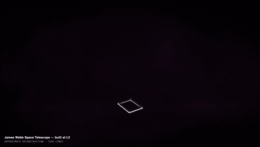</a>
  <a href="https://rtmandreyev.github.io/construct/films/voyager-1/">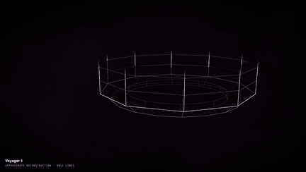</a>
  <a href="https://rtmandreyev.github.io/construct/films/arecibo-observatory/">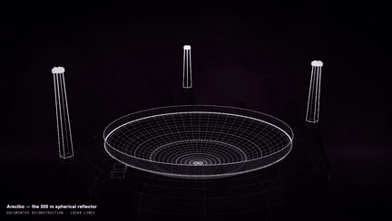</a>
</p>

**Game engines and Blender.** The FJ62 in Godot, knocked apart into its pieces; and from light to a finished model. [Game developers →](docs/for/game-developers.md) · [3D artists →](docs/for/3d-artists.md)

<p align="center">
  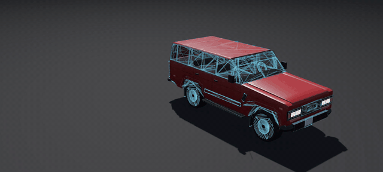
  <a href="https://rtmandreyev.github.io/construct/examples/light-to-metal/">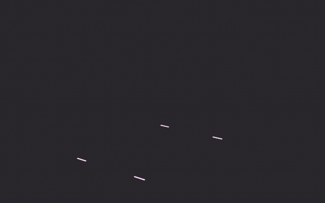</a>
</p>

**Prints and CAD.** An exact print of the FJ62 beside its voxel print; the Yamaha CFX and the Leica M3 in FreeCAD. [Makers →](docs/for/makers.md)

<p align="center">
  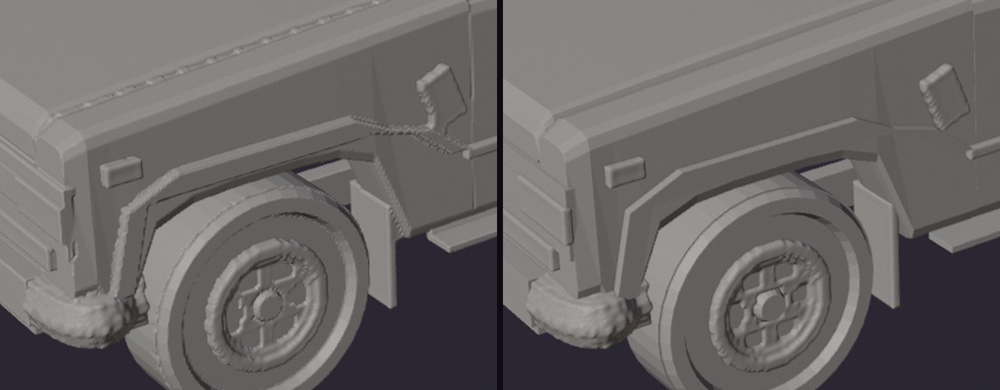
  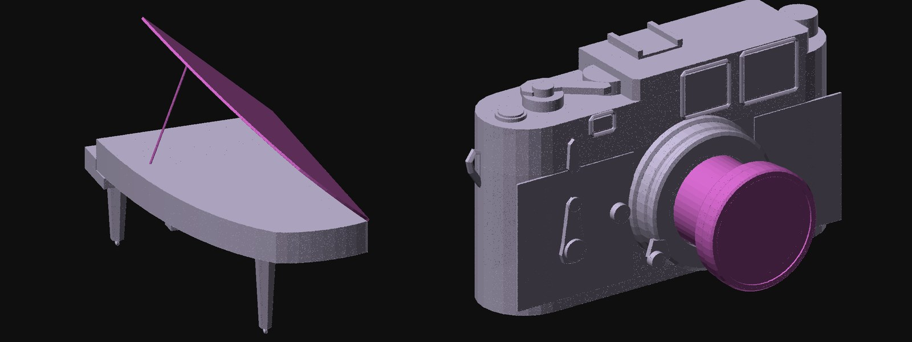
</p>

**Model kits.** Four constructs as kits to print, glue and paint: the Yamaha CFX piano (1:12, 54 pieces), Tompion's year-going clock (1:12, 34 pieces), the VW T1 Samba (1:16, 98 pieces) and an owner's Vespa GS 150 (1:12, 28 pieces), each with its steps in 3D and a booklet to print. Open them in your browser, or download their plates: [the kits in the gallery](https://rtmandreyev.github.io/construct/#kits). [Makers →](docs/for/makers.md)

<p align="center">
  <a href="https://rtmandreyev.github.io/construct/examples/yamaha-cfx/kit/assembly.html">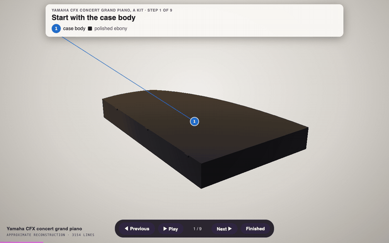</a>
  <a href="https://rtmandreyev.github.io/construct/examples/tompion-year-going-clock/kit/assembly.html">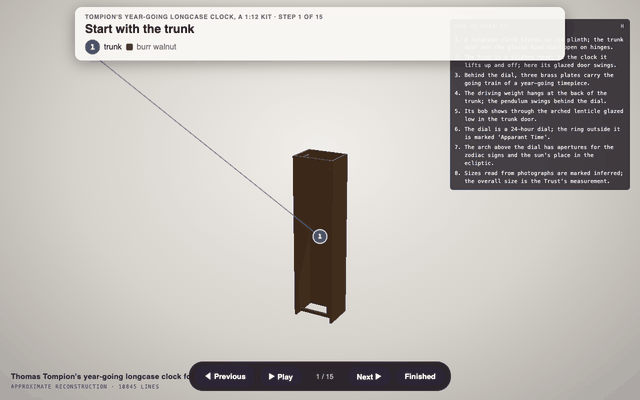</a>
  <a href="https://rtmandreyev.github.io/construct/examples/volkswagen-t1-samba/kit/assembly.html">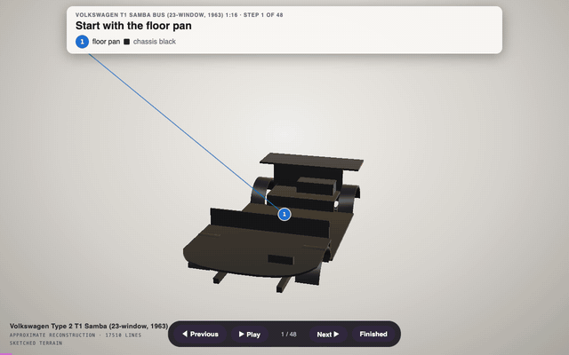</a>
</p>
<p align="center">
  <a href="https://rtmandreyev.github.io/construct/examples/yamaha-cfx/kit/booklet.html">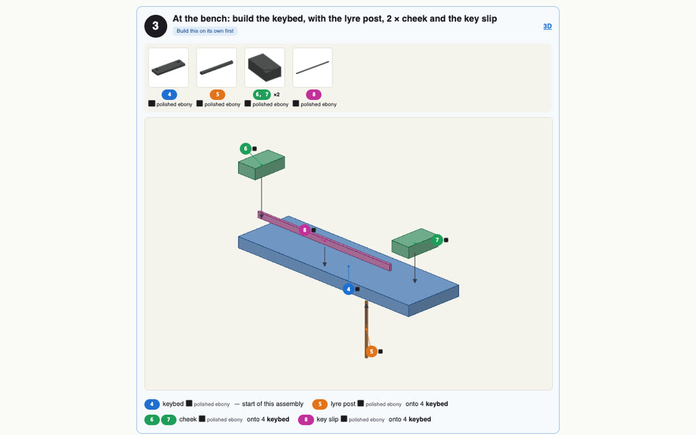</a>
</p>

**NetLogo runs.** A simulation's whole run as a construct, time as its height. [Educators and researchers →](docs/for/educators-and-researchers.md)

<p align="center">
  <a href="https://rtmandreyev.github.io/construct/examples/netlogo-flocking/"></a>
  <a href="https://rtmandreyev.github.io/construct/examples/netlogo-wolf-sheep/">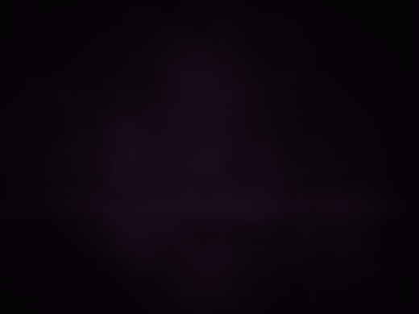</a>
  <a href="https://rtmandreyev.github.io/construct/examples/netlogo-fire/">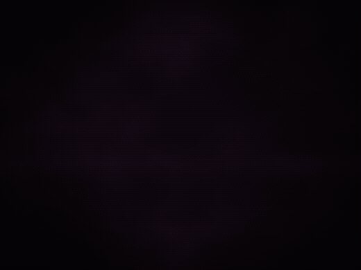</a>
</p>

**Beyond objects.** The same visual language works for ideas and data. Here a classic NetLogo agent-based model, Uri
Wilensky's *Simple Viral Marketing*, was rebuilt to run live in the browser and drawn as a construct: five hundred
people, one product, word of mouth and a little advertising. The floor is the social network, and each person rises
to the moment they adopted, so you can watch an idea spread and see who it reaches last, and why.

<p align="center"><a href="https://rtmandreyev.github.io/construct/examples/netlogo-viral-marketing/">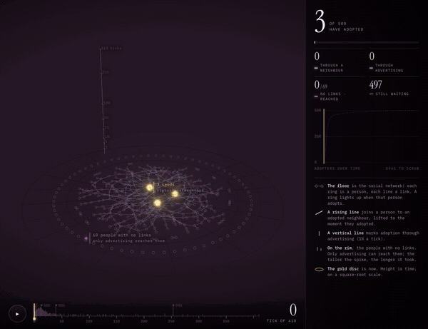</a></p>
<p align="center"><sub><a href="https://rtmandreyev.github.io/construct/examples/netlogo-viral-marketing/">Open the live model</a> to build new networks, run them tick by tick and compare a hundred runs with NetLogo's own. The model is © 2012 Uri Wilensky; this example is under CC BY-NC-SA 3.0 (see <a href="#license">License</a>).</sub></p>

## How it works

A scene is data, never code: the agent says what the thing is, and Construct decides how it
looks. That split is what keeps every construct honest and in one style. In masterpiece mode the
review becomes a loop, judged by a critic that never saw the authoring.

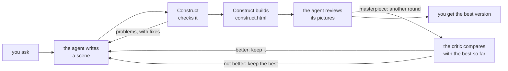

- **You can see how each part is known.** Press **P** in any construct and every part is coloured
  by whether it is verified, supplied by you, inferred or decorative. Press **S** to see it as a solid,
  the way a modelling program or a print shows it.
- **The check runs to zero.** Floating parts, claims without evidence and details too fine to see
  are reported, with fixes, before anything is built.
- **The critic is independent.** It is a fresh model that compares each new version with the best
  so far without knowing which is which. Only a better version is kept.
- **Masterpiece stops when it stops improving:** after two rounds without a better version, after
  12 rounds, or after two hours. In the author's own blind comparisons, on two subjects, there was
  no visible improvement after about round 12, so more rounds mostly cost time.

<p align="center">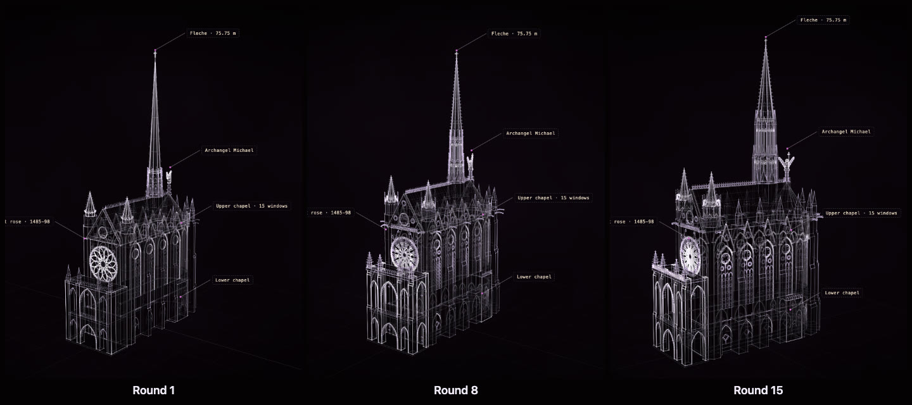</p>
<p align="center"><sub>The critic at work: the Sainte-Chapelle at rounds 1, 8 and 15 of a run by Claude Opus 5.5, made before masterpiece had its 12-round cap. The flèche gains its tiers, and the window tracery, buttresses and pinnacles fill in.</sub></p>

The whole process, with a construct improving round by round, is in
**[How a construct is made](docs/HOW-IT-IS-MADE.md)**. What you see in a construct, and why
models never choose its colours, is in **[The Measured Light style](docs/STYLE.md)**.

## Install

Construct runs from a copy of this repository; there is nothing to install system-wide. Clone it
and build the skills for your agent:

```sh
git clone https://github.com/rtmandreyev/construct.git
cd construct
python3 construct_hologram/package.py --out dist    # builds the Claude Code and Hermes skills
```

Then add the skill to your agent, or use Construct directly:

| Host | How to add it |
| --- | --- |
| Claude Code | `claude --plugin-dir dist/claude-code/construct` for one session, or copy `dist/claude-code/construct/skills/construct` into `.claude/skills/` |
| Hermes, the plugin | `hermes plugins install rtmandreyev/construct#hermes/construct`: thirteen tools, the construct live in the chat, worlds, 3D models, kits and NetLogo runs in Hermes Desktop ([Construct for Hermes](hosts/hermes/construct/README.md)) |
| Hermes, the skill alone | `hermes skills install rtmandreyev/construct/skills/construct`, or copy `dist/hermes/construct` into `~/.hermes/skills/` |
| Any MCP client | Add `{"mcpServers": {"construct": {"command": "python3", "args": ["/path/to/construct/construct_hologram/server.py"]}}}` |
| Any OpenAI-compatible model | `python3 construct_hologram/cli.py author "..." --base-url ... --model ... --key-env ... --out scene.json` |
| By hand | The command line below; no model needed |
| Blender | `python3 scripts/build_blender_extension.py`, then **Edit → Preferences → Get Extensions → Install from Disk** with the zip in `dist/` |

## Quick start

**In the Claude or ChatGPT app, no terminal.** Download Construct, give the app its folder and your photos, and ask:
the Claude app's Cowork and the ChatGPT app's Codex both read the skill and build the construct for you.
[Construct in the Claude or ChatGPT app →](docs/for/in-the-apps.md)

**In your agent,** just ask in plain words: *"a masterpiece of the Sydney Opera House"*, or *"a masterpiece
construct of my guitar from these photos"*. The agent does the rest and tells you what it is doing. The
constructs at the top of this page were all made in masterpiece mode, rounds judged by a second, independent model:
ask for it for anything you care about.

To try Construct without a model, fill in a ready-made template by hand:

```sh
C=construct_hologram/cli.py
python3 $C params book --variant paperback --output book.json   # fill in the facts you know
python3 $C check book.json             # audit: PASS, or paths and fix hints
python3 $C build book.json --out out   # out/construct.html: open it in any browser
python3 $C review book.json --out out  # out/review/*.png: stills to judge it by
```

Once a construct is open, drag to orbit and scroll to zoom. **R** replays the assembly, **L** shows
the labels, **T** hides the text on its surfaces, **P** shows how each part is known, **S** shows it as a solid,
and **1**–**6** move between views.

## Modes

A mode sets how much effort goes into a construct. Say one in your request, or say nothing and
the skill picks one and tells you why before it starts.

| Mode | What it does | When it stops | Rough cost | Use it for |
| --- | --- | --- | --- | --- |
| **fast** | One pass with self-review | About 10 minutes (30 for a richer subject) | Cents with DeepSeek V4.1 Flash | Generic subjects, simple objects, quick requests |
| **masterpiece** | Rounds judged by an independent critic, each version compared with the best so far | Two rounds without a win, 12 rounds, or 2 hours of active work | Up to 2 hours of frontier-model tokens | A named car, landmark or building whose likeness matters |
| **timeboxed** | Masterpiece in 2 hours in all: the critic's time counts too | Two rounds without a win, 12 rounds, or 2 hours in all | Up to 2 hours, fewer rounds when the critic is slow | When you want masterpiece done within two hours |
| **unbounded** | The same rounds, with no cap and no time limit | Only after two rounds without a win | Many rounds and hours, a high token cost | Only when you ask for it by name |

Masterpiece's two hours count only the agent's own work; the critic's turns come on top, so a
run with a slow critic can take three hours or more. **timeboxed** stops at two hours in all. The
skill never picks timeboxed or unbounded on its own: the critic finds an improvement almost every round,
so it can run for hours. Every round is reported, so you can stop it whenever you like.

## Models

Any capable model can make a construct, but some subjects need a stronger one. From the
evaluation runs:

- **Named subjects in masterpiece mode** (a car model, a landmark): a Sol or Opus class model
  (tested: GPT-6.1 Sol, Claude Opus 5.5). A smaller model given such a subject says so and
  recommends them.
- **Simpler objects in fast mode:** DeepSeek V4.1 Flash does as well as those on objects such as a
  tape deck, a watch or a camera (a toy xylophone with its own finish map: about nine minutes).
- **Worlds:** placing and arranging works with any of the models above. A world from a picture in
  masterpiece mode is long work for a strong model: Rain Harbour and Stortorget were each about a day
  of GPT-6.1 Sol, every construct built by its own subagent. Say "fast" for one pass each. Worlds were
  also tested in Hermes Desktop with DeepSeek V4 Pro.
- **Small models** (tested: MiniMax M3.1 Flash, Thinking Machines Inkling, NVIDIA Nemotron 3.5
  Super VL) are not recommended: in about half of their runs they did not save a scene, and they
  made scale errors.

## Requirements

Construct is deliberately small. You need:

- Python 3.10 or newer. Nothing else to install: no packages, no virtual environment.
- For review stills, a Chromium-family browser you already have (Chrome, Chromium, Edge, Brave).
- For video, ffmpeg.
- For the Blender add-on, Blender 4.2 or newer (the film of a run: checked in Blender 5.2); for the
  NetLogo bridge, NetLogo 6 or 7 (the extension: NetLogo 7, and NetLogo 3D 7).
- For CAD, FreeCAD 1.0 or newer (STEP needs nothing more); for game engines, any glTF 2.0 importer
  (glued joints and worlds as game maps: tested in Godot 4.7). FBX and USD come through Blender.
- For Hermes, the Construct plugin needs Hermes 0.22 or newer; a world from a picture in masterpiece
  mode needs `delegation.max_spawn_depth: 2` in Hermes's config (an orchestrator subagent per
  construct).
- Tested on macOS; review capture on Linux and Windows is untested.

## Documentation

| If you want to… | read |
| --- | --- |
| see everything new in 1.3, the worlds one by one | [What's new in 1.3](docs/NEW-IN-1.3.md) |
| make a world, in Hermes or by hand, and the format | [Worlds, step by step](docs/for/worlds-walkthrough.md) and [Worlds](docs/WORLDS.md) |
| see how a world was made from one picture | [Rain Harbour](examples/worlds/rain-harbour/) and [Stortorget](examples/worlds/stortorget/) |
| use constructs and whole levels in a game | [Construct for game developers](docs/for/game-developers.md) |
| see everything new in 1.2, with examples | [What's new in 1.2](docs/NEW-IN-1.2.md) |
| see everything new in 1.1, with examples | [What's new in 1.1](docs/NEW-IN-1.1.md) |
| see how a construct is made, step by step | [How a construct is made](docs/HOW-IT-IS-MADE.md) |
| know what you are looking at, and the keys | [The Measured Light style](docs/STYLE.md) |
| run it every way, from a first construct by hand to Claude Code and Hermes | [Using Construct](docs/USING.md) |
| fix something that went wrong | [Troubleshooting](docs/TROUBLESHOOTING.md) |
| start from a ready-made template (a book, a CD, a guitar, a car) | [Archetypes](docs/ARCHETYPES.md) |
| make mountains, routes and planets from real elevation data | [Terrain](docs/TERRAIN.md) |
| turn a construct into a film with music | [Film mode](docs/FILM.md) |
| export a 3D model or a world, plain or finished from its own material map | [3D export](docs/EXPORT.md) and the [Blender add-on](hosts/blender/README.md) |
| print it, or make it a model kit | [3D printing and kits](docs/PRINTING.md) |
| open it in CAD | [FreeCAD and STEP](docs/FREECAD.md) |
| put it in a game engine | [Godot](docs/GODOT.md) |
| draw a NetLogo model's run | [The NetLogo bridge](docs/NETLOGO.md) and [the extension](hosts/netlogo/README.md) |
| teach with it, or show it in a museum | [In a classroom and a museum](docs/CLASSROOM.md) |
| compare models, or score your own | [Evaluation](docs/EVALUATION.md) |
| build on it or test the code | [Development](docs/DEVELOPMENT.md) and [the scene contract](CONTRACT.md) |
| write your own adapter (a format, an engine, a machine) | [Adapters](docs/ADAPTERS.md) |
| use it in Hermes, from the request to a printable kit | [Villa Savoye in Hermes, step by step](docs/for/hermes-walkthrough.md) and [Construct for Hermes](hosts/hermes/construct/README.md) |
| design something new from real things (a ship, a creature, a vehicle) | [New things from real ones](docs/for/invent-from-what-exists.md) |
| design a physical product from a system's documentation | [Documentation → product](docs/for/documentation-to-product.md) |
| see how reconstructing, modifying and inventing are one pipeline | [The design-freedom continuum](docs/for/documentation-to-product.md#the-design-freedom-continuum) |
| know where the method comes from | [About](docs/ABOUT.md) |
| see what changed | [CHANGELOG.md](CHANGELOG.md) and the [1.3.0](docs/releases/v1.3.0.md), [1.2.0](docs/releases/v1.2.0.md), [1.1.0](docs/releases/v1.1.0.md) and [1.0.0](docs/releases/v1.0.0.md) release notes |

The full index is in [docs/README.md](docs/README.md).

## Contributing

See [CONTRIBUTING.md](CONTRIBUTING.md). Run the tests with
`python3 -m unittest discover -s construct_hologram -t . -p 'test_*.py'`. Security reports:
[SECURITY.md](SECURITY.md).

## License

[Apache-2.0](LICENSE) — Copyright (c) 2026 Artyom Andreyev (see [NOTICE](NOTICE)); versions up to 0.3.0 were MIT. The NetLogo example folders
(`examples/netlogo-*`: [viral marketing](examples/netlogo-viral-marketing/), [flocking](examples/netlogo-flocking/),
[wolf sheep](examples/netlogo-wolf-sheep/), [fire](examples/netlogo-fire/), [fireflies](examples/netlogo-fireflies/),
[virus on a network](examples/netlogo-virus-on-a-network/) and [virus compare](examples/netlogo-virus-compare/)) derive from Uri
Wilensky's NetLogo models and are under CC BY-NC-SA 3.0 instead (see each LICENSE). The
[Stortorget](examples/worlds/stortorget/) world, made from a CC BY-SA 4.0 photograph that it includes, is under CC BY-SA
4.0 (see its [LICENSE](examples/worlds/stortorget/LICENSE)). The [Blender
add-on](hosts/blender/) is under GPL-3.0-or-later, as Blender's extensions platform requires; what
you make with it is yours.

Construct's working method is inspired by [Anatomy](https://github.com/wheresryan22/anatomy)'s
truth-first construction (MIT); it shares the method, not code. Product, vehicle and place names
in the examples belong to their owners: each example is an independent reconstruction from
public references, not an official model. See [NOTICE](NOTICE).
