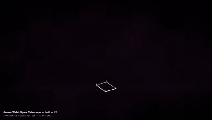
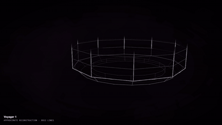
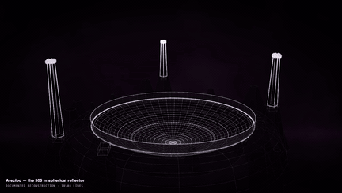
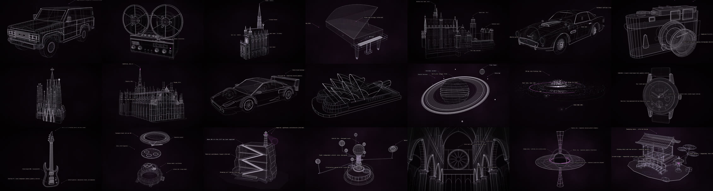
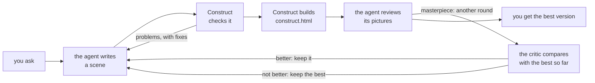
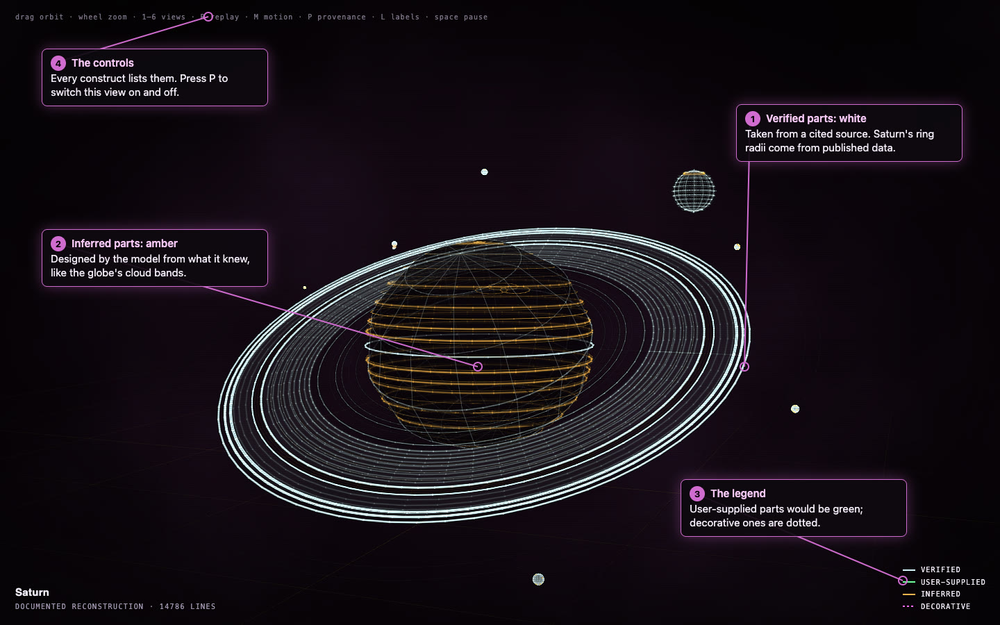

# Construct

**Holographic constructs any AI agent can build, from a description, honestly.** You ask your
agent for a thing in plain words, and it builds an animated holographic model of it in the
**Measured Light** style, as one web page you can open anywhere.

<p align="center">
  <a href="https://rtmandreyev.github.io/construct/examples/sainte-chapelle/"></a>
  <a href="https://rtmandreyev.github.io/construct/examples/toyota-land-cruiser-fj62/"></a>
  <a href="https://rtmandreyev.github.io/construct/examples/duomo-di-milano/"></a>
</p>
<p align="center"><sub>Sainte-Chapelle · Toyota Land Cruiser FJ62 · Duomo di Milano, each built by Claude Opus 5.5 in masterpiece mode. <a href="https://rtmandreyev.github.io/construct/">Open the gallery</a> to orbit them, replay the assembly and read the labels.</sub></p>

**Film mode.** A construct can also assemble across a whole piece of music: the build pauses, surges
and flares with it, and you get a video with the music in it. See [Film mode](docs/FILM.md).

<p align="center">
  <a href="https://rtmandreyev.github.io/construct/films/james-webb-space-telescope/"></a>
  <a href="https://rtmandreyev.github.io/construct/films/voyager-1/"></a>
  <a href="https://rtmandreyev.github.io/construct/films/arecibo-observatory/"></a>
</p>
<p align="center"><sub><a href="https://rtmandreyev.github.io/construct/films/james-webb-space-telescope/">James Webb Space Telescope</a> · <a href="https://rtmandreyev.github.io/construct/films/voyager-1/">Voyager 1</a> · <a href="https://rtmandreyev.github.io/construct/films/arecibo-observatory/">Arecibo Observatory</a>, each assembling across a piece of music. Open one to watch the film, or to turn the live construct around.</sub></p>

```
you ask  →  the agent writes a scene  →  Construct checks it  →  Construct builds the page
         →  the agent reviews it  →  (masterpiece) an independent critic judges each round
```

- **Any agent, any model.** Claude Code, Hermes, any MCP client or any OpenAI-compatible endpoint, or by hand.
- **Honest about what is known.** Every fact and part says whether it is verified, supplied by you, inferred or decorative.
- **One house style.** Models never choose the colours, so every construct looks like it belongs with the rest.
- **It repairs itself.** Every problem comes back with where it is and how to fix it.
- **Nothing to install.** Python's standard library and a browser; no API keys or network service inside Construct.

## What it does

In the common case:

1. **You ask for something in plain words**, in your agent: *"make a construct of a Leica M3"*,
   or *"a masterpiece of the Sydney Opera House"*. Before any work, the skill tells you which
   mode it will use, fast or masterpiece, why, and roughly how long it will take.
2. **The agent looks it up.** For a specific, named subject it finds real facts and reference
   photos. The photos are only for comparison; they are never copied into the construct or
   published, because they belong to someone else.
3. **The agent writes a scene.** A scene is a short text file that says what the thing is: the
   facts, each marked with how well it is known, and the parts, built from simple shapes, with
   how they assemble and open. The agent never draws pixels or writes graphics code.
4. **Construct checks it.** Something floating, a claim stronger than its evidence, a part too
   small to see: every problem comes back with where it is and how to fix it, and the agent
   repairs the scene until the check is clean.
5. **Construct builds the page.** One `construct.html` that opens in any browser, works offline
   and shows the construct building itself, part by part.
6. **The agent reviews it.** It looks at stills from every view and improves the weakest point.
   In **masterpiece** mode an independent critic takes over the judging, round by round, and you
   get a short report after each one.

## See it in practice

The examples are real runs: each one was made by an AI agent with Construct, in fast or
masterpiece mode, by Claude Opus 5.5, GPT-6.1 Sol or DeepSeek V4.1 Flash. Open any of them to
watch it assemble, turn it around and read its labels.

<p align="center"><a href="https://rtmandreyev.github.io/construct/"></a></p>

**[See all 24 examples in the gallery →](https://rtmandreyev.github.io/construct/)** · each scene and its hero image are in
[examples/](examples/).

## How it works

A scene is data, never code: the agent says what the thing is, and Construct decides how it
looks. That split is what keeps every construct honest and in one style. In masterpiece mode the
review becomes a loop, judged by a critic that never saw the authoring.



- **You can see how each part is known.** Press **P** in any construct and every part is coloured
  by whether it is verified, supplied by you, inferred or decorative.
- **The check runs to zero.** Floating parts, claims without evidence and details too fine to see
  are reported, with fixes, before anything is built.
- **The critic is independent.** It is a fresh model that compares each new version with the best
  so far without knowing which is which. Only a better version is kept.
- **Masterpiece stops when it stops improving:** after two rounds without a better version, after
  12 rounds, or after two hours. In blind comparisons nobody could see a difference after about
  round 12, so more rounds mostly cost time.

<p align="center"></p>
<p align="center"><sub>Honest about what is known: Saturn in the provenance view (<b>P</b>). The rings come from published data and are drawn in white; the cloud bands were designed by the model and are drawn in amber.</sub></p>

<p align="center"></p>
<p align="center"><sub>The critic at work: the Sainte-Chapelle at rounds 1, 8 and 15 of a masterpiece run by Claude Opus 5.5. The flèche gains its tiers, and the window tracery, buttresses and pinnacles fill in.</sub></p>

The whole process, with a construct improving round by round, is in
**[How a construct is made](docs/HOW-IT-IS-MADE.md)**. What you see in a construct, and why
models never choose its colours, is in **[The Measured Light style](docs/STYLE.md)**.

## Install

Construct runs from a copy of this repository; there is nothing to install system-wide. Clone it
and build the skills for your agent:

```sh
git clone https://github.com/rtmandreyev/construct.git
cd construct
python3 construct_hologram/package.py --out dist    # builds the Claude Code and Hermes skills
```

Then add the skill to your agent, or use Construct directly:

| Host | How to add it |
| --- | --- |
| Claude Code | `claude --plugin-dir dist/claude-code/construct` for one session, or copy `dist/claude-code/construct/skills/construct` into `.claude/skills/` |
| Hermes | Copy `dist/hermes/construct` into `~/.hermes/skills/` (or a project's `.hermes/skills/`, then `hermes skills trust`) |
| Any MCP client | Add `{"mcpServers": {"construct": {"command": "python3", "args": ["/path/to/construct/construct_hologram/server.py"]}}}` |
| Any OpenAI-compatible model | `python3 construct_hologram/cli.py author "..." --base-url ... --model ... --key-env ... --out scene.json` |
| By hand | The command line below; no model needed |

## Quick start

In your agent, just ask in plain words: *"make a construct of a 1970s desk fan"*, or *"a
masterpiece of the Sydney Opera House"*. The agent does the rest and tells you what it is doing.

To try Construct without a model, fill in a ready-made template by hand:

```sh
C=construct_hologram/cli.py
python3 $C params book --variant paperback --output book.json   # fill in the facts you know
python3 $C check book.json             # audit: PASS, or paths and fix hints
python3 $C build book.json --out out   # out/construct.html: open it in any browser
python3 $C review book.json --out out  # out/review/*.png: stills to judge it by
```

Once a construct is open, drag to orbit and scroll to zoom. **R** replays the assembly, **L** shows
the labels, **P** shows how each part is known, and **1**–**6** move between views.

## Modes

A mode sets how much effort goes into a construct. Say one in your request, or say nothing and
the skill picks one and tells you why before it starts.

| Mode | What it does | When it stops | Rough cost | Use it for |
| --- | --- | --- | --- | --- |
| **fast** | One pass with self-review | About 10 minutes (30 for a richer subject) | Cents with DeepSeek V4.1 Flash | Generic subjects, simple objects, quick requests |
| **masterpiece** | Rounds judged by an independent critic, each version compared with the best so far | Two rounds without a win, 12 rounds, or 2 hours of active work | Up to 2 hours of frontier-model tokens | A named car, landmark or building whose likeness matters |
| **unbounded** | The same rounds, with no cap and no time limit | Only after two rounds without a win | Many rounds and hours, a high token cost | Only when you ask for it by name |

The skill never picks unbounded on its own: the critic finds an improvement almost every round,
so it can run for hours. Every round is reported, so you can stop it whenever you like.

## Models

Any capable model can make a construct, but some subjects need a stronger one. From the
evaluation runs:

- **Named subjects in masterpiece mode** (a car model, a landmark): a Sol or Opus class model
  (tested: GPT-6.1 Sol, Claude Opus 5.5). A smaller model given such a subject says so and
  recommends them.
- **Simpler objects in fast mode:** DeepSeek V4.1 Flash does as well as those on objects such as a
  tape deck, a watch or a camera.
- **Small models** (tested: MiniMax M3.1 Flash, Thinking Machines Inkling, NVIDIA Nemotron 3.5
  Super VL) are not recommended: in about half of their runs they did not save a scene, and they
  made scale errors.

## Requirements

Construct is deliberately small. You need:

- Python 3.10 or newer. Nothing else to install: no packages, no virtual environment.
- For review stills, a Chromium-family browser you already have (Chrome, Chromium, Edge, Brave).
- For video, ffmpeg.
- Tested on macOS; review capture on Linux and Windows is untested.

## Documentation

Start with the first two if you are new; the full index is in [docs/README.md](docs/README.md).

- [How a construct is made](docs/HOW-IT-IS-MADE.md): the process, step by step, with a construct improving over rounds
- [The Measured Light style](docs/STYLE.md): what you see in a construct, the labels, the provenance marks and the controls
- [Using Construct](docs/USING.md): every way to run it, from a first construct by hand to Claude Code and Hermes
- [Troubleshooting](docs/TROUBLESHOOTING.md): common problems in plain language
- [Archetypes](docs/ARCHETYPES.md): ready-made templates for books, CDs, guitars, bottles, cars and more
- [Terrain](docs/TERRAIN.md): mountains, routes and planets from real elevation data
- [Film mode](docs/FILM.md): a construct that assembles across a track of music, for videos and films
- [About](docs/ABOUT.md): where Construct's method comes from
- [Evaluation](docs/EVALUATION.md): how models compare, and how to score your own
- [Development](docs/DEVELOPMENT.md): for contributors and for building Construct into your own tools
- [CONTRACT.md](CONTRACT.md), [CHANGELOG.md](CHANGELOG.md), the [v0.3.0](docs/releases/v0.3.0.md) and [v0.2.1](docs/releases/v0.2.1.md) release notes and [PUBLISHING.md](PUBLISHING.md)

## Contributing

See [CONTRIBUTING.md](CONTRIBUTING.md). Run the tests with
`python3 -m unittest discover -s construct_hologram -t . -p 'test_*.py'`. Security reports:
[SECURITY.md](SECURITY.md).

## License

[MIT](LICENSE) — Copyright (c) 2026 Artyom Andreyev.

Construct's working method is inspired by [Anatomy](https://github.com/wheresryan22/anatomy)'s
truth-first construction (MIT); it shares the method, not code. Product, vehicle and place names
in the examples belong to their owners: each example is an independent reconstruction from
public references, not an official model. See [NOTICE](NOTICE).
