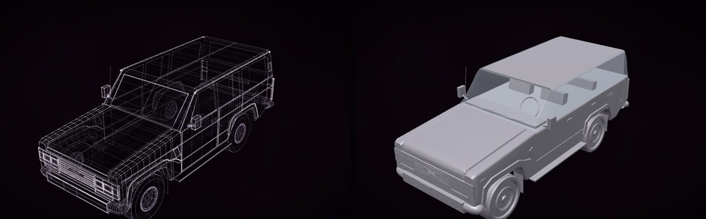
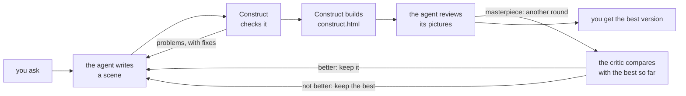

# Construct

**Describe a thing. Get a hologram, a 3D model, a print and a kit.** You ask any AI agent for a thing
in plain words, and it builds an animated model of it in lines of light, the **Measured Light** style,
as one web page you can open anywhere, honest about what is known. The same construct becomes a 3D
model with named parts and working joints, a print, a model kit, a CAD file or a film.

<p align="center">
  <a href="https://rtmandreyev.github.io/construct/examples/sainte-chapelle/"></a>
  <a href="https://rtmandreyev.github.io/construct/examples/toyota-land-cruiser-fj62/"></a>
  <a href="https://rtmandreyev.github.io/construct/examples/duomo-di-milano/"></a>
</p>
<p align="center"><sub><b>Constructs.</b> Sainte-Chapelle · Toyota Land Cruiser FJ62 · Duomo di Milano, each built by Claude Opus 5.5 in masterpiece mode. <a href="https://rtmandreyev.github.io/construct/">Open the gallery</a> to orbit them, replay the assembly and read the labels.</sub></p>

- **Any agent, any model.** Claude Code, Hermes, any MCP client or any OpenAI-compatible endpoint, or by hand.
- **Honest about what is known.** Every part says how it is known, its size and its shape apart, every guess in a shade of how firmly it is held.
- **One house style.** Models never choose the colours, so every construct looks like it belongs with the rest.
- **It repairs itself.** Every problem comes back with where it is and how to fix it.
- **Nothing to install.** Python's standard library and a browser; no API keys or network service inside Construct.

## New in 1.1

- **Models come alive.** A NetLogo model's run becomes a construct with one command in NetLogo:
  time as height, a replay bar and a *How to read it* panel. [For educators and researchers →](docs/for/educators-and-researchers.md)
- **Size and shape, apart.** A part can be size-verified from a spec sheet and only traced in shape; every guess
  is shaded by how firmly it is held. Press **P**. [For museums and archives →](docs/for/museums-and-archives.md)
- **See it as a solid.** Press **S** in any construct to see it as a modelling program shows it; `check --fit`
  names what pokes through. [For 3D artists →](docs/for/3d-artists.md)
- **Things you can hold.** Exact prints with true walls, model kits glued as a kit designer would with a booklet on
  paper and the same steps in 3D, true CAD shapes. [For makers →](docs/for/makers.md)
- **Ready for game engines.** Pieces that hold together on their hinges, or break apart. [For game developers →](docs/for/game-developers.md)

<p align="center"></p>
<p align="center"><sub>One construct, two views: the FJ62 in light, and as a solid (<b>S</b>).</sub></p>

## Find your path

| You are… | Construct gives you | Start here |
| --- | --- | --- |
| **Anyone with an AI agent** | A thing you describe, as a construct you can turn, replay and share | [Make a construct](docs/for/anyone.md) |
| **A maker** | A print at your printer's largest size, a model kit with plates and a booklet, true CAD shapes | [Print, kit, CAD](docs/for/makers.md) |
| **A game developer** | Props with named parts, real sizes and working joints, for Godot, Unity or Unreal | [Into a game engine](docs/for/game-developers.md) |
| **A 3D artist** | A construct in Blender with its build, joints and finish on sliders, ready to render or model over | [Into Blender](docs/for/3d-artists.md) |
| **In film and motion** | A construct that assembles across a piece of music, as a video | [Film mode](docs/for/film-and-motion.md) |
| **An educator or researcher** | An agent-based model's run drawn as a construct, compared, printed, filmed | [Models come alive](docs/for/educators-and-researchers.md) |
| **A museum or archive** | Reconstructions that say how each part is known, so a visitor can tell evidence from design | [Honest reconstructions](docs/for/museums-and-archives.md) |
| **A developer** | A scene contract, a command line, an MCP server and skills to build on | [Build on it](docs/for/developers.md) |

## How it works

A scene is data, never code: the agent says what the thing is, and Construct decides how it
looks. That split is what keeps every construct honest and in one style. In masterpiece mode the
review becomes a loop, judged by a critic that never saw the authoring.



- **You can see how each part is known.** Press **P** in any construct and every part is coloured
  by whether it is verified, supplied by you, inferred or decorative. Press **S** to see it as a solid,
  the way a modelling program or a print shows it.
- **The check runs to zero.** Floating parts, claims without evidence and details too fine to see
  are reported, with fixes, before anything is built.
- **The critic is independent.** It is a fresh model that compares each new version with the best
  so far without knowing which is which. Only a better version is kept.
- **Masterpiece stops when it stops improving:** after two rounds without a better version, after
  12 rounds, or after two hours. In the author's own blind comparisons, on two subjects, there was
  no visible improvement after about round 12, so more rounds mostly cost time.

<p align="center"></p>
<p align="center"><sub>The critic at work: the Sainte-Chapelle at rounds 1, 8 and 15 of a masterpiece run by Claude Opus 5.5. The flèche gains its tiers, and the window tracery, buttresses and pinnacles fill in.</sub></p>

The whole process, with a construct improving round by round, is in
**[How a construct is made](docs/HOW-IT-IS-MADE.md)**. What you see in a construct, and why
models never choose its colours, is in **[The Measured Light style](docs/STYLE.md)**.

## Install

Construct runs from a copy of this repository; there is nothing to install system-wide. Clone it
and build the skills for your agent:

```sh
git clone https://github.com/rtmandreyev/construct.git
cd construct
python3 construct_hologram/package.py --out dist    # builds the Claude Code and Hermes skills
```

Then add the skill to your agent, or use Construct directly:

| Host | How to add it |
| --- | --- |
| Claude Code | `claude --plugin-dir dist/claude-code/construct` for one session, or copy `dist/claude-code/construct/skills/construct` into `.claude/skills/` |
| Hermes | `hermes skills install rtmandreyev/construct/skills/construct`, or copy `dist/hermes/construct` into `~/.hermes/skills/` |
| Any MCP client | Add `{"mcpServers": {"construct": {"command": "python3", "args": ["/path/to/construct/construct_hologram/server.py"]}}}` |
| Any OpenAI-compatible model | `python3 construct_hologram/cli.py author "..." --base-url ... --model ... --key-env ... --out scene.json` |
| By hand | The command line below; no model needed |
| Blender | `python3 scripts/build_blender_extension.py`, then **Edit → Preferences → Get Extensions → Install from Disk** with the zip in `dist/` |

## Quick start

In your agent, just ask in plain words: *"make a construct of a 1970s desk fan"*, or *"a
masterpiece of the Sydney Opera House"*. The agent does the rest and tells you what it is doing.

To try Construct without a model, fill in a ready-made template by hand:

```sh
C=construct_hologram/cli.py
python3 $C params book --variant paperback --output book.json   # fill in the facts you know
python3 $C check book.json             # audit: PASS, or paths and fix hints
python3 $C build book.json --out out   # out/construct.html: open it in any browser
python3 $C review book.json --out out  # out/review/*.png: stills to judge it by
```

Once a construct is open, drag to orbit and scroll to zoom. **R** replays the assembly, **L** shows
the labels, **T** hides the text on its surfaces, **P** shows how each part is known, **S** shows it as a solid,
and **1**–**6** move between views.

## Modes

A mode sets how much effort goes into a construct. Say one in your request, or say nothing and
the skill picks one and tells you why before it starts.

| Mode | What it does | When it stops | Rough cost | Use it for |
| --- | --- | --- | --- | --- |
| **fast** | One pass with self-review | About 10 minutes (30 for a richer subject) | Cents with DeepSeek V4.1 Flash | Generic subjects, simple objects, quick requests |
| **masterpiece** | Rounds judged by an independent critic, each version compared with the best so far | Two rounds without a win, 12 rounds, or 2 hours of active work | Up to 2 hours of frontier-model tokens | A named car, landmark or building whose likeness matters |
| **unbounded** | The same rounds, with no cap and no time limit | Only after two rounds without a win | Many rounds and hours, a high token cost | Only when you ask for it by name |

The skill never picks unbounded on its own: the critic finds an improvement almost every round,
so it can run for hours. Every round is reported, so you can stop it whenever you like.

## Models

Any capable model can make a construct, but some subjects need a stronger one. From the
evaluation runs:

- **Named subjects in masterpiece mode** (a car model, a landmark): a Sol or Opus class model
  (tested: GPT-6.1 Sol, Claude Opus 5.5). A smaller model given such a subject says so and
  recommends them.
- **Simpler objects in fast mode:** DeepSeek V4.1 Flash does as well as those on objects such as a
  tape deck, a watch or a camera.
- **Small models** (tested: MiniMax M3.1 Flash, Thinking Machines Inkling, NVIDIA Nemotron 3.5
  Super VL) are not recommended: in about half of their runs they did not save a scene, and they
  made scale errors.

## Requirements

Construct is deliberately small. You need:

- Python 3.10 or newer. Nothing else to install: no packages, no virtual environment.
- For review stills, a Chromium-family browser you already have (Chrome, Chromium, Edge, Brave).
- For video, ffmpeg.
- For the Blender add-on, Blender 4.2 or newer (the film of a run: checked in Blender 5.2); for the
  NetLogo bridge, NetLogo 6 or 7 (the extension: NetLogo 7, and NetLogo 3D 7).
- Tested on macOS; review capture on Linux and Windows is untested.

## Documentation

| If you want to… | read |
| --- | --- |
| see how a construct is made, step by step | [How a construct is made](docs/HOW-IT-IS-MADE.md) |
| know what you are looking at, and the keys | [The Measured Light style](docs/STYLE.md) |
| run it every way, from a first construct by hand to Claude Code and Hermes | [Using Construct](docs/USING.md) |
| fix something that went wrong | [Troubleshooting](docs/TROUBLESHOOTING.md) |
| start from a ready-made template (a book, a CD, a guitar, a car) | [Archetypes](docs/ARCHETYPES.md) |
| make mountains, routes and planets from real elevation data | [Terrain](docs/TERRAIN.md) |
| turn a construct into a film with music | [Film mode](docs/FILM.md) |
| export a 3D model, plain or finished | [3D export](docs/EXPORT.md) and the [Blender add-on](hosts/blender/README.md) |
| print it, or make it a model kit | [3D printing and kits](docs/PRINTING.md) |
| open it in CAD | [FreeCAD and STEP](docs/FREECAD.md) |
| put it in a game engine | [Godot](docs/GODOT.md) |
| draw a NetLogo model's run | [The NetLogo bridge](docs/NETLOGO.md) and [the extension](hosts/netlogo/README.md) |
| teach with it, or show it in a museum | [In a classroom and a museum](docs/CLASSROOM.md) |
| compare models, or score your own | [Evaluation](docs/EVALUATION.md) |
| build on it or test the code | [Development](docs/DEVELOPMENT.md) and [the scene contract](CONTRACT.md) |
| know where the method comes from | [About](docs/ABOUT.md) |
| see what changed | [CHANGELOG.md](CHANGELOG.md) and the [1.1.0](docs/releases/v1.1.0.md) and [1.0.0](docs/releases/v1.0.0.md) release notes |

The full index is in [docs/README.md](docs/README.md).

## Contributing

See [CONTRIBUTING.md](CONTRIBUTING.md). Run the tests with
`python3 -m unittest discover -s construct_hologram -t . -p 'test_*.py'`. Security reports:
[SECURITY.md](SECURITY.md).

## License

[Apache-2.0](LICENSE) — Copyright (c) 2026 Artyom Andreyev (see [NOTICE](NOTICE)); versions up to 0.3.0 were MIT. The four NetLogo example folders
([viral marketing](examples/netlogo-viral-marketing/), [flocking](examples/netlogo-flocking/),
[wolf sheep](examples/netlogo-wolf-sheep/) and [fire](examples/netlogo-fire/)) derive from Uri
Wilensky's NetLogo models and are under CC BY-NC-SA 3.0 instead (see each LICENSE). The [Blender
add-on](hosts/blender/) is under GPL-3.0-or-later, as Blender's extensions platform requires; what
you make with it is yours.

Construct's working method is inspired by [Anatomy](https://github.com/wheresryan22/anatomy)'s
truth-first construction (MIT); it shares the method, not code. Product, vehicle and place names
in the examples belong to their owners: each example is an independent reconstruction from
public references, not an official model. See [NOTICE](NOTICE).
