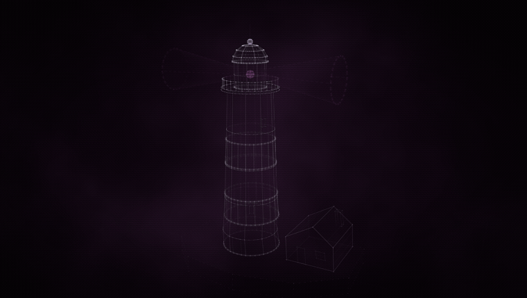
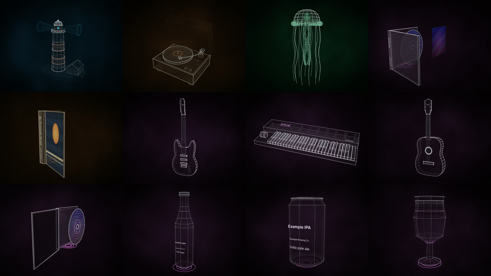
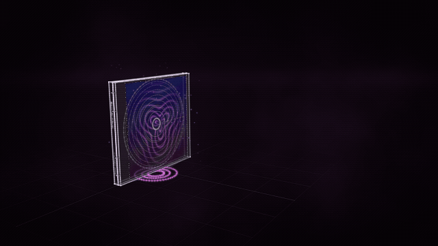

# Construct

**Holographic constructs any agent can build — from a description, honestly.**



Construct is an agent skill and toolkit that turns a description of a real or fictional thing
into an honest, animated holographic construct. A model — any model — writes a short declarative scene, or
fills an archetype's parameters. Construct validates it, audits it, compiles it
deterministically and renders it in one holographic style: line light over smoked glass,
staged assembly, opening and idle life, and a visible certainty for every fact and part.

- **Any agent, any model.** Hermes, Claude Code, any MCP client, a CLI, Python, or any
  OpenAI-compatible endpoint. No API key, model or network service inside Construct.
- **Honest about what is known.** Every fact is `verified` (with a source), `user_supplied`,
  `inferred` or `decorative`. Unknown facts are left out, never guessed. Text on an object
  comes only from facts; artwork only from images the user supplied, checked by hash.
- **One style for everyone.** Agents never choose colours, so an entry written by a small
  model sits on the shelf next to one written by a frontier model.
- **Repairs itself.** Every problem comes back with a JSON path, a code and a fix hint, and the
  repair loop runs until the draft is valid and free of visible defects.
- Python 3.10+, standard library only. MIT licensed.



## Install

```sh
git clone https://github.com/rtmandreyev/construct
cd construct
python3 construct_hologram/package.py --out dist     # builds the Hermes and Claude Code skills
```

Nothing to install for the CLI, MCP server or Python use: they run from the checkout. Review
stills need a Chromium-family browser you already have (Chrome, Chromium, Edge, Brave);
video needs ffmpeg.

## Use it from any agent

| Where | How |
|---|---|
| **Hermes** | Copy `dist/hermes/construct` into `~/.hermes/skills/` (or a project's `.hermes/skills/` and run `hermes skills trust` there). Then ask in plain words: *"make a construct of a 1970s desk fan"*. |
| **Claude Code** | `claude --plugin-dir dist/claude-code/construct` for a session, or copy `dist/claude-code/construct/skills/construct` into `.claude/skills/`. Ask in plain words, or `/construct:construct`. |
| **Any MCP agent** | Add `{"mcpServers": {"construct": {"command": "python3", "args": ["/path/to/construct/construct_hologram/server.py"]}}}`. Seven read-only tools: `construct_diagnose`, `construct_params_template`, `construct_expand_params`, `construct_compile`, and the legacy `hologram_template`, `hologram_validate`, `hologram_compile`. |
| **Any OpenAI-compatible model** | `python3 construct_hologram/cli.py author "a can of porter" --params --base-url https://api.deepseek.com/v1 --model deepseek-chat --key-env DEEPSEEK_API_KEY --out can.json` (also OpenRouter, OpenAI, Ollama, llama.cpp, LM Studio). |
| **By hand, no model** | `params` → `check` → `build` → `review` → `video` (below). |
| **Python** | `from construct_hologram import diagnose, params, scene, render` |

A complete walk-through of every entry point, with costs and timings from live runs, is in
[docs/USING.md](docs/USING.md).

## Thirty seconds, by hand

```sh
C=construct_hologram/cli.py
python3 $C params book --variant paperback --output book.json   # fill in the facts you know
python3 $C check book.json        # audit: PASS (0 errors, 0 warnings) — or paths and fix hints
python3 $C build book.json --out out    # out/construct.html: open it in any browser
python3 $C review book.json --out out   # out/review/*.png: stills to judge it by
python3 $C video book.json --out out/book.mp4 --seconds 12
```



## What makes it honest


The provenance view shows how every part is known. The audit refuses `verified` without a
source, refuses a `null` or placeholder fact, flags parts that float or barely render, and
requires the documented-accuracy claim to be backed. Generated artwork is labelled
**generated decoration**, and a real cover is shown only from bytes the user supplied.

Likeness is a separate question. The audit proves a construct is valid and honest, not that it
looks like the thing: for free-form subjects that depends on the model and on a visual review
(a person, or a model that can see the renders). Parameter archetypes look the same from every
model.

## Documentation

- [docs/ABOUT.md](docs/ABOUT.md) — what Construct is, where its method comes from, how to talk about it
- [docs/USING.md](docs/USING.md) — every entry point, step by step, with a worked example
- [docs/ARCHETYPES.md](docs/ARCHETYPES.md) — the parameter archetypes (cases, books, guitars, synth, vessels)
- [docs/TERRAIN.md](docs/TERRAIN.md) — places, peaks and routes from elevation data you supply; Earth from coastline data
- [CONTRACT.md](CONTRACT.md) — the `construct/0.2` scene and geometry contract for apps
- [docs/EVALUATION.md](docs/EVALUATION.md) — cross-model results and how to score your own model
- [CONTRIBUTING.md](CONTRIBUTING.md) · [CHANGELOG.md](CHANGELOG.md)

## Credits

Construct is inspired by **Anatomy's truth-first construction method**
([wheresryan22/anatomy](https://github.com/wheresryan22/anatomy), MIT): true numbers first, a
parts list before geometry, an audit run to zero, rendered images read before delivery, and
never copying a reference image. Construct shares the method, not code: nothing from Anatomy
is included. Its holographic look and construction grew out of NODE's Measured Light holograms
by the same author. See [docs/ABOUT.md](docs/ABOUT.md).

## Integrations: Tessera

Tessera (a collection app) consumes Construct as a pinned dependency. Its atlas renders
compiled geometry natively, re-validates it, drives the articulations and turns to the `open`
view, and sets labels in its own type from each item's live facts. Its agent pipeline wraps
`diagnose`, `params.expand` and `compile_scene`. The previous ids `tessera.hologram/0.2` and
`tessera-hologram*` are still read for one release.

## Limitations

- One periodic motion per part; articulations nest, periodic motions do not.
- A closed procedural vocabulary: no imported meshes, CAD, photogrammetry or booleans.
- Artwork is a flat image on a face; liquids in glasses read faintly.
- Terrain reads ESRI ASCII grids and XYZ exports (convert GeoTIFF first), the globe GeoJSON; see [docs/TERRAIN.md](docs/TERRAIN.md).
- Tested on macOS; Linux and Windows review capture is untested.

MIT licence — see [LICENSE](LICENSE) and [NOTICE](NOTICE).
