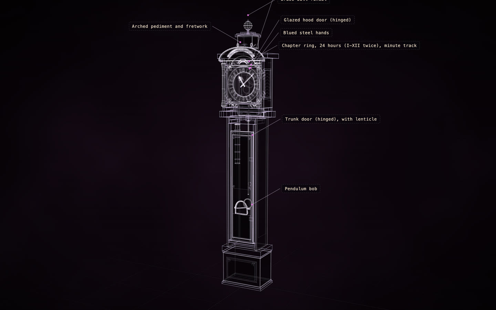
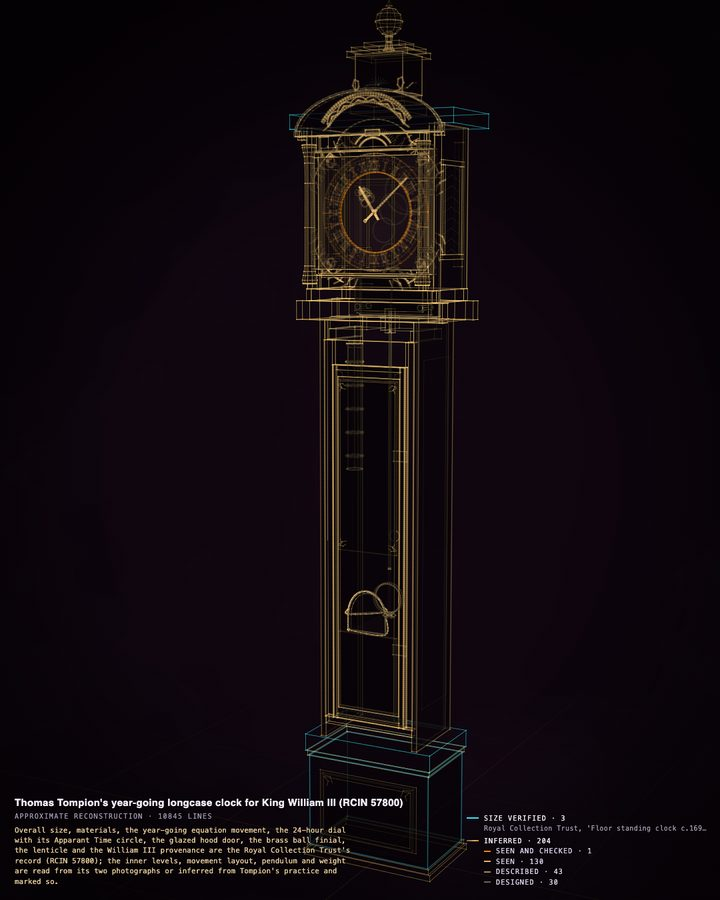
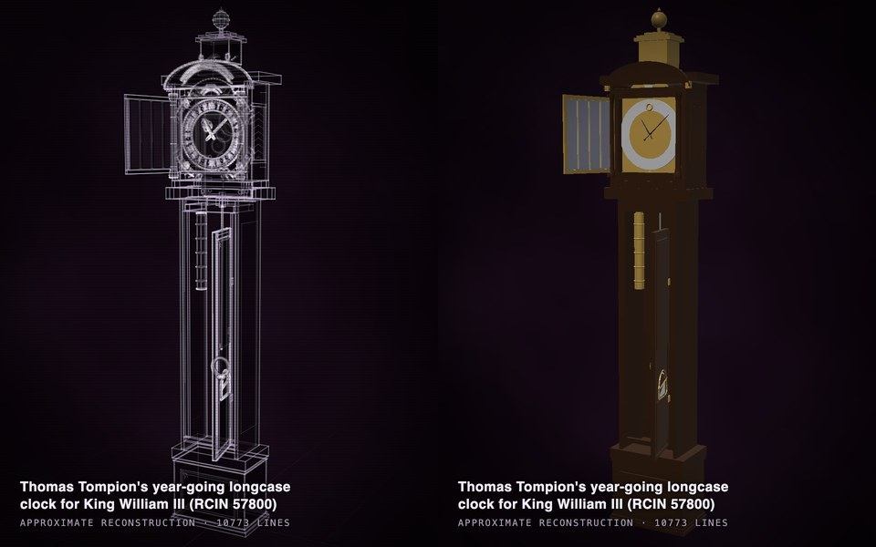
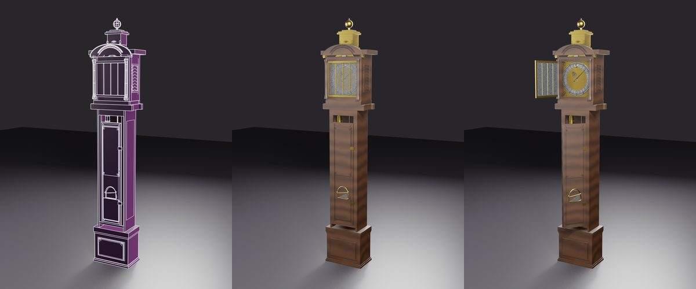
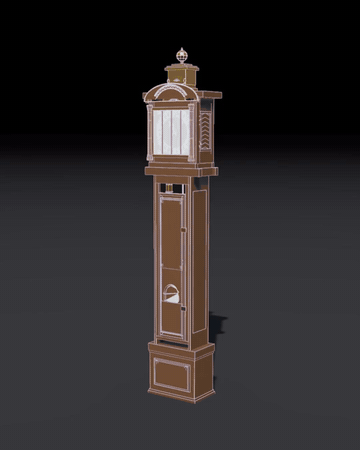
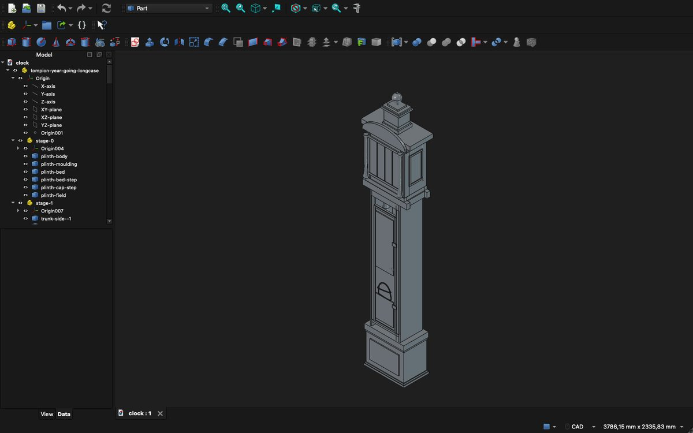
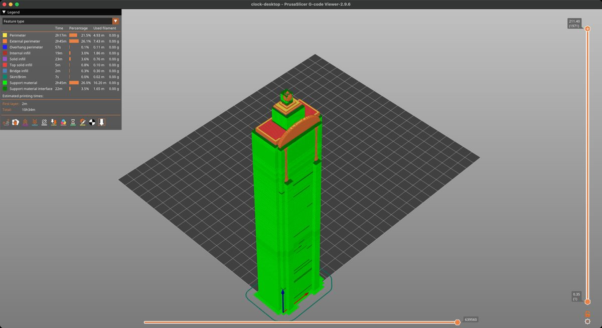
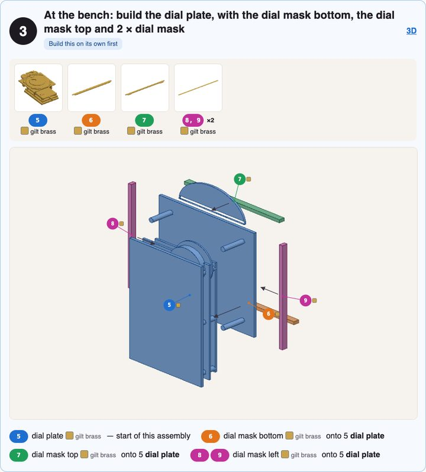
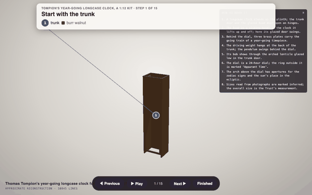
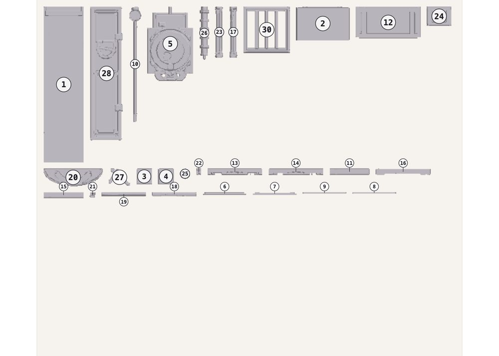

# A longcase clock, end to end

One construct taken through everything Construct 1.1 does: from a request in plain words to a researched
construct, its provenance, a solid, a 3D model in Blender, a prop in Godot, a film, a CAD file in FreeCAD, a
print in PrusaSlicer and a model kit. Each step shows the command, what came out, and what we found.

**Who did what.** DeepSeek V4.1 Flash built the construct through Hermes, in masterpiece mode: twelve rounds,
each judged by an independent critic. Claude Opus 5.5 then ran every other step with the 1.1 commands below,
and made two changes by hand, shown where they happen: one renamed part, and a kit plan. Everything needed to
repeat it is in [examples/tompion-year-going-clock](../examples/tompion-year-going-clock/). Below, `construct` is
short for `python3 construct_hologram/cli.py` in a checkout of Construct.

**Open it as you read:** [the live construct](https://rtmandreyev.github.io/construct/examples/tompion-year-going-clock/) · [its scene](../examples/tompion-year-going-clock/scene.json) ·
[the finish map](../examples/tompion-year-going-clock/maps/finish.json) · [the kit plan](../examples/tompion-year-going-clock/kit-plan.json)

- [1. Ask](#1-ask)
- [2. The agent researches, builds and runs the rounds](#2-the-agent-researches-builds-and-runs-the-rounds)
- [3. Check it, and check the fit](#3-check-it-and-check-the-fit)
- [4. Provenance](#4-provenance)
- [5. The solid](#5-the-solid)
- [6. In Blender](#6-in-blender)
- [7. In a game engine](#7-in-a-game-engine)
- [8. A film](#8-a-film)
- [9. CAD](#9-cad)
- [10. A print](#10-a-print)
- [11. A model kit](#11-a-model-kit)

<p align="center"><a href="https://rtmandreyev.github.io/construct/examples/tompion-year-going-clock/"></a></p>

## 1. Ask

The whole request, given to Hermes with the construct skill:

> Using the construct skill, make a masterpiece construct of Thomas Tompion's year-going longcase clock made
> for King William III (about 1695-1700), now in the Royal Collection. Masterpiece mode.
>
> - Research it: its real dimensions, materials and features, each recorded as a fact with its source.
> - Model it as separate, named parts a clockmaker or model maker would recognise: the plinth and base, the
>   trunk and its trunk door, the hood with its glazed hood door, columns and finials, the dial with its
>   chapter ring, hands and spandrels, the movement behind the dial (plates, pillars, the going train's
>   wheels), the pendulum and the weight, the seatboard.
> - The trunk door and the hood door open on their hinges (articulations); the pendulum swings (idle life).
> - Say how each part is known, its size and its shape separately, as the skill describes.
> - Check it until clean, including `construct check --fit`, so nothing pokes through another part or floats.
> - Run the masterpiece rounds with an independent critic, as the skill describes, and record the critic's
>   verdict.

```sh
hermes -z "$(cat REQUEST.md)" --in clock/          # or ask any agent with the construct skill
```

[Using Construct in Hermes, Claude Code or any agent →](USING.md)

## 2. The agent researches, builds and runs the rounds

The agent read the Royal Collection's record of the clock (RCIN 57800) and of its sister equation clock, a
Britannica entry on Tompion and a Christie's lot essay on another of his clocks, looked at two photographs,
and wrote the scene: 207 named parts and 23 facts, each with its source. Among them:

| fact | value | how it is known |
| --- | --- | --- |
| height, width, depth | 2.23 × 0.455 × 0.236 m | verified · Royal Collection |
| case | burr walnut veneer | verified · Royal Collection |
| dial | 24-hour chapter ring in Roman numerals, minute circle marked "Apparant Time" *[sic]* | verified · Royal Collection |
| hands | blued steel | verified · Royal Collection |
| duration | one year on a single winding | verified · Royal Collection |
| dial plate | 12 in (0.305 m) square | inferred · Christie's essay on a sister clock |

Then twelve masterpiece rounds. Each round the agent worked on at most four of the critic's open defects, and a
fresh critic compared the new version with the best so far without knowing which was which. Nine of the
eleven judged rounds won. The large gains came in rounds 2 to 7 (the trunk narrowed, Roman hours on the chapter ring, pierced hands,
moulded panels on the door and plinth, the lenticle in the trunk door); rounds 8 to 12 were finer detail on the
dial. The run stopped at the 12-round cap after 90 minutes of the agent's own work and 217 of the critic's
(masterpiece counts only the first; `timeboxed` mode counts both). The critic's last verdict is still
"improve", and it says why: the arch above the hood is a thin hoop, and the movement behind the dial does not
read as one.

```sh
construct rounds status          # round 13, stopped: the 12-round cap (best: round 12)
```

[The scene it wrote →](../examples/tompion-year-going-clock/scene.json) · [How the rounds work →](HOW-IT-IS-MADE.md)

## 3. Check it, and check the fit

```sh
construct check scene.json                     # audit: PASS, 0 errors; 16 small parts may vanish at the hero framing
construct check scene.json --fit --cells 600   # fit: nothing pokes through or hides (131 parts as solids)
```

The fit is checked on a grid of 600 voxels along the clock's height, 3.7 mm each: the default 160 (14 mm) is
coarser than the clock's 8 mm door frames and 3 mm dial layers, and reports them as poking through.

`check` also reads the names. The solid view, the exports, the prints and the kits know glass by its id, and the
hood door's glass was named `hood-door` ("Glazed hood door" only in its label), so `check` asked for its id to say
glass. One rename, `hood-door` to `hood-door-glass`, and everything after the light shows the dial through it.
(Because the scene changed after the rounds, `check` now also notes that the critic judged the version before.)

## 4. Provenance

Press **P**. Every part is coloured by how it is known, and the legend counts each kind and names the sources:
here 3 parts of verified size (the plinth and the hood's cornice, which set the clock's width, from the Royal
Collection's dimensions) and 204 inferred, in
shades from designed to seen in a photograph and checked against a fact.

<p align="center"><a href="https://rtmandreyev.github.io/construct/examples/tompion-year-going-clock/construct.html?mode=provenance"></a></p>
<p align="center"><sub><a href="https://rtmandreyev.github.io/construct/examples/tompion-year-going-clock/construct.html?mode=provenance">Open it in the provenance view</a></sub></p>

It is an honest picture of what two photographs and a museum record can give: the overall size and the
materials are documented; the shape of each moulding was read from a photograph; what hides behind the dial
(the movement's wheels) was designed from Tompion's practice and says so.

## 5. The solid

Press **S**: the same construct as a modelling program shows it, the glass clear.

<p align="center"><a href="https://rtmandreyev.github.io/construct/examples/tompion-year-going-clock/construct.html?mode=solid"></a></p>
<p align="center"><sub><a href="https://rtmandreyev.github.io/construct/examples/tompion-year-going-clock/construct.html?mode=solid">Open it as a solid</a> · <a href="https://rtmandreyev.github.io/construct/examples/tompion-year-going-clock/construct.html?open=1">with its doors open</a></sub></p>

## 6. In Blender

A finish is a small map kept beside the scene, never a fact in it
([maps/finish.json](../examples/tompion-year-going-clock/maps/finish.json)): burr walnut, gilt brass, a silvered
chapter ring, blued steel hands, glass.

```sh
construct export scene.json --out clock.glb --materials finish.json     # 207 parts; animations: open, idle
construct export scene.json --out clock.obj                             # about 3,800 quads, ready to subdivide
construct export scene.json --out quality.glb --quality                 # each triangle coloured by its quality
```

In Blender, the add-on imports the scene itself, with its build, metal, finish and open as sliders on the
clock, and makes the reveal ([the add-on](../hosts/blender/README.md), [3D export](EXPORT.md)): the construct builds itself in light, turns to a plain model, takes its finish,
and opens both doors.

<p align="center"></p>

## 7. In a game engine

```sh
construct export scene.json --out clock-glued.glb --materials finish.json --pieces glued --colliders
```

What stays put is one body; each door is one more, on its own hinge
([`construct_joints.gd`](../hosts/godot/construct_joints.gd) makes them Godot joints), with a collision box per part. Below, the finished model in Godot 4.7, loaded at run time: the
glTF's own animations open the doors, and its idle animation swings the pendulum. [The Godot guide →](GODOT.md)

<p align="center"></p>

## 8. A film

The construct assembling across a piece of music, the build following the track.

```sh
construct audio track.mp3 --out clock-audio.json
construct video scene.json --out clock-film.mp4 --assembly 20 --seconds 24 --size 1080x1350 --audio clock-audio.json --sound track.mp3 --camera steady
```

<p align="center"></p>

The film's music (a Pixabay track) stays with the video; the GIF is silent. [Film mode →](FILM.md)

## 9. CAD

```sh
construct freecad scene.json --out clock.FCStd --step clock.step
# 131 named parts, 2 joints; 125 of 131 true shapes (exact solids, splines, NURBS)
```

In FreeCAD, the model tree holds the clock's stages and its named parts, with the two doors as joints. What a
construct draws only in lines (a moulding's edge, the hour numerals) is left out of the CAD file, and said.
[FreeCAD and STEP →](FREECAD.md)

<p align="center"></p>

<sub>FreeCAD's window, with its own render of the 3D view (a screenshot of a window does not capture its 3D view).</sub>

## 10. A print

```sh
construct print scene.json --printers
#   desktop  1:11   43 x 24 x 211 mm; parts 68 kept / 61 thickened / 2 lost (a Prusa MK4 class printer)
construct print scene.json --out clock.3mf --printer desktop --fit --exact
```

One watertight print, 21 cm tall. PrusaSlicer reads it as manifold and slices it: about 10½ hours and 80 cm³ of
filament (about 100 g of PLA), with supports over the face where the hood overhangs the trunk.
[Printing →](PRINTING.md)

<p align="center"></p>

## 11. A model kit

```sh
construct kit scene.json --scale 12 --printer desktop --out kit/
```

The first build made 114 pieces in 60 steps and listed 17 problems: pillars and weight rings too thin to
handle, a hood back glued before anything held it, a hood door's glass a hair from its frame. A construct is
drawn to look right as light, not to be moulded, so a kit wants a plan: what a factory casts in one piece is
merged. Two passes of [kit-plan.json](../examples/tompion-year-going-clock/kit-plan.json) (the movement with its
dial plate; the trunk as one box; the hood's shell; the pendulum with its bob; an order of sub-assemblies):

```sh
construct kit scene.json --scale 12 --printer desktop --plan kit-plan.json --materials finish.json --out kit/
# 34 pieces on 2 plates, 15 steps, at 1:12 (38 x 22 x 186 mm)
```

<p align="center"><a href="https://rtmandreyev.github.io/construct/examples/tompion-year-going-clock/kit/booklet.html"></a> <a href="https://rtmandreyev.github.io/construct/examples/tompion-year-going-clock/kit/assembly.html"></a></p>

<p align="center"><sub>Open this kit yourself: <a href="https://rtmandreyev.github.io/construct/examples/tompion-year-going-clock/kit/booklet.html">its booklet</a> and <a href="https://rtmandreyev.github.io/construct/examples/tompion-year-going-clock/kit/assembly.html">its steps in 3D</a>.</sub></p>

<p align="center"></p>

The kit's checks leave two notes for the builder: the dial plate sits a hair off the trunk (a drop of glue fills
it), and the pendulum's upper rod comes out in two pieces, the smaller too fine to print at 1:12, so the kit leaves
it off. **Not yet
built by anyone:** like every kit, it is made and checked by software and by AI critics, and a first version.
[Kits →](PRINTING.md#a-kit-revell-style) · [Your first kit, step by step →](for/makers.md#your-first-kit-step-by-step)
