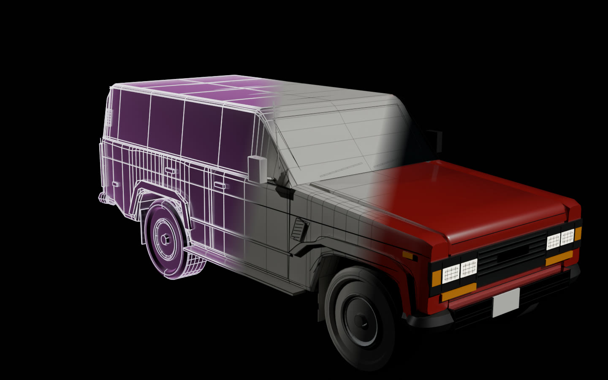

# 3D export

<p align="center"><a href="https://rtmandreyev.github.io/construct/examples/light-to-metal/"></a></p>
<p align="center"><sub>The FJ62 construct exported with <code>construct export</code> and rendered in Blender, unedited: the hologram, the plain model and the model finished by a material map. <a href="https://rtmandreyev.github.io/construct/examples/light-to-metal/">From light to a finished model</a> shows four gallery constructs as these files, live.</sub></p>

A construct already describes a thing as named parts in metres, with an assembly order, joints and
motions. `construct export` writes that description out as a 3D model, so the same construct can
go into Blender, a game engine or a web page as an object, not only as a hologram.

```
your scene  ──►  construct export scene.json --out model.glb  ──►  Blender, Godot, Unreal, Unity, three.js
                 construct export scene.json --out model.obj  ──►  anything that reads OBJ
```

Export is optional and changes nothing else: the hologram, its page and its geometry are exactly
what `build` makes without it.

## Export a construct

```sh
construct export scene.json --out model.glb
```

| Option | What it does |
| --- | --- |
| `--out FILE.glb` or `FILE.obj` | glTF 2.0 binary, or Wavefront OBJ with an `.mtl` beside it |
| `--out FILE.fbx`, `FILE.usd` or `FILE.usdz` | the glTF carried over by Blender (when it is installed: `$CONSTRUCT_BLENDER`, `blender` on the PATH, or the usual installs): FBX for Unity, Unreal, Maya and 3ds Max; USD for Omniverse and Houdini, USDZ for Apple's Reality Composer and Quick Look. Blender's importer and exporters do the work, so the parts, materials and opening animation are what they make of the glTF |
| `--wire edges` (default), `tubes`, `seams`, `none` | the line art: as edges (Blender keeps them); as thin tubes (game engines drop plain lines); as dark tubes for the design lines only, the parts drawn as lines (door seams, creases, outlines), for a finished model; or left out |
| `--merge` | glTF: every part that does not move merged into one mesh per material, for game engines; moving parts keep their own nodes and animations |
| `--colliders` | glTF: a box collider per part, named for Godot (`<part>-convcolonly`), moving with its joint ([GODOT.md](GODOT.md)) |
| `--pieces` | glTF: the pieces the object would break into, each a rigid body with convex shapes (`OMI_physics_body`), for break-apart and assembly ([GODOT.md](GODOT.md)) |
| `--wire-radius M` | the tubes' radius in metres (default: from the object's size) |
| `--pose closed` (default) or `open` | the pose the model rests in; a glTF carries the opening animation either way |
| `--materials map.json` | colours and finishes for parts, by id or pattern (below) |
| `--frame z-up` | OBJ only, for Z-up tools; glTF is Y up by definition |
| `--quality` | glTF: each triangle coloured by its smallest angle, to find the slivers |
| `--asset-root DIR` | where the scene's artwork paths are read from (default: the scene's own folder) |

Agents use the same export through the skill, and MCP clients through the `construct_export` tool
(the `.glb` comes back as base64).

## What is in the file

| In the construct | In the glTF |
| --- | --- |
| each part | a named node (the part's id), under a node for its assembly stage (`stage-0`, `stage-1`, …); its role, certainty, source and basis are in `extras.construct` |
| the construct's facts and sources | `extras.construct` on the root node, with the scene's hash and the contract |
| surfaces | triangle meshes with smoothed normals (a crease keeps hard edges hard) and box-projected texture coordinates in metres (`TEXCOORD_0`); one material per role, named `construct:mass`, `construct:identity` and so on, and glass (`construct:glass`) for a part named for its glazing (glass, window, windscreen, canopy…) |
| the line art | line primitives with unlit materials in the house palette's tones (`construct:light:…`), or tubes, or nothing |
| points (lights, motes) | a point primitive |
| hinges, turns, slides, lifts | pivot nodes; the animation `open` plays them in their order groups (1.5 s each), `open:<id>` plays one; a joint that rides on another is nested inside it |
| spin, swing, bob | the looping animation `idle` (a pulse of light is listed in the root's `extras`) |
| the assembly | each vertex's build phase, 0 to 1, as the vertex attribute `_PHASE` |
| artwork (a sign's lettering, a cover, a texture) | a textured face, `<part>.artwork`, under its part: it moves with the part's joint and stays with its piece |

Units are metres; the front faces +Z. In Blender the importer turns that into Z up, front −Y.

Artwork is embedded as the page embeds it: only bytes that match the scene's declared sha256, with
rights that permit showing them, as PNG or JPEG (glTF carries no WebP); anything else is left out with a
note. Each image is embedded once, however many faces show it. Its material (`construct:artwork:<asset>`)
is double-sided and blended where the PNG is transparent; a circle mask is a disc or a ring. When the part
glows (a `look.glow` above 0, or an identity or data part, which glow by default) or the material map
makes it a light, the image is also its emissive texture, so a sign lights. A world reads each
construct's artwork from that construct's own folder. The MCP tool exports a document without a folder,
so its artwork is left out.

An OBJ has the same surfaces and edges, one object per part, in one pose, without animation or
build phase. Its positions are shared between faces and its strips are quads again (a loft, a lathe, a
tube or an extrusion's side is a grid of four-sided faces), so it subdivides cleanly in Blender or Houdini;
normals and texture coordinates stay per corner, so a hard edge stays hard. Its artwork faces are objects
too, their images written beside the `.mtl` (`map_Kd`, and `map_Ke` for a face that gives light).

Every export reports how well shaped its triangles are: the share whose smallest angle is under 10
degrees (thin slivers, which subdivide and shade badly) and under 20. `--quality` writes a glTF with each
triangle coloured by that angle (green good, amber under 20 degrees, red under 10), to see where they are.

## Opening it

- **Blender, with the Construct add-on** ([hosts/blender](../hosts/blender/README.md), Blender 4.2
  and later, tested with 5.2): File → Import → Construct reads a scene or a `.glb` and gives the
  construct three controls: **Build** (the assembly), **Open** (every joint) and **Light ↔ Metal**
  (from the hologram to the solid model), with the line art as real tubes.
- **Blender, without the add-on:** File → Import → glTF 2.0. The parts arrive as named objects
  under their stages, the `open` and `idle` animations as actions, `_PHASE` as a mesh attribute,
  and the extras as custom properties. Edges show in the viewport; give them a material or use
  `--wire tubes` to render them.
- **three.js** (tested with 0.160): `GLTFLoader`. The build phase is `geometry.attributes._phase`,
  the animations are in `gltf.animations` for an `AnimationMixer`, the extras in `userData`.
- **Godot** (tested with 4.7.2): its glTF loader brings in the parts, the materials, the texture
  coordinates and the `open` and `idle` animations. It ignores transmission and clear coat, so glass
  also carries a translucent base colour (alpha 0.35, blended), which Godot shows.
- **Unreal, Unity, Babylon.js:** they import glTF 2.0 (Unity with Unity's glTFast package); not
  tested here.

**For a game,** export the finished model merged, with its seams:

```sh
construct export scene.json --out prop.glb --materials prop.materials.json --merge --wire seams
```

The Toyota Land Cruiser FJ62 comes out at about 37,000 triangles in 22 draw calls (from about 300
unmerged), with its tailgate still opening; the Arturia MiniFreak at about 4,500 triangles. The
texture coordinates are a box projection: enough to texture a part or tile a material, and an
engine can generate lightmap coordinates from them on import.

**A build reveal.** Because every vertex knows when it appears, a shader can assemble the model:
draw a fragment only when its `_PHASE` is at most a build value you animate from 0 to 1. In
Blender, an Attribute node reading `_PHASE`, a Greater Than node and a Mix Shader with a
Transparent BSDF do it; in three.js, compare `_phase` in the material's shader.

## A material map: the finished model

By default every part gets a neutral material for its role: the plain model. A material map
finishes it:

```json
{"materials": [
  {"parts": "glasshouse", "name": "tinted glass", "color": "#2c3540", "finish": "glass"},
  {"parts": "headlamp-*", "name": "headlamp", "color": "#fff3dc", "finish": "light"},
  {"parts": ["bumper-*", "handle-*"], "name": "chrome", "color": "#d9dde2", "finish": "chrome"},
  {"parts": "tyre-*", "name": "rubber", "color": "#1b1b1c", "finish": "rubber"},
  {"parts": ["body", "bonnet", "roof"], "name": "Freeborn Red", "color": "#99191d", "finish": "paint"}
]}
```

`parts` is a part id, a pattern (`*`, `?`) or a list of them; the first rule that matches a part
wins. `color` and `emissive` are `#rrggbb`; `metallic` and `roughness` (0 to 1) override the
finish's own. The finishes:

| finish | in the glTF | in Blender, with the add-on |
| --- | --- | --- |
| `paint` | a clear coat (`KHR_materials_clearcoat`) | as imported |
| `brushed` | metallic, roughness 0.32 | streaks along the part |
| `chrome` | metallic, roughness 0.05 | as imported |
| `wood` | roughness 0.55 | wood grain |
| `rubber` | roughness 0.92 | a fine tooth |
| `plastic` | roughness 0.45 | as imported |
| `glass` | transmission and IOR (`KHR_materials_transmission`, `KHR_materials_ior`) | as imported |
| `light` | emissive, at strength 4 (`KHR_materials_emissive_strength`) | as imported |

Each material keeps its finish in `extras.construct.finish`. The grain and streaks are procedural
and need no texture coordinates. Colour is a host's choice in Construct, so a map belongs to the
person who exports, kept beside the scene, never in it: `examples/light-to-metal/maps/` has four.

## What it is, and what it is not

- **It is** a correctly sized model in named parts, with working joints, its assembly order and
  its provenance: a blockout, a prop, a kitbash part, a previs model, a teaching model, or the
  starting point for modelling.
- **It is not** a finished hero asset. Shapes come from Construct's own vocabulary (boxes,
  cylinders, lathes, lofts, tubes, extrusions…); overlapping parts are not merged, so the model is
  not watertight for 3D printing; the only textures are the scene's own artwork, there are no levels
  of detail, and the texture coordinates are a simple box projection. Joints are mechanical (hinges,
  slides); there is no skinned rig. It is not CAD.
- **Sizes are as true as their certainty.** A part marked `verified` has a source; one marked
  `inferred` was designed; the extras say which.
- **Every part has a surface only if its shape has one.** A main or structural part drawn as a
  line (a `curve`) has none; the audit warns `no-surface` so an author can give it a solid shape.
- A solid compile may hold up to 200,000 triangles (the hologram's budget is 48,000).

## How it is checked

The tests export the small examples (a CD case whose booklet lifts and then slides, a camera lens
that slides and turns, an amplifier, an open-reel deck with spinning reels) and replay the file's
own animations in a small glTF evaluator: every vertex of an opened joint and a spinning part
lands where the compiler puts it, to a fraction of a millimetre. They also check the file's
structure, the OBJ, the material map, the merged and seam-only files, the command line and the MCP
tool; when `CONSTRUCT_BLENDER` names a Blender binary, Blender's own importer, and when
`CONSTRUCT_GODOT` names a Godot 4 binary, Godot's glTF loader.

For 1.0.0, eleven files were checked with the [Khronos glTF Validator](https://github.com/KhronosGroup/glTF-Validator)
(2.0.0-dev.3.10): the finished, merged, seam-only, tube, open-pose and plain FJ62; the finished
James Webb, Revox (game-ready) and MiniFreak; the orrery's motion; Saturn; the Sagrada Família
merged; and a NetLogo run. All have no errors and no warnings. It found one error in merged files
(a stage whose parts were all merged kept an empty list of children), now fixed and tested. Its
remaining notes are informational: texture coordinates that no texture uses yet (they are there
for you to texture), and a few triangles of zero area.
