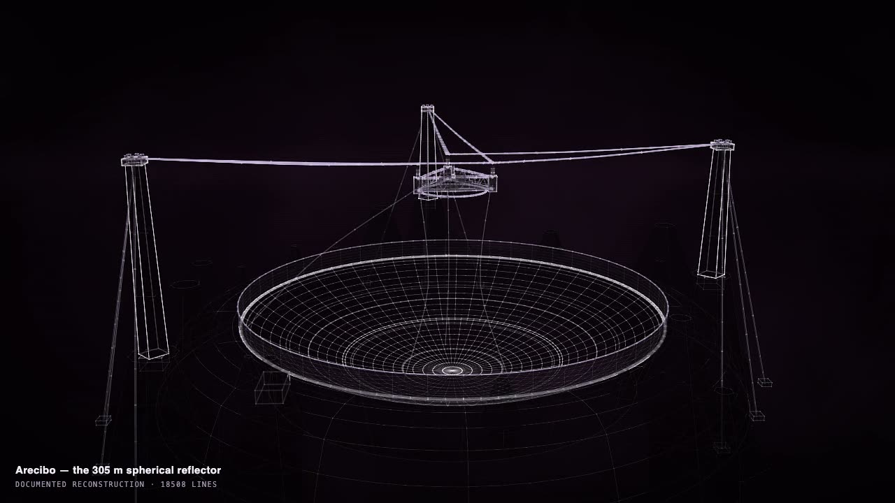
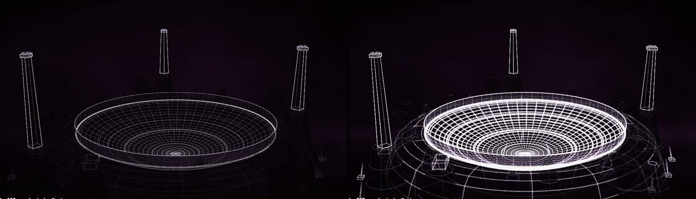

# Film mode

<p align="center">
  <a href="https://rtmandreyev.github.io/construct/films/james-webb-space-telescope/"></a>
  <a href="https://rtmandreyev.github.io/construct/films/voyager-1/"></a>
  <a href="https://rtmandreyev.github.io/construct/films/arecibo-observatory/"></a>
</p>
<p align="center"><sub><a href="https://rtmandreyev.github.io/construct/films/james-webb-space-telescope/">James Webb Space Telescope</a> · <a href="https://rtmandreyev.github.io/construct/films/voyager-1/">Voyager 1</a> · <a href="https://rtmandreyev.github.io/construct/films/arecibo-observatory/">Arecibo Observatory</a>: three constructs made by DeepSeek V4.1 Flash, each assembling across a piece of music. Open one to watch the film, or its live construct.</sub></p>

Film mode lets a construct assemble across a piece of music. Instead of building itself in a few
seconds, it builds for as long as the track lasts, and you can see the music in it: the build
nearly pauses in the quiet passages and surges in the loud ones, the light swells and dims with
the music, the construct flares on the strong attacks, and when the music moves on to a new
section, a new part of the construct begins. You get a video with the music in it, ready for a
music video, a visualiser or a scene in a longer film.

```
your track (.wav)  ──►  construct audio  ──►  features (loudness, brightness, attacks, sections)
your scene         ──►  construct video --audio --assembly <track length> --sound <track>  ──►  film.mp4
```

Film mode is entirely optional. The scene is the same scene, and a construct made without the
film options is exactly what Construct made before film mode existed, byte for byte.

## Make a construct assemble across a track

You need a construct (a scene that passes `check`), the track as an audio file, and ffmpeg, which
film mode uses to read the audio and write the video. Any format ffmpeg reads works; a `.wav` is
the safest.

**1. Measure the track.** Construct listens to the track and writes down, for every frame of the
video, how loud it is, how bright, where the attacks are, and where the track changes section:

```sh
python3 construct_hologram/cli.py audio track.wav --out track-audio.json
```

Each track is measured against its own range, from its quieter moments to its louder ones, so a
loudly mastered song still moves between calm and intense instead of sitting at full volume.
If you prefer one fixed scale for every track, add `--scale fixed`. If you have the vocals as a
separate stem, add `--voice vocals.wav`, and the construct will shimmer while the voice is present.

**2. Render the film.** Tell Construct how long the assembly should last, usually the length of
the track in seconds, and give it the measurements and the track itself:

```sh
python3 construct_hologram/cli.py video scene.json --out film.mp4 \
    --assembly 245 --audio track-audio.json --sound track.wav --camera steady --size 1920x1080 --fps 24
```

The construct builds for 245 seconds, following the music, and the finished video has the track
in it. A construct with a ceremony assembly first shows a short opening, a ghost of itself
collapsing into place, of about a second (1.25 s); its build starts after that, so for a build
that ends with the track, give `--assembly` the track's length minus 1.25. The video runs three
seconds past the assembly so it can settle; set `--seconds` for a different length. A scene whose
assembly style is `cut` appears at once, so film mode has nothing to pace there.

Rendering takes a while: every frame is drawn in a browser, about a frame or two a second on a
laptop, so a four-minute film at 24 frames a second takes roughly an hour.

**3. Watch it.** Open `film.mp4`. A quiet opening builds only a little; the louder the music, the
faster the construct grows; each new section starts a new part of it; and it completes exactly
when its build time is up.

## How the music shows

| | What you see | What drives it |
| --- | --- | --- |
| **Pace** | the build nearly pauses in quiet passages and surges in loud ones | how loud each moment is compared with the rest of the track |
| **Light** | the whole construct swells and dims, from 60% to 140% of its usual light (a little more on an accent) | the music's loudness |
| **Accents** | a flare at the edge being drawn, and a brief glow over what is already built | the strong attacks: drum hits, plucks, the start of a chord |
| **Sections** | when the track moves on, a new stage of the construct begins | changes in the track's loudness and brightness that last |
| **Voice** | a fine shimmer over the construct | a separate vocal stem, if you gave one |

**Pace.** Every moment of the track is ranked against the rest, from the quietest to the loudest,
and the build moves at a speed set by that rank, smoothed over two seconds so it swells and settles
rather than flickers. The quietest moments move about ten times slower than an even build, and
the loudest about three times faster; near silence it almost stops. The whole build is then scaled
so that it still ends on the second you asked for. Because the speed follows the rank, a calm
track with small changes in loudness still shows them.

**Accents.** Construct finds the attacks in the track, at most five a second, and only the
stronger ones flare, the strongest most. A flare is instant and fades in about a fifth of a
second, so the construct pulses with the music without strobing.

**Sections.** Construct compares each moment of the track with the eight seconds before and after
it, and marks a new section where they differ most, at least ten seconds apart (more in a long
track). A construct is
built in stages, foundation first, and each section boundary is where the next stage begins: the
stage before it finishes, a short breath, and the new one starts as the music changes. If a track
has no clear sections, the build simply follows the pace.

## How strongly: the reactivity

`--reactivity` sets how strongly the music shows, from 0 to 2. The default, 1, is made so that
the music is clearly visible even on calm, ambient tracks.

| Reactivity | What it does |
| --- | --- |
| `0` | an even build with steady light, no accents and no sections: the music is only the soundtrack |
| `0.5` | a calmer film: gentler swings in pace and light, only the strongest attacks flare |
| `1` (the default) | pace from about a tenth to three times an even build, light from 60% to 140%, accents and sections |
| `1.5`, `2` | stronger still: quiet passages pause, loud ones race, more attacks flare |

On calm synth tracks of about a minute each, at the default, the build ran up to 8–27%
ahead of or behind an even build, its speed over any four seconds ranged from 0.07–0.33× to
1.9–3.3× an even build, and the light from 0.60 to 1.53. Before film mode had these settings, the
same tracks gave 5–16%, 0.23–0.42× to 1.2–1.5×, and 0.82 to 1.18.

## Choose the camera

`--camera` decides how the camera moves:

| Camera | What it does | Pick it when |
| --- | --- | --- |
| `tour` (the default) | plays the scene's own camera choreography: flights to its close-ups and views | the scene's tour tells the story you want, part by part |
| `steady` | no flights; one long shot from the view, slowly drifting and breathing | a single long shot, or a film that should end on the whole construct |
| `still` | the view held exactly, nothing moves but the construct | a locked-off shot, or one you will move in your editor |

A tour that flies to close-ups during the build ends wherever it was going when the build ends,
which may be a detail rather than the whole construct; `steady` keeps the whole construct in view
from start to end. Choose the view with `--view` (`hero` by default).

If you do play the scene's tour, each flight keeps its place in the story. A flight the scene
starts halfway through its build starts when the film's build is halfway, so the camera arrives
as the parts it looks at are built, and it flies a little slower, as the build does (at most
three times slower, and no longer than 12 seconds unless the scene's own flight is). A flight
after the build starts as long after the film's build as the scene set it, and a flight before
the build stays where it was.

## Preview it in a browser

You can watch the same thing live. Build the construct with film mode, put the features file next
to the page, and open it with the film options:

```sh
python3 construct_hologram/cli.py build scene.json --out out --film
cp track-audio.json out/
# then open out/construct.html?assembly=245&audio=track-audio.json, and play the track alongside
# (add &camera=steady, &camera=still or &reactivity=1.5 to try the other settings)
```

The page doesn't play the audio itself; it follows the measurements in time. A page built
without `--film` is the ordinary construct and ignores these options.

## What film mode doesn't do

- **It doesn't follow a beat grid.** Accents follow the attacks it hears, not a tempo: there is
  no beat or bar detection, so a flare can land on an off-beat attack, and a steady pulse with
  soft attacks may not flare at all.
- **Sections come from loudness and brightness**, not from harmony or melody. A chord change at
  the same loudness and brightness is not a new section, and a track shorter than about 20
  seconds has none. There is at most one section boundary per stage of the construct, so a
  construct with four stages uses the three strongest.
- **The voice only comes from a separate stem.** Construct doesn't pick a voice out of a mixed
  track.
- **It listens in mono, at 16 kHz.** Stereo movement and very high frequencies are not used.
- **The browser preview is silent**, and it is not synchronised to a player: play the track
  yourself alongside, or watch the rendered film.

## Long assemblies in a scene

A normal construct assembles in at most 20 seconds, and that is what the check expects. For a
film it is better to keep the scene as it is and set the length when you render, with
`--assembly`. If you do write a long assembly into the scene, up to 1200 seconds is accepted, and
the check warns `long-assembly` to remind you that it is meant for film.

## For filmmakers: the three.js loader

If you are making a film in a 3-D engine built on [three.js](https://threejs.org/), you can place
a construct inside your own scene, with your own camera, lighting and post-processing, instead of
rendering Construct's page. `construct_hologram/film/construct-three.js` is an optional loader for
that. Construct itself doesn't need it, and it needs three.js, which you bring.

```js
import { loadConstruct, makeBuildCurve, ALBUM_TONES } from "./construct-three.js";

const c = await loadConstruct("geometry.json", { scale: 1 });   // written by `construct build`
scene.add(c.group);

const audio = await (await fetch("track-audio.json")).json();
const build = makeBuildCurve(audio.energy, audio.fps, 0, 245);  // a build that follows the music, done at 245 s

// every frame, at track time t:
const i = Math.round(t * audio.fps);
c.update({ build: build(t), time: t, energy: audio.energy[i], high: audio.high[i], voice: audio.voice[i] });
```

The loader draws the construct's lines as glowing screen-space strokes and its solid parts as
dark glass, with the faint x-ray of hidden lines, as the Construct viewer does. It uses the house
palette by default. `ALBUM_TONES` is an optional warmer palette made for an album film; pass any
eight colours as `palette` to use your own. Line glow breathes with `energy`, a fine shimmer
follows `high`, and the growing edge of the build flares while `voice` is present.

The loader's `makeBuildCurve` is the simpler pace of the first film mode (faster with loudness,
up to about eight times); it doesn't stage sections or flare on attacks. The features file has
what you need to add them in your own engine: `onset` per frame and `sections` with their times.

## Film examples

The three films at the top of this page were made by DeepSeek V4.1 Flash in masterpiece mode,
each assembling across a piece of music. Each has a page in the
[gallery's film section](https://rtmandreyev.github.io/construct/#films) with both versions:

| Construct | The film | The live construct |
| --- | --- | --- |
| James Webb Space Telescope | [Watch the film](https://rtmandreyev.github.io/construct/films/james-webb-space-telescope/) | [Open the live construct](https://rtmandreyev.github.io/construct/films/james-webb-space-telescope/#live) |
| Voyager 1 | [Watch the film](https://rtmandreyev.github.io/construct/films/voyager-1/) | [Open the live construct](https://rtmandreyev.github.io/construct/films/voyager-1/#live) |
| Arecibo Observatory | [Watch the film](https://rtmandreyev.github.io/construct/films/arecibo-observatory/) | [Open the live construct](https://rtmandreyev.github.io/construct/films/arecibo-observatory/#live) |

**Why a film?** The film carries the music and plays the long, music-shaped assembly exactly as
it was rendered. The live construct is the construct itself, to orbit, replay and read its labels,
but a browser page doesn't play the track: to see the music driving the build, watch the film.

The scenes are in [examples/films/](../examples/films/); the videos are published with the
gallery only.



*Arecibo halfway through its film: the dish and the towers are built, and the cables and the
suspended platform are being drawn.*



*An accent, one frame apart: just before a strong attack in the music (left), and on it (right),
when what is built glows and the height being drawn flares brightest.*
