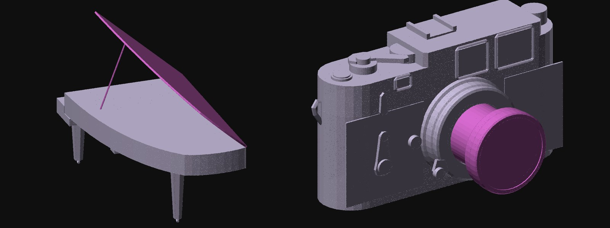

# FreeCAD

<p align="center"></p>
<p align="center"><sub>The Yamaha CFX and the Leica M3 from the gallery, built in FreeCAD by <code>construct freecad</code>: named solids, the parts that move (magenta) in their joints' groups, opened by setting each group's Placement to its <code>Open</code> value. Drawn from FreeCAD's own tessellation.</sub></p>

`construct freecad` builds a construct in FreeCAD as named solids with its joints, and writes a
FreeCAD document and STEP, for engineering work and CAD tools.

```
your scene  ──►  construct freecad scene.json --out model.FCStd --step model.step  ──►  FreeCAD, and any CAD tool through STEP
```

It runs FreeCAD's own command line, so FreeCAD 1.0 or newer must be installed (freecad.org). It is
found as `$CONSTRUCT_FREECAD`, `freecadcmd` on the PATH, or the usual installs; `--freecad PATH`
names one.

## Build a construct in FreeCAD

```sh
construct freecad scene.json --out model.FCStd
construct freecad scene.json --out model.FCStd --step model.step
construct freecad scene.json --out model.step
```

```
wrote piano.FCStd, piano.step: 26 named parts, 2 joints
  surfaces, not solids (open in the construct): lyre-post, prop
  drawn only in lines, left out: case-rim, plate, strings-treble, strings-bass, bridge
```

## What is in the document

| In the construct | In FreeCAD |
| --- | --- |
| a part | a `Part::Feature` labelled with its id (its label as `Label2`): its closed pieces sewn into solids and refined, so coplanar facets become one face; its open surfaces as shells |
| its role, certainty, source, basis, stage | properties in the group "Construct" |
| assembly stages | a group per stage, `stage-0`, `stage-1`, … for the parts that do not move |
| an articulation (hinge, turn, slide, lift) | a group `joint-<id>` holding its parts, nested as the joints ride on one another, with its type, axis, pivot and amount, and an `Open` placement: set the group's Placement to it and the joint opens; its axis drawn as a line |
| metres, Y up | millimetres, Z up |

STEP keeps the tree and the names. The construct's annotations and its parts drawn only in lines
are left out, and the command lists them.

## What it is not

The solids are the construct's own shapes, faceted as the construct draws them: exact for boxes and
prisms, a polygon where the construct draws a cylinder or a curve. They are good for layout,
clearance, packaging and a start to model over, not for machining a curved face. Joints are
groups with their axis and range, not FreeCAD Assembly joints; dimensions come from the construct,
so a part's size is as certain as the construct says.

The tests build the Yamaha CFX in FreeCAD when `CONSTRUCT_FREECAD` names its `freecadcmd`, reopen
the document, check every shape is valid, open the lid by its joint and read the STEP back.
