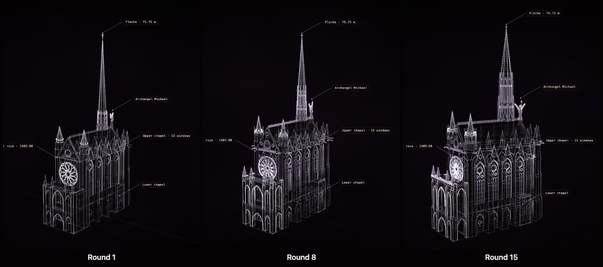

# How a construct is made

This page follows one construct from your request to the finished page, in plain terms. You
don't need to know any of it to use Construct: you ask, and the agent does the work. It helps
to know what is happening, though, especially in masterpiece mode, where a run can take a while.

```
you ask  →  the agent looks it up  →  it writes a scene  →  Construct checks it
         →  Construct builds the page  →  the agent reviews it
         →  (masterpiece) a critic judges each round  →  you get the best version
```

## The steps

1. **You ask for something in plain words.** *"Make a construct of a Leica M3"*, or *"a
   masterpiece of the Sainte-Chapelle"*. Before it starts, the agent tells you which mode it
   will use, fast or masterpiece, why, and roughly how long it will take. If you name a mode
   yourself, it uses yours.

2. **The agent looks it up.** For a specific, named subject it finds real facts (dimensions,
   dates, the features that make the thing recognisable) and reference photos. The photos are
   for comparison only. They are never copied into the construct or published with it, because
   they belong to someone else; the construct only cites where its facts came from.

3. **It writes a short scene description.** A scene is a plain text file that says what the
   thing is: the facts, each marked with how well it is known, and the parts, built from a set
   of simple shapes (boxes, lathes, lofts, towers, shells), with how they assemble and open.
   The agent describes the object; it never draws pixels or writes graphics code.

4. **Construct checks it and points out problems.** Something floating in the air, a claim
   stronger than its evidence, a part too small to see: each problem comes back with where it
   is and how to fix it. The agent fixes them and checks again until the scene is clean.

5. **Construct builds the page.** The scene becomes one `construct.html` file, which opens in
   any modern browser, works offline, and shows the construct assembling itself.

6. **The agent reviews its own pictures.** Construct takes stills of the construct from every
   view, and the agent looks at them the way a person would, then improves the weakest point.
   In fast mode, this is where the work ends.

7. **In masterpiece mode, an independent critic takes over the judging.** The critic is a
   second, fresh model that never saw the authoring. Each round, the agent fixes a few problems
   at most (four), so it is clear what helped. The critic then looks at the new version on its
   own, and compares it with the best version so far, shown side by side without saying which
   is which. Only a version the critic prefers is kept; otherwise the best one stays. You get a
   short report after every round: what the critic asked for, what changed, and whether it won.

   The run stops when it stops getting better (two rounds in a row without a win), or after 12
   rounds, or after two hours of the agent's own working time. Why 12: in blind comparisons of
   long runs, nobody could see a difference after about round 12, so more rounds mostly cost
   time. If you really want to keep going, ask for **unbounded** mode, which keeps the rounds
   coming until the critic stops finding improvements.

## A construct improving over rounds



The same Sainte-Chapelle, made by Claude Opus in masterpiece mode, at round 1, round 8 and
round 15. Round 1 is already recognisable. By round 8 the flèche has gained its tiers; by round
15 the window tracery, the buttresses and the pinnacles have filled in and the whole building
reads as more solid. Every step was kept only because the critic, comparing the two
versions blind, preferred it. You can open the final version
[in the gallery](https://rtmandreyev.github.io/construct/examples/sainte-chapelle/).

## What you need

| | fast | masterpiece |
| --- | --- | --- |
| **The skill** | installed in your agent ([install](../README.md#install)) | the same |
| **A model** | any capable model; DeepSeek does well | GPT-6.1 Sol or Claude Opus |
| **Seeing pictures** | helpful: the agent reviews its own stills | needed: the critic compares pictures with reference photos |
| **A browser** | a Chromium-family browser (Chrome, Edge, Brave) on the same machine for review stills | the same |
| **A critic** | not used | a helper agent your agent can start, or a second model you point it at |

Your agent looks up references itself when it has web access. Without it, the construct is made
from what the model knows and says so.

## How long it takes and what it costs

- **fast:** about 10 minutes, or up to 30 for a richer subject. With DeepSeek a full construct
  costs about one or two cents in model use; parameter-based things like a book or a CD cost
  less than a cent.
- **masterpiece:** up to two hours of the agent's own working time, plus the critic's time each
  round, so often well over an hour in all. It uses a frontier model throughout, so it is the
  expensive mode; on a subscription plan it uses your plan's allowance.
- **unbounded:** no limit on rounds or time. Expect many rounds and hours, and a high token
  cost. You can stop it after any round, and the best version so far is always saved.

Which model to use: for a named car, landmark or building in masterpiece mode, **GPT-6.1 Sol**
or **Claude Opus**. For simpler objects in fast mode, **DeepSeek** does as well as either. If
you ask a smaller model for a hard named subject, it tells you so and suggests one of those.

## Learn more

- [The Measured Light style](STYLE.md): what you see in a construct, and why.
- [Using Construct](USING.md): every way to run it, step by step.
- [Troubleshooting](TROUBLESHOOTING.md): when something doesn't work.
