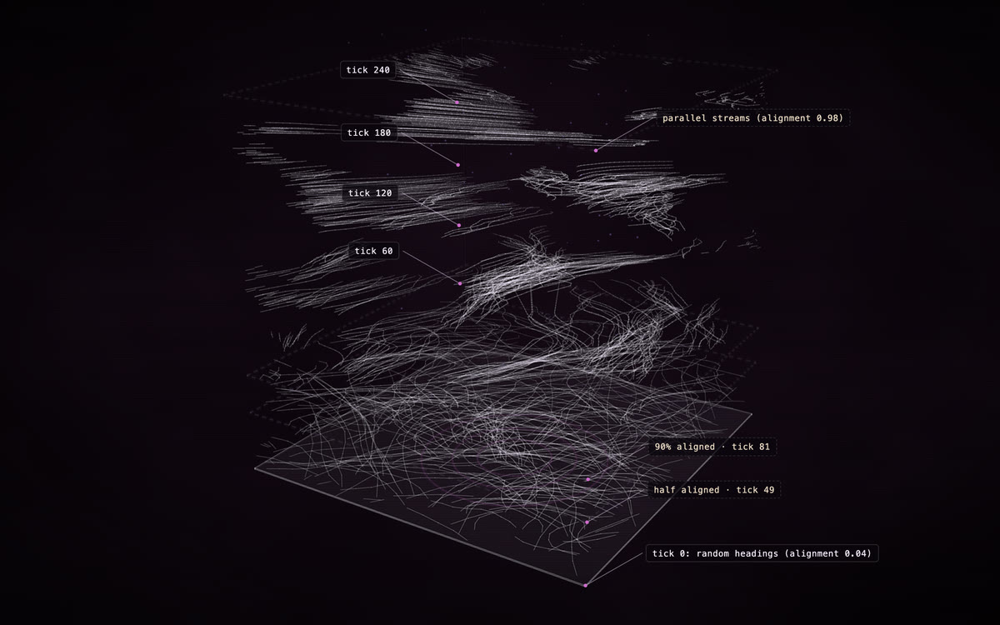
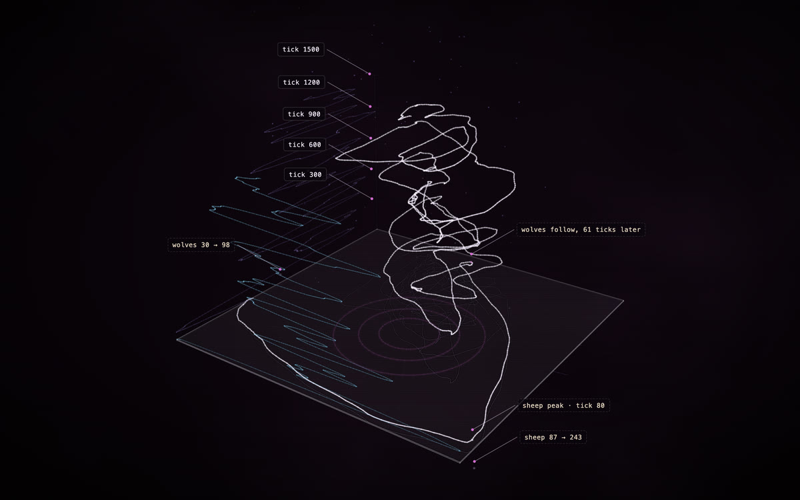
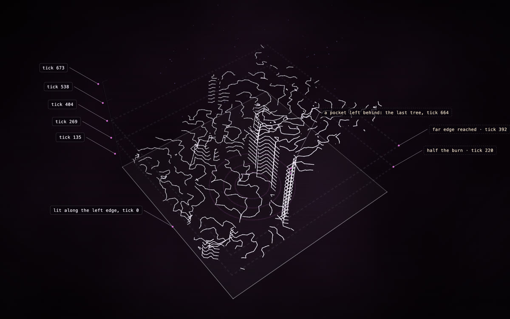

# The NetLogo bridge

<p align="center">
  <a href="https://rtmandreyev.github.io/construct/examples/netlogo-flocking/"></a>
  <a href="https://rtmandreyev.github.io/construct/examples/netlogo-wolf-sheep/"></a>
  <a href="https://rtmandreyev.github.io/construct/examples/netlogo-fire/"></a>
</p>
<p align="center"><sub>Three runs of NetLogo Models Library models (© Uri Wilensky, CC BY-NC-SA 3.0), recorded with the bridge and drawn as constructs from the data alone, then art-directed by Claude Opus 5.5 (labels and milestones; the data is locked): <a href="https://rtmandreyev.github.io/construct/examples/netlogo-flocking/">Flocking</a> · <a href="https://rtmandreyev.github.io/construct/examples/netlogo-wolf-sheep/">Wolf Sheep Predation</a> · <a href="https://rtmandreyev.github.io/construct/examples/netlogo-fire/">Fire</a>.</sub></p>

An agent-based model unfolds in time. The bridge records a NetLogo run and draws it as a construct
in which time is height: the floor is the world (or two of the model's quantities), and the run
rises from it. Because a construct assembles from the floor up, its assembly replays the run.

```
your model (.nlogox)  ──►  construct netlogo-instrument  ──►  the model, recording itself
NetLogo (setup, go)   ──►  run.jsonl
run.jsonl             ──►  construct netlogo --view …    ──►  scene.json  ──►  construct build
```

No AI model is needed for any of it: the construct is computed from the recording, so the same run
always gives the same construct, and every data part is marked `verified` against the recording
(a dataset source that names the model, NetLogo's version and the random seed). An optional
[art-direction pass](#3-art-direction-optional) can then add views, emphasis, labels and
milestones on top, and the data lock makes sure it never changes the data.

## 1. Record a run

The fastest way is to let Construct instrument a copy of your model:

```sh
construct netlogo-instrument "Wolf Sheep Predation.nlogox" --title "Wolf Sheep Predation" --out run/ \
    --reporters "count sheep;count wolves" --no-turtles --seed 11 --ticks 1500
```

It writes, into `run/`, the model with three things added (and nothing else changed):
`__includes ["construct.nls"]`, the recording set up after setup's `reset-ticks`, and
`construct-record` after go's `tick`; it copies `construct.nls` beside it and writes a BehaviorSpace
experiment, `construct-experiment.xml`. Then either open the model in NetLogo and press setup and
go, or run it headless:

```sh
NetLogo_Console --headless --model "run/Wolf Sheep Predation-construct.nlogox" \
    --setup-file run/construct-experiment.xml --experiment construct --threads 1
```

(On a Mac the console is inside the NetLogo folder; `netlogo-headless.sh` there runs it, with
`JAVA_HOME` set to NetLogo's own `runtime/Contents/Home`.) The experiment sets the seed, runs up to
`--ticks` and calls `construct-finish`. To change the model's settings, add BehaviorSpace
`<constants>` to the experiment, as for any experiment.

| Option | What it records |
| --- | --- |
| (always) | each turtle's who, breed, position and colour, every record; the links whenever their number changes |
| `--turtles heading,energy` | turtle variables or reporters, per turtle |
| `--reporters "count sheep;count wolves"` | observer reporters, every record |
| `--patches pcolor:4` | a patch reporter, every 4 ticks |
| `--no-turtles` | no turtles (when only reporters or patches matter: much smaller files) |
| `--every 5` | a record every 5 ticks |
| `--seed 42` | sets and records the random seed |

**By hand**, for a model that instrumenting does not fit: put `construct.nls` beside the model, add
`__includes ["construct.nls"]`, and at the end of setup:

```
construct-start "My model" "run.jsonl"
construct-seed 42                                   ; the seed your run used, if you set one
construct-track-turtles ["energy"]
construct-track-reporters ["count sheep" "count wolves"]
construct-track-patches "pcolor" 4
construct-record
```

then `construct-record` at the end of go and `construct-finish` when the run ends. The recording is
JSON Lines: a header (the title, NetLogo's version, the seed, the world), then one line per
record. With BehaviorSpace, give each run its own file, since parallel runs would share one.

## 2. Draw it

```sh
construct netlogo run/run.jsonl --view phase --smooth 25 --out scene.json
construct build scene.json --out out/
```

| View | For | What it draws |
| --- | --- | --- |
| `space-time` | moving agents (flocks, ants, traffic) | each turtle's track, rising with time, in a cube as tall as the world is wide; up to 150 turtles (`--max-agents`), chosen evenly by who |
| `network-time` | spreading on a network (diffusion, epidemics, adoption) | the network on the floor; each turtle rises to the tick its `--state` variable first turned true, and each link between two risen turtles climbs from the earlier to the later |
| `phase` | two quantities in a cycle (predator and prey) | `--x` across the floor and `--z` front to back (the first two reporters by default), height is ticks; its shadow on the floor is the classic phase plot, and the walls carry each against time. `--smooth N` averages over N records, recorded as a fact |
| `field` | something spreading over patches (fire, contagion, settlement) | the front of change: where each patch's reporter first (`--change last`: last) changed, drawn every few ticks and raised to its tick; nothing where nothing changed. `--levels` fronts (32), over about `--resolution` blocks (64) |

`--time sqrt` stretches the early ticks, for a run whose changes come early (most of an adoption
cascade happens in its first tenth). Each construct records what was drawn as facts: the model, the
seed, the ticks, which agents, how the data was sampled.

## 3. Art direction (optional)

The bridge's construct is exact but plain: no names on the axes, no milestones, one view. An
art-direction pass, by an AI agent or by you, makes it read, as the
[Simple Viral Marketing](../examples/netlogo-viral-marketing/) example does with its adoption
rings and callouts. The pass is a separate layer, `art.json`, applied when the run is drawn:

```sh
construct netlogo run.jsonl --view field --levels 24 --art art.json --out scene.json
```

| Key | What it holds |
| --- | --- |
| `credit` | who directed it, required: a model (`"Claude Opus 5.5"`) or a person. It becomes the source `art`, "Art direction by …", shown with **P** |
| `title`, `summary` | the construct's title and its one-paragraph summary |
| `looks` | per data part, by id: its `label`, `look` (tone, weight, alpha, glow, line) or `note`, and nothing else |
| `parts`, `facts`, `annotations` | its own: milestone rings, tick marks, axis names, callouts. Source `art` (or none), `inferred` when computed from the run (the note says how) or `decorative` |
| `presentation` | views, framing and atmosphere, merged over the bridge's |
| `animation` | assembly, idle and camera, in place of the bridge's |

**The data lock.** Every scene the bridge draws carries a `data_lock` fact: the fingerprint of its
data (each part from the run, the run's facts, the view and the coordinates). `construct check` and
`build` refuse a scene whose data no longer matches it, so neither an art pass nor a hand edit can
move a point, drop a track or change a tick without it showing. Reformatting the file, or a data
part's label, look or note, leaves the fingerprint as it was. The layer itself can't claim the
recording either: a part or fact of its own with source `run` is refused.

What makes a good pass:
- **Milestones come from the recording,** computed by a short script over `run.jsonl`, never
  estimated by eye: "half the forest burned, tick 212" is what the run says.
- **Every data part stays visible.** Emphasis dims the context, never the data.
- **A few rounds, looked at.** `construct review scene.json --out out/` before and after each change;
  keep a change only when the construct reads better. The house style is in [STYLE.md](STYLE.md).
- The layer is kept beside the scene, so the pass is reviewable and redrawn with the run.

## How it was checked

- **The bridge reproduces a run exactly.** The [Simple Viral Marketing](../examples/netlogo-viral-marketing/)
  example's model, instrumented and re-run with its seed and settings in NetLogo 7.0.4, gives the
  same run as its original export: it ends at tick 470, and all 500 people's adoption ticks are
  the same. The recorder uses no randomness, so it never changes a run.
- The three examples were recorded headless in NetLogo 7.0.4: Flocking (300 ticks, 4.5 seconds),
  Wolf Sheep Predation (1,500 ticks) and Fire (673 ticks over 63,001 patches, 8 seconds).
- The tests check instrumenting, reading a recording, every view, the data lock (a moved point, a
  dropped part, a changed tick or a part that claims the run fails; a restyled or reformatted scene
  passes) and the art layer on small recordings, and, when
  `CONSTRUCT_NETLOGO` names NetLogo's folder, a headless run end to end.

## Limits

- Desktop NetLogo 6.x and 7 (`.nlogox` for instrumenting); NetLogo Web does not support include
  files. NetLogo 3D's third coordinate is not recorded.
- A construct holds 24,000 lines, so a long run of many agents is sampled; the facts say how.
- Construct does not colour by data (the renderer owns colour): a view shows a quantity by position,
  not by hue.
