# What's new in 1.1, a walkthrough

1.1 is two releases in one. **Models come alive:** a NetLogo simulation's whole run becomes a construct a student
can read, compare, print, film and hold. And **things you can make:** any construct becomes a print, a model
kit, a CAD file or a game-ready prop. This page goes through each new feature with an example and the commands
to try it; [a longcase clock, end to end](END-TO-END.md) takes one construct through all of them. The full list is in the [changelog](../CHANGELOG.md), and the story in the
[release notes](releases/v1.1.0.md).

In the commands below, `construct` is short for `python3 construct_hologram/cli.py` in a checkout of Construct.

- [Your own formats](#your-own-formats)
- [Honest in finer shades](#honest-in-finer-shades)
- [See it as a solid](#see-it-as-a-solid)
- [Contact you can trust](#contact-you-can-trust)
- [Cleaner 3D](#cleaner-3d)
- [Game engines](#game-engines)
- [CAD](#cad)
- [Prints](#prints)
- [Model kits](#model-kits)
- [A run in one command](#a-run-in-one-command)
- [Reading a run](#reading-a-run)
- [For the classroom](#for-the-classroom)
- [Runs as films and 3D models](#runs-as-films-and-3d-models)
- [For agents](#for-agents)
- [Smaller things](#smaller-things)

## Your own formats

Everything Construct writes (the page, glTF, FreeCAD, prints, kits) reads the same construct: named parts at their
real sizes, how each is known, how they assemble, open and move. An adapter of your own reads it too, from the
glTF in any language or from the compiled geometry in Python, and writes whatever your tool, machine or craft
takes. A template writes a parts sheet (sizes in millimetres, how each size and shape is known, the source) and an
STL per part.

```sh
PYTHONPATH=/path/to/construct python3 hosts/adapter-template/construct_parts.py scene.json out/
```

[Adapters →](ADAPTERS.md)

## Honest in finer shades

A spec sheet verifies a car's length, not its outline: a part's size and its shape are now answered apart
(`{"size": "verified", "shape": "traced"}`), with `traced` for a fit to an orthographic drawing. Every guess is a
deeper amber the more firmly it is held to the real thing: designed, described, seen in a picture, seen and
checked by a verified fact or a passing silhouette comparison. Press **P**; the legend counts each kind and names
the sources behind the verified ones.

<p align="center">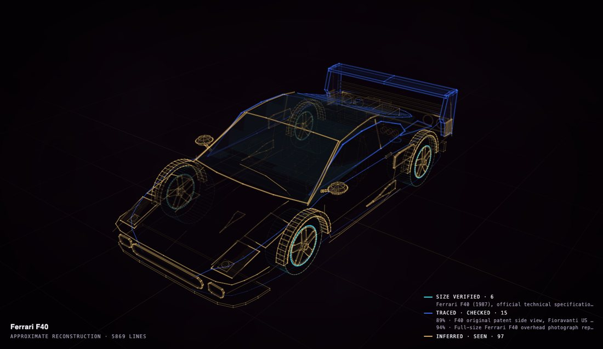 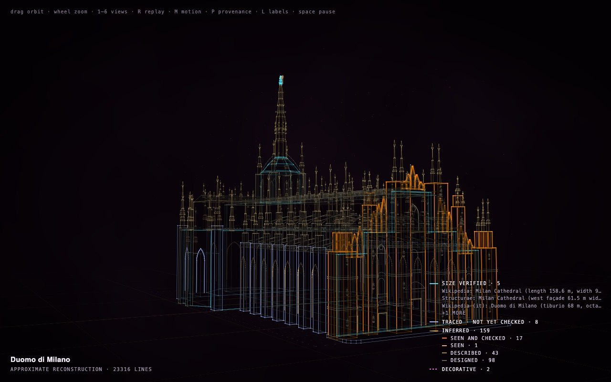</p>
<p align="center"><sub>The Ferrari F40: its size verified from the official specifications, its body traced from the patent drawings.
The Duomo di Milano: the whole range, from verified sizes to decorative guesses, each counted in the legend.</sub></p>

```sh
construct compare scene.json --trace side.trace.json --view side --record   # a traced shape, checked
```

[Museums and archives →](for/museums-and-archives.md)

## See it as a solid

Press **S** in any construct to see it as a modelling program shows it, lit like a studio, still building in
stages. The light forgives what a solid shows; `check --fit` names the parts that poke through others or hide
inside them, the most visible first, for an agent or a person to fix one by one.

<p align="center">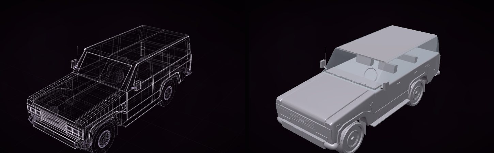</p>

```sh
construct check scene.json --fit
```

## Contact you can trust

A construct is checked for whether every part rests on something, and that check used to look at the parts'
boxes. A desk fan two models built passed it with its stem standing short of the base and its motor short of the
pole: the base's rim made its box reach past the stem's foot, and a wire bridged the gap under the motor. Now
`check` follows support through the solids themselves. A part whose surface meets nothing held up is an error; a
part carried only by something far thinner than itself is a warning; both name the gap and the part to rest it
on. It runs in every mode and needs no picture, so a model that cannot see its renders gets it too.

<p align="center">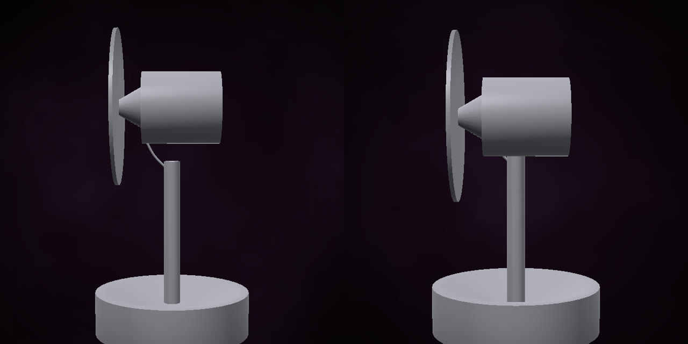</p>
<p align="center"><sub>Before: the audit said PASS. After: both joints seated, and the audit says PASS for real.</sub></p>

```
$ construct check fan.json
audit: FAIL (1 errors, 0 warnings)
  ERROR [unsupported] stem rests on nothing that reaches the ground (and so do 'bracket', 'motor', 'nose',
  resting on it): its box touches its neighbours', but no surface meets one that is held up. The nearest is
  'base', 0.02 m away: move it onto 'base', or set "floating": true if it truly hovers.

# with the stem seated
  warn [thin-support] motor is held up only by 'bracket', 0.004 m across under a part 0.12 m across. Is that
  really what carries it? If it rests on something, its surfaces should meet: the nearest sturdy part is
  'stem', 0.03 m away.
```

It found three such gaps in the gallery too, now closed: a door handle and the side vents standing off the Aston
Martin DB5's body, the brass orrery's mechanism hanging in its gear deck, and the James Webb Space Telescope's
sunshield short of its bus.

## Cleaner 3D

For Blender and any 3D program: solids pass smoothly between a loft's sections and round tubes have twice the
sides; an OBJ's positions are shared and its strips are quads again, so it subdivides cleanly; every export
reports its thin triangles, and `--quality` shows where they are. The Blender add-on brings in constructs with
their build, joints and finish on sliders, and NetLogo runs as films and 3D models.

<p align="center"><a href="https://rtmandreyev.github.io/construct/examples/light-to-metal/">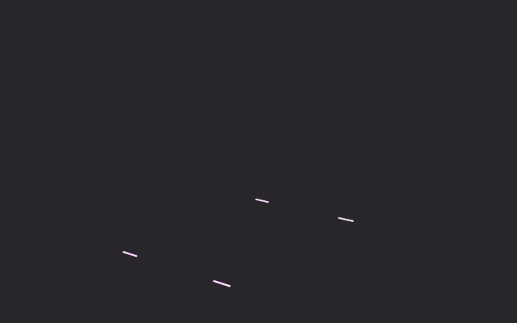</a></p>

```sh
construct export scene.json --out model.obj
construct export scene.json --out quality.glb --quality       # each triangle coloured by its quality
construct export scene.json --out model.glb --materials finish.json --wire seams
```

[3D export →](EXPORT.md) · [the Blender add-on →](../hosts/blender/README.md) · [3D artists →](for/3d-artists.md)

## Game engines

Props with named parts, real sizes and working joints: glued pieces that hold together on their hinges
(`hosts/godot/construct_joints.gd` makes them Godot joints), or pieces that break apart and settle; a collider
per part; seeded variants of an archetype.

<p align="center">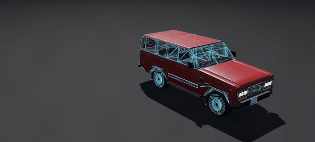</p>

```sh
construct export scene.json --out car.glb --pieces glued --colliders
construct export scene.json --out car.glb --pieces            # pieces that break apart
construct params vehicle --seed 3 --output coupe-3.json        # a seeded variant
```

[Godot guide →](GODOT.md) · [Game developers →](for/game-developers.md)

## CAD

A construct in FreeCAD with its joints, as true CAD shapes where their parameters allow (boxes, cylinders,
lathes, extrusions from splines, lofts as NURBS surfaces), and STEP for any CAD program.

<p align="center">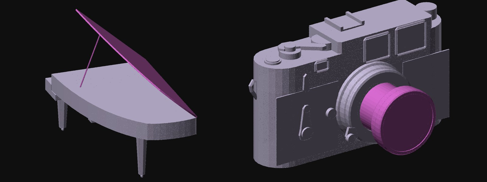</p>

```sh
construct freecad scene.json --out model.FCStd --step model.step   # runs FreeCAD
```

[FreeCAD and STEP →](FREECAD.md)

## Prints

One checked, watertight print (STL or 3MF) at the largest size your printer takes; `--exact` keeps the
construct's own solids, with thin parts given true walls, for the finest detail. Line art can be engraved like
a kit's panel lines.

<p align="center">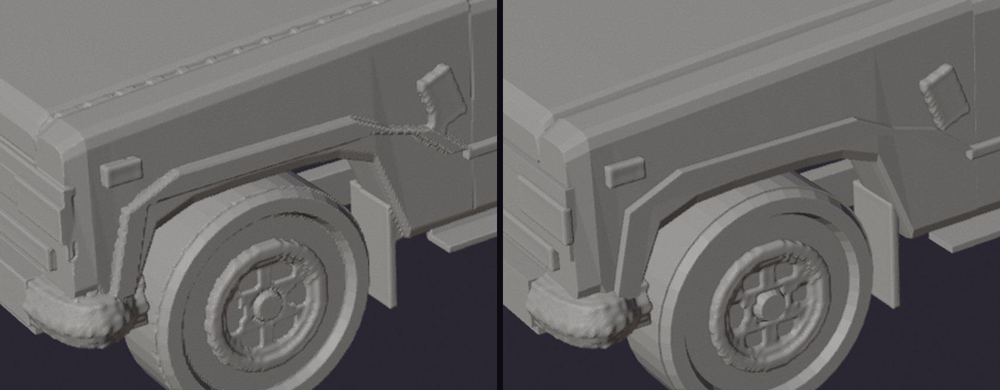</p>

```sh
construct print scene.json --printers                          # how large on each printer class, what survives
construct print scene.json --out model.3mf --printer desktop --fit --exact
```

A run you can hold: `construct netlogo-plates run.jsonl --out plates/` prints a run as plates that stack, with
pins and a key card.

<p align="center">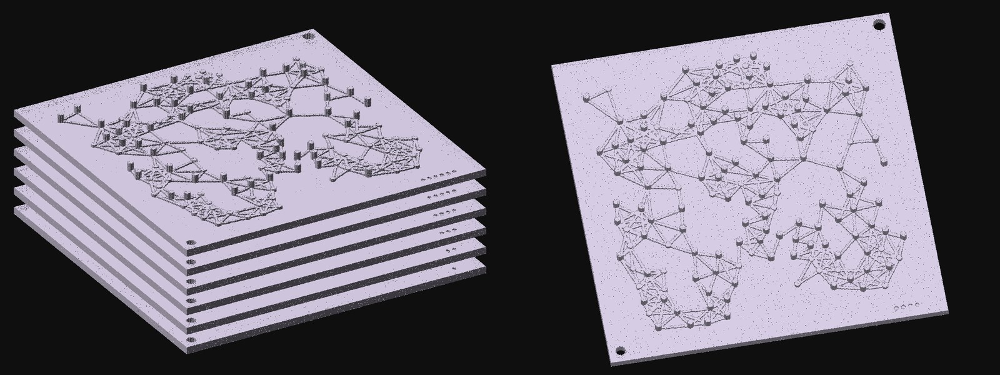</p>

## Model kits

A construct as a kit to print, glue and paint, as a Revell or Tamiya kit is: pieces true to the construct's shapes
on numbered plates (clear parts on plates of their own), glued in the order a kit designer would, with a booklet
drawn as a kit sheet and the same steps in 3D.

<p align="center">
  <a href="https://rtmandreyev.github.io/construct/examples/yamaha-cfx/kit/assembly.html">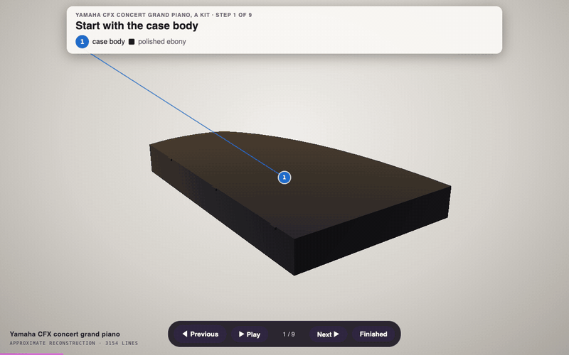</a>
  <a href="https://rtmandreyev.github.io/construct/examples/tompion-year-going-clock/kit/assembly.html">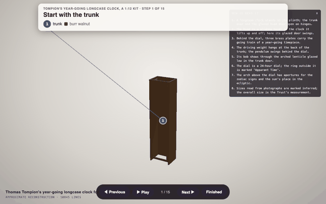</a>
  <a href="https://rtmandreyev.github.io/construct/examples/volkswagen-t1-samba/kit/assembly.html">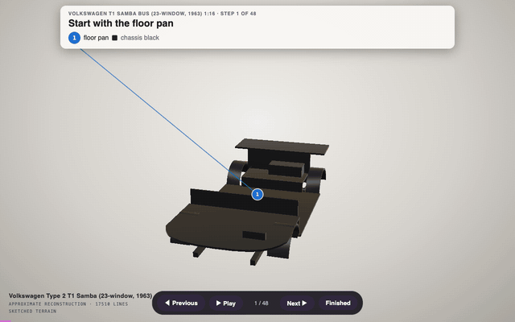</a>
</p>
<p align="center"><sub>The Yamaha CFX at 1:12 (54 pieces, 9 steps), Tompion's year-going clock at 1:12 (34 pieces, 15 steps, <a href="END-TO-END.md#11-a-model-kit">made step by step</a>) and the VW T1 Samba at 1:16 (98 pieces, 48 steps). Click one to open its steps in 3D.</sub></p>

Open them in your browser: the Yamaha CFX ([in 3D](https://rtmandreyev.github.io/construct/examples/yamaha-cfx/kit/assembly.html), [booklet](https://rtmandreyev.github.io/construct/examples/yamaha-cfx/kit/booklet.html), [plates](https://github.com/rtmandreyev/construct/releases/latest/download/construct-kit-yamaha-cfx.zip)), Tompion's clock ([in 3D](https://rtmandreyev.github.io/construct/examples/tompion-year-going-clock/kit/assembly.html),
[booklet](https://rtmandreyev.github.io/construct/examples/tompion-year-going-clock/kit/booklet.html), [plates](https://github.com/rtmandreyev/construct/releases/latest/download/construct-kit-tompion-year-going-clock.zip)), the VW T1 Samba ([in 3D](https://rtmandreyev.github.io/construct/examples/volkswagen-t1-samba/kit/assembly.html), [booklet](https://rtmandreyev.github.io/construct/examples/volkswagen-t1-samba/kit/booklet.html), [plates](https://github.com/rtmandreyev/construct/releases/latest/download/construct-kit-volkswagen-t1-samba.zip)) and an owner's Vespa GS 150 at 1:12 ([in 3D](https://rtmandreyev.github.io/construct/examples/vespa-gs150/kit/assembly.html),
[booklet](https://rtmandreyev.github.io/construct/examples/vespa-gs150/kit/booklet.html), [plates](https://github.com/rtmandreyev/construct/releases/latest/download/construct-kit-vespa-gs150.zip)).

- **The booklet:** a cover, the paints, the plates with every piece numbered, then a card per step with the
  parts it takes and a shaded, exploded drawing (no hidden lines), many of one kind under one callout.
- **In 3D:** the instructions at the top with a line to each piece, Previous, Play, Next and Finished at the
  bottom; at the bench the model so far is a faint ghost around what you are building.
- **Repeated work is one step:** four wheels, eleven key sections, both doors.
- **Print one piece first:** every piece is also on its own in `pieces/`, and `--only` reprints a few.

<p align="center">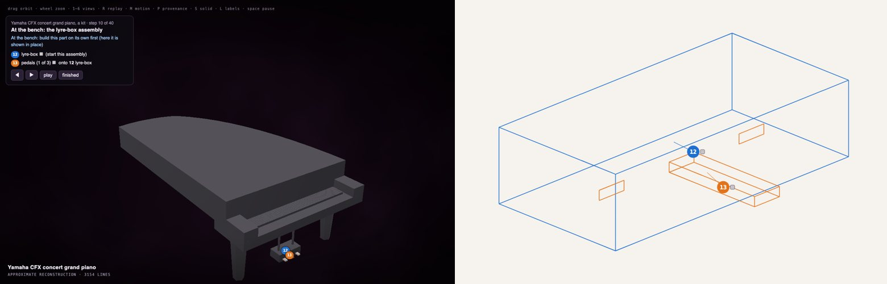</p>

```sh
construct kit scene.json --scale 12 --printer large --out kit/   # kit/booklet.html, kit/assembly.html, plates
construct kit scene.json --scale 12 --printer large --out kit/ --only 12,14
```

**Not yet built by anyone.** The kits are made and checked by software and by AI critics; none has been printed
and glued by a person, and they are a first version. If you build one, please
[tell us how it went](https://github.com/rtmandreyev/construct/issues). [Your first kit, step by step →](for/makers.md#your-first-kit-step-by-step)

## A run in one command

A NetLogo 7 extension. Add one line to a model, type one command, and the run opens as a construct in your
browser: time is its height, so the whole run is one shape you can turn.

<p align="center"></p>

In NetLogo, with the extension unzipped into `extensions/construct`:

```
extensions [construct]          ; at the top of the model's code
construct:run                   ; in the Command Center: setup, run, record, draw, open
```

It runs the model as its own buttons do and stops when the model stops (or after 1000 runs of go, and says so;
`construct:run-for 3000` runs longer). Of NetLogo 7.0.4's 445 two-dimensional models, 388 record a run with no
edits. [NetLogo bridge →](NETLOGO.md) · [the extension →](../hosts/netlogo/README.md)

## Reading a run

The construct chooses the view the data suits: a network where something spread, a field's fronts, two counts
that cycle, the agents' paths, or the new **pulse**, for agents that switch on and off (fireflies, firing
cells), where falling into step shows as a thin column opening into wide plates. When order forms early in a
long run (a flock, fireflies in step), it is drawn over the window where it formed, and says so.

<p align="center"> </p>

Every construct of a run carries a legend, a replay bar (drag it, or press play) and a **How to read it** panel,
and marks its own moments from the counts: a peak, half way, all at once.

```sh
construct netlogo run.jsonl --view auto --out run.json      # outside NetLogo, from a recording
construct netlogo run.jsonl --view pulse --window whole --out run.json
```

## For the classroom

Runs side by side on one time scale, for a lesson: a slider moved, or another seed.

<p align="center">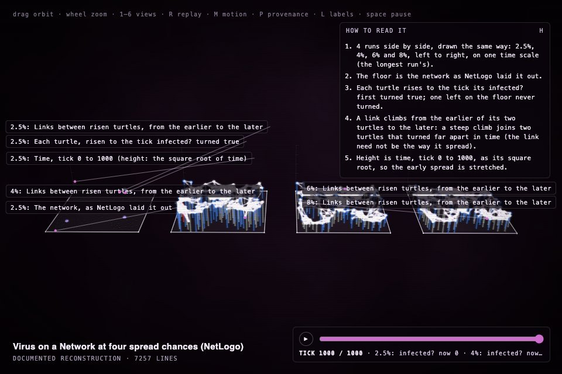</p>

```sh
construct netlogo-compare low.jsonl high.jsonl --labels "2.5%,6%" --out compare.json
construct netlogo run.jsonl --view auto --csv counts.csv --out run.json
```

Printed (Cmd/Ctrl+P), the page is a one-page worksheet with three questions. The panel offers the counts as
CSV and **Cite this run** (model, NetLogo version, seed, ticks, Construct's version and the data lock). Opt-in
critic rounds judge a run's construct by its facts and by how a student would read it.
[Educators and researchers →](for/educators-and-researchers.md)

## Runs as films and 3D models

In Blender, the recording itself is drawn: every agent at every tick as moving light with a trail, in its own
NetLogo colours, each link while it lasts, the patches as a floor. Nothing is sampled. NetLogo 3D runs fly in
their box.

<p align="center">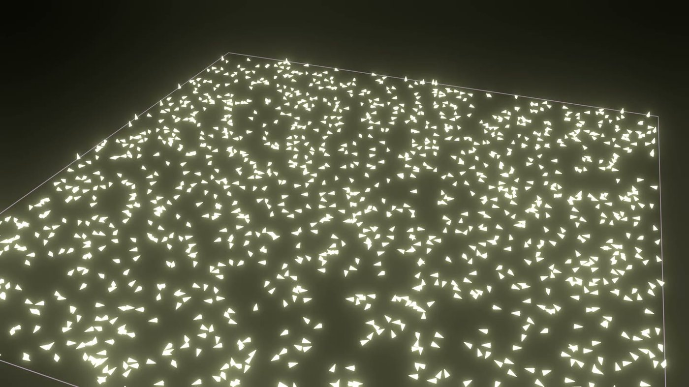</p>

```sh
construct netlogo-film run.jsonl --out film.mp4             # needs Blender
construct netlogo run.jsonl --view auto --solid --glb run.glb --out run.json
```

In NetLogo: `(construct:draw "auto" "film" true)` or `(construct:draw "auto" "model" true)`.

<p align="center">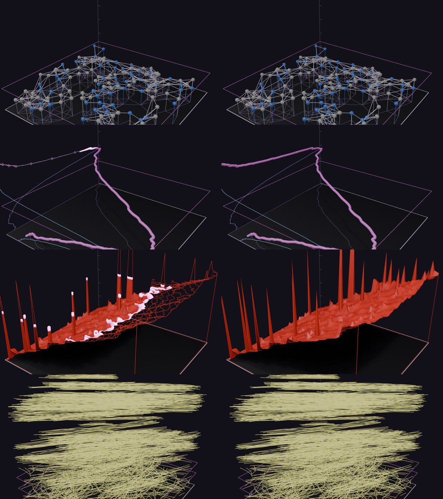</p>

## For agents

The MCP server gains `construct_netlogo_instrument` and `construct_netlogo_draw`, so Hermes or any MCP client
can instrument a model, draw a run and export it. The skills know the extension, reading a run, kits, prints
and films. [Developers →](for/developers.md)

## Smaller things

- **Timeboxed mode:** masterpiece in two hours in all, the critic's time included, for when you
  need it done by a certain time (`mode: timeboxed`). Masterpiece is unchanged.
- **T** hides the text printed on a construct's surfaces (a lens's name, a cover's title); `?text=0` starts
  without it.
- Every malformed scene, recording or command is answered with an error that says where, not a crash.
