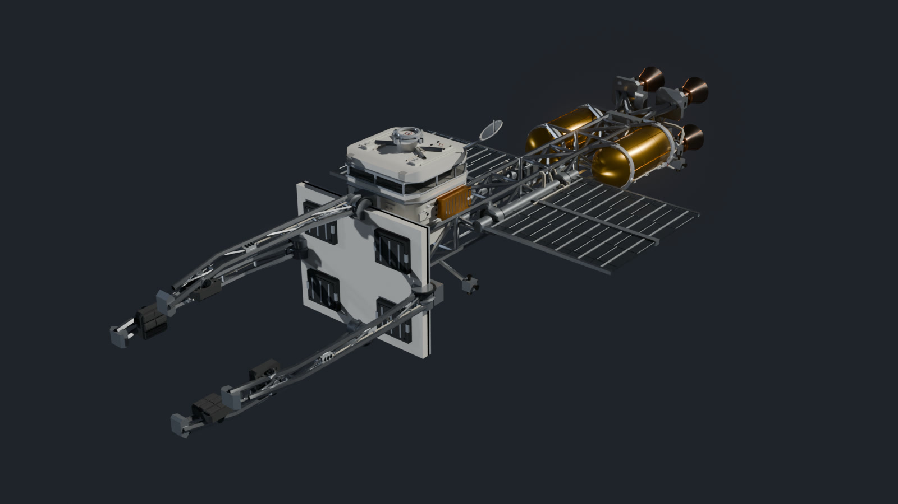
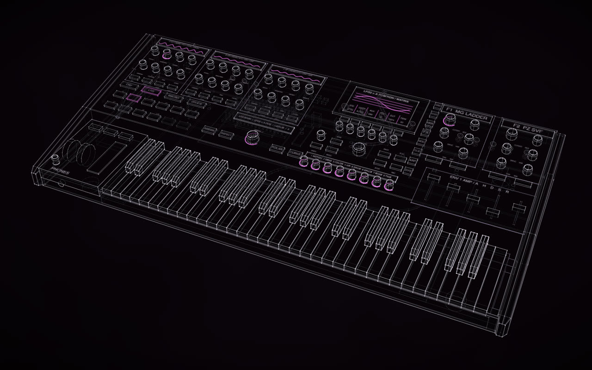
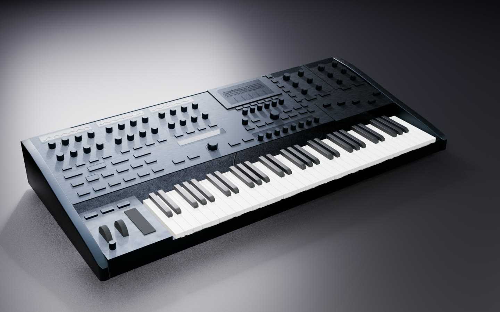
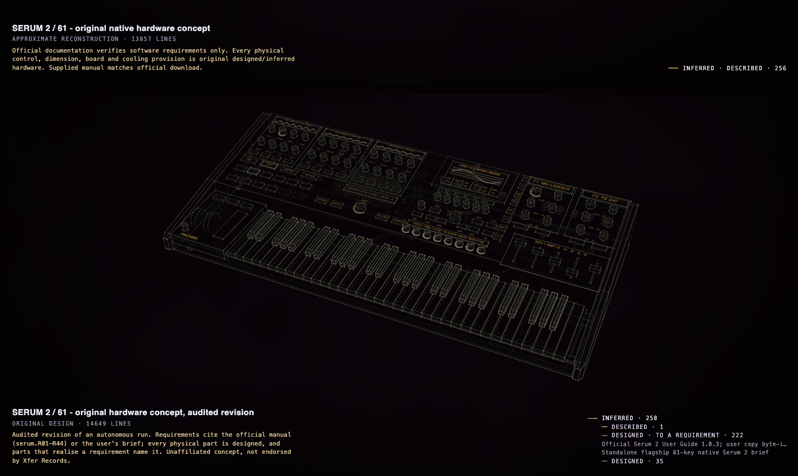
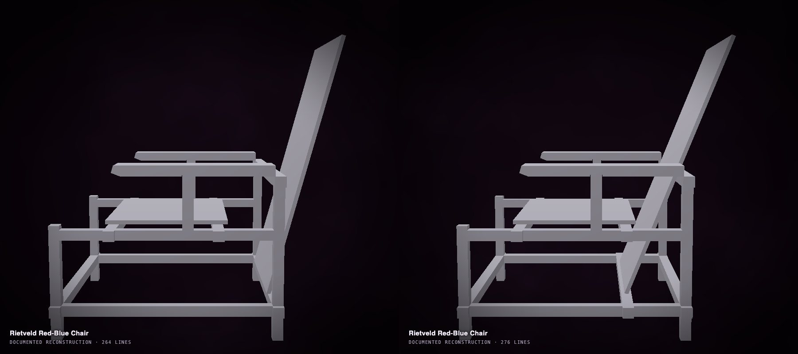
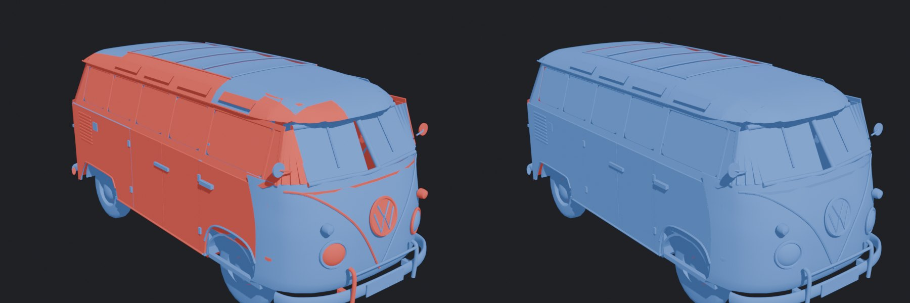
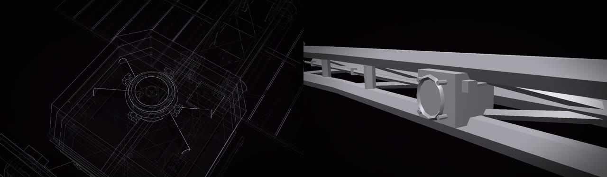
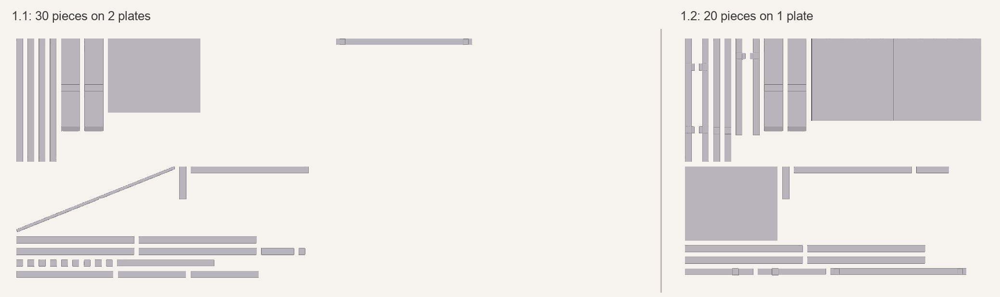

# What's new in 1.2, a walkthrough

1.2 is about the far end of what Construct can make. Until now a construct reconstructed something that exists. 1.2
follows two runs that design what does not: **KESTREL**, an invented ship built from real spacecraft studies, and a
**hardware instrument designed from a software manual**. They showed what a design needs that a reconstruction did not:
a designed part should say what it was designed *to*, a new design should not be captioned a reconstruction, a
critic must stand apart from the author, and the checks must catch what an agent misses (a chair back that would
fall over, a pillar through a window, a number left stale). This page goes through each change with an example and
the commands to try it. The full list is in the [changelog](../CHANGELOG.md).

In the commands below, `construct` is short for `python3 construct_hologram/cli.py` in a checkout of Construct.

- [New things from real ones: KESTREL](#new-things-from-real-ones-kestrel)
- [Documentation → product](#documentation--product)
- [Designed to a requirement](#designed-to-a-requirement)
- [Is it held?](#is-it-held)
- [The fit, more exact](#the-fit-more-exact)
- [Numbers that went stale](#numbers-that-went-stale)
- [The critic stands apart](#the-critic-stands-apart)
- [Solids wound outward](#solids-wound-outward)
- [Bigger constructs](#bigger-constructs)
- [Glued joints inside joints](#glued-joints-inside-joints)
- [Kits: boards lie flat](#kits-boards-lie-flat)
- [Smaller things](#smaller-things)

## New things from real ones: KESTREL

A crewed ice tug about 120 m long, for a game: GPT-6.1 Sol in Codex was given a brief that named what to learn
from (NASA's space tug study, the ISS truss and its turning radiators), the size and frame, what must be there and
what may be invented. It researched and built 254 named parts with six joints, 256 after thirteen masterpiece
rounds judged by independent critics. Then a fourth brief asked for close-up detail on a strict rule: keep every
part's name, place and size, add detail as new parts. All 256 parts stayed; 242 were added.

<p align="center"> </p>
<p align="center"><sub>The construct, and the same ship exported with its finish map and rendered in Blender.</sub></p>

Both versions are in the gallery under Apache-2.0, with the four briefs as sent and the record of every round:
[examples/kestrel](../examples/kestrel/), [examples/kestrel-v2](../examples/kestrel-v2/). The walkthrough
follows it from the brief to the joints in Godot, and says how to write a brief for anything invented.

```sh
construct check examples/kestrel-v2/scene.json
construct export examples/kestrel/scene.json --out kestrel.glb --pieces glued   # for Godot
```

[New things from real ones →](for/invent-from-what-exists.md)

## Documentation → product

A well-documented system can be the specification for a physical product nobody has built. In one 64-minute
session, GPT-6.1 Sol in Codex read Serum 2's 354-page manual, saved an inventory of 44 capability groups before
drawing anything, mapped each to controls, displays and the parts inside, and built a 61-key instrument concept as
a construct, a 3D model and a film. The page follows the run, shows the prompt and the documents it wrote, and says
plainly what it showed and what it did not: a requirements-traced, internally consistent concept, not a validated
product.

> **Unaffiliated concept. Not endorsed by Xfer Records.**

<p align="center"> </p>
<p align="center"><sub>The original autonomous run as a construct, and the audited revision in the gallery, its case closed and finished
in Serum 2's interface colours, in Blender.</sub></p>

The same page sets out the **design-freedom continuum**: reconstructing what exists, modifying it, replacing a part,
redesigning around its function, re-housing a functional core, turning a documented system into a product,
inventing from requirements. They are one pipeline with more and more left to design, and the gallery's examples
sit along it.

[Documentation → product →](for/documentation-to-product.md)

## Designed to a requirement

A designed part could cite nothing it was designed to, so a part the user asked for ("two seats") or a documented
function ("a 64-slot modulation matrix") looked like free invention, and a whole instrument designed from a manual
showed as one even amber. A fact may now be a **requirement**, from the request or a document, citing it; a part
that realises it names it in its `basis` and stays `inferred`, because a requirement says what a part must do, not
what it looks like.

From the [Serum revision](../examples/serum-2-61/scene.json), a requirement and a part made to it:

```json
{"key": "serum.R25", "value": "Modulation matrix; official manual pp. 209-214", "certainty": "verified",
 "source": "serum-manual", "requirement": true,
 "note": "64 slots and 49 documented sources; source/destination, source remap curve with rise/fall slew, ..."}
```

```json
{"id": "page-matrix", "certainty": "inferred", "basis": ["serum.R25"], "...": "..."}
```

Press **P**: the legend splits DESIGNED into *designed · to a requirement* and *designed*, and names the
requirements' sources. `check` counts them and warns when a requirement has no part:

```
  designed parts: 257 to a requirement (request.keys, request.standalone, serum.R01, serum.R02, serum.R03, serum.R04, ...), 35 designed freely
```

and, on a copy with every link to one requirement taken out:

```
  warn [requirement-unmet] no part names the requirement serum.R31 in its basis: say which parts realise it.
```

<p align="center"></p>

A new design is `subject.accuracy: "original"`, captioned **ORIGINAL DESIGN** instead of APPROXIMATE
RECONSTRUCTION. ([The scene contract](../CONTRACT.md), *Requirements*.)

## Is it held?

A Rietveld Red-Blue chair, built from five photos through Hermes, passed every check while its back board stood on
the rear low rail along its bottom edge and leaned back with nothing behind it: the upper rail ran on the sitter's
side. The audit now asks of each structural part that stands on something whether its weight is over where it
touches, seen from above.

```
warn [tips] back stands on 'cross-low-rear' only along one edge (a line 0.402 m long), around [0.001, 0.104, -0.301] m,
  with its weight 0.099 m to the back of it: it would tip over. Give it a second hold on that side (a rail or a stop
  it leans against), or move it until its weight is over what it stands on.
```

<p align="center"></p>
<p align="center"><sub>Before (left): the warning above. After the agent read it (right): the board's foot on the low rail, its
back against the upper rail, the warning gone.</sub></p>

A part fixed into the side of another or hung from it is left alone, and so is a rod's end joined across its
section. Over the gallery and the bundled examples it finds nothing.

## The fit, more exact

`check --fit` looks at the solids, not the lines. Three changes:

- **Glass.** It used to leave glass out, so a pillar standing through a quarter window passed. It now names a solid
  part that crosses a pane (`crosses-glass`), and not the frame that holds the pane's edge.
- **Finer pokes.** A poke is confirmed on its two parts alone at voxels four times finer. On the R34 a 2 cm
  diffuser was said to poke through the strakes it only touches; over the gallery about 90 such false pokes go.
- **Open shells.** A solid left open where it shows, an uncapped tube end or a lathe that stops short of its axis,
  is named (`open`), with how to close it. Holes on the ground or inside another part are not.

```sh
construct check scene.json --fit
```

## Numbers that went stale

A chair's *How to read it* still gave an 11.8° lean after the fact became 15.2°. The audit now compares each number
with a unit in *How to read it* and the annotations with the one fact it clearly names. The Red-Blue chair below
(a later version, its lean now 21.8°), with one line of its text set back to the 15.2° it once had:

```
warn [stale-number] How to read it (line 5) says '15.2 deg', but the fact back_lean is 21.8 °: say the fact's
  value, or correct the fact.
```

It speaks only when every telling word of the fact's key is in the same clause and no fact at all has that value.

## The critic stands apart

An audit of a masterpiece run found the author's own rationale in a critic's packet, and a critic that had written
to the author mid-review and then changed its blind score. Now:

- a rounds packet holds only the renders, the reference pictures and the user's request (`--reference` refuses a
  document);
- once written it is **sealed**: read-only, its hash in the run's state. `rounds record` refuses an answer when the
  packet changed or is gone;
- a packet is answered once: a recorded blind verdict is read-only, its hash in the history, and `rounds report`
  names a round edited afterwards. A new answer needs a new packet.

Once an answer is recorded the packet is removed (its renders are kept with the round's checkpoint), so gigabytes
no longer build up in the temporary folder over many runs.

## Solids wound outward

In Blender's face orientation, mirrored copies, cylinders, cones, lathes, tori and spheres showed inside out: a
mirror turns a surface inside out, and round shapes were wound inward. Every primitive is now wound outward and a
mirrored copy is wound back, so a 3D export's normals, a modelling program's face orientation, booleans, solidify
and recalculated normals agree. A fully rounded loft section and an extrusion closed by repeating its first point
now make one closed surface; spheres and lathes no longer leave slivers at their poles.

<p align="center"></p>
<p align="center"><sub>The T1's export in Blender, faces coloured by direction (blue outward, red inside out): 1.1 left,
1.2 right. The light is unchanged.</sub></p>

## Bigger constructs

- **Up to 1,024 parts** (was 256). The best constructs were at the cap (the T1 255, Sagrada Família 256), so "make it
  more detailed, keep every part" had nowhere to go. What costs is copies and lines, and their budgets are unchanged.
  KESTREL's second version has 498 parts.
- **48,000 lines and 48,000 triangles** on a construct's page (was 24,000 each), measured at 60 fps. The 3D export's
  budgets are unchanged, and terrain, globes and NetLogo runs draw as lightly as before.

<p align="center"></p>

## Glued joints inside joints

`--pieces glued` named every body after its last joint. The T1's four sunroof panels, moved by a fold and a lift at
once, shared one name: three of its nine joints were lost, and in Godot the bus flew apart. Each body now has its
own name, a part moved by joints inside joints carries the whole chain (one Generic6DOFJoint3D in
[`construct_joints.gd`](../hosts/godot/construct_joints.gd)), a slide's joint sits on the piece it moves, and a
construct's pieces no longer collide with one another.

| The T1, glued, in Godot 4.7, 6 s | 1.1 | 1.2 |
| --- | --- | --- |
| joints made (of 9) | 6 | 9 |
| moved past its own travel | the body 2.75 m, the engine lid 7.7 m | nothing |

```sh
construct export examples/volkswagen-t1-samba/scene.json --out t1.glb --pieces glued
```

[Godot →](GODOT.md)

## Kits: boards lie flat

A Red-Blue chair at 1:6 laid its 2 mm back board, set at a slant, on its edge, and each rail's ends that stand proud
of the leg it passes through came out as chips of their own. A thin board set at a slant now lies on its broad face;
a bit under 6 mm every way that trimming cuts off a part is moulded with the piece that cut it off, and what is left
of the part keeps its own name ("cross-low-rear", not "1 of 3"). Plates fill each row before starting a new one.

<p align="center"></p>
<p align="center"><sub>The same chair's kit at 1:6, made by 1.1 (left) and by 1.2 (right).</sub></p>

```sh
construct kit scene.json --out kit/ --scale 6
```

[3D printing and kits →](PRINTING.md)

## Smaller things

- **FreeCAD gets only what it needs:** `construct freecad` ran FreeCAD with a copy of the whole environment, API
  keys included. It now passes only what a program needs to start, and FreeCAD's own settings. Hermes's skill scan
  had read the copy as a possible leak; the skill now installs as is
  (`hermes skills install rtmandreyev/construct/skills/construct`).
- **The film constructs leave:** the three view-only constructs made for a film, never under a licence, are no
  longer in the repository or the gallery. KESTREL, which anyone may reuse, shows the use case instead.
- **The R34, refined for the solid:** windows fitted to their frames, C-pillars that close, rear quarters that end
  on the tail panel, flush sills and capped tubes ([its page](../examples/nissan-skyline-gt-r-r34/README.md)).
