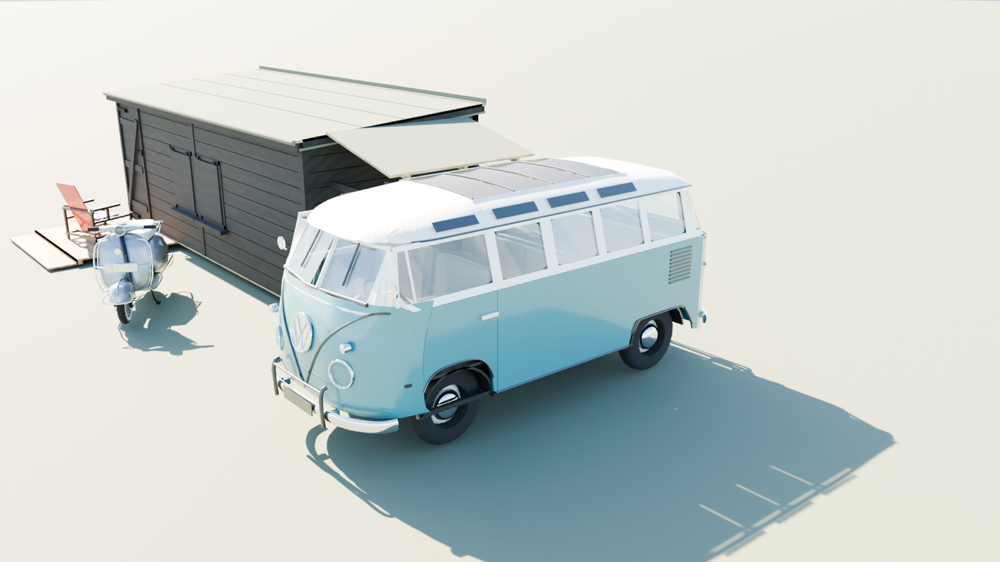
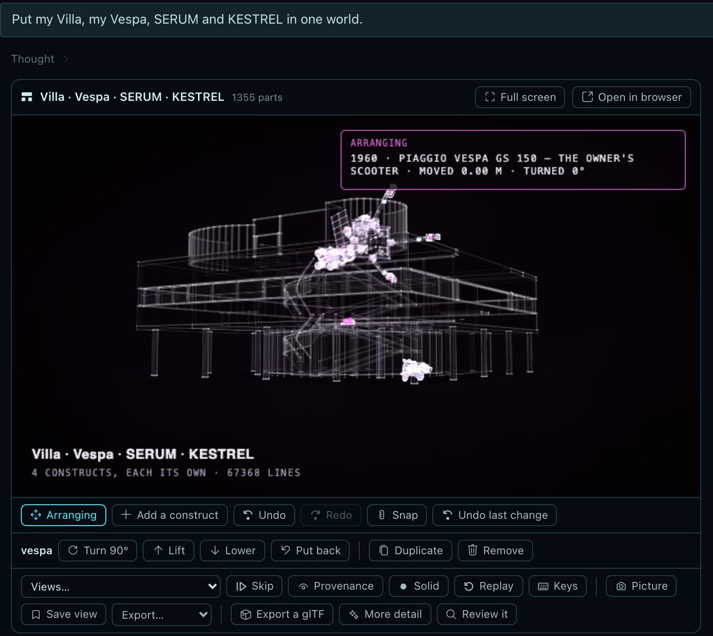
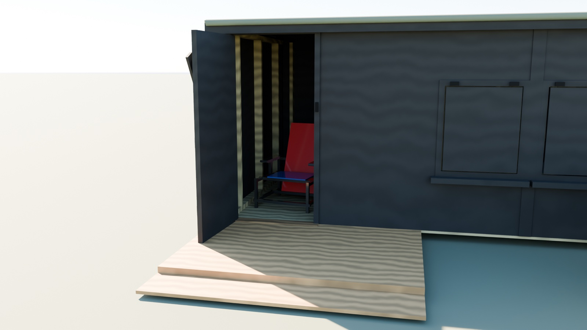
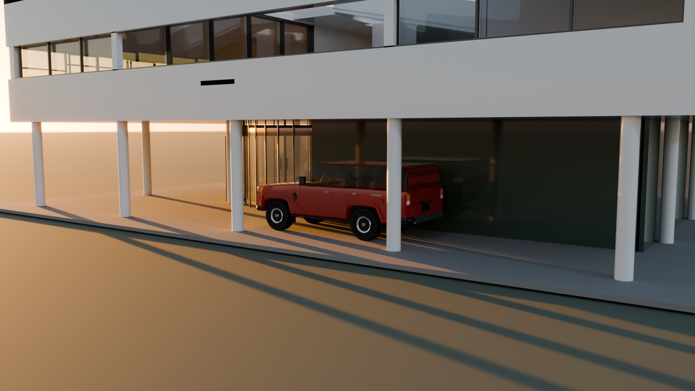
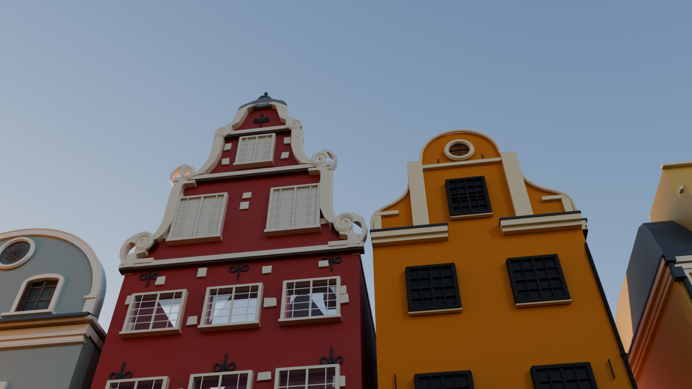
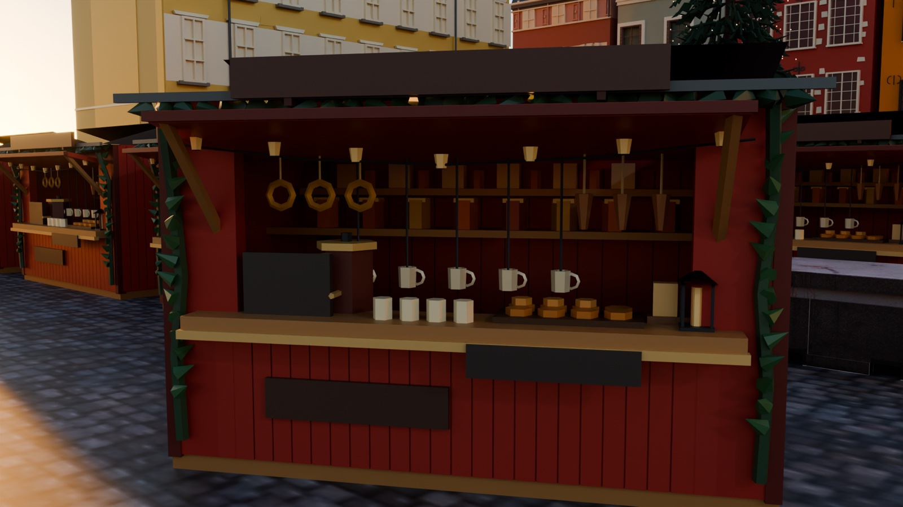
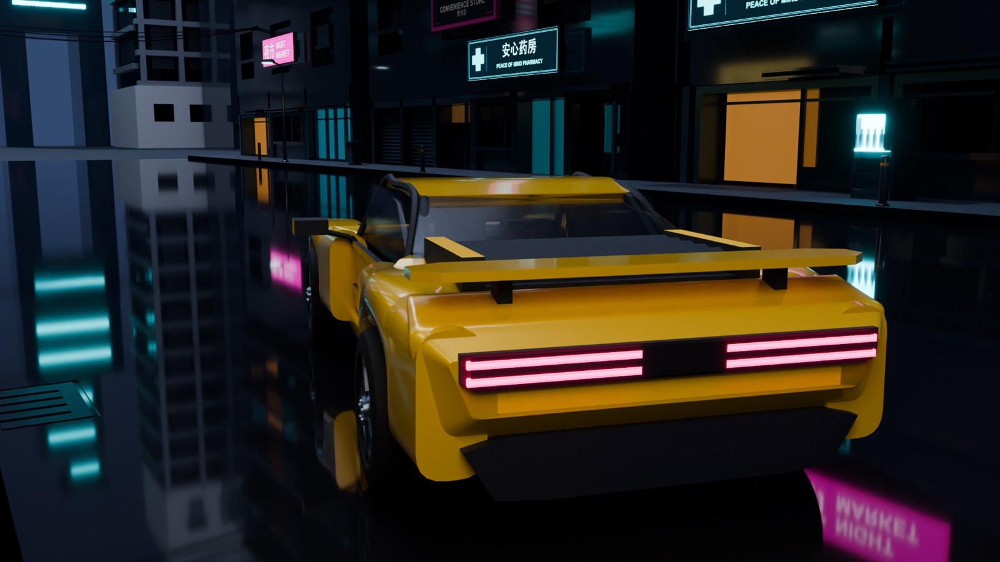
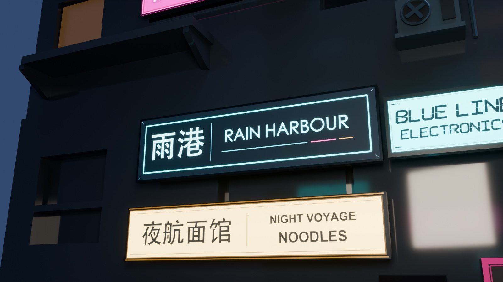
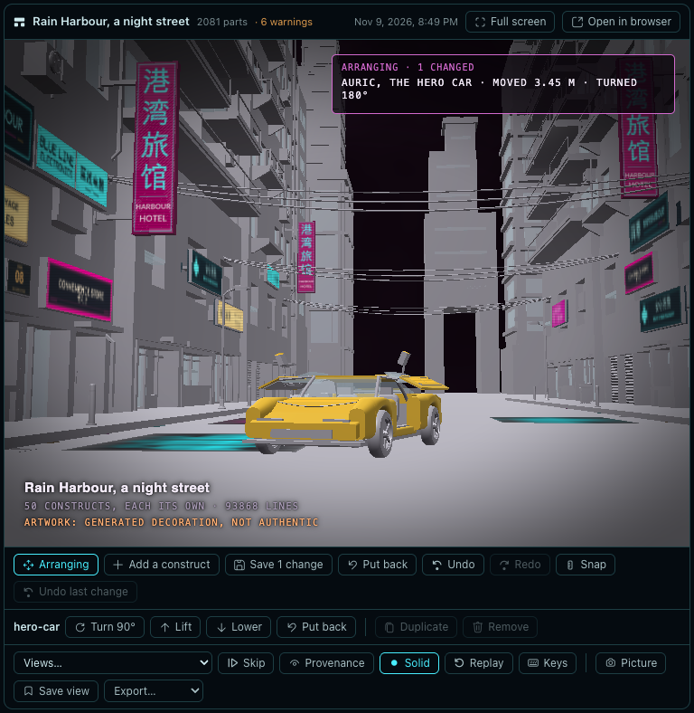
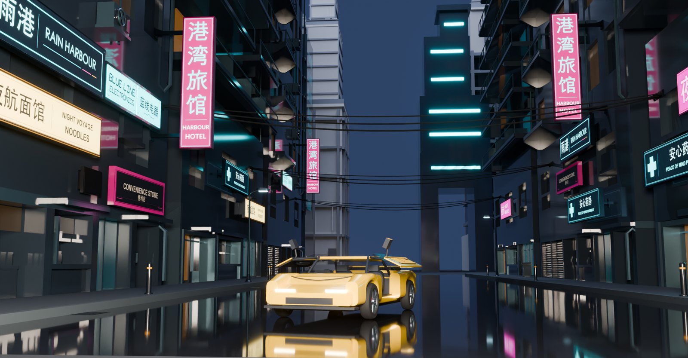

# What's new in 1.3, a walkthrough

1.3 is about **worlds**: whole constructs placed together in one place, each still itself. A world can be your
yard, your house with your furniture and your cars, a ship in the sky, a market square from a photograph, or a game
level from a concept picture. This page goes through the worlds that ship, one feature each, from the simplest to
the most ambitious, then the rest of what changed. The full list is in the [changelog](../CHANGELOG.md).

In the commands below, `construct` is short for `python3 construct_hologram/cli.py` in a checkout of Construct.

- [What a world is](#what-a-world-is)
- [1. The shed: move anything, on every axis](#1-the-shed-move-anything-on-every-axis)
- [2. The Villa: your own constructs, in one place](#2-the-villa-your-own-constructs-in-one-place)
- [3. KESTREL over the Villa: far off, at its real size](#3-kestrel-over-the-villa-far-off-at-its-real-size)
- [4. Stortorget: a world from one photograph, zero-shot](#4-stortorget-a-world-from-one-photograph-zero-shot)
- [5. Rain Harbour: a game level, zero-shot](#5-rain-harbour-a-game-level-zero-shot)
- [Out to other tools, finished](#out-to-other-tools-finished)
- [Masterpiece rounds, sturdier](#masterpiece-rounds-sturdier)
- [The plugin, from two long runs](#the-plugin-from-two-long-runs)
- [The constructs that ship](#the-constructs-that-ship)

## What a world is

A world places constructs at their real sizes and keeps each one whole: its parts, sources, provenance, critic's
verdicts and joints stay its own, under its placement's id (`vespa/legshield`). A world is not one big model. Every
construct in it can still be opened, moved, exported on its own, reused in another world, and animated by its own
joints. The world's audit says what overlaps, what runs into the house it stands in, what stands where a door
opens, and what stands on nothing.

A world is made by asking Hermes (in words, or from one picture), by hand on its card in Hermes Desktop, or by
writing its `world.json`. Each one below is in [`examples/worlds/`](../examples/worlds/), and each picture on this
page is that world imported into Blender with Construct's add-on and rendered as it ships.

```sh
construct build examples/worlds/the-shed/world.json --out out/the-shed   # its page, like a construct's
construct check examples/worlds/the-shed/world.json                       # the world's audit
```

## 1. The shed: move anything, on every axis

<p align="center"></p>

[The shed and the things around it](https://rtmandreyev.github.io/construct/worlds/the-shed/) is the smallest world: [a garden shed](https://rtmandreyev.github.io/construct/examples/garden-shed-planned/)
with its planned deck, [a VW T1 Samba](https://rtmandreyev.github.io/construct/examples/volkswagen-t1-samba/) by the log store, [a Vespa GS 150](https://rtmandreyev.github.io/construct/examples/vespa-gs150/) on its stand, [State Bench](https://rtmandreyev.github.io/construct/examples/state-bench/) inside on the floor,
and [Rietveld's Red-Blue Chair](https://rtmandreyev.github.io/construct/examples/rietveld-red-blue-chair/) inside by the door. Five constructs from the gallery, each unchanged, and each keeps its
joints: the shed's door opens on its hinge, and the chair is inside.

It is the place to learn **Arrange**. On a world's card in Hermes Desktop (or **A** on its page anywhere):

- **Across the ground:** click a construct and drag it. It rides on whatever is under the pointer, the yard, the
  deck, a table, a roof, and a wall stops it. What stands on it goes with it (move the shed and the bench inside
  comes too).
- **Up and down:** **Lift** and **Lower** (Page Up / Down) for what hangs or flies; Alt keeps its level while you
  drag. Saved, a construct lands on what is under it.
- **Round:** **Shift**-drag or **Q / E** to turn, **Turn 90°** on its bar, the arrows to nudge. **N** snaps to a
  quarter-metre grid and 15° turns; ⌘-click chooses several to move and turn together.
- **Add a construct** opens the library with previews; the one you pick lands on a floor it fits on, or on clear
  ground in front.

<p align="center"></p>

**Save** checks the world with the moves (the audit names anything that now overlaps), saves it and rebuilds it,
with no model turn; **Undo last change** steps back. **Save view** names the camera as a view of the world;
**Picture** saves a still at 2560 × 1440.

<p align="center"></p>
<p align="center"><sub>The shed's own door, opened by its joint, and the chair inside on the shed's floor
(<code>"on": "shed/floor-deck"</code>).</sub></p>

## 2. The Villa: your own constructs, in one place

[The Villa Savoye, lived in](https://rtmandreyev.github.io/construct/worlds/villa-savoye-lived-in/) is what worlds are for: the
constructs you have made, together where they belong. [Le Corbusier's house](https://rtmandreyev.github.io/construct/examples/villa-savoye/) holds [an Eames lounge chair](https://rtmandreyev.github.io/construct/examples/eames-lounge-chair/) facing the
terrace glass, [a Tompion clock](https://rtmandreyev.github.io/construct/examples/tompion-year-going-clock/) against the salon wall, [a Jackson](https://rtmandreyev.github.io/construct/examples/jackson-juggernaut-et7/) by the studio table, and two tables designed for
this world: one carries [a Braun SK 4](https://rtmandreyev.github.io/construct/examples/braun-sk4/), [a Revox A77](https://rtmandreyev.github.io/construct/examples/revox-a77/) and [a Leica M3](https://rtmandreyev.github.io/construct/examples/leica-m3/), the other [SERUM 2 / 61](https://rtmandreyev.github.io/construct/examples/serum-2-61/). [A Land Cruiser FJ62](https://rtmandreyev.github.io/construct/examples/toyota-land-cruiser-fj62/) and
[an Aston Martin DB5](https://rtmandreyev.github.io/construct/examples/aston-martin-db5/) stand under the pilotis, [KESTREL](https://rtmandreyev.github.io/construct/examples/kestrel-v2/) far off over the roof. Thirteen placements of twelve constructs,
each at its real size.

<p align="center">
  
  
</p>

Things stand **on** the part they rest on, not at a guessed height:

```json
{"id": "table", "construct": "constructs/tube-table/scene.json", "on": "villa/living-floor-east", "at": [-2.6, 0, 9.65]},
{"id": "revox", "construct": "revox-a77", "on": "table/top", "at": [-2.42, 0, 9.7], "yaw": 160},
{"id": "fj62",  "construct": "toyota-land-cruiser-fj62", "on": "villa/drive-through-ground", "at": [7.8, 0, -2.2]}
```

The world's audit checks each part of a placement against the house's, so the cars must clear the columns, and the
Revox's lid must have room to open. In Hermes, ask for it the way you would say it:

> Put my Eames chair in the Villa's salon facing the terrace, my Revox and Leica on a table by the west wall, and the
> FJ62 under the pilotis.

Hermes places them with `construct_world`, several at once, and shows the world live in the chat; open any of them
and its provenance, critic's verdicts and joints are still its own. [Worlds, step by step](for/worlds-walkthrough.md)
goes through this world in Hermes from the first request.

## 3. KESTREL over the Villa: far off, at its real size

<p align="center"></p>

A world can hold what is far away without shrinking it to fit. A **sky** placement gives a construct's real size and
how far off it is, and the world draws it at the angle it would fill in the sky. KESTREL, an ice tug 120 m long,
hangs over the Villa's roof garden at its real size from a kilometre and a half: small, high and believable, not a
toy on the roof.

```json
{"id": "kestrel", "construct": "kestrel-v2",
 "sky": {"diameter_m": 120.0, "distance_m": 1500.0, "azimuth": -150, "elevation": 18}}
```

The same rule scales a planet: `of` names the part the diameter belongs to (Saturn's globe, 120,536 km), so its rings
and moons come at the same scale; [KESTREL at Saturn](https://rtmandreyev.github.io/construct/worlds/kestrel-at-saturn/) puts the planet
behind the tug as it would look from about 350,000 km. Nothing a view fits ever changes a sky placement's size, and a
far placement no longer pulls every view out to empty ground. Anything not at real size (`scale` other than 1) is
disclosed by the audit and wherever the world is shown.

## 4. Stortorget: a world from one photograph, zero-shot

<p align="center">
  
  
</p>
<p align="center"><sub>Left, the photograph the world was asked from (Wikimedia Commons, CC BY-SA 4.0, credited on
<a href="../examples/worlds/stortorget/">its page</a>); right, the world in Blender from the same place.</sub></p>

Put the two side by side: the same gables in the same order and colours, No. 20's stepped red front beside No. 18's
orange curve, the spruce rising in front of them, the rows of red stalls, the granite block, the lamp. All of it
came from that one photograph and one request, zero-shot: no plan drawn by a person, no model picked from a library.
The one thing added after the run is the spruce's material map, which makes its needles green in exports. Attach a picture and ask for a world from it, for example:

> Make this square as a world: the houses, the market, the tree. Masterpiece.

Hermes plans the pieces (each distinct thing once, placed as often as needed), researches what it can name, builds
each new construct in its own subagent in masterpiece rounds with a fresh critic each round, places them at real
size, then runs the whole world through rounds of its own against the picture. A round that loses puts the world
and its constructs back.

[Stortorget](../examples/worlds/stortorget/) is Stockholm's old square at Christmas: eight real houses researched one
by one (the red No. 20, the orange No. 18, Börshuset), one market stall built once and placed 41 times, the
Christmas tree, the lamp. Each house says what is documented and what is inferred from the photograph.

<p align="center">
  
  
</p>

Its page has the request word for word, the plan, every construct's rounds, the world's rounds, and what the last
critic still found.

**One picture is a deliberate limit.** Both worlds here were each asked from a single picture, to show how far one
goes. Nothing stops you giving more: photographs from every side, a plan, elevations, old postcards, measurements.
Each construct then has more to be checked against, and what the provenance view (**P**) marks as inferred becomes
documented. With tens or hundreds of photographs of one place, a world becomes a digital twin of it: a heritage site
recorded house by house, a street for a film's previsualisation, a campus or a shop floor to plan a change in, a
level built on a real neighbourhood.

## 5. Rain Harbour: a game level, zero-shot

<p align="center"></p>

One concept picture and one request made [Rain Harbour](../examples/worlds/rain-harbour/), zero-shot like
Stortorget: a 60 m night street, its towers, eight neon signs in real English and Chinese, and
[AURIC](https://rtmandreyev.github.io/construct/worlds/rain-harbour/constructs/auric/), a hero car built to be driven,
its gull-wing doors on working hinges. 21
constructs placed 50 times, each built in its own rounds; then 12 world rounds against the picture. Final verdict:
good.

<p align="center">
  
  
  
</p>

What makes it a level and not a picture of one: every construct in it is still a construct. The car is one object
with its own doors on their hinges; a sign is one object with its artwork; the street, each tower and each prop can
be moved, reused in another level, or replaced, and the world exports as one file with each placement a named group:

```sh
construct export examples/worlds/rain-harbour/world.json --out level.glb                   # Blender, Unity, Unreal
construct export examples/worlds/rain-harbour/world.json --out level.glb --pieces glued    # a Godot map
```

In Godot the glued map's fixed body stays put while each door is a body of its own on its hinge. [For game
developers](for/game-developers.md) goes through it with numbers measured in Godot, and why a construct is not a
text-to-mesh model.

### Changed by hand, no AI

A level made from one prompt is still yours to change, with no model at all. Opened from the Worlds tab in Hermes,
**Arrange**: click AURIC, **Turn 90°** twice and the arrow keys to bring it out into the middle of the street; click
the cyan-banded signal tower at the end of the street and bring it 30 m closer with the arrow keys. **Save** checks
the level and rebuilds it (the same six cable notes as before, nothing new). Exported again and rendered from the
same camera, with the car's doors opened on their own hinges:

<p align="center"></p>

<p align="center">
  
  
</p>
<p align="center"><sub>Left, the level as Hermes made it; right, after a few clicks and key presses in Hermes: the car
turned and moved, the tower brought closer, AURIC's doors open. Same camera, same light; nothing else changed.</sub></p>

## Out to other tools, finished

A world exports as one file, each placement a named group, every joint in the `open` animation. FBX (Unity, Unreal,
Maya), USD and USDZ (Omniverse, Houdini, Apple's Reality tools) are made from the glTF by Blender when it is
installed. The Blender add-on imports a `world.json` too, finding the constructs it names beside it.

- **Every construct finishes with its own map, by default.** A construct now writes `scene.materials.json` beside
  its scene as its last step (paint, brushed metal, chrome, wood, rubber, plastic, glass, light), and every export,
  the Blender add-on and the plugin use it without being told. Tyres come out rubber and chrome comes out chrome
  even without a map; a map that misses surfaces lists them (`unmapped`) in the export's summary. Fifteen gallery
  constructs gained maps of their own.
- **Artwork comes along.** A sign's picture, a label, a screen exports as a textured quad under its part, in glTF and
  OBJ alike: Rain Harbour's glTF carries 26 images.

```sh
construct export examples/worlds/the-shed/world.json --out shed.glb      # finished from each construct's map
construct export examples/worlds/the-shed/world.json --out shed.fbx      # through Blender
```

## Masterpiece rounds, sturdier

Two long runs in Hermes (Rain Harbour and Stortorget, about a day each, every construct built by its own subagent)
found what the rounds recorder made harder than it should be. Each is fixed:

- **A tie is a result.** A critic who finds two versions equal says `same`; the round did not beat the best.
- **More time on request.** `rounds extend 90` reopens a run stopped by its time ceiling; the other stop rules stand.
- **Artwork travels with checkpoints.** A sign's picture is copied into the round's checkpoint and put back when a
  round loses, so a critic never judges a blank sign.
- **References carry over.** The picture and the request given at `rounds start` stay with every packet until
  changed; a reference naming a view the scene lacks is refused before the build, not after.
- **`rounds record --dry-run`** checks a critic's answer without recording it. Packets stay in the project
  (`packets/round-NN/`); a long request goes in a file (`--request-file`).
- **Colour is judged in the solid view.** The light view keeps Construct's house palette for every construct; a
  part's own colour shows in the solid view and in every export.

## The plugin, from two long runs

- **Shown live, not as a file.** A construct or world a subagent built is shown by building it in the chat first, so
  it opens live on its card. A world's page up to 192 MB travels gzipped; one larger says so.
- **A world's constructs stay current.** `construct_world` op `refresh` brings an improved construct back into the
  world; copies are named after their projects, so two constructs never share one.
- **Friendlier tools:** `construct_command` answers `--help`; a project may be named by its folder; edits accept
  `views[1]`, JSON pointers and dashed keys; errors name the limit they hit; a review whose capture fails says why
  and tries smaller; a material map names the key it does not know.
- **Downloads ask first.** A world that places a gallery construct by name fetches it from Construct's own GitHub
  release only after you approve it in Hermes's prompt; an unattended run is refused.
- **Big worlds keep their colours.** Thousands of styles (Stortorget has about 15,600) draw on every GPU, checks on
  a 7,700-part tree run in 14 s instead of 86, and the solid view cuts away only where a view looks into a room, so a
  street keeps its façades.

## The constructs that ship

The plugin ships 24 constructs (16 in 1.2.1). New: the Villa Savoye, SERUM 2 / 61, the Leica M3, the Jackson,
State Bench, Saturn, the Aston Martin DB5, the Sagrada Família, the James Webb Space Telescope and Rietveld's Red-Blue
Chair; the Eames is now the one built in the ChatGPT app. The Yamaha CFX and the first KESTREL left (KESTREL v2
stays). Wordmarks drawn on a maker's product (a guitar's headstock, a camera's top plate) are left off.

Six worlds ship to start from: the five above and [a street of landmarks](https://rtmandreyev.github.io/construct/worlds/a-street-of-landmarks/)
(the Duomo, the Sainte-Chapelle, the Sagrada Família and Neuschwanstein on one street at their real sizes). The plugin
ships all six, Rain Harbour and Stortorget with their constructs and their artwork.
[The format](WORLDS.md) · [Worlds, step by step](for/worlds-walkthrough.md)
