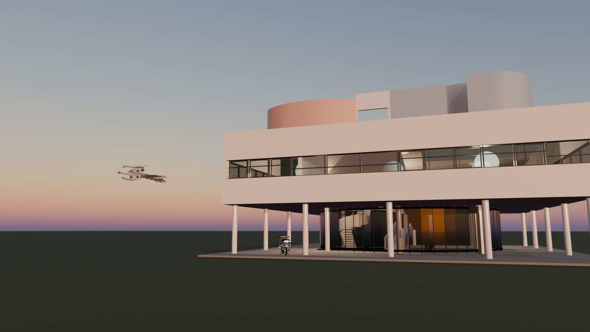
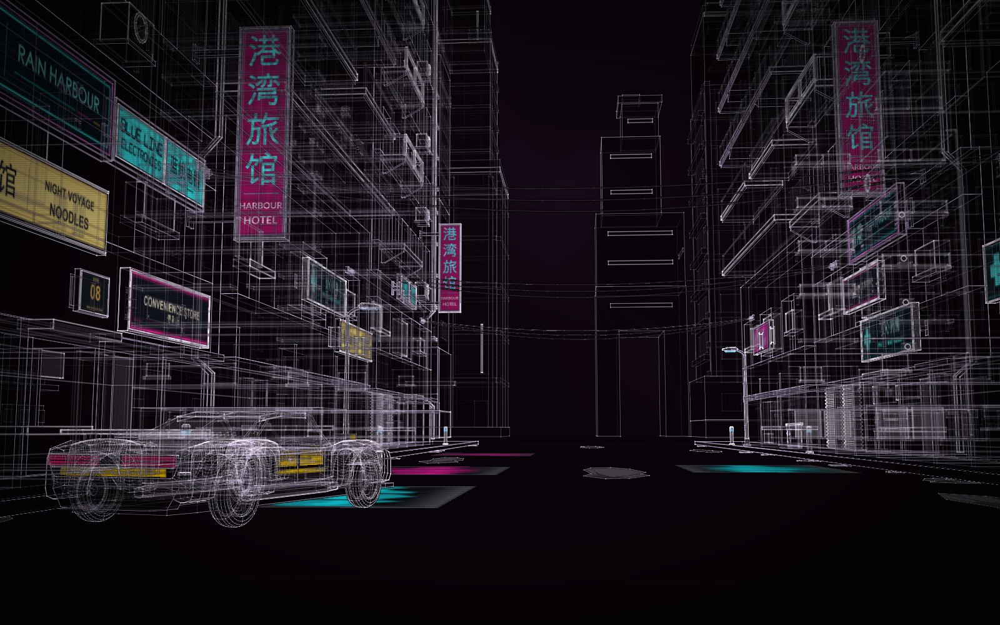
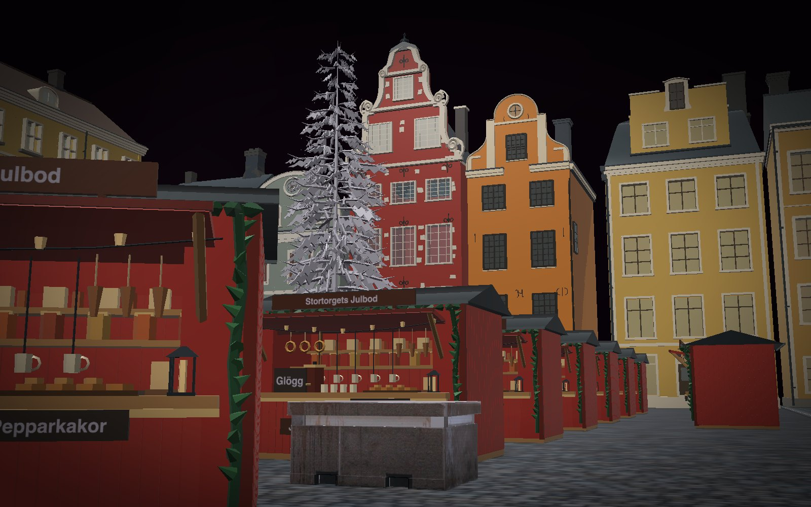

# What's new in 1.3, a walkthrough

1.3 is about **worlds**: whole constructs placed together in one place, each still itself. Your house with your
furniture and your cars, a ship over the roof; a street, a market square, a game level. A world is made by asking
Hermes, or by hand on its card, or from one picture in masterpiece rounds. This page goes through each change with
an example and the commands to try it. The full list is in the [changelog](../CHANGELOG.md).

In the commands below, `construct` is short for `python3 construct_hologram/cli.py` in a checkout of Construct.

- [Worlds](#worlds)
- [A world from a picture](#a-world-from-a-picture)
- [Arranged by hand](#arranged-by-hand)
- [Out to other tools](#out-to-other-tools)
- [Masterpiece rounds, sturdier](#masterpiece-rounds-sturdier)
- [The plugin, from two long runs](#the-plugin-from-two-long-runs)
- [The constructs that ship](#the-constructs-that-ship)

## Worlds

A world places constructs at their real sizes and keeps each one whole: its parts, sources, provenance, critic's
verdicts and joints stay its own, under its placement's id (`vespa/legshield`). Things stand on the part they rest on
(`on: villa/drive-through-ground`); a ship hangs in the sky at the size it looks from a kilometre off; Saturn fills the
sky behind KESTREL at its real size from 350,000 km. The world's audit says what overlaps, what runs into the house
it stands in, what stands where a door opens, and what stands on nothing.

<p align="center"></p>
<p align="center"><sub>The Villa Savoye, a Vespa GS 150 and KESTREL in one world, imported into Blender with
Construct's add-on and lit at dusk. Each is the construct from the gallery, unchanged.</sub></p>

Six ship to start from:

| World | What it holds |
| --- | --- |
| [Rain Harbour](../examples/worlds/rain-harbour/) | a game level from a concept picture: 21 constructs placed 50 times |
| [Stortorget](../examples/worlds/stortorget/) | Stockholm's old square at its Christmas market, from a photograph |
| [The Villa Savoye, lived in](../examples/worlds/villa-savoye-lived-in/world.json) | the house with its furniture, a guitar, a clock, a synthesizer, an FJ62 and a DB5 under the pilotis, KESTREL over the roof |
| [The shed and the things around it](../examples/worlds/the-shed/world.json) | the shed with its planned deck, the Samba, the Vespa, State Bench and the Red-Blue Chair |
| [A street of landmarks](../examples/worlds/a-street-of-landmarks/world.json) | the Duomo, the Sainte-Chapelle, the Sagrada Família and Neuschwanstein on one street |
| [KESTREL at Saturn](../examples/worlds/kestrel-at-saturn/world.json) | the ice tug at the rings, the planet at its real size behind it |

```sh
construct build examples/worlds/the-shed/world.json      # its page, like a construct's
construct check examples/worlds/the-shed/world.json      # the world's audit
```

[Worlds, step by step](for/worlds-walkthrough.md) · [the format](WORLDS.md)

## A world from a picture

Attach a picture and ask for a world from it. Hermes plans the pieces (each distinct thing once, placed as often as
needed), builds each new construct in its own subagent in masterpiece rounds with a fresh critic each round, places
them at real size, then runs the whole world through rounds of its own against the picture. A round that loses puts
the world and its constructs back.

<p align="center">
  <a href="../examples/worlds/rain-harbour/"></a>
  <a href="../examples/worlds/stortorget/"></a>
</p>

- **[Rain Harbour](../examples/worlds/rain-harbour/)**, from a concept picture: a 60 m street, its towers, eight
  neon signs in real English and Chinese, and AURIC, a drivable hero car whose doors swing. 21 constructs, each in
  its own rounds; then 12 world rounds against the picture. Final verdict: good.
- **[Stortorget](../examples/worlds/stortorget/)**, from a photograph: eight real houses (the red No. 20, the orange
  No. 18, Börshuset), one market stall placed 41 times, the tree, the lamp. What is documented and what is inferred,
  house by house.

Each page has the request word for word, the plan, every construct's rounds, the world's rounds and what the last
critic still found.

## Arranged by hand

On a world's card in Hermes Desktop, **Arrange**: click a construct and drag it onto anything (a floor, a table, a
roof), **Shift**-drag or **Q / E** to turn it, the arrows to nudge it, **Lift / Lower** for what hangs or flies.
What stands on it goes with it. **Add a construct** opens the library with previews and drops one where it fits.
**Save** checks the world with the moves, saves it and rebuilds it, with no model turn; **Undo last change** steps
back. **Save view** names the camera as a view of the world; **Picture** saves a still.

<p align="center"></p>

Outside Hermes, a world's page does the same with **A**; in Hermes, Save runs `/construct arrange` in the gateway.

## Out to other tools

A world exports as one file, each placement a named group, every joint in the `open` animation:

```sh
construct export examples/worlds/the-shed/world.json --out shed.glb                        # Blender, Unity, Unreal, three.js
construct export examples/worlds/rain-harbour/world.json --out level.glb --pieces glued   # a Godot map: doors swing
construct export examples/worlds/the-shed/world.json --out shed.fbx                        # through Blender
```

FBX (Unity, Unreal, Maya), USD and USDZ (Omniverse, Houdini, Apple's Reality tools) are made from the glTF by
Blender when it is installed. The Blender add-on imports a `world.json` too, finding the constructs it names beside
it.

## Masterpiece rounds, sturdier

Two long runs in Hermes (Rain Harbour and Stortorget, about a day each, 428 agent sessions between them) found what
the rounds recorder made harder than it should be. Each is fixed:

- **A tie is a result.** A critic who finds two versions equal says `same`; the round did not beat the best.
- **More time on request.** `rounds extend 90` reopens a run stopped by its time ceiling; the other stop rules stand.
- **Artwork travels with checkpoints.** A sign's picture is copied into the round's checkpoint and put back when a
  round loses, so a critic never judges a blank sign.
- **References carry over.** The picture and the request given at `rounds start` stay with every packet until
  changed; a reference naming a view the scene lacks is refused before the build, not after.
- **`rounds record --dry-run`** checks a critic's answer without recording it. Packets stay in the project
  (`packets/round-NN/`); a long request goes in a file (`--request-file`).
- **Colour is judged in the solid view.** The light view keeps Construct's house palette for every construct; a
  part's own colour shows in the solid view and in every export.

## The plugin, from two long runs

- **Shown live, not as a file.** A construct or world a subagent built is shown by building it in the chat first, so
  it opens live on its card.
- **A world's constructs stay current.** `construct_world` op `refresh` brings an improved construct back into the
  world; copies are named after their projects, so two constructs never share one.
- **Friendlier tools:** `construct_command` answers `--help`; a project may be named by its folder; edits accept
  `views[1]`, JSON pointers and dashed keys; errors name the limit they hit; a review whose capture fails says why
  and tries smaller.
- **Downloads ask first.** A world that places a gallery construct by name fetches it from Construct's own GitHub
  release only after you approve it in Hermes's prompt; an unattended run is refused.

## The constructs that ship

The plugin ships 24 constructs, the ones made to a masterpiece's standard: KESTREL v2, an Aston Martin DB5, the
James Webb Space Telescope, the Sagrada Família and Rietveld's Red-Blue Chair join the FJ62, the Samba, the Vespa,
the Villa Savoye, SERUM 2 / 61, the Tompion clock, the Revox, the Leica, the Jackson and the rest. Wordmarks drawn on
a maker's product (a guitar's headstock, a camera's top plate) are left off.
