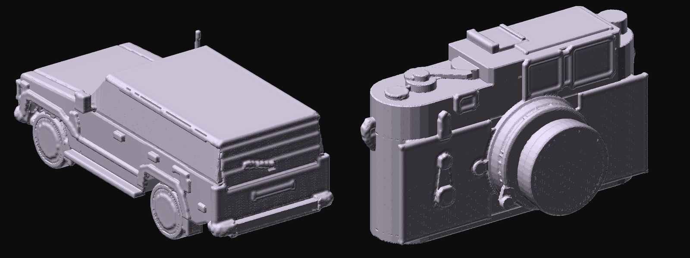
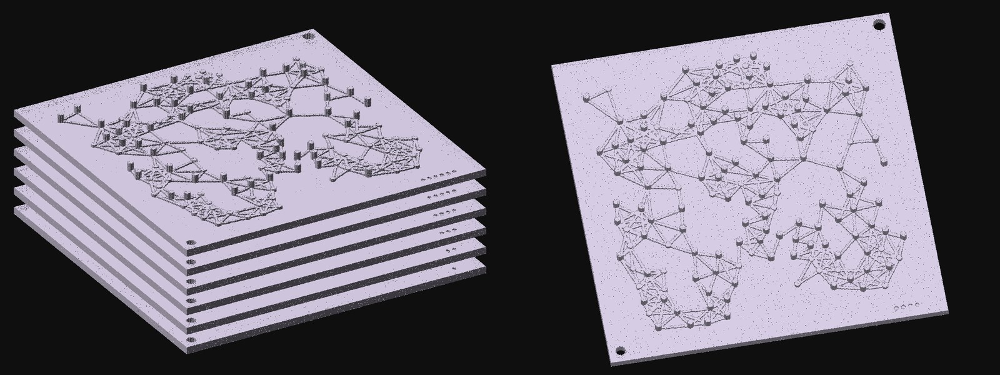

# 3D printing

<p align="center"></p>
<p align="center"><sub>The FJ62 (1:48) and the Leica M3 (1:1.5) from the gallery, as <code>construct print</code> writes them: one watertight piece each, 10 cm long, previewed from the STL. PrusaSlicer reads both as manifold, one part, and slices them.</sub></p>

A construct is drawn from many overlapping shapes, some of them open surfaces, which is right for a
hologram and for Blender but not for a printer: a slicer wants one closed surface. `construct print`
makes that surface and checks it.

```
your scene  ──►  construct print scene.json --out model.3mf  ──►  PrusaSlicer, Bambu Studio, Cura, OrcaSlicer
                 construct print scene.json --out model.stl  ──►  any slicer
```

You do not need a printer to check a print: open the file in a slicer and slice it. The slicer's
preview shows every layer, its supports, the time and the filament.

## Print a construct

```sh
construct print scene.json --out model.3mf
construct print scene.json --out fj62.stl --scale 43
```

| Option | What it does |
| --- | --- |
| `--out FILE.3mf` or `FILE.stl` | 3MF (millimetres, with the title and scale) or binary STL |
| `--size MM` | the longest side, in millimetres (default 100) |
| `--scale N` | instead, print at 1:N of the object's real size (1:43 and 1:24 are common model scales) |
| `--detail MM` | the voxel size (default 0.4, a common nozzle's width); smaller is finer and slower |
| `--wall MM` | open surfaces, and parts too thin to fill, are thickened to this wall (default 0.8) |
| `--join MM` | gaps between parts up to this wide are closed, so the print is one piece (default 1.6; 0 leaves them) |
| `--lines engrave` or `raised` | the parts drawn only in lines (seams, tracery, grilles): cut into the surface as grooves, one voxel deep and only where there is solid behind them, like a model kit's engraved panel lines; or raised (`--lines` alone). By default they are left out |
| `--bed WxDxH` | the printer's build volume in millimetres (default 250x210x220) |
| `--printer CLASS` | a printer class: its bed, finest voxel and thinnest wall (see [Printers](#printers-the-largest-print-and-every-detail)) |
| `--fit` | instead of a size or scale, the largest print that stands on the bed (turned a quarter if it fits only that way) |
| `--printers` | for each printer class, the largest print and how much survives; writes nothing |
| `--exact` | 3MF: the construct's own solids as they are, joined by the slicer (see below) |

It prints the size, the scale and what to know:

```
wrote fj62.3mf: 44.9 x 101.3 x 40.5 mm at 1:48, 280208 triangles
  overhangs need supports (4356 mm2 face down steeper than 45 degrees)
  thickened to the 0.8 mm wall: antenna, axle-front, axle-rear, badge-4wd-carrier, ...
  drawn only in lines, not printed (--lines prints them raised): a-pillar, belt-line, ...
  watertight
```

The exit status is 0 for a watertight print. Agents use the same print through the skill, and MCP
clients through the `construct_print` tool (the file comes back as base64, with the report).

## How the print is made

The print is made in voxels at its own scale, so what is too small to print is decided in
millimetres, not in the construct's metres.

1. Each part's closed surfaces are filled: a voxel is solid when its centre is inside (by the parity
   of rays, so the surfaces' winding does not matter).
2. Open surfaces (a panel, a shell, a fin), and closed parts too thin to fill, are thickened to the
   wall.
3. Everything is joined into one solid, and gaps between parts up to `--join` wide are closed. The
   construct's annotations (its floating parts) are left out, and so are parts drawn only in lines,
   unless `--lines`.
4. Sealed cavities are filled; the slicer makes its own infill.
5. The boundary of the solid becomes the surface, each edge shared by exactly two triangles (where
   two voxels meet only along an edge, one more is filled). It is smoothed, never by more than half
   a voxel, and each vertex within a voxel of the construct's own surface is moved onto it, so
   flat and sloping faces come out flat.
6. It stands on the bed: the lowest layer at z = 0, Z up.

## The checks

| Check | What it means |
| --- | --- |
| watertight | every edge shared by exactly two triangles, wound outward: a slicer reads it as a solid |
| pieces | separate solids after joining; a piece that would start in the air needs supports or a wider `--join` |
| fits the bed | the size against `--bed` |
| overhangs | faces pointing down more steeply than 45° from the vertical: the slicer will need supports |
| thickened | the parts made thicker than the construct draws them |
| left out | parts drawn only in lines, and annotations |

The tests check the first three against PrusaSlicer itself when it is installed
(`CONSTRUCT_PRUSASLICER=/path/to/PrusaSlicer`): `--info` reads each print as manifold and one part,
and a print slices with supports.

## A run you can hold

A construct of a NetLogo run has time as its height. Printed, the same idea becomes a stack of
plates, one per moment, that you assemble in order: building the stack replays the run, and taking
it apart steps back through time.

<p align="center"></p>
<p align="center"><sub>Virus on a Network, six moments from tick 0 to tick 300, previewed from the files. On the plate at the peak (tick 68), 118 of 150 people are infected: the tall dots.</sub></p>

```sh
construct netlogo-plates run.jsonl --out plates/ --at 0,20,40,68,120,300
construct netlogo-plates fireflies.jsonl --out plates/ --plates 4 --state hidden? --tall false
```

Each plate is the world at one tick, from above: every turtle a dot where it stood, tall where its
true/false state is on (`--state` names the variable, `--tall false` stands the false ones up),
every link a low ridge. Two pin holes of different sizes, 3 mm and 4 mm, key the plates so they fit
one way round, and each plate's number is engraved as dots in its corner. The folder also holds the
two pins, eight spacer sleeves and `KEY.md`, the key card: each plate's tick and counts, how to
stack them, the model and the recording's SHA-256, so a classroom set says exactly what it shows.

| Option | What it does |
| --- | --- |
| `--plates N` | N plates, evenly over the run (default 6) |
| `--at T,T,…` | the ticks to print instead (the landmarks of the run's construct are good choices) |
| `--size MM` | the world's longer side (default 100; the plate adds an 8 mm rim) |
| `--state VAR`, `--tall true\|false` | the variable shown by height, and which value stands tall |
| `--format 3mf\|stl` | the files' format |

The plates are made in voxels like a print, so each file is one watertight solid; the tests check
PrusaSlicer reads a plate and a pin as manifold, one part. Plates are evenly spaced on the pins;
spacing them by time is a later step.

## A kit, Revell-style

`construct kit` makes a construct into a model kit to print, glue and paint, as a Revell or Tamiya kit is:

```sh
construct kit examples/toyota-land-cruiser-fj62/scene.json --out fj62-kit/ --materials examples/light-to-metal/maps/fj62.json
```

- **Pieces.** Each part becomes pieces of its own at the kit's scale (1:24 by default, `--scale`). Where two
  parts overlap, the later one is trimmed, so they meet flush and fit when glued; mirrored copies (four
  wheels, two mirrors) are separate pieces; a bit too small to print is merged into the piece it touches.
  The parts drawn only in lines (seams, grilles) are engraved into the pieces they lie on, as a kit's
  panel lines. Glass is a clear piece.
- **Plates.** Each piece lies on its largest flat face, packed onto plates the size of the bed
  (`plate-N.3mf`, each piece a named object), numbered in the order they are glued. Clear pieces have plates
  of their own, to print in clear filament or resin; the plate maps show each piece in its paint.
- **What goes onto what.** Each piece is glued onto the piece it is most firmly joined to among those more
  foundational than it (the plan's earlier sub-assembly, an earlier stage, or the piece more holds onto), with
  more weight where it rests on the piece below and less into glass. A part that stays put is never glued to
  one that opens (a pillar is not glued to a door), and what opens takes its own glass and handles.
- **Buildings go up from the ground:** in a building, what starts lower holds what starts higher, so the
  plinth is the base and the spire goes on last.
- **The order a builder works in.** A piece's own attachments go on at the bench before it is fitted: the
  glass into its shell before the shell meets the chassis, a tyre onto its rim before the wheel goes on. A
  shell goes on after the interior it closes over, and what opens (doors, bonnet, tailgate) is hung last.
- **The booklet** (`booklet.html`, on paper, to print): the finished model, the plates, the steps (at the bench
  or on the model, each new piece in a colour of its own with a numbered callout and a chip of its paint, the
  piece it goes onto drawn darker, a sub-assembly drawn on its own while it is built) and a painting guide.
- **In 3D** (`assembly.html`): the same steps on the construct's solid view in the kit's paints: each step's
  pieces drop into place in gluing order while the rest steps back, numbered, with a panel saying what goes
  onto what; drag to turn it, the arrow keys or play to step through, `#step-N` to open at a step.
- **Checked before printing:** pieces too small to handle, slivers (thinner than 1.5 mm and short) and fragile
  blades (as thin and long), pieces that touch nothing, merges that came out in several pieces, pieces
  bigger than the bed, too many pieces. `kit.json` is the kit without its geometry, for a critic to read.

**A critic, as for a construct.** `construct kit --critic` prints a kit designer's brief: a critic (a fresh
agent or model) reads `kit.json` and the booklet's pictures and answers with a plan, parts to merge into one
piece, small parts to keep, clear parts, parts that are not clear though their names say glass (`opaque`: a
chrome mirror glass), which `--plan kit-plan.json` applies to the next build. A merged piece is built at its
largest part's stage. What holds the glass (a windscreen frame, a window seal) is never taken for glass.

## Printers: the largest print and every detail

A construct has real sizes, so it knows how large it can print on a given printer and what is lost at
that size. `--printers` asks, for five printer classes, without printing:

```
construct print r34.json --printers
  small    1:27    81.6 x 172.8 x 51.1 mm, voxel 0.4 mm; real features under ~10.6 mm lost; parts 209 / 26 / 0
  desktop  1:19    113.3 x 240 x 71 mm, voxel 0.4 mm; real features under ~7.7 mm lost; parts 230 / 5 / 0
  cube     1:19    116 x 245.8 x 72.7 mm, voxel 0.4 mm; real features under ~7.5 mm lost; parts 230 / 5 / 0
  large    1:14    158.7 x 336 x 99.3 mm, voxel 0.4 mm; real features under ~5.5 mm lost; parts 233 / 2 / 0
  resin    1:22    98.8 x 209.3 x 61.9 mm, voxel 0.233 mm (the grid's limit); real features under ~5.1 mm lost; ...
```

| Class | Like | Bed (mm) | Voxel | Wall |
| --- | --- | --- | --- | --- |
| `small` | Bambu Lab A1 mini | 180 x 180 x 180 | 0.4 | 0.8 |
| `desktop` | Prusa MK4 | 250 x 210 x 220 | 0.4 | 0.8 |
| `cube` | Bambu Lab X1, P1, A1 | 256 x 256 x 256 | 0.4 | 0.8 |
| `large` | Prusa XL, Creality K2 Plus | 350 x 350 x 350 | 0.4 | 0.8 |
| `resin` | a 10-inch resin printer | 218 x 122 x 220 | 0.05 | 0.4 |

These are classes, not models: give your own printer's numbers with `--bed`, `--detail` and `--wall`.
The parts column (kept / thickened / lost) is an estimate from each part's size: thickened is a part
thinner than the wall (a panel, a rod), lost one under two voxels long.

`construct print scene.json --out car.3mf --printer large --fit` prints at that largest size. The voxel
print has a limit of its own, 900 voxels along the longest side (a 36 cm print at 0.4 mm, about three
minutes and 3 GB of memory to make), so on a resin printer the voxel is wider than the printer could
print. That is what `--exact` is for.

### Exact: the construct's own solids

```sh
construct print scene.json --out car.3mf --printer resin --fit --exact
```

An exact print writes the construct's closed solids as they are, each wound outward, as the parts of
one object; the slicer fills their union, at the printer's own resolution. Open surfaces (a window, a
body panel, a curved nose) become true shells the wall thick, half to each side and closed along their
open edges, and parts too thin to fill (a sign, a mirror glass, a spring) grow just enough to reach the
wall, both in their own shape. Each corner moves along the least-squares offset of the faces around it, so
a box's corner stays square. Only a surface that branches (an edge shared by three faces) or folds back on
itself still goes through the voxels; the notes name those. It is 3MF
only: PrusaSlicer, and slicers that read its part table, list every solid by its part's name. The
pieces are judged by their boxes (parts whose boxes meet within the join print as one), and the slicer
decides the supports. What it keeps is the construct's own faceting (a cylinder of 24 sides prints with
24), with nothing rounded off by voxels.

## How much detail survives

A print keeps the construct's form, not its light. The hologram draws every edge, inside and out; a print
shows one outer surface, so what a construct says in lines (tracery, panel seams, engraving) only shows
when it is cut in or raised (`--lines`). Below that, the limit is the printer: at the default 0.4 mm voxel
(a common nozzle) a 15 cm Sainte-Chapelle is 1:492, and anything under about 20 cm in the real building
is lost. A larger print, or a resin printer with `--detail 0.1`, keeps far more. Lines that float just off
a surface (a window drawn in front of its wall) are not engraved, since there is nothing behind them to
cut into.

## What it is not

A print is the construct's form at a scale, solid, in one material. It does not hollow, split a
large object into pieces (a kit does), add pegs, or orient the model for the fewest supports (it only
turns it on the bed to fit); a slicer does the last well. Fine detail smaller than the voxel is lost or thickened, and the report says which
parts were thickened. Colour and multi-material printing are not made.
