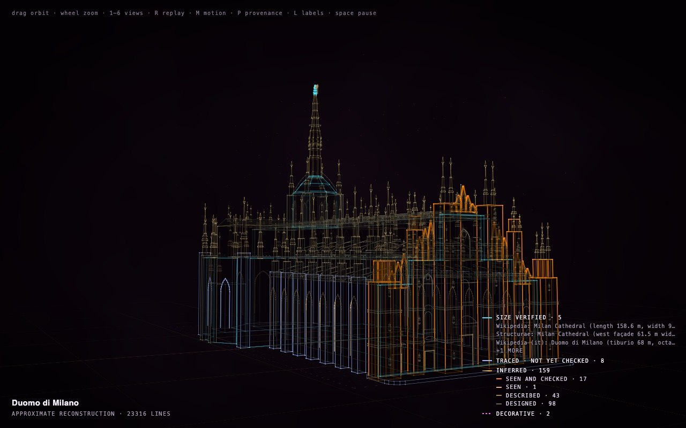

# How each part is known: the provenance view, in plain words

Every construct says, part by part, where it came from. Press **P** on any construct to see it: each part takes
a colour for how it is known, and a legend in the corner counts the parts of each kind and names the sources
behind them. This page explains every word you will see there.

The Duomo di Milano with <b>P</b> on: verified sizes in cyan, traced parts in blue, everything
else a shade of amber.

## The five marks

Every part, and every fact a construct states, carries one of five marks.

| Mark | What it means | An example |
| --- | --- | --- |
| **verified** | Taken from a source the construct cites by name: a maker's specification, a published measurement, a dataset. The source is listed; you can check it. | Saturn's rings, from published measurements of their radii. |
| **user-supplied** | Something you told the agent yourself. It is yours to vouch for, so it is marked as yours. | The title on the spine of your own book. |
| **traced** | Fitted to a drawing seen square-on (a blueprint, a plan, a patent elevation), drawn to a scale that a verified size sets. Closer than a guess, but a tracing, not a measurement. | The Ferrari F40's body outline, traced on its patent drawings. |
| **inferred** | Worked out by the agent: designed from what it knows, or read off a photograph taken at an angle. Most parts of most constructs are inferred, and the construct says so. | A house's height estimated from a photograph. |
| **decorative** | Added for presentation, not a claim about the real thing. Drawn dotted. | An ornament added only for the look of the page. |

**Verified never means that Construct measured anything.** It means the number comes from a source the scene
names. Construct never fetches a source; the agent reads it, and the scene records which one.

## Size and shape, answered apart

A part can be known one way for its size and another for its shape. A car body whose length a specification
gives, and whose outline was traced on a blueprint, is *size verified, shape traced*. The colours show the
difference:

| Colour | Part |
| --- | --- |
| white | verified, size and shape |
| cyan | size verified; the shape traced or inferred |
| violet | shape verified, from a drawing, a measurement or a dataset |
| blue | traced; a stronger blue once a silhouette comparison with its drawing has passed |
| amber, pale to deep | inferred, in four shades (below) |
| green | user-supplied |
| magenta, dotted | decorative |

A shape is only *verified* when a drawing, a measurement or a dataset gives its coordinates. A count or a
description never verifies a size: "four storeys" does not say how tall a storey is.

## The four shades of a guess

Inferred parts are not all equally uncertain. The amber deepens with how firmly a guess is held to the real
thing:

| Shade | What holds it |
| --- | --- |
| **designed** (palest) | Nothing. The agent designed it and cites no source: a hidden back wall, a part no picture shows. |
| **described** | Words: a document, the request, or a stated fact it rests on, but no picture of it. |
| **seen** | A picture of the thing: a photograph, a drawing, an observation. The part cites the picture it was read from. |
| **seen and checked** (deepest) | A picture, and also a verified or user-supplied fact it rests on, or a silhouette comparison with its reference that passed. Window bays read from a photograph and counted in the city museum's description. |

A shade measures **evidence, not error**. Nothing measures most guesses against the real thing; a deep amber
part is better supported, not proven right. A part modelled from a photograph that forgets to cite it shows
as designed, so the honest move for an agent is always to cite what it looked at.

**Designed to a requirement.** Some designed parts answer to something even with nothing real to copy: what
you asked for ("two seats") or what a document says the thing must do ("a 64-slot modulation matrix"). The
legend counts these apart, as *designed · to a requirement*, and names the requirement's source. They stay
the palest shade: a requirement says what a part must do, not what it looks like.

## Facts, not only parts

A construct also lists facts (a height, a date, a count, a material), each with the same marks. A fact is
*verified* only when it names its source. Some sources state things that are true but are not measurements:
"four storeys and two attic levels", "three window bays". A construct may mark such a fact verified and say in
its note that it is a documented statement, not a measurement; [Stortorget](../examples/worlds/stortorget/#provenance-revisited)
does this for 36 of its facts. A fact nobody knows is not written at all: Construct refuses an empty value, and the agent is told never to
write a placeholder or a plausible guess in its place.

## The caption under every construct

The line under a construct's name says what kind of reconstruction it is, for the whole thing:

| Caption | What it means |
| --- | --- |
| **GENERIC RECONSTRUCTION** | a typical example of the kind, not a particular one |
| **APPROXIMATE RECONSTRUCTION** | this particular thing, but imprecise |
| **DOCUMENTED RECONSTRUCTION** | this particular thing, with its key parts backed by evidence (Construct's check enforces it) |
| **ORIGINAL DESIGN** | a new design: there is nothing real to reconstruct, though it may borrow reasoning from real things |
| **RECORDED RUN** | a run of a NetLogo model, drawn from its recording |

## Where to see it

- Press **P** on any construct in [the gallery](https://rtmandreyev.github.io/construct/), or on its card in
  Hermes (**Provenance**). Saturn is a good first one: its rings show as verified, its cloud bands as designed.
- A world keeps every construct's own marks: in [Stortorget](https://rtmandreyev.github.io/construct/worlds/stortorget/)
  each house says what its own sources establish.
- For the full rules an agent follows, see [The Measured Light style](STYLE.md#how-each-part-is-known) and the
  [scene contract](../CONTRACT.md).
