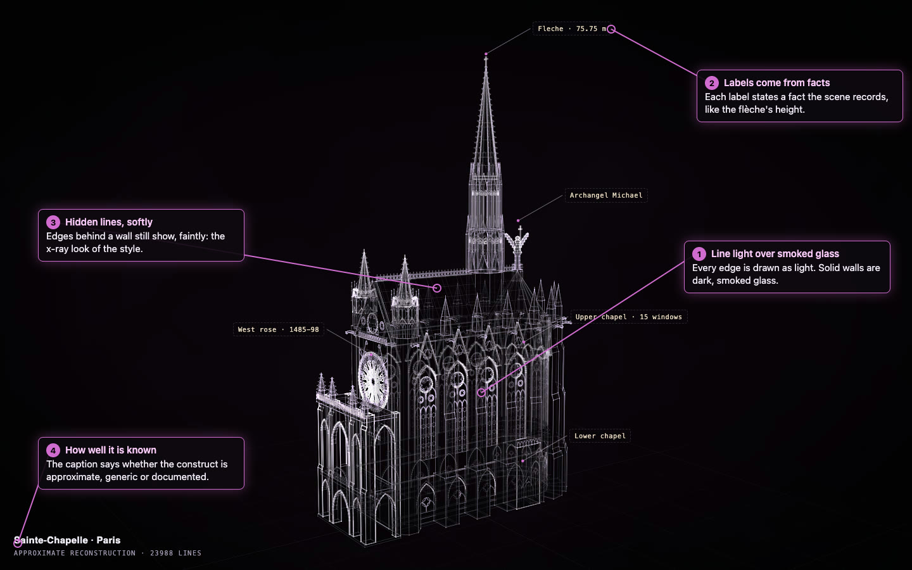
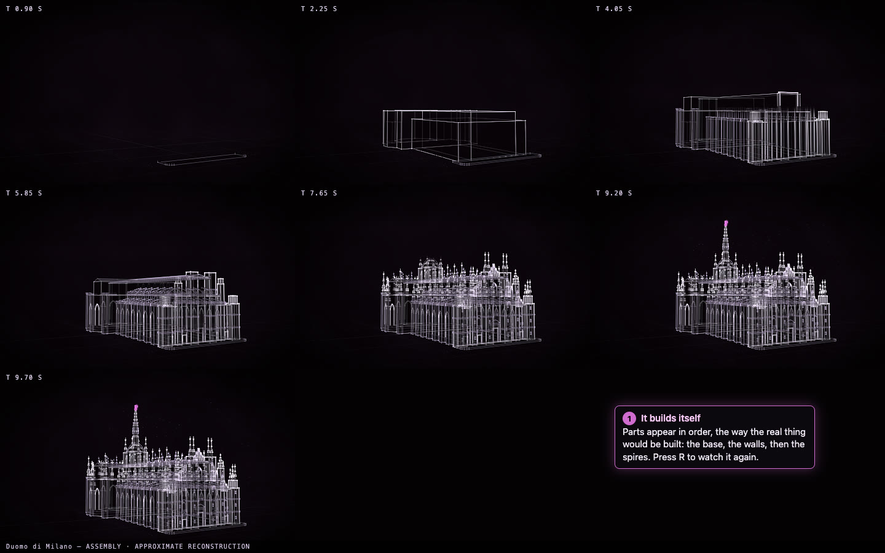
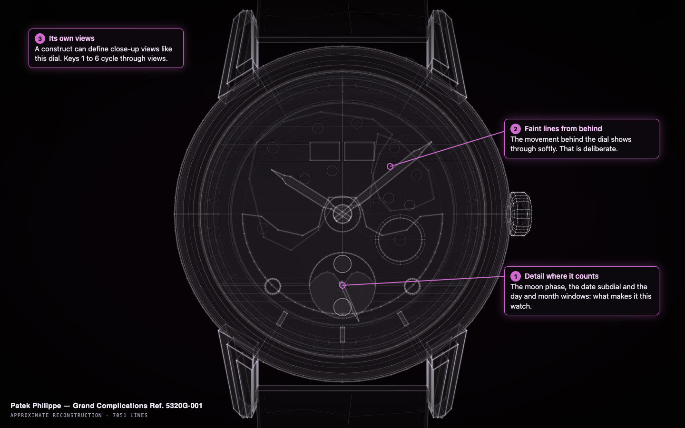

# The Measured Light style

Every construct is drawn in one style, called **Measured Light**: edges drawn as light over
smoked glass, built part by part in front of you, with every fact and part marked by how well
it is known. This page explains what you are looking at when you open a construct, and why it
looks the way it does.

The style grew out of the author's earlier Measured Light holograms. Construct is an
independent re-creation of that look; it contains none of that work's code.

## The look

A construct is made of lines of light. **Every edge is drawn as a glowing line**, and solid
parts are filled with dark, smoked glass, so you see both the outline of a thing and its
volume (1).

**Hidden lines still show, softly.** An edge behind a wall stays faintly visible, the way it
would on a technical drawing held up to the light (3). That is what lets you read the far side
of a building or the movement behind a watch dial without turning it around. It is part of the
style, not a rendering mistake.

**The caption tells you how well it is known** (4). It reads *documented* when the important
parts rest on sources, *approximate* when the construct follows the real thing closely but not
from measured plans, and *generic* when it is a typical example rather than a specific one.
It also counts the lines.

## One house palette

The colours come from one house palette, and **the model never chooses them**. That sounds
like a limitation, and it is a deliberate one. When a model picks its own colours, every
construct looks different and a small model's work looks worse next to a large model's. With one
palette, a construct written by a small model sits next to one written by a frontier model and
they look like they belong together. The model spends its effort on what the thing is, which
is the part only it can do.

You can still choose another palette yourself when you build a construct; the model can't.

## How a construct assembles

When a construct opens, **it builds itself**, the way the real thing would be built. The
parts rise in order from the ground up, each one with a bright tip as it grows: foundations,
then walls, then roofs and spires. When everything has settled, anything that opens does so (a lid lifts, a lens extends,
a disc turns), and then the construct rests with a calm, slow life of its own. Press **R** to
watch the assembly again.

## Labels

**Labels come from facts.** Each label states something the scene records, like the height of
the Sainte-Chapelle's flèche or the date of its west rose, and points to the part it belongs
to. A construct never labels what it doesn't know: if the scene has no author for a book,
there is no author line. Press **L** to show or hide the labels.

## How each part is known

Every fact and every part in a construct is marked with how it is known:

| Mark | Meaning |
| --- | --- |
| **verified** | taken from a source the scene cites, such as a maker's specification or a published dataset |
| **user-supplied** | something you told the agent, such as the title of your own book |
| **inferred** | designed by the model from what it knew or measured from a photo; most parts of most constructs |
| **decorative** | added for presentation and not a claim about the real thing |

In the normal view the marks are subtle: verified and user-supplied parts are drawn at full
brightness, inferred parts a little softer, and decorative parts dotted. Press **P** for the provenance view, which colours every part by its mark and shows a
legend. Saturn is a good one to try: its rings come from published measurements and show as
verified, while its cloud bands are the model's own design.

## Detail where it counts

The style asks for one clear object at a glance and something true to find up close. The most
detail goes where a thing's identity lives: a watch's moon phase and date windows, a camera's
rangefinder, a cathedral's windows and spires. Many constructs also define their own close-up
views, like this dial. Press **1** to **6** to move between views.

## The controls

| Do this | And you get |
| --- | --- |
| Drag | Orbit around the construct |
| Scroll | Zoom in and out |
| **R** | Replay the assembly |
| **L** | Show or hide the labels |
| **P** | The provenance view |
| **M** | Turn the motion down or back up |
| **1** to **6** | Move between views |
| **Space** | Pause and resume |

If you leave a construct alone for a while after moving it, it returns to its own camera.

## What the style deliberately doesn't do

- **Glass is never tinted.** Windows and lenses are drawn in the same smoked glass as everything
  else, so stained glass and coloured lenses don't show their colour.
- **Stills show the closed pose.** A picture taken of a construct shows it before anything
  opens; open it in a browser to see the lid lift or the lens extend.
- **It is not photorealistic.** There are no textures, materials or lighting effects, and no
  imported 3-D models. A construct is a drawing of what the thing is, honest about what is known.
- **Hidden lines are never fully hidden.** As above, that is the x-ray look of the style.

To see all of this on real constructs, open the
[examples gallery](https://rtmandreyev.github.io/construct/).
