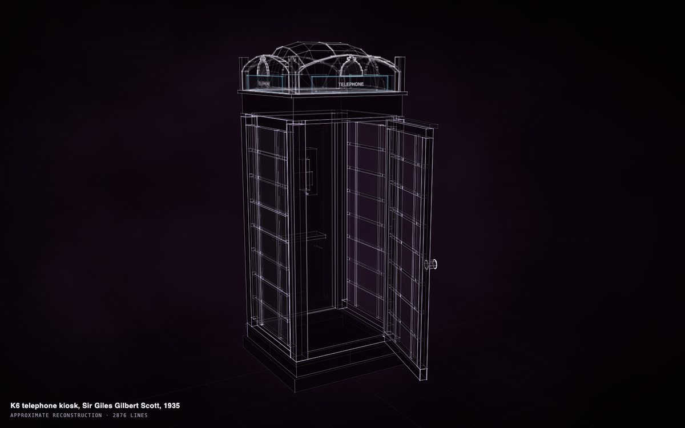
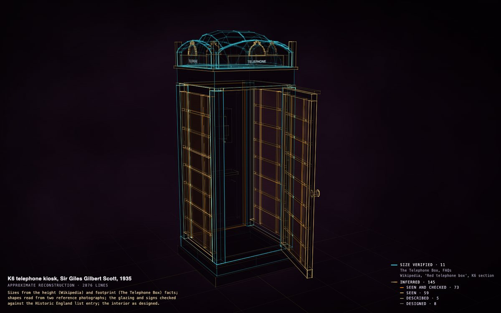
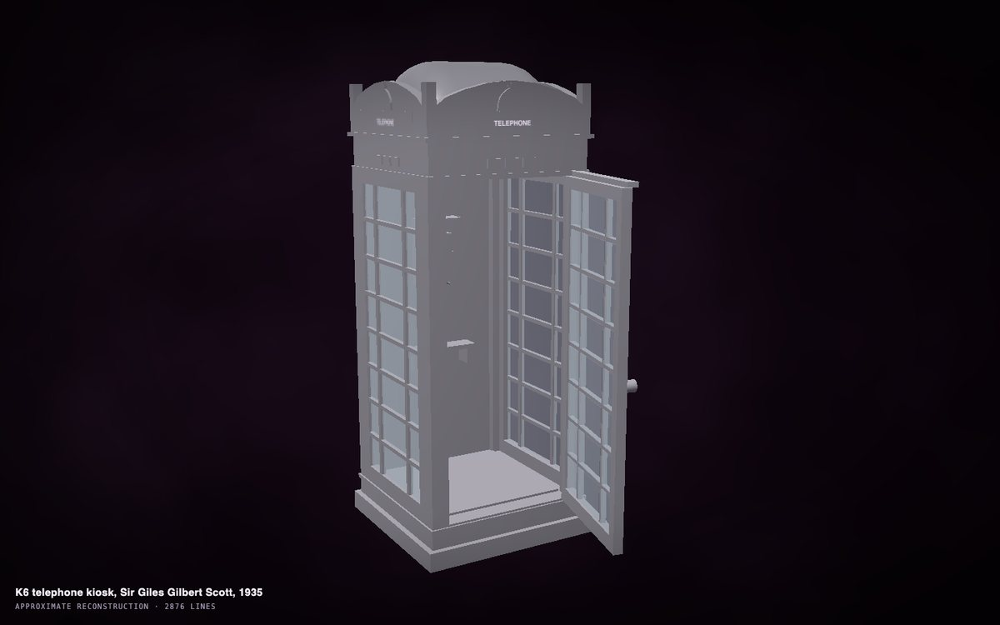
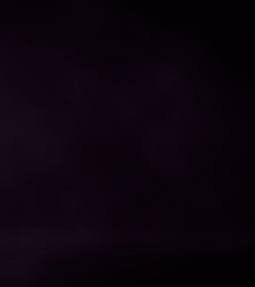
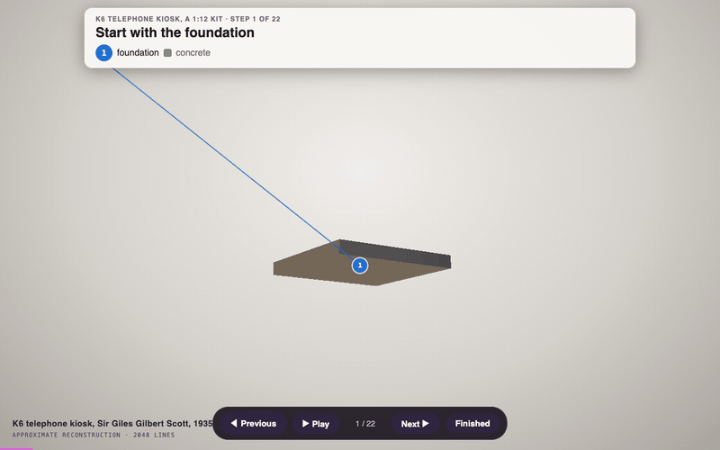
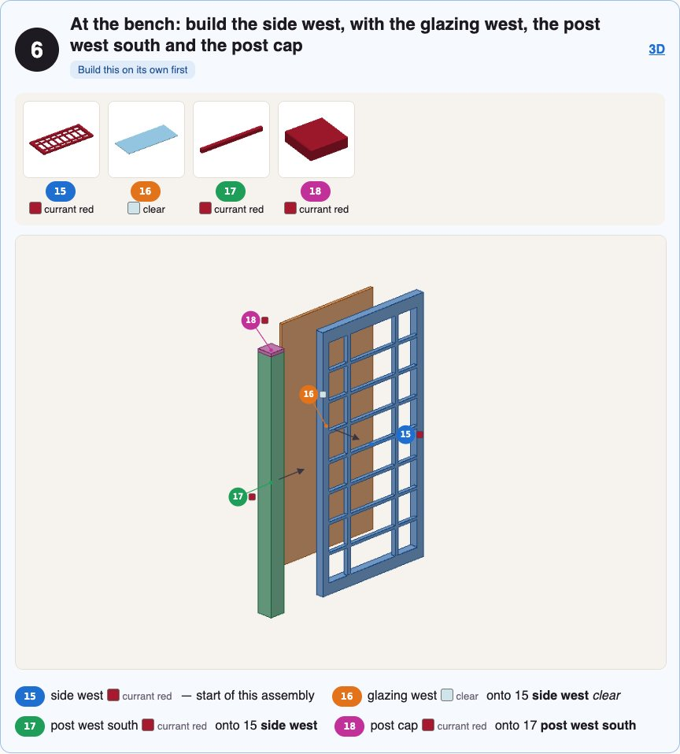
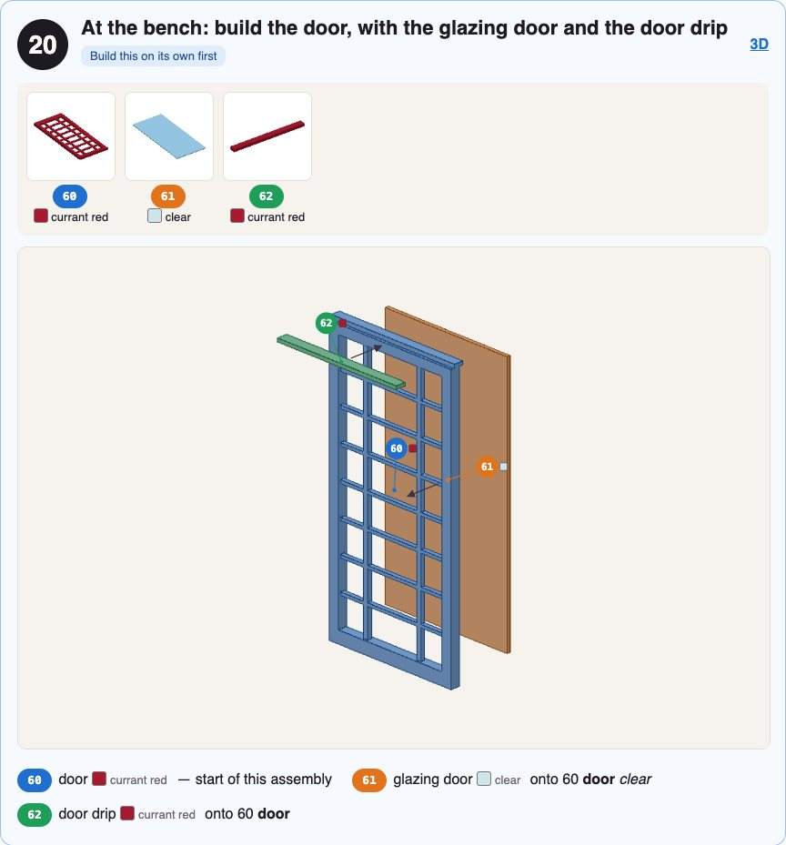
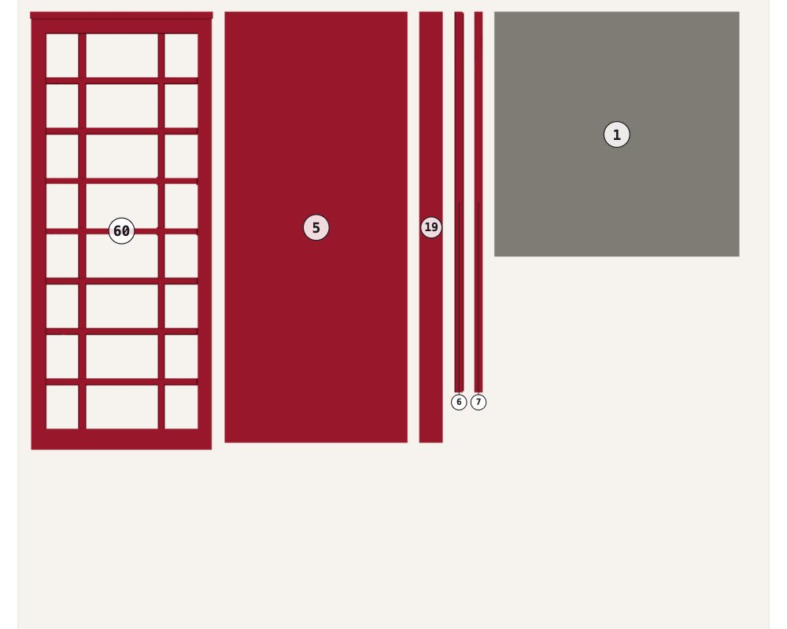

# The K6 telephone box, end to end

One construct taken through everything Construct 1.1 does: from a request in plain words to a researched
construct, its provenance, a solid, a 3D model, a prop in a game engine, a film, a CAD file, a print and a model
kit. Each step shows the command, what came out, and what we found.

**Who did what.** DeepSeek V4.1 Flash built the construct, through Hermes, in 28 minutes (fast mode, its standard tier).
Claude Opus 5.5 then ran every other step with the 1.1 commands below, and made two passes by hand that are
said where they happen: a provenance pass, and a kit-ready copy. Everything needed to repeat it is in
[examples/k6-telephone-kiosk](../examples/k6-telephone-kiosk/).

- [1. Ask](#1-ask)
- [2. The agent researches and builds](#2-the-agent-researches-and-builds)
- [3. Check the fit](#3-check-the-fit)
- [4. Provenance](#4-provenance)
- [5. The solid](#5-the-solid)
- [6. A 3D model](#6-a-3d-model)
- [7. In a game engine](#7-in-a-game-engine)
- [8. A film](#8-a-film)
- [9. CAD](#9-cad)
- [10. A print](#10-a-print)
- [11. A model kit](#11-a-model-kit)
- [What we learned](#what-we-learned)

<p align="center"></p>

## 1. Ask

The whole request, given to the agent with the construct skill:

> Make a construct of the K6 red telephone kiosk designed by Sir Giles Gilbert Scott (1935), as it stands in
> Britain today. Standard mode. Research its real dimensions and record each as a fact with its source. Model it
> as separate, named parts a model maker would recognise: the plinth, the four corner posts, the roof and its
> domed top, the crown panels with the embossed crown, the illuminated TELEPHONE signs, the glazed side and back
> panels with each pane of glass as its own part, the door with its own glazing, the interior shelf and the
> telephone. The door opens outward on its hinge. Say how each part is known, its size and its shape
> separately. Check it until clean, including `construct check --fit`. Build the page and review its pictures;
> fix the weakest point.

```sh
hermes -z "$(cat REQUEST.md)" --in k6/          # or ask any agent with the construct skill
```

## 2. The agent researches and builds

The agent read Wikipedia, the Historic England list entry and The Telephone Box (a kiosk collection's site),
looked at two reference photographs, and wrote the scene: 156 named parts, 17 facts, a door that opens 76° on
its hinge. Its facts, each with its source:

| fact | value | how it is known |
| --- | --- | --- |
| height | 2.51 m | verified · Wikipedia |
| footprint | 0.92 m | verified · The Telephone Box |
| mass | 690 kg | verified · Wikipedia |
| glazing | 3 columns × 8 rows on each glazed side | verified · Historic England list entry |
| glazed sides | 3 (the back is solid) | verified · Historic England list entry |
| signs | 4, TELEPHONE | verified · Historic England list entry |
| paint | currant red, BS 381C 539 | verified · Wikipedia |
| plinth height, pediment height | 0.22 m, 0.225 m | inferred · read from a photograph |

It kept to the evidence over the request: asked for a glazed back, it built a solid one, because the list
entry records "a solid rear side". Its own review fixed a roof that read as a birdcage and a door that swung
104° across the front.

```sh
construct check scene.json          # audit: PASS, 0 errors, 0 warnings
construct review scene.json --out out
```

## 3. Check the fit

```sh
construct check scene.json --fit
```

`check --fit` names 41 places where a glazing bar passes through a mullion. On a real K6 each window frame is
one iron casting, so the bars and mullions are meant to cross; the kit moulds each frame as one piece (step 11).

**Found here:** the Construct that Hermes carries was older than 1.1, so the agent had no `check --fit` and
wrote its own fit check instead. With 1.1 in Hermes it would run this one.

## 4. Provenance

The agent recorded verified facts but left every part plainly "inferred", which shows as one flat colour. A
provenance pass (by hand, a few lines of JSON) said what each part rests on:

- the corner posts and the shell: **size verified** from the height and footprint facts, shape seen in the
  photographs (`"certainty": {"size": "verified", "shape": "inferred"}`);
- the glazing and the signs: seen in the photographs **and checked** against the list entry's 3 × 8 glazing
  and TELEPHONE signs;
- the rest of the outside: **seen** in the photographs; the inside (shelf, payphone): **designed**.

<p align="center"></p>

Press **P**. The legend counts each kind (11 size verified; 145 inferred: 73 seen and checked, 59 seen, 5
described, 8 designed) and names the sources behind the verified sizes.

## 5. The solid

Press **S**: the same construct as a modelling program shows it. `review` writes `solid.png` for a critic.

<p align="center"></p>

## 6. A 3D model

A finish is a small colour map, kept beside the scene, never a fact in it
([maps/finish.json](../examples/k6-telephone-kiosk/maps/finish.json)): currant red, clear glass, white signs, black
fittings.

```sh
construct export scene.json --out k6.glb --materials finish.json --merge   # 156 parts, the door's open animation
construct export scene.json --out k6.obj                                   # 2225 quads, ready to subdivide
construct export scene.json --out quality.glb --quality                    # each triangle coloured by its quality
```

## 7. In a game engine

```sh
construct export scene.json --out k6-glued.glb --materials finish.json --pieces glued --colliders
```

What stays put is one body; the door is one more, on its own hinge (`hosts/godot/construct_joints.gd` makes it
a Godot joint), with a collision box per part. In Godot, the glTF's own `open` animation swings the door.

## 8. A film

The construct assembling across a piece of music, the build following the track.

```sh
construct audio track.mp3 --out k6-audio.json
construct video scene.json --out k6-film.mp4 --assembly 26 --seconds 30 --audio k6-audio.json --sound track.mp3 --camera steady
```

<p align="center"></p>

The film's music (a Pixabay track) stays with the video; the GIF is silent.

## 9. CAD

```sh
construct freecad scene.json --out k6.FCStd --step k6.step     # 156 named parts, 1 joint; 156 of 156 true shapes
```

Every part is a true CAD shape (boxes, extrusions, lofts as NURBS), with the door as a joint in FreeCAD.

## 10. A print

```sh
construct print scene.json --printers
```

```
small    1:15    67.5 x 71.3 x 172.8 mm   parts 80 kept / 76 thickened / 0 lost
desktop  1:12    82.5 x 87.1 x 211.2 mm   parts 81 / 75 / 0
cube     1:10    96 x 101.3 x 245.8 mm    parts 81 / 75 / 0
large    1:7.5   131.2 x 138.5 x 336 mm   parts 155 / 1 / 0
resin    1:12    82.5 x 87.1 x 211.2 mm   parts 156 / 0 / 0
```

```sh
construct print scene.json --out k6.3mf --printer desktop --fit --exact
```

One watertight object, 82.5 × 87.1 × 211.2 mm at 1:12: 80 of the construct's solids as they are and the thin
ones as true 0.8 mm shells. PrusaSlicer reads it as manifold, one object of 175 parts.

## 11. A model kit

A construct is drawn to look right as light, not to be moulded, so the kit gets a **kit-ready copy** (by hand,
[kit/scene-kit.json](../examples/k6-telephone-kiosk/kit/scene-kit.json); the construct stays as it is):

- each side's 24 panes become **one clear sheet** just behind its frame, 1.7 mm thick at 1:12 (the door's sheet
  swings with the door);
- each window frame is **one casting**: a plan merges its stiles, rails, mullions and bars
  ([kit/kit-plan.json](../examples/k6-telephone-kiosk/kit/kit-plan.json));
- the interior floor and the back's mouldings are thickened to about 2 mm at 1:12, so nothing breaks (the
  kit's first build named them as fragile).

```sh
construct kit scene-kit.json --scale 12 --printer desktop --plan kit-plan.json --materials finish.json --out kit/
```

64 pieces on 5 plates, 22 steps, 209 mm tall. The booklet builds the plinth, the back panel with the
payphone, each side frame with its glazing and posts at the bench, the roof, then the crowns, and hangs the
door last; the 3D guide shows the same steps.

<p align="center"></p>

<p align="center"> </p>

<p align="center"></p>

The kit's own check is clean. **Not yet built by anyone:** print one piece first, from `kit/pieces/`, or
`--only 60` for the door.

## What we learned

The walkthrough found and fixed four things in Construct, now in 1.1:

- a merged piece is named for what its parts are together ("the side west", "the door"), not its largest part
  ("the side west stile");
- a clear piece is clear, whatever a colour map's catch-all rule gives it;
- the 3D guide frames the whole model below its instructions, and looks from below only at pieces truly under
  it;
- the construct skill now teaches kits, kit-ready copies and true CAD shapes, so an agent without this page
  knows them.

And two that are not Construct's: the Construct inside Hermes was older than 1.1 (it updates when 1.1 is
published), and a construct for a kit still wants a kit-ready pass, by an agent or by hand, as above.
