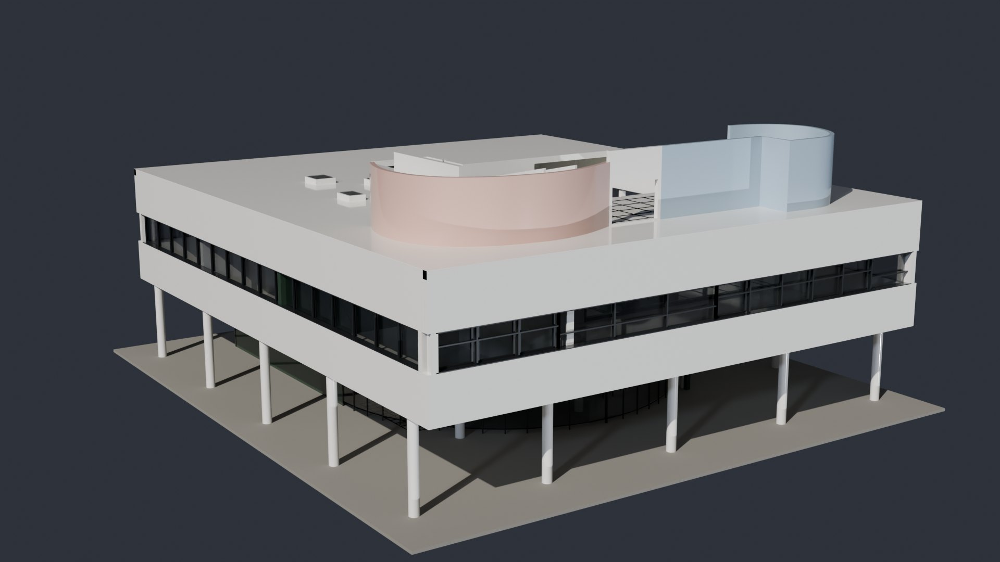
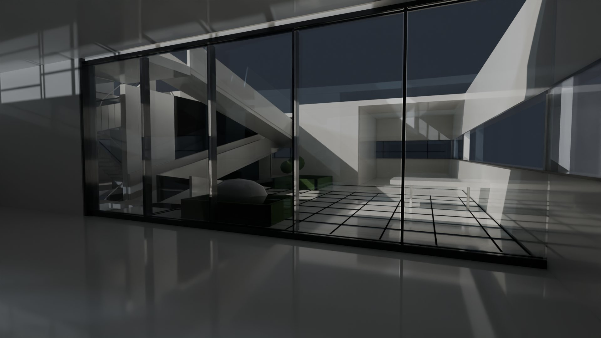
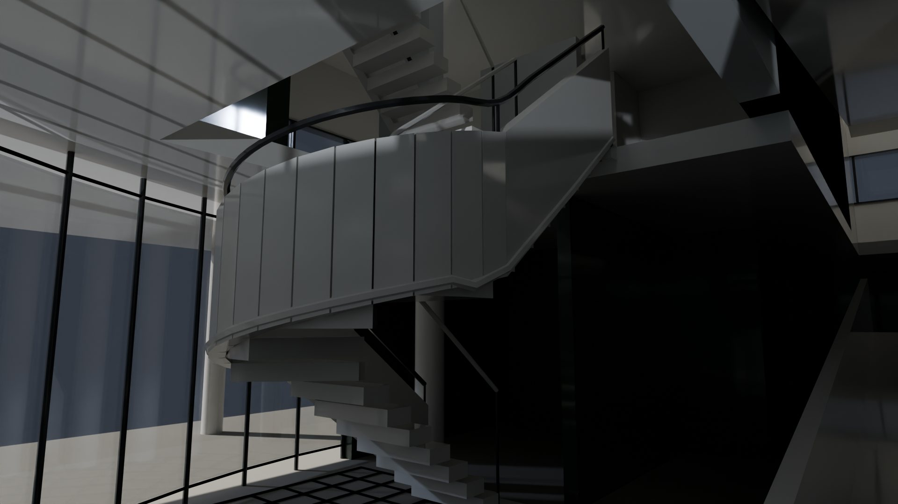
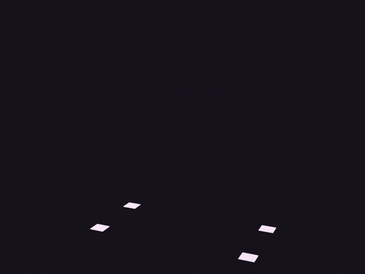
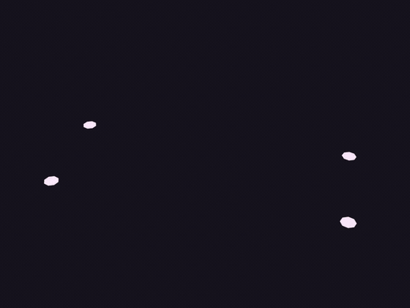
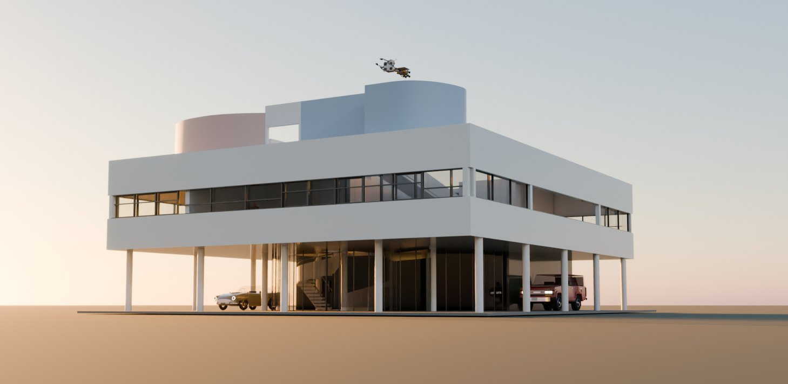

# Construct for 3D artists

A construct comes into Blender as a model of named parts at real size, with four sliders on it: **Build** (its
assembly), **Open** (every joint), **Light ↔ Metal** (from the hologram to the solid) and **Plain ↔ Finished** (from
clay to its materials). The finish is a small map of part names to paint, chrome, glass, wood or rubber. Since 1.3 the
add-on imports a whole world too, and Blender carries the model on to FBX and USD.

<p align="center"><a href="../../examples/villa-savoye/"></a></p>
<p align="center"><sub>The Villa Savoye, made in Hermes by GPT-6.1 Sol, finished in Blender with the add-on and its
material map, rendered in Cycles. <a href="../../examples/villa-savoye/README.md#in-blender">More stills, inside and out</a>.</sub></p>

## Our example: the Villa Savoye

The [Villa Savoye](../../examples/villa-savoye/) is a reconstruction from Le Corbusier and Jeanneret's published plans,
section and dimensions: 396 named parts, from the pilotis to the ramp's four flights, the ribbon windows' sashes in
their reveals, the stair's winders and the roof garden's two curved solarium screens. It was built in twelve
masterpiece rounds, each judged by a fresh critic, then checked as a solid and repaired part by part
([the walkthrough](hermes-walkthrough.md)).

**The finish** is [maps/finish.json](../../examples/villa-savoye/maps/finish.json), ten rules kept beside the scene.
Each matches part ids or patterns, and the first that matches a part wins; four of them:

```json
{"parts": ["solarium-long-curved-screen"], "name": "solarium rose", "color": "#d9b3a6", "finish": "paint", "roughness": 0.7},
{"parts": ["solarium-return-curved-screen"], "name": "solarium blue", "color": "#a9bccb", "finish": "paint", "roughness": 0.7},
{"parts": ["drive-through-ground"], "name": "gravel", "color": "#8d8a83", "finish": "plastic", "roughness": 0.95},
{"parts": ["*"], "name": "white render", "color": "#ecebe6", "finish": "paint", "roughness": 0.75}
```

The finishes are paint (a clear coat), brushed, chrome, wood, rubber, plastic, glass and light; in Blender the add-on
draws wood grain, brushed streaks and rubber's tooth procedurally, so nothing needs texture coordinates.

<p align="center">
  
  
</p>
<p align="center"><sub>Inside the salon, and the stair from the entrance hall. Every surface is a named part of the construct.</sub></p>

## From light to metal

<p align="center">
  <a href="https://rtmandreyev.github.io/construct/examples/light-to-metal/"></a>
  <a href="https://rtmandreyev.github.io/construct/examples/light-to-metal/"></a>
</p>
<p align="center"><sub>The Revox A77 and the Arturia MiniFreak, revealed by the add-on's sliders. <a href="https://rtmandreyev.github.io/construct/examples/light-to-metal/">See them in 3D</a>.</sub></p>

| On the root object (sidebar, **Construct** tab) | What it does |
| --- | --- |
| **Build** 0–1 | every vertex appears at its build phase, behind a bright front |
| **Open** 0–1 | every hinge, turn, slide and lift, in its order |
| **Light ↔ Metal** 0–1 | lines of light over dark glass, to the solid with its design lines as dark seams |
| **Plain ↔ Finished** 0–1 | clay, to the material map's finish |
| **Lines** | the line art's thickness, as real tubes |
| **Keyframe a Reveal** | keys the assembly in light, the turn to metal, the finish and the opening, from the current frame |

They are ordinary drivers on custom properties, so a saved `.blend` keeps working without the add-on. Every part keeps
its role, certainty and source as custom properties, and periodic motion (a spinning reel) stays as the `idle` action.
The same works for the gallery's finished examples:
[KESTREL](invent-from-what-exists.md#take-it-further-a-finish-in-blender) (sixteen rules, from gold foil to radiator
black), the [Vespa](your-vehicle.md#take-it-further-try-a-finish-in-blender) and the
[Eames chair](copy-your-thing.md#take-it-further-a-finished-model-in-blender).

## A whole world

File > Import > Construct reads a `world.json` as well as a scene: it finds the constructs the world places beside it
(its own `constructs/` folder, or the examples in a checkout of Construct), each placement whole, with the usual
build, open, metal and finish sliders. A world whose constructs it cannot find comes in as its exported `.glb`
instead.

<p align="center"></p>
<p align="center"><sub>The Villa Savoye, lived in: the house, a Land Cruiser FJ62 and an Aston Martin DB5 under it, KESTREL
far off over the roof, imported with the add-on and lit at dusk. Each is the gallery's construct, unchanged, finished
with its own material map.</sub></p>

The worlds that ship are in [examples/worlds](../../examples/worlds/): a street with the Duomo, the Sainte-Chapelle and
the Sagrada Família at their real sizes, Rain Harbour's night street, Stortorget's square. In Hermes Desktop you can
arrange one by hand first (drag, turn, lift; **Save**), then export it ([worlds, step by step](worlds-walkthrough.md)).

## Model over it

- **OBJ in quads.** An OBJ's positions are shared and its strips are four-sided faces again, so it subdivides cleanly:
  Tompion's clock comes out as 207 parts with 3,802 quads. Normals and texture coordinates stay per corner, so a hard
  edge stays hard.
- **Outward normals.** Every primitive is wound outward and a mirrored copy is wound back (fixed in 1.2), so face
  orientation, booleans, solidify and recalculated normals agree.
- **See the slivers.** Each export reports its share of thin triangles; `--quality` writes a glTF with each triangle
  coloured by its smallest angle, to show what to remesh.
- **Check the solid first.** Press **S** on the construct's page for the solid view, or run `construct check --fit` for
  parts that poke through others, cross a pane or hang in the air.

## Try it

```sh
python3 scripts/build_blender_extension.py                                  # dist/construct-blender-<version>.zip
construct export scene.json --out model.glb --materials finish.json --wire seams
construct export scene.json --out model.obj                                   # quads, ready to subdivide
construct export scene.json --out model.fbx                                   # or .usd, .usdz: through Blender
```

In Blender (4.2 or later; tested with 5.2): **Edit > Preferences > Get Extensions > Install from Disk**, then
**File > Import > Construct** and choose a scene, a world or a `.glb`. `construct` is short for
`python3 construct_hologram/cli.py` in a checkout of Construct.

## Good to know

- **A starting point, not a finished hero asset.** Shapes come from Construct's vocabulary (boxes, lathes, lofts,
  tubes, extrusions); overlapping parts are not merged; there are no textures, and the texture coordinates are a box
  projection in metres. Joints are mechanical; there is no skinned rig.
- **Colour belongs to you.** The hologram keeps Construct's house palette; a construct's own colours show in the solid
  view and in every export, and a material map is yours, kept beside the scene, never in it.
- **A part drawn only as a line has no surface**; the audit warns `no-surface` so it can be given one.
- **New designs:** a ship, a vehicle or a creature to light and render, designed from real ones:
  [new things from real ones](invent-from-what-exists.md).

## Go deeper

- [The Blender add-on](../../hosts/blender/README.md): install, the controls, how it works, NetLogo runs as films
- [3D export](../EXPORT.md): every option, the material map, what is in the file
- [Worlds](../WORLDS.md): what a world holds and how it exports
