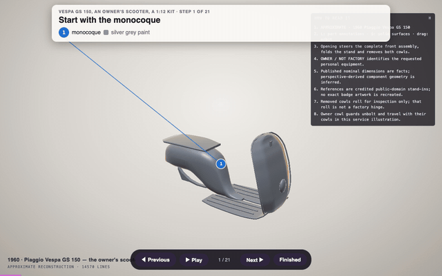
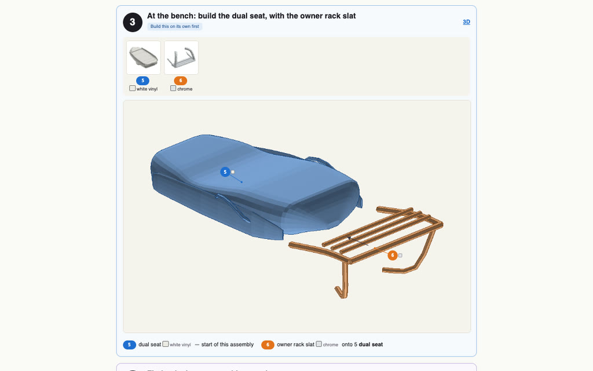
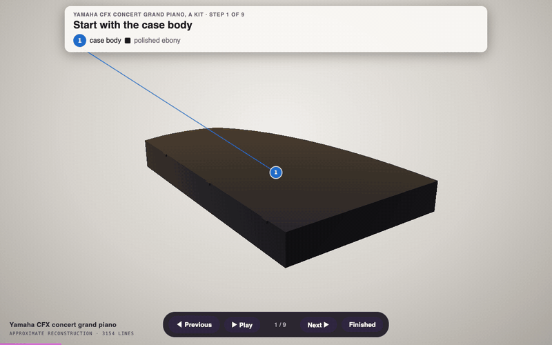
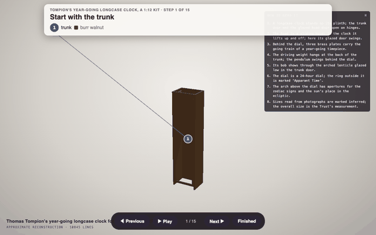
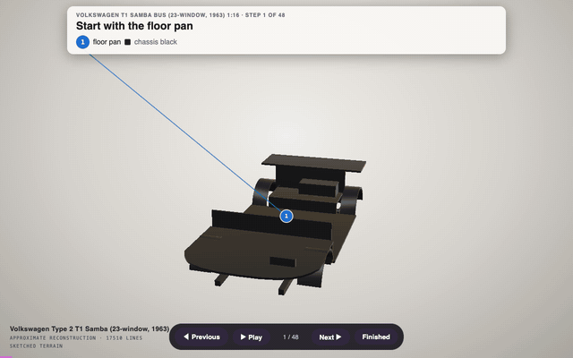

# A model kit of your own thing

Not the kits someone else chose to make: yours. Your scooter, your house, your guitar as a kit to print, glue and
paint, with numbered plates, a booklet drawn like a kit sheet and the same steps in 3D. No terminal: the Claude app
or the ChatGPT app does the work ([how to set it up](in-the-apps.md)).

  
  

The <a href="https://rtmandreyev.github.io/construct/examples/vespa-gs150/">Vespa from <i>your vehicle</i></a> as a 1:12 kit: 32 pieces on 3 plates, 21 steps, 157 mm long.
The 3D guide (left) and a page of the booklet (right). Open them yourself: <a href="https://rtmandreyev.github.io/construct/examples/vespa-gs150/kit/assembly.html">the kit in 3D</a> and <a href="https://rtmandreyev.github.io/construct/examples/vespa-gs150/kit/booklet.html">its booklet</a>.

## Our example, start to finish

**The model.** The kit starts from a construct of the thing, here the owner's Vespa built from two photos
([how it was made](your-vehicle.md)). We made this kit with Construct's own kit command, in the two steps below; in
the apps, these two messages, sent in the chat that made the model, do the same.

**First, ask for the kit:**

> Make it a model kit at 1:12 for my printer (a Prusa MK4), with the booklet and the 3D guide.

**What came back, first:** a kit of 184 pieces in 91 steps, with a list of problems: wheel bolts, cowl tabs and
trim strips as pieces of their own, slivers too thin to print. That is normal for a first build. A construct is
drawn to look right, not to be moulded, so a kit wants a plan: what a factory would cast as one piece is merged.

**Then, ask for a plan:**

> Merge what a factory would cast as one piece: the body with its floor, runners and legshield; each wheel with its
> tyre, whitewalls and hubcaps; each cowl with its trim and tabs; the fork with its mudguard; the engine with its
> exhaust; each side's guard bars; the rack; the badges. The headlamp glass and the rear light lens are clear parts.
> Make the kit again.

**What came back:** 32 pieces on 3 plates in 21 steps, painted from the scooter's own finish (silver paint, chrome
bars, whitewall tyres, a white seat with blue piping), built as a model maker would: the body first, the seat and
rack and the wheels at the bench, the cowls hung last. The plan it wrote is
[kit-plan.json](../../examples/vespa-gs150/kit-plan.json). Its checks leave a few notes for the builder, said in the
booklet: some joints with a gap under a millimetre (a drop of glue fills them), two small cowl tabs to fit after the
cowls, and a few specks too small to print, left off.

**What you get:** `booklet.html` (open it and print it), `assembly.html` (the steps in 3D, turn them in your
browser), and a `.3mf` file per plate for your printer's software (PrusaSlicer, Bambu Studio, Cura), plus every
piece on its own to reprint one.

**Open this one yourself:** [the Vespa kit in 3D](https://rtmandreyev.github.io/construct/examples/vespa-gs150/kit/assembly.html), [its booklet](https://rtmandreyev.github.io/construct/examples/vespa-gs150/kit/booklet.html), and
[its plates to print](https://github.com/rtmandreyev/construct/releases/latest/download/construct-kit-vespa-gs150.zip) (a zip: the three plates, the booklet and the 3D guide).

## More kits

  
  
  

A piano and a clock at 1:12 (the clock <a href="../END-TO-END.md#11-a-model-kit">made step by step</a>), a VW bus at 1:16.

Every kit here, to open in your browser or print:

| Kit | Pieces | Steps in 3D | Booklet | Plates to print |
| --- | --- | --- | --- | --- |
| Yamaha CFX piano, 1:12 | 54 | [open](https://rtmandreyev.github.io/construct/examples/yamaha-cfx/kit/assembly.html) | [open](https://rtmandreyev.github.io/construct/examples/yamaha-cfx/kit/booklet.html) | [.zip](https://github.com/rtmandreyev/construct/releases/latest/download/construct-kit-yamaha-cfx.zip) |
| Tompion's year-going clock, 1:12 | 34 | [open](https://rtmandreyev.github.io/construct/examples/tompion-year-going-clock/kit/assembly.html) | [open](https://rtmandreyev.github.io/construct/examples/tompion-year-going-clock/kit/booklet.html) | [.zip](https://github.com/rtmandreyev/construct/releases/latest/download/construct-kit-tompion-year-going-clock.zip) |
| VW T1 Samba bus, 1:16 | 98 | [open](https://rtmandreyev.github.io/construct/examples/volkswagen-t1-samba/kit/assembly.html) | [open](https://rtmandreyev.github.io/construct/examples/volkswagen-t1-samba/kit/booklet.html) | [.zip](https://github.com/rtmandreyev/construct/releases/latest/download/construct-kit-volkswagen-t1-samba.zip) |
| Vespa GS 150, an owner's scooter, 1:12 | 32 | [open](https://rtmandreyev.github.io/construct/examples/vespa-gs150/kit/assembly.html) | [open](https://rtmandreyev.github.io/construct/examples/vespa-gs150/kit/booklet.html) | [.zip](https://github.com/rtmandreyev/construct/releases/latest/download/construct-kit-vespa-gs150.zip) |

## Do it with your own thing

1. Make a model of it from your photos, in masterpiece mode ([copy your thing](copy-your-thing.md),
   [your vehicle](your-vehicle.md), [your home or garden](home-and-garden.md)).
2. In the same chat: *"Make it a model kit at 1:12 for my printer ([your printer]), with the booklet and the 3D
   guide."* Choose a scale that fits your printer: 1:12 for a scooter or a chair, 1:24 for a car, 1:100 for a house.
3. If the first kit has many small pieces, send the second message above, naming the parts of your own thing that
   belong together.
4. Print one small sub-assembly first, then the plates, and build it with the booklet beside you.

## Good to know

- **Not yet built by a person.** The kits are made and checked by software and by AI critics, and they are a first
  version. If you build one, [tell us how it went](https://github.com/rtmandreyev/construct/issues).
- **Print, glue, paint:** plastic cement or superglue holds the pieces, and the booklet names each piece's paint.
- [Everything else to know about the apps →](in-the-apps.md)
