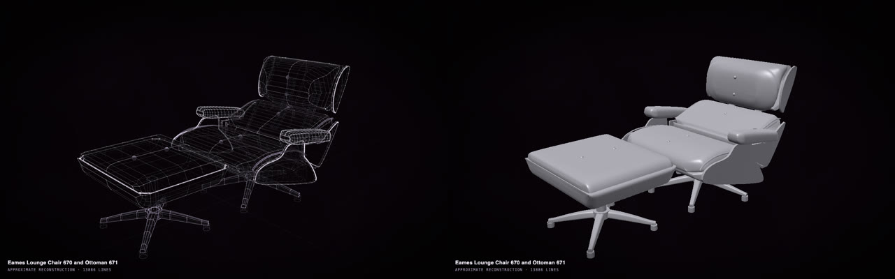
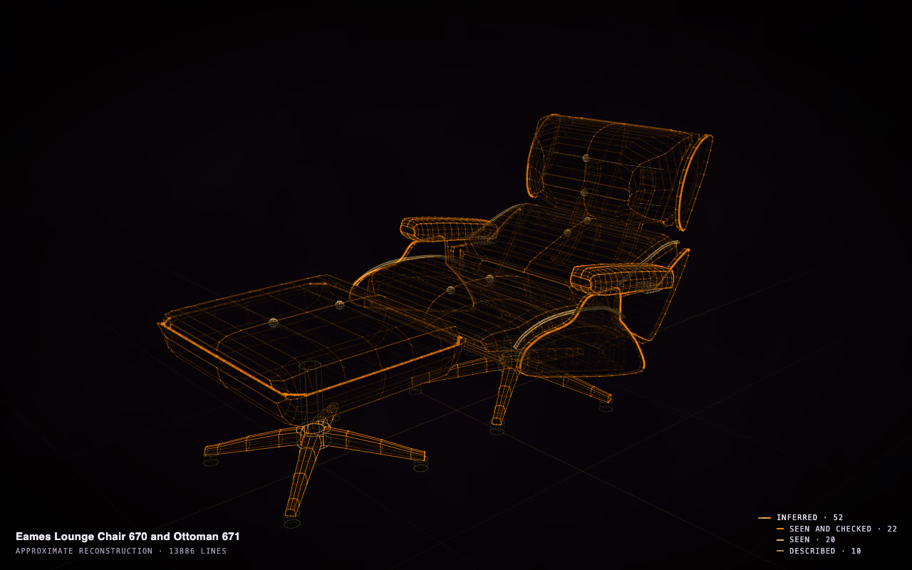
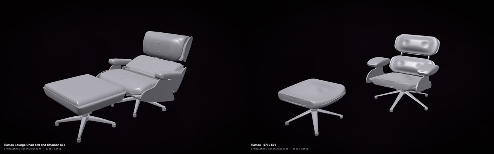

# Make a digital copy of something you own

Your chair, guitar, camera, lamp or heirloom in 3D, from your photos and whatever its maker publishes. It is a model
you can turn, change, render, print or hand to someone, and it tells you what was measured and what was guessed. You
need no terminal: the Claude app or the ChatGPT app does the work ([how to set it up](in-the-apps.md)).

An Eames Lounge Chair and Ottoman from two photos and one message. <a href="https://rtmandreyev.github.io/construct/examples/eames-lounge-chair/">Open it</a>: drag to turn it, <b>P</b> for how each part is known, <b>S</b> for the solid.

## Our example, start to finish

**The photos.** Two photographs, standing in for an owner's own (from Wikimedia Commons):

  
  

Casey Marshall, CC BY 2.0 · sailko, CC BY 2.5

**The message,** sent in the Claude app's **Cowork**. In this test the skill came as a zip file in the folder;
with the [setup on these pages](in-the-apps.md) the message starts *"Read skills/construct/SKILL.md..."*
instead, as in the one to copy below.

> Unzip construct-skill.zip in this folder, read construct/SKILL.md and use it to make a masterpiece construct of my
> Eames Lounge Chair and Ottoman (Herman Miller, the 670 chair and 671 ottoman) from the two photos in
> ../eames-lounge-chair/refs/. Research its published dimensions. Masterpiece mode. Save construct.html here.

**What came back.** The app looked up the maker's published sizes, read the shells, cushions, arms and swivel
base from the photos, and built 52 named parts. Then it improved them in rounds, each judged by a second,
independent model that compared the new version with the best so far: 5 rounds, 13 minutes of its own work and 18
of the critic's, until two rounds in a row could not beat round 3. Press **P** and the construct says how each part
is known. Here every part is honestly a reading, in shades of how firmly it is held: 22 seen in the photos and
checked against the maker's published sizes, 20 seen in the photos, 10 described in the sources.

The same message in the ChatGPT app (Codex, GPT-6.1 Sol) made its own chair, in 11 rounds and about an hour:

The Claude app's chair (left) and the ChatGPT app's (right, <a href="https://rtmandreyev.github.io/construct/examples/eames-lounge-chair-chatgpt/">open it</a>), from the same photos and message.

## Take it further: a finished model in Blender

Ask, in the same chat: *"Give me a file for Blender, with walnut shells, black leather and polished aluminium."*
It writes a small finish map ([the one used here](../../examples/eames-lounge-chair/maps/finish.json)) and a
`.glb` that Blender, and most 3D programs, open as a model of named parts. With the
[Construct add-on for Blender](../../hosts/blender/README.md), the build, the finish and the joints are sliders:

Other things to ask for:

- *"Make it a file I can 3D print, 15 cm tall"* (a miniature for a shelf or a dolls' house).
- *"Give me a STEP file"*: the format CAD programs (FreeCAD, Fusion, SolidWorks) open, for anyone who designs
  or makes parts.
- *"Show it in green leather"*, *"make the ottoman 10 cm lower"*: the copy changes, the original stays.

## Do it with your own thing

**Gather:**

- **Photos:** 2 to 10, from different sides, in good light, the whole thing in each. More sides, better shapes.
- **What it is,** as exactly as you know it: the maker, the model, the year. The app looks up what is published.
- **A measurement or two,** if you have a tape measure: the height, the width. Sizes you measured are marked as
  yours, and the rest is checked against them.

**Send** (after the [one-time setup](in-the-apps.md)), with your photos in a folder such as `my-chair`:

> Read skills/construct/SKILL.md in this folder and use the Construct skill to make a masterpiece construct of my
> **[what it is: maker, model, year]** from the photos in **my-chair/**. **[What you measured, e.g. "it is 84 cm
> tall"]**. Research its published dimensions. Masterpiece mode. Save it as **my-chair/my-chair.html**.

In the ChatGPT app, start it with *"Using the construct skill, make..."* instead. Expect half an hour to an hour
for something like a chair.

## Good to know

- **It is a careful model, not a measurement.** Before you make anything to fit, check the sizes that matter. **P**
  shows how each part is known: measured by you, published by the maker, or read from your photos (and whether it
  was checked against a published size).
- **Shapes come from what the photos show.** The underside, the back, the inside: if no photo shows it, it is
  inferred, and says so.
- [Everything else to know about the apps →](in-the-apps.md)
