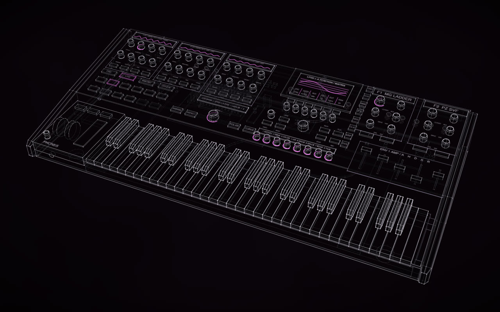
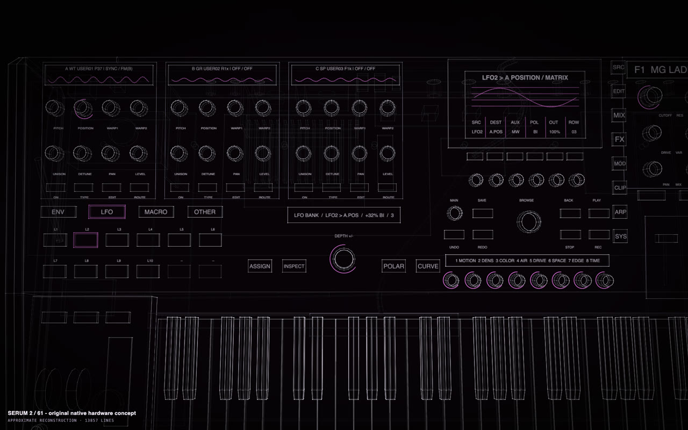
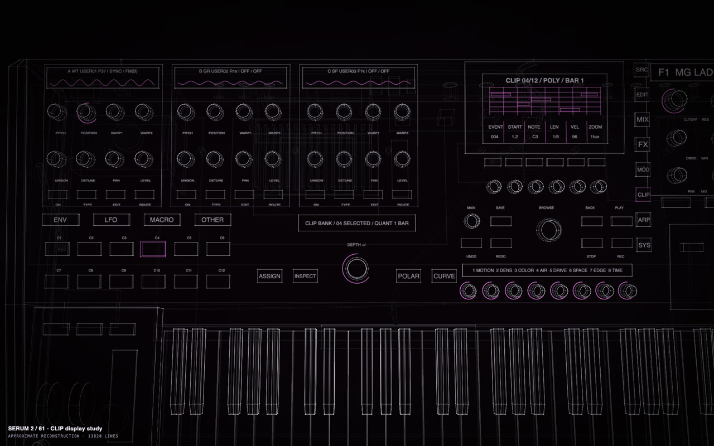
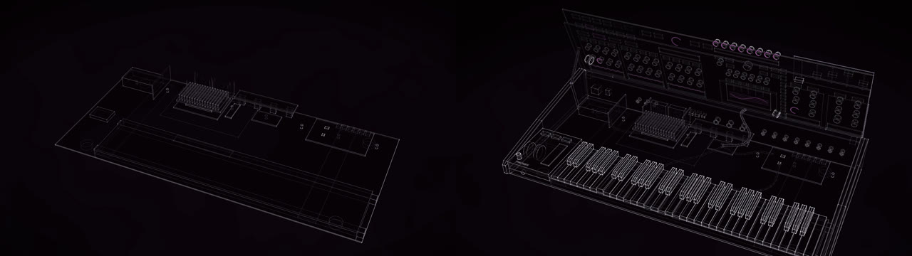
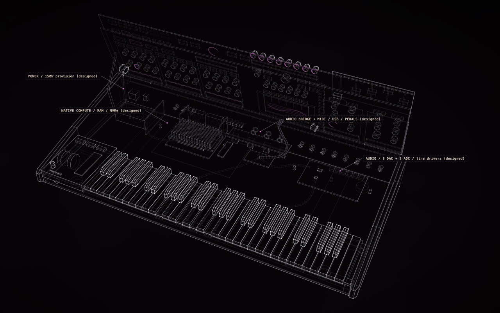
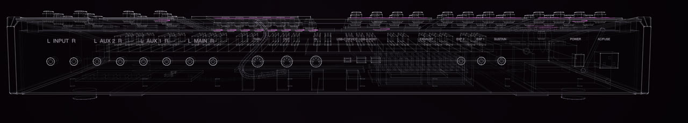
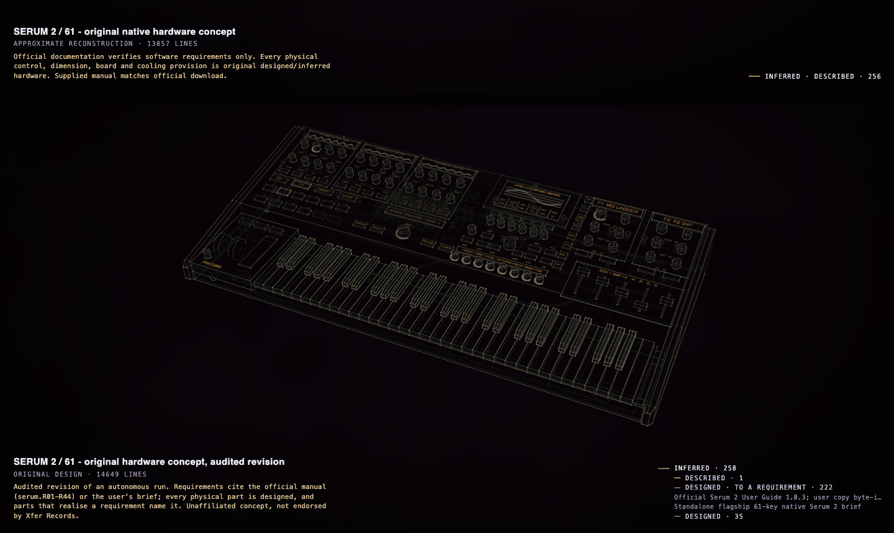
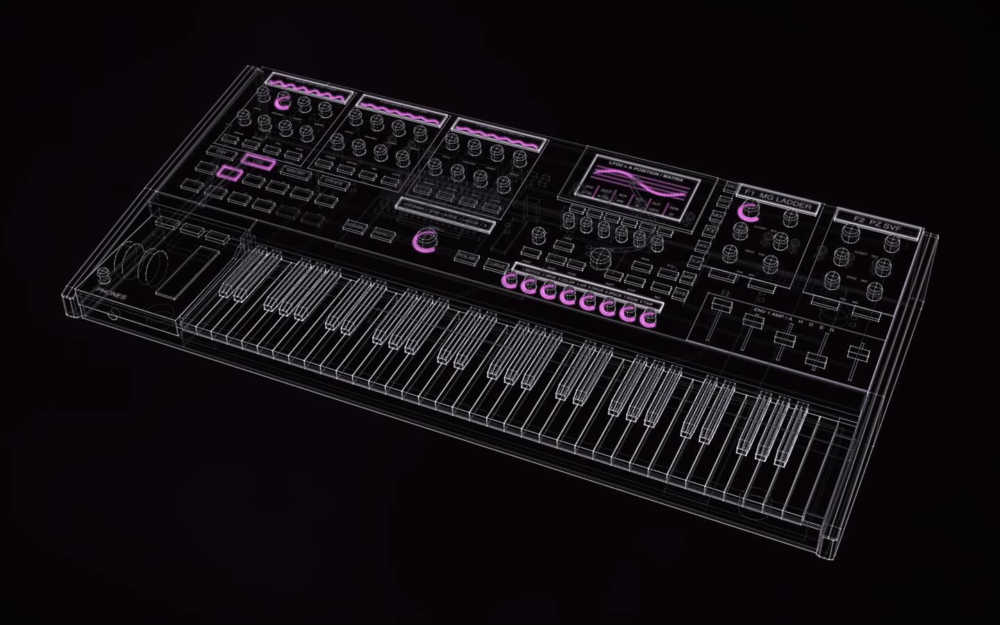
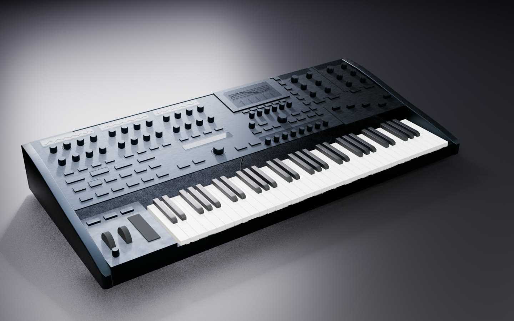
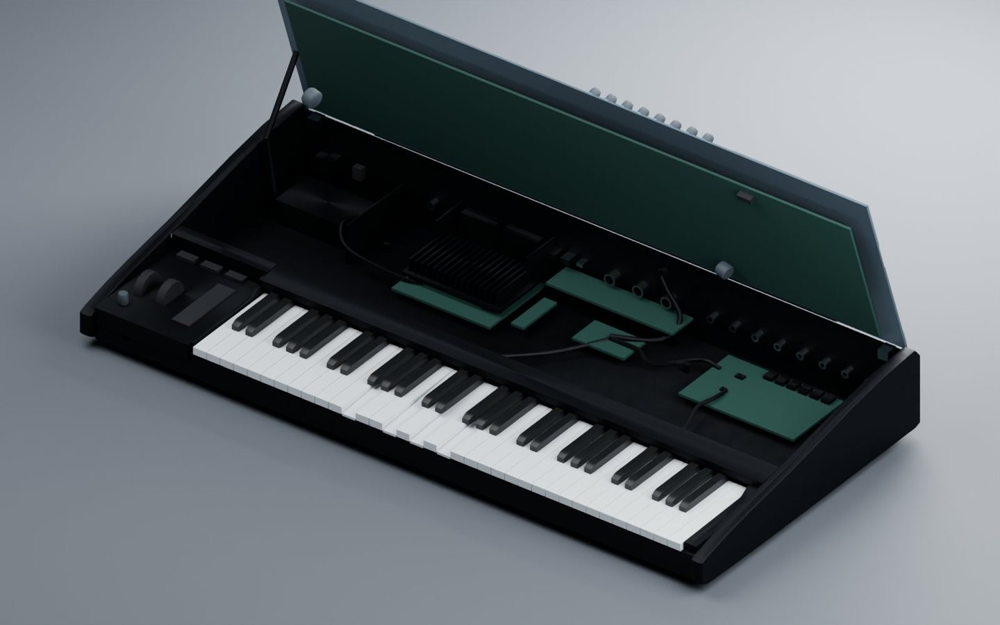

# Documentation → product

A program, a system or a machine that is well documented can be the specification for a physical product nobody
has built. The documentation fixes what the product must do; the agent designs the controls, displays, enclosure
and insides that do it, and Construct keeps the two apart, checks the result and builds it as a construct and a 3D
model. This page follows one run, a hardware instrument designed from the manual of a software synthesizer, and
says plainly what it showed and what it did not.

> **Unaffiliated concept. Not endorsed by Xfer Records.** Serum 2 is Xfer Records' software synthesizer. The
> instrument on this page is an invented concept made from its public manual; Xfer Records and its people had no
> part in it and have not seen or approved it.

<p align="center"></p>
<p align="center"><sub>The concept: native Serum 2 as a standalone 61-key instrument. GPT-6.1 Sol in Codex, masterpiece mode,
one session of 64 minutes. The original autonomous run, shown as it came out.</sub></p>

The pictures down to [The result](#the-result) are the original autonomous run, as it came out. An independent audit
then read the run; what it found worth correcting is corrected in an audited revision of the same instrument,
[live in the gallery](https://rtmandreyev.github.io/construct/examples/serum-2-61/) and described under
[The audited revision](#the-audited-revision).

## The question

Can an agent with Construct take the documentation of a complex software product and design a plausible
standalone physical version of it: one that keeps every documented capability reachable, instead of a box with a
few knobs on it?

Serum 2 is a demanding test. Its manual documents three oscillators with five engines each (wavetable,
multisample, sample, granular, spectral), sub and noise oscillators, two filters, three nested effect racks, four
envelopes, ten LFOs, eight macros, a 64-slot modulation matrix with 49 sources, clip banks with a piano-roll
editor, an arpeggiator, a wavetable editor, a formula parser, MPE and a preset database. A panel of knobs cannot
hold that; the design has to decide how each part is reached.

## The input

One brief, written in advance (about 13,000 characters), given to GPT-6.1 Sol (high reasoning effort) in Codex on
the desktop, with the Construct skill already installed. It asked for:

- **Serum 2 itself as a standalone flagship instrument,** 61 full-size keys, the native engine running as the
  instrument's own firmware: not a controller, not a computer hosting the plugin, not a synth "inspired by" it.
- **Every documented capability,** with the hard ones kept, not dropped.
- **Requirements first:** an inventory of the manual saved before any geometry.
- **Real instruments as references for principles,** not for copying.
- **Masterpiece mode,** and four documents beside the construct, the scene, a glTF and a film: the requirements,
  a function map, the hardware architecture and the design notes.

The specification was Xfer's current public manual: 354 pages, Serum 2.0.18, manual 1.0.3, dated 27 April 2025.
The agent downloaded it itself.

### The exact prompt

The brief, verbatim, is [PROMPT.md](../../examples/serum-2-61/PROMPT.md) (13,120 characters). It opens:

```text
Using the Construct skill, design and build a **masterpiece construct of Serum 2 as a real, standalone, flagship 61-key hardware synthesizer**.

The premise is:

**Imagine Xfer Records and Steve Duda decided to manufacture and sell Serum 2 as hardware. Design the physical instrument they could actually ship.**

This is NOT:

- a MIDI controller for Serum 2
- a computer that merely hosts the existing Serum 2 plugin
- a generic synthesizer inspired by Serum
- an emulation of Serum
- a decorative concept model
- a toy
- a software UI placed on a large touchscreen
```

The premise is imagined: neither Xfer Records nor Steve Duda had any part in the run. The
rest of the brief sets the order of work (documentation, requirements, interaction, hardware, layout, industrial
design, then the construct), the four references, the visual identity, the physical format, the modulation problem,
the displays, the insides, what "fully functional" means, ergonomics, provenance and the deliverables.

## The reference instruments

The brief named four instruments to study for lessons in industrial design and interaction, and forbade copying
them: "Borrow reasoning, not appearance." The agent read their makers' pages and manuals (kept out of this
repository) and wrote down, in the design notes' table *Reference lessons and original identity*, what it took from
each and what it did deliberately otherwise.

<p align="center">
  <a href="https://commons.wikimedia.org/wiki/File:Andromeda_a6.JPG"></a>
  <a href="https://commons.wikimedia.org/wiki/File:Modal_002_(white)_by_Modal_Electronics_-_2017_NAMM_Show_(2017-01_by_Pete_Brown_@_Flickr_31661095613).jpg"></a>
</p>
<p align="center">
  <a href="https://frap.tools/magnolia/"></a>
  <a href="https://www.udo-audio.com/super-6"></a>
</p>
<p align="center"><sub>The four references the brief named. The Alesis Andromeda A6 (photo: Thomas Henk, public domain) and the
Modal 002 (photo: Pete Brown, CC BY 2.0), from Wikimedia Commons; the Frap Tools Magnolia (photo © Frap Tools) and the
UDO Super 6 (photo © UDO Audio Ltd), shown from their makers' own pages for comparison and not part of this
repository or its licence.</sub></p>

| Reference | What the run took from it | What it did otherwise |
| --- | --- | --- |
| [Frap Tools Magnolia](https://frap.tools/magnolia/) | generous room for hands, and source and destination state made explicit, can make complex synthesis playable | three engine strips with their own displays and a dedicated signed-depth control; not its macro centrepiece, panel colour or arrangement |
| [UDO Super 6](https://www.udo-audio.com/super-6) | performance controls deserve their own reachable region; consistent families of controls matter more than screen size | a persistent eight-macro area and source pads; not its colours, its switches and faders, or its doing without a screen |
| [Modal Electronics 002](https://modalelectronics.com/wp-content/uploads/2025/08/MODAL002_MANUAL_v1-03.pdf) | a physical control and a contextual display can expose the same parameter; exact entry is valuable | six graph encoders and one universal node editor; no numeric keypad, white body or copied sequencer bank |
| [Alesis Andromeda A6](https://www.alesis.com/rscdn/1571/documents/a6_manual.pdf) | a deep flagship needs both immediate modules and a second place for editing | a triad of engine strips and faders for whichever envelope is selected; not its blue panel, its outline or where it puts oscillators, filters and envelopes |

Whether the result is original is a judgement, not a check. The audit found the layout a familiar archetype
(oscillator strips, a screen, filters, macros in front): coherent, with its own identity carried mostly by the
faceted end structures and the naming.

Serum 2's own interface is Xfer's and is not reproduced here; it can be seen on
[Xfer's Serum 2 page](https://xferrecords.com/products/serum-2) and in its
[manual](https://xferrecords.com/web-manual/serum-2). The design notes rule out putting a shrunken copy of it on the
instrument's display.

## Requirements first

Seven minutes into the session the agent saved `SERUM_REQUIREMENTS.md`: the manual reduced to **44 capability
groups**, each with its page range and the behaviour it requires (R01, three independent oscillators with five
engines; R25, the 64-slot matrix with its 49 sources, curves, slew, auxiliary sources and output scaling; R44, what
depends on a host program). The session log fixes the order: the inventory at minute 7, the function map and
hardware architecture at minute 13, the design notes at minute 14, the first geometry at minute 18.

Each row is a paraphrase of its pages, not a quotation. Spot-checked against the manual, the counts held (64 slots
and 49 sources, ten LFOs, twelve clip slots, four envelopes, up to 16 unison voices); one detail in one row was not
in the pages it cites. The grouping itself is the agent's: nobody has yet compared it with the manual parameter by
parameter.

### The run's documents

The run's documents are published beside the revision, as the run wrote them (one local path removed):

- [SERUM_REQUIREMENTS.md](../../examples/serum-2-61/run/SERUM_REQUIREMENTS.md): the 44 groups, R01 to R44, each
  with its page range and required behaviour; the edition, and what could not be checked.
- [FUNCTION_MAP.md](../../examples/serum-2-61/run/FUNCTION_MAP.md): for each group, where it is on the instrument,
  how it is reached, its class, its feedback and its compromise.
- [HARDWARE_ARCHITECTURE.md](../../examples/serum-2-61/run/HARDWARE_ARCHITECTURE.md): the compute contract,
  memory and storage, the audio path and its routings, control scanning, I/O, power and cooling, each figure tagged
  documented, user-supplied, reference-derived or designed.
- [DESIGN_NOTES.md](../../examples/serum-2-61/run/DESIGN_NOTES.md): the parameter principle, the modulation
  sequence, displays, ergonomics, how the reference instruments were used, and what remains uncertain.
- [assembly_manifest.json](../../examples/serum-2-61/run/assembly_manifest.json) and
  [control_rig.json](../../examples/serum-2-61/run/control_rig.json): the service assemblies, and the intended motion
  of every key and control.

The documents sort every statement into four kinds: **documented** (what the manual says the software does),
**user-supplied** (the premise: native, 61 keys, flagship, complete), **reference-derived** (what published
instruments and parts show is possible) and **designed** (everything new: the panel, the mapping, the chassis, the
electronics, the cooling).

## Parameters, not pixels

The design notes, written before any geometry, set one rule: *the stable object is the parameter, not a screen
pixel.* Every engine parameter keeps its identity, units, value, modulation eligibility, undo history and saved
state; a dedicated knob, a contextual encoder and a display field are all views of that same parameter. So a
feature with no knob of its own is still the same feature, reached another way, rather than a simplified second
engine.

In the model this shows in one checkable way: the display studies. The same scene in its modulation, effects and
clip states changes only labels and the screen's trace; not one part moves or changes size.

<p align="center">
   A.POS / +32% BI / 3, the matrix row on the central display">
  
</p>
<p align="center"><sub>The same hardware in two states: modulation (left) and clips (right). The pads, the display and the six
encoders change meaning; the geometry does not.</sub></p>

That is the extent of it in the scene: the controls carry no parameter IDs, and no parameter registry is modelled.
The principle is stated in the design and shown by the display states, not built into the model.

## Modulation, as hardware

In the software, modulation is a drag from a source onto a knob. The design turns it into a sequence for hands:

1. Choose a source: a family key (ENV, LFO, MACRO, OTHER) and one of twelve pads, or a macro encoder.
2. Press **ASSIGN** to latch an assignment mode that is hard to miss.
3. Touch the destination's encoder; it is chosen without its value changing.
4. Turn the signed **DEPTH** encoder, which starts at zero; **POLAR** sets unipolar or bipolar on its own.
5. Press ASSIGN again to leave. The same pair again opens the existing row instead of making a duplicate.
6. Hold **INSPECT** and touch a destination: the display lists every row that moves it, rather than drawing twelve
   arcs around one knob. **CURVE** opens the remap curves and rise and fall slew.

The deep matrix work (auxiliary sources, output scaling, bypass, delete, reassign, sorting and locking all 64
slots) stays on the central display as a table, with undo. It is an established hardware idiom (touch the
destination, turn a depth encoder) applied to Serum's documented matrix; hardware-native for the frequent
operations, a faithful table for the deep ones.

## Deep editing

The hard features are kept, each with a stated route and a stated compromise:

- **Effects:** no knobs of their own; the FX page and the six encoders reach every rack. The effects state shows a
  nested path, BUS1 › L/H › LOW › CONVOLVE, with IR, SIZE, TONE, PRE, DAMP and MIX, the manual's own controls for
  that effect.
- **Clips:** CLIP turns the twelve source pads into clip slots and the display into a piano roll; the keyboard
  step-enters notes. Source selection and clip launching cannot happen on the pads at once, and the design says so.
- **Formulas and text:** an onboard text editor on the six encoders, a USB keyboard optional. The notes call it
  slower than a computer, an accepted compromise rather than a missing feature.
- **MPE:** poly pressure on the keybed, no invented per-key X/Y, external MPE controllers supported.
- **What depends on a host program** (dragging audio to a DAW, shared tuning): declared as interoperability limits,
  with a USB route, not pretended away.

`FUNCTION_MAP.md` gives each of the 44 groups a place on the instrument, a way in, feedback and its compromise.
Every documented capability group has a stated hardware access path. About a dozen have controls of their own,
three are drawn as display states, and the rest go through the shared page keys, six encoders and display, an
ordinary solution on large synthesizers that also makes "covered" easy to reach.

## Inside: the compute contract

The model opens. The control deck hinges up at the rear on a two-link stay, over a bay of designed electronics: a
compute carrier, an audio board, I/O, power and cooling, joined by modelled harnesses. In the assembly the
electronics are built before any panel or key.

<p align="center"></p>
<p align="center"></p>
<p align="center"><sub>The service view, every callout marked designed.</sub></p>

What the agent did not know, it did not invent. Xfer publishes no embedded benchmark, core count or memory figure,
so `HARDWARE_ARCHITECTURE.md` defines a **compute contract** before any processor:

- a replaceable compute carrier (170 × 135 mm) with a power and heat allowance (35 W sustained, 55 W short-term),
  memory and storage provisions (32 GB, 1 TB NVMe), all marked as design figures, not documented minimums;
- targets to benchmark against: 48 kHz, a 64-sample audio deadline (1.333 ms), a 32-note test workload at High
  quality, under 5 ms from key to sound, with named worst cases (every engine, 16 unison voices, the full matrix,
  nested and convolution effects);
- a rule for failure: faster compute, more cooling or an openly stated voice limit, never quietly lower quality;
- no processor named until the engine has been ported and profiled.

The rest is the same kind of provision. An eight-channel DAC feeds six balanced line outputs and the headphones; a
two-channel ADC takes a stereo input; the rear panel's six outputs and phones add up to those eight channels, and
the converter parts are cited as examples of a class, not chosen. A separate controller scans the keys. A 150 W
supply sits behind a mains barrier, its budget about 96 W sustained. A fin stack and two 60 mm fans exhaust at the
rear; the notes work out the airflow (about 8.8 CFM for 75 W at a 15 °C rise) and call it a starting figure, not a
fan curve or a thermal simulation. Fans and storage come out through an underside hatch.

<p align="center"></p>

## Provenance: what is known, what is designed

The documents keep the four kinds apart, and the model never presents a design as evidence: all 256 physical
parts are designed (inferred), the 44 requirement groups are facts cited to the manual's pages, the premise is
the user's, and three reference figures (an instrument's size, a display's size, a DAC's channel count) are cited
to their makers.

In the original run the model did not *show* which designed part answers which requirement. No part cited the
requirement it realizes (the WARP knobs did not point to R04, the ASSIGN section did not point to R25), so pressing
**P** showed the whole instrument in one shade, and the trace from requirement to control lived only in the
function map. The viewer's subtitle read APPROXIMATE RECONSTRUCTION, because Construct 1.1 had no class for an
original design.

Construct 1.2 adds both. A fact can be a *requirement*, citing the request or the document it comes from, and a
designed part names the requirements it realizes in its basis while staying designed; a new design is captioned
ORIGINAL DESIGN. The audited revision uses them: the 44 groups and the brief's two premises are requirements, and
the provenance legend counts 222 parts designed to a requirement and 35 designed freely, naming the manual and the
brief as their sources.

<!-- renders pending: recapture from the final scene if the part counts change -->
<p align="center"></p>
<p align="center"><sub>P, the provenance view: the original run's caption and legend (above), and the audited revision
(below).</sub></p>

## Checks and critics

They establish different things, and neither is engineering validation.

- **Construct's check** passed with no errors and four warnings, reproduced independently with the current
  toolkit: nothing floats and nothing claims more than its evidence. The fit
  check (what pokes through what) was run on the first draft, not on the final scene; run later on the final scene
  with Construct 1.2, it found knobs left open at the top, controls passing through their printed overlays, rear
  connectors through the rear panel and parts buried in others. The revision fixes them.
- **A product check** the agent wrote for itself confirms that parts and lists exist and agree with each other;
  a few of its checks measure (the keys in order, the clearance between knob caps, the boards not overlapping).
- **The critic loop**: five rounds, each new version preferred to the last; the five-round critic loop reached its
  configured stop condition. The critics found real presentation problems: legends running
  through knob rings, an unreadable rear panel, a bay with no visible harnesses, crowded labels. They were the same
  model family as the author, had no reference to compare with, and received the author's own documents with each
  version; one critic messaged the author mid-round and then changed its blind judgement. Read the loop as a check
  on legibility, not as an expert's review.

## The result

From one prompt to packaged deliverables: a 61-key instrument in 256 named parts with 15 joints (the service deck,
representative keys, knobs, a fader, a button and the wheels); the modulation, effects and clip display states; rear I/O; the
electronics bay; a glTF with named parts and its joints' animations (not tested in Blender by the run); a 32-second review
film; and the four documents, the function map giving a route for each of the 44 groups. The scene stopped at the
256-part cap of Construct 1.1.0, which limited the bay's detail.

## The audited revision

The audit's findings that were cheap and clear to correct are corrected in a revision of the scene, published in
the gallery as [SERUM 2 / 61](../../examples/serum-2-61/) beside the run's brief and documents. It is a correction
pass on the same instrument, not a redesign, and it says so in its caption, its provenance note and its
[README](../../examples/serum-2-61/README.md), which lists every change and why.

- **Requirement-linked provenance:** as above, 222 designed parts name the requirements they realize.
- **ORIGINAL DESIGN,** not APPROXIMATE RECONSTRUCTION.
- **One detail removed** from R35 that the pages it cites do not give, and R36 in the manual's own terms.
- **FILES and SHIFT keys** (hold SHIFT for help) beside the BROWSE encoder: the function map sent work to them, and
  the original panel had none.
- **The black keys** stand about 12 mm above the white keys, not 19 mm.
- **The fit:** knob tops closed, controls seated on their overlays, connectors flush with the rear panel, boards and
  harnesses clear of each other. `check --fit` now finds nothing poking through or hidden at 480 and 600 voxels;
  at its default coarser grid it still reports the two converter chips, the line drivers and the fan hubs as
  buried, all thinner than its 6.75 mm cells.
- **The critic record removed:** it judged the original scene, not this one.

<!-- renders pending: hero.jpg is regenerated by scripts/gallery_images.py from the final scene -->
<p align="center"><a href="https://rtmandreyev.github.io/construct/examples/serum-2-61/"></a></p>
<p align="center"><sub>The audited revision: <a href="https://rtmandreyev.github.io/construct/examples/serum-2-61/">open it live</a>,
drag to orbit, R replays the assembly and the service deck's opening, P shows how each part is known, S shows it as
a solid.</sub></p>

### In Blender

<!-- renders pending: the GIF and both stills are of the revision before its case gaps and colours are fixed; render again from the final scene (and recheck the import figures below) -->

The revision exported with `construct export` and the run's own finish proposal as a
[material map](../../examples/serum-2-61/materials.json) (dark anodized aluminium, polymer keys, cover glass,
elastomer wheels), then rendered headless in Blender 5.2 through Construct's add-on, unedited apart from a camera,
lights and a floor:

<p align="center"></p>
<p align="center"></p>
<p align="center"></p>
<p align="center"><sub>Built in light, plain, finished; the finished model; the service deck open on its stay over the bay.
The finish is the run's proposal, not a manufacturer's.</sub></p>

This is also the Blender import test the audit asked for. Blender's own glTF importer read the exported file
without error: one root, 258 named parts with their provenance (role, certainty, basis, source) as custom
properties, the 1.08 × 0.52 × 0.155 m size, the map's finishes as materials, and 17 actions (the opening, one for each
of the 15 joints, and the idle motion). The add-on's import of the scene gave the parts, their line art and 153
drivers on its Build, Open, Light ↔ Metal and Plain ↔ Finished controls, which made the pictures above. No CAD
(STEP) check was made: FreeCAD was not available.

## Time

In a single 64-minute agent session (64 min 27 s from task start to task complete; GPT-6.1 Sol, high effort), from
prompt to packaged deliverables, including the research, five critic rounds and the exports. About 20 minutes went
to research and documents before the first scene, about 32 to the rounds (critics included) and about 12 to the
exports. The brief was written in advance and the skill was already installed; one message from the person
arrived during the run ("I downloaded the manual for you"), which the agent did not need: it had the same file.

## What it shows

- A large software specification can become a structured physical product concept, with the requirements written
  down before the design and the order provable from the record.
- Every documented capability group can be given a stated route on the instrument, with its compromise, and the
  coverage tracked explicitly, row by row.
- Interaction can be designed and represented, not only an exterior: the modulation sequence, and display states
  on fixed hardware.
- Internal packaging can be proposed coherently: channel counts that match the ports, a cooling path, a service
  path, harnesses, with every figure marked as a design figure.
- The documents can keep documented behaviour, the user's premise, reference precedent and new design apart.

In one sentence: in a single 64-minute agent session, Construct produced a requirements-traced, internally
consistent physical product concept for a complex documented software instrument, with an explicit function map,
an engineering-honest architecture and a checked, articulated 3D model. It did not produce a validated product.

## What it does not show

- Working firmware, DSP parity with the software, realtime capacity or polyphony.
- That any processor is suitable.
- PCB, electrical, EMC or mains design; converter and audio performance.
- Thermal and acoustic behaviour.
- Tactile usability and ergonomics: nobody has played a mock-up.
- Mechanical tolerances, loads or swept clearances.
- Safety, compliance or readiness to manufacture.
- That the 44 groups are complete: the same agent wrote the inventory and the check that compares it with the
  function map.
- An expert's judgement: no synth designer, Serum user or engineer has reviewed it.
- That the method generalizes: one subject, one model, one run.

The run's own documents list the engineering gaps in this list themselves.

## Why it worked

The problem is complex but unusually well conditioned. The manual states its architecture in counts (three
oscillators, two filters, four envelopes, ten LFOs, eight macros, 64 slots, 12 clips), and counts turn straight into
panel sections and pads. It is linear and page-addressed, so 354 pages could be reduced to 44 cited rows in minutes.
Synthesizers are a mature hardware genre, with known idioms for oscillator strips, filter sections, macro rows and
assign-and-depth modulation, standard keybeds and catalogued converters, so the model had strong priors; the manual
was not doing all the work. And nothing had to look like an existing object: a car or a building is harder because
its shape is the evidence.

That is also the guidance. Documentation → product works best for a system with rich, authoritative documentation
and explicit functional semantics: a professional tool, an instrument, a control surface for a documented
protocol. It will be harder where the documentation is sparse or contradictory, where there is no hardware genre to
borrow from, or where physical constraints dominate.

## Doing it

The pattern of the brief, for any well-documented system:

1. **The documentation,** named or attached, and which edition is the authority.
2. **The product:** its form, size and class ("a standalone 61-key instrument"), and what it must not be (a
   controller, a computer in a box).
3. **Completeness:** every documented capability reachable, the hard ones kept, each compromise stated.
4. **Requirements first:** an inventory with IDs and page references, saved before any geometry.
5. **References for principles,** named, and nothing copied from them.
6. **The insides,** as provisions and contracts where nothing is known (no invented chip, no invented benchmark).
7. **Provenance:** documented, user-supplied, reference-derived and designed kept apart, and parts citing the
   requirements they answer.
8. **Deliverables:** the construct, the scene, a glTF, a film, and the requirements, function map and
   architecture as documents.

Other uses this suggests, untested: *keep what it does, redesign how a person uses it*, an existing product with its
documentation and photos, its functions fixed and its controls and layout redesigned; or *keep the original core*,
a working board or mechanism fixed as evidence and a new enclosure and control surface designed around it. Designing
around an existing board does not establish electrical compatibility with it.

The run's brief and documents are published with [the audited revision](../../examples/serum-2-61/), corrected
where the audit found problems, beside this original autonomous run.

## The design-freedom continuum

Construct's examples are not separate tricks. They are one pipeline (research, the facts and requirements, a
structured scene, provenance, checks, the build) run with more or less of the result fixed by evidence. Moving
right, less is fixed by evidence and more by requirements, and more is designed; provenance says which side of
that line every part is on.

```text
RECONSTRUCT ◄────────────────── TRANSFORM ──────────────────► INVENT
fixed by evidence                                    fixed by requirements
```

| Point | What stays fixed | What is designed | Example | Status |
| --- | --- | --- | --- | --- |
| **Reconstruct** an existing product | the object: its sizes, shapes, parts | almost nothing | [Eames Lounge Chair](../../examples/eames-lounge-chair/) ([copy your thing](copy-your-thing.md)) | demonstrated |
| Reconstruct, the owner's changes told apart | the object as it is, factory and owner's parts each known | nothing; what differs is labelled | [Vespa GS 150](../../examples/vespa-gs150/) ([your vehicle](your-vehicle.md)) | demonstrated |
| **Modify** an existing product | the existing object | the planned change, marked as designed | [garden shed with a planned change](../../examples/garden-shed-planned/) ([home and garden](home-and-garden.md)) | demonstrated |
| **Replace a part** | the product around it and the interface it fits | the new part | [Braun SK 4 replacement knob](../../examples/braun-sk4-knob/) ([make the part](replace-a-part.md)) | demonstrated |
| **Redesign** around the existing function | what the product does | how it is used and laid out | none yet | a possibility, untested |
| **Re-house** a functional core | a board, module or mechanism | the enclosure and controls around it | none yet | a possibility, untested |
| **Documentation → product** | the documented behaviour | the whole physical product | [SERUM 2 / 61](../../examples/serum-2-61/) (this page) | demonstrated once |
| **Invent** from requirements | the stated requirements | everything else | [KESTREL](../../examples/kestrel/) ([new things from real ones](invent-from-what-exists.md)) | demonstrated |

At one end the request is *tell me what exists, invent nothing*; at the other, *here are the requirements, design
the rest*; in between, *keep these facts, functions, interfaces or parts, and redesign the rest*. Construct does not
relabel design as evidence anywhere along it.
