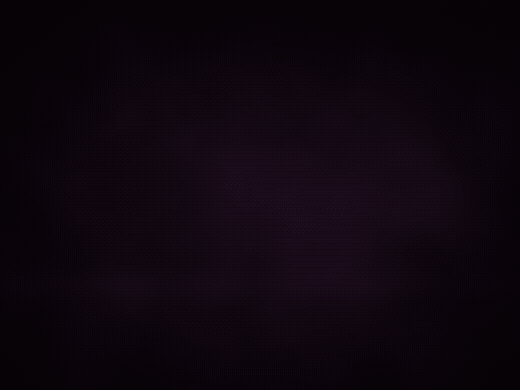
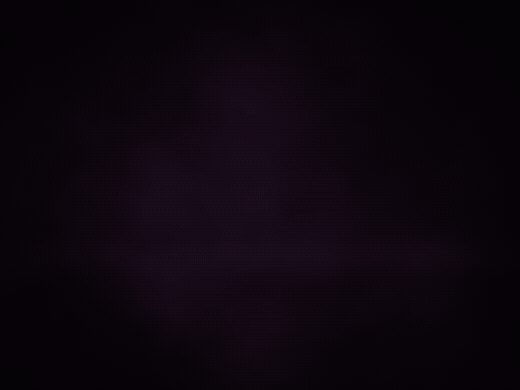
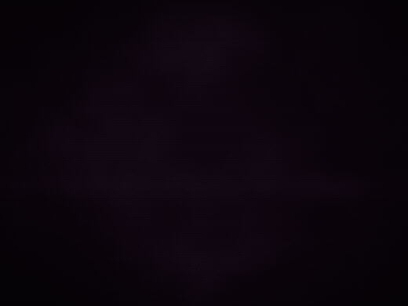
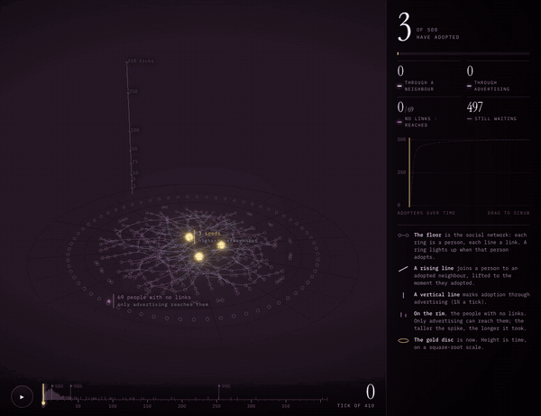
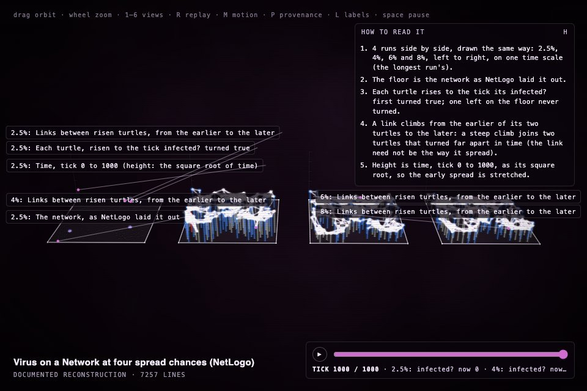
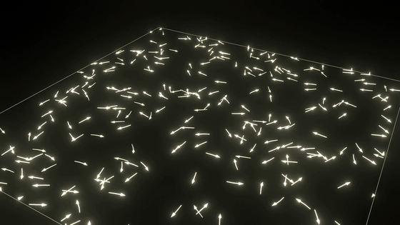
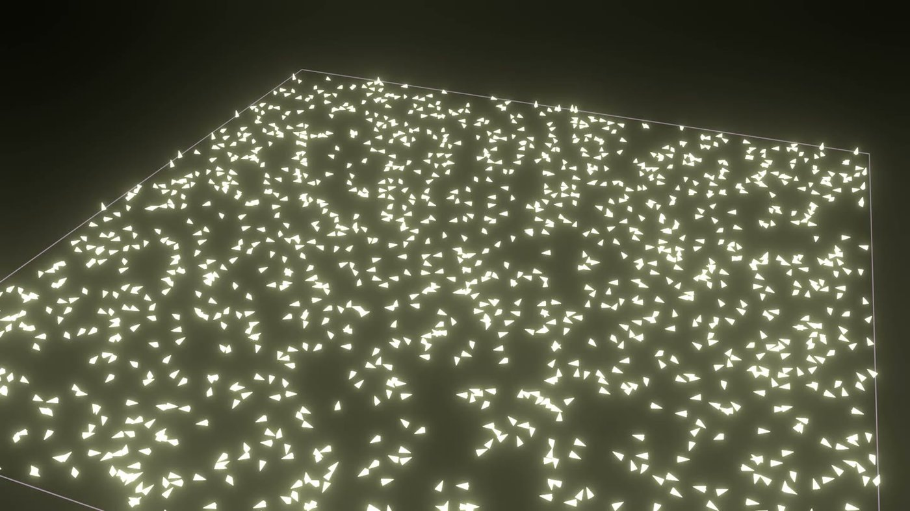
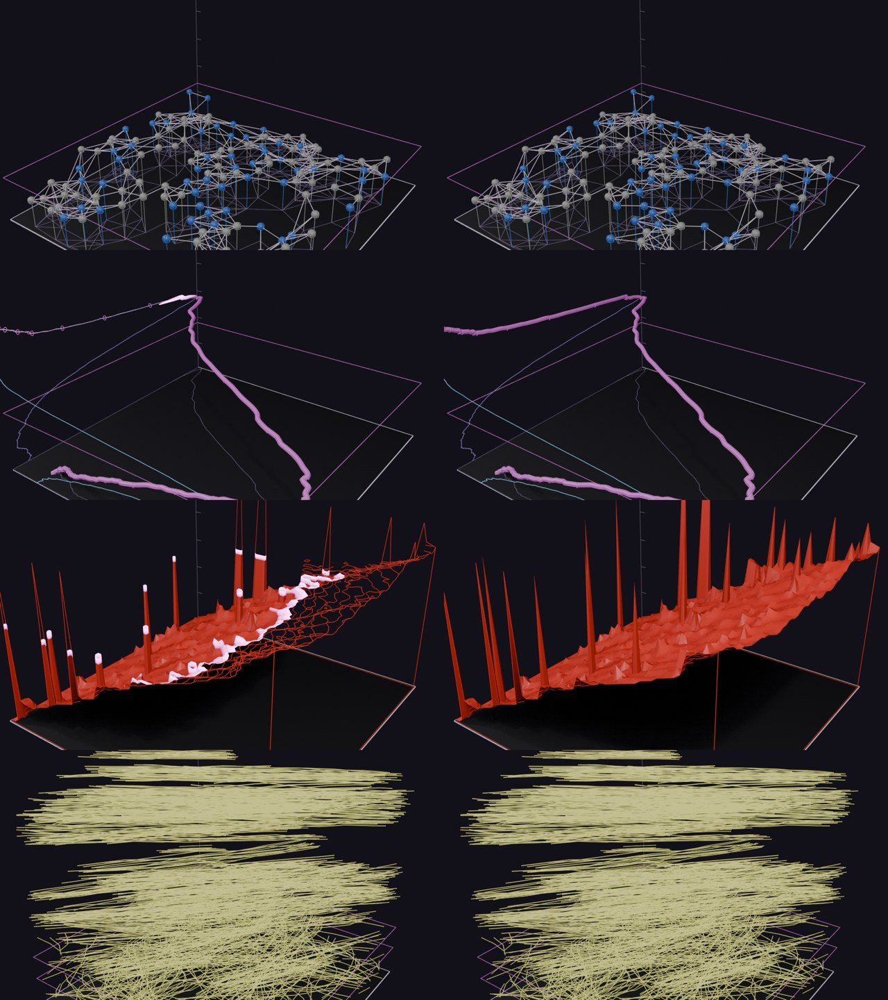
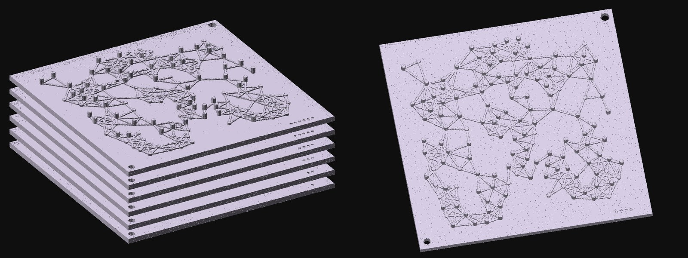

# Construct for educators and researchers

An agent-based model's run becomes something to explore, replay and compare: drawn with time as its height, so its
assembly replays the run, in the model's own NetLogo colours, with a legend, a *How to read it* panel, a replay bar
and the moments that matter marked on it. Everything drawn comes from the recording, under a data lock. The same
run goes into Blender as a film or a 3D model, and onto a 3D printer as plates you can hold.

<p align="center">
  <a href="https://rtmandreyev.github.io/construct/examples/netlogo-flocking/"></a>
  <a href="https://rtmandreyev.github.io/construct/examples/netlogo-wolf-sheep/"></a>
  <a href="https://rtmandreyev.github.io/construct/examples/netlogo-fire/"></a>
</p>
<p align="center"><sub>Flocking, Wolf Sheep Predation and Fire: one NetLogo run each, with time as height. Open one to turn it, replay it and read it.</sub></p>

## One command in NetLogo

Add `extensions [construct]` to a model and type `construct:run`. It runs the model as its buttons do, records what
is worth recording and opens the run as a construct, in a view chosen for the data: tracks rising in time for
things that move, a network that lights up as something spreads, a loop for a cycle, a field for fronts. 388 of
the 445 two-dimensional models in NetLogo's Models Library record with no edits.

```
extensions [construct]
construct:run
```

## Reading a run

Every run says how to read it: a legend for each colour, a panel that explains the shape, a replay bar that steps
through the ticks, and landmarks where the order forms (the flock aligning, the fireflies falling into step, the
front reaching the far edge). The counts come as CSV, and *Cite this run* gives the model, NetLogo's version, the
seed and the ticks.

<p align="center"><a href="https://rtmandreyev.github.io/construct/examples/netlogo-viral-marketing/"></a></p>
<p align="center"><sub>A live simulation: Simple Viral Marketing, rebuilt to run in the browser. <a href="https://rtmandreyev.github.io/construct/examples/netlogo-viral-marketing/">Run it</a> and compare a hundred runs with NetLogo's own.</sub></p>

## Two runs side by side

A slider moved, or another seed: two or more runs on one time scale, with a printable worksheet for the class.

<p align="center"><a href="https://rtmandreyev.github.io/construct/examples/netlogo-virus-compare/"></a></p>

```sh
construct netlogo-compare low.jsonl high.jsonl --labels "2.5%,6%" --out compare.json
```

## In Blender: films and 3D models

The recording itself, drawn in Blender: every agent at every tick as moving light with a trail, in its own NetLogo
colours, each link while it lasts, the patches as a floor. Nothing is sampled. Or the run as a 3D model with
named parts, to render, light and print.

<p align="center">
  
  
</p>
<p align="center"><sub>Flocking and Fireflies as films, rendered in Blender from the recordings.</sub></p>

<p align="center"></p>
<p align="center"><sub>Four runs as 3D models in Blender, each in its own colours.</sub></p>

```sh
construct netlogo-film run.jsonl --out film.mp4                      # needs Blender
construct netlogo run.jsonl --view auto --solid --glb run.glb --out run.json
```

In NetLogo: `(construct:draw "auto" "film" true)` or `(construct:draw "auto" "model" true)`.

## A run you can hold

On a 3D printer the same idea becomes a stack of plates, one per moment, keyed with pins so they go together in
order: building the stack replays the run, and taking it apart steps back through time. A key card says what each
plate is, the model and its data lock.

<p align="center"></p>
<p align="center"><sub>Virus on a Network, six moments from tick 0 to tick 300, previewed from the files. On the plate at the peak (tick 68), 118 of 150 people are infected: the tall dots.</sub></p>

```sh
construct netlogo-plates run.jsonl --out plates/ --at 0,20,40,68,120,300
```

## Go deeper

- [In a classroom and a museum](../CLASSROOM.md): a lesson with two runs compared, and a worksheet
- [The NetLogo bridge](../NETLOGO.md) and [the extension](../../hosts/netlogo/README.md)
- [A run you can hold](../PRINTING.md#a-run-you-can-hold): the plates, in full
- [The Blender add-on](../../hosts/blender/README.md#a-netlogo-run-as-a-film): a run as a film

The NetLogo models are © Uri Wilensky; the NetLogo examples are under CC BY-NC-SA 3.0.
