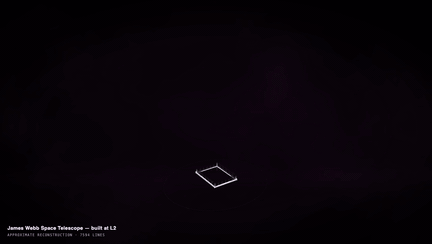
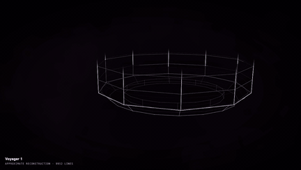
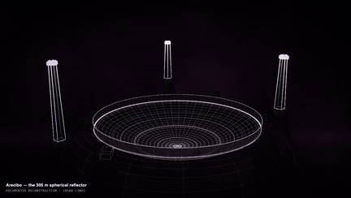
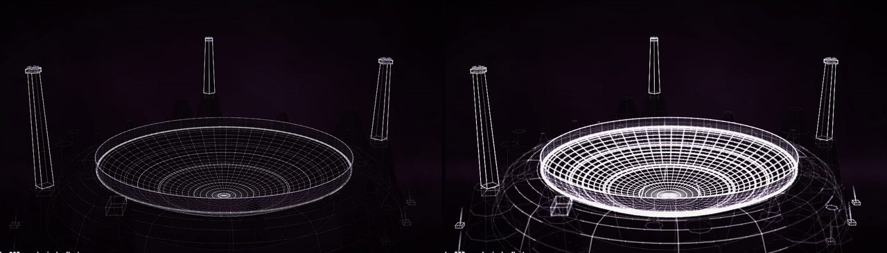
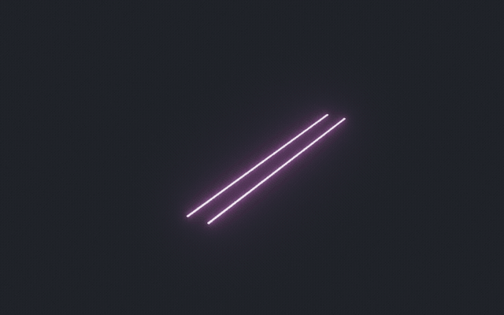
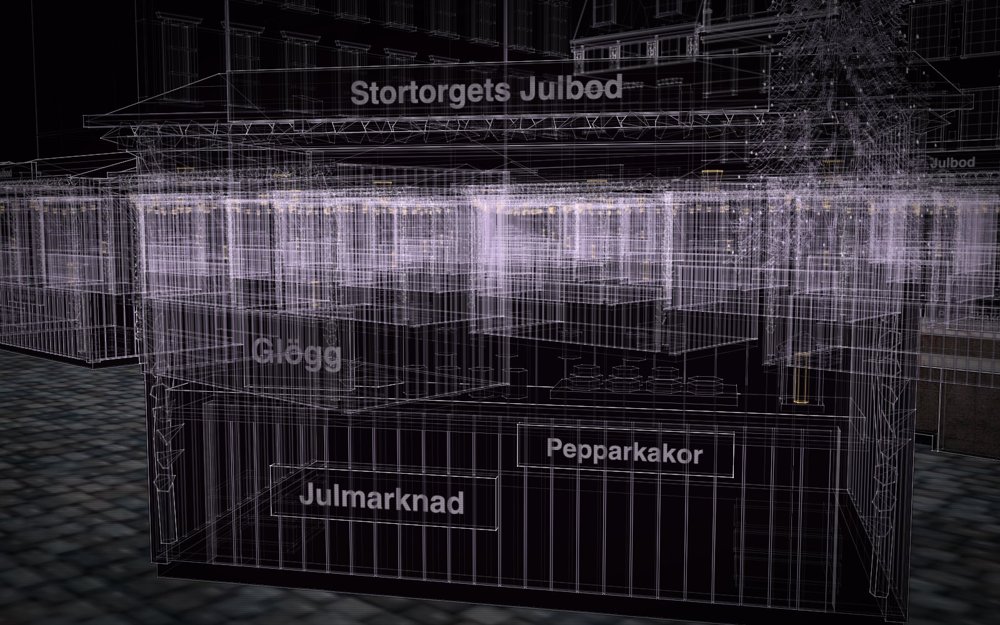
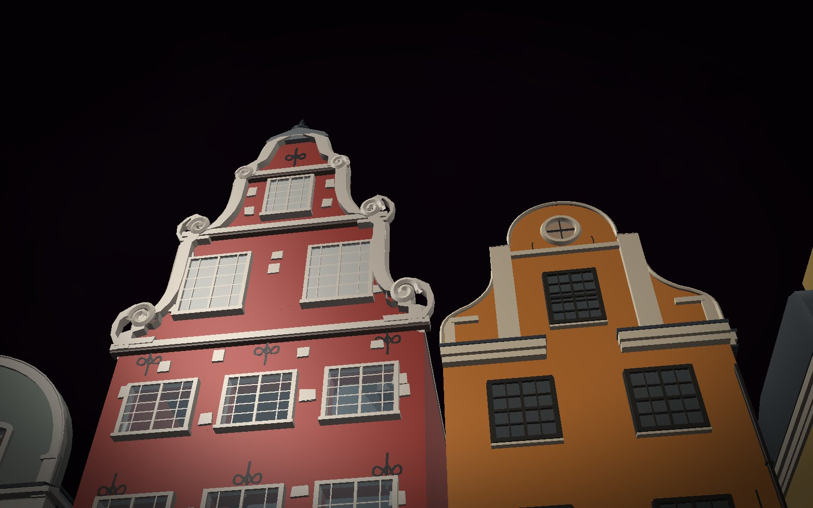

# Construct for film and motion

A construct can assemble across a piece of music for as long as the track lasts: the build nearly pauses in quiet
passages and surges in loud ones, flares on the strong attacks, starts a new stage at each new section, and shimmers
while a vocal stem sings. You get an MP4 with the track in it. For your own shots, the same construct goes into
Blender with a keyed reveal, or into your own three.js scene; a world's named views are ready-made camera positions.

<p align="center">
  <a href="https://rtmandreyev.github.io/construct/films/james-webb-space-telescope/"></a>
  <a href="https://rtmandreyev.github.io/construct/films/voyager-1/"></a>
  <a href="https://rtmandreyev.github.io/construct/films/arecibo-observatory/"></a>
</p>
<p align="center"><sub>The James Webb Space Telescope, Voyager 1 and the Arecibo Observatory, made by DeepSeek V4.1 Flash in
masterpiece mode, each assembling across a piece of music. Each page has the film and the live construct.</sub></p>

## How the music shows

Construct listens to the track first (`construct audio`) and writes, for every frame, how loud it is, how bright,
where the attacks are and where the sections change. Each track is measured against its own range, so a loudly
mastered song still moves between calm and intense.

| | What you see | At the default reactivity |
| --- | --- | --- |
| **Pace** | the build nearly pauses in quiet passages and surges in loud ones, smoothed over two seconds | from about a tenth of an even build to three times it, and it still ends on the second you asked for |
| **Light** | the whole construct swells and dims | 60% to 140% of its usual light |
| **Accents** | a flare at the edge being drawn, a brief glow over what is built | the stronger attacks, at most five a second, each fading in about a fifth of a second |
| **Sections** | a new stage of the construct begins | where the track's loudness and brightness change for good, at least ten seconds apart |
| **Voice** | a fine shimmer over the construct | a separate vocal stem, if you give one |

`--reactivity` runs from 0 (an even build, the music only the soundtrack) to 2 (quiet passages pause, loud ones race).

<p align="center"></p>
<p align="center"><sub>Arecibo, one frame apart: just before a strong attack (left), and on it (right).</sub></p>

## Your track, step by step

1. **Measure the track** (any format ffmpeg reads; a `.wav` is safest):
   `construct audio track.wav --out track-audio.json` (add `--voice vocals.wav` for the shimmer).
2. **Render the film,** the assembly as long as the track less the 1.25 s opening:
   ```sh
   construct video scene.json --out film.mp4 --assembly 245 --audio track-audio.json --sound track.wav \
       --camera steady --size 1920x1080 --fps 24
   ```
   `--camera tour` plays the scene's own flights to its close-ups (timed to the parts they look at), `steady` keeps
   the whole construct in one slowly drifting shot, `still` locks the view for a move you add in your editor.
   `--view` picks the view.
3. **Wait.** Every frame is drawn in a browser, a frame or two a second on a laptop: a four-minute film at 24 frames
   a second takes about an hour.
4. **Preview it live** before you render: `construct build scene.json --out out --film`, copy the features file
   beside the page and open `out/construct.html?assembly=245&audio=track-audio.json` while you play the track.

In Hermes the same is one request ("film it assembling across this track, with this vocal stem"): `construct_film`
renders in the background, its progress shows in the chat, and the film plays on the card when it is done. The
[Villa Savoye](hermes-walkthrough.md#7-a-kit-and-a-film)'s 15-second film was asked for this way, in one sentence;
[Tompion's clock](../END-TO-END.md#8-a-film) was filmed across a track from the command line.

## In Blender

The [Blender add-on](../../hosts/blender/README.md) brings a construct in with its build, joints, light-to-metal and
finish on sliders, and **Keyframe a Reveal** keys all four from the current frame: the assembly in light, the turn to
a solid, the finish from a material map, the opening. Then light and render it your way.

<p align="center"></p>
<p align="center"><sub>KESTREL, an invented ice tug, revealed in Blender and finished from a sixteen-rule material map
(<a href="invent-from-what-exists.md#take-it-further-a-finish-in-blender">how</a>).</sub></p>

A NetLogo model's run comes into Blender as a film too: every agent at every tick as glowing light with a trail in its
own NetLogo colour, at 30 ticks a second (`construct netlogo-film run.jsonl --out film.mp4`;
[models come alive](educators-and-researchers.md)).

## Sets and shots: worlds

A world places whole constructs together at real size and names its own views, so the shots of a set can be asked
for with it. [Stortorget](../../examples/worlds/stortorget/), Stockholm's old square at its Christmas market, was asked
for "made to be filmed", with five views: the view from where the photograph was taken, the nearest stall close with its bulbs, the red
and orange gables from below, the tree, and a high view over the square. Each is a named view of the world
(`b-stall-close`, `c-gables-low`…); `construct video world.json --view c-gables-low` renders the world assembling
from it, with `--sound` for a track under it.
In Blender, the add-on imports the world whole ([3D artists](3d-artists.md#a-whole-world)).

<p align="center">
  
  
</p>
<p align="center"><sub>Two of Stortorget's named views: the nearest stall, and the gables from below in the solid view.</sub></p>

## In your own engine

If your film is made in a three.js engine, `construct_hologram/film/construct-three.js` places a construct in your
scene, with your camera, lights and post-processing. It draws the lines as glowing strokes and the solids as dark
glass, as the construct's page does, and takes the music's energy, brightness and voice per frame from the same
features file. For other tools, `construct export` writes glTF (named parts, the `open` animation and each vertex's
build phase as `_PHASE`, for a reveal in your own shader), and FBX or USD through Blender.

## Good to know

- **Music-shaped assembly is for a construct.** A world's page does not carry film mode in this release: a world
  films as its own assembly, at its own pace, with your track laid under it.
- **No beat grid.** Accents follow the attacks film mode hears, not a tempo; sections come from loudness and
  brightness, not harmony; a track shorter than about 20 seconds has none.
- **The voice comes only from a separate stem,** and the track is heard in mono at 16 kHz.
- **The browser preview is silent:** play the track alongside it, or watch the rendered film.
- Rendering needs a Chromium-family browser and ffmpeg; Construct installs neither.

## Go deeper

- [Film mode](../FILM.md): every option, how the music drives the build, the three.js loader
- [The Blender add-on](../../hosts/blender/README.md) and [runs as films](../NETLOGO.md)
- [New things from real ones](invent-from-what-exists.md): design a ship, a vehicle or a creature for your film
