# Construct for game developers

Props and whole levels you can open, change and rebuild: named parts at real sizes, doors and lids on working
hinges, a record of how every part is known, and one command to a Godot map, a glTF or an FBX. Make the models your
game needs from photos, studies or a concept picture, instead of buying stock models or living with a generated
blob of triangles. Godot 4.7 is tested here. Unity and Unreal take the same glTF, or an FBX made from it by Blender.

<p align="center">
  
  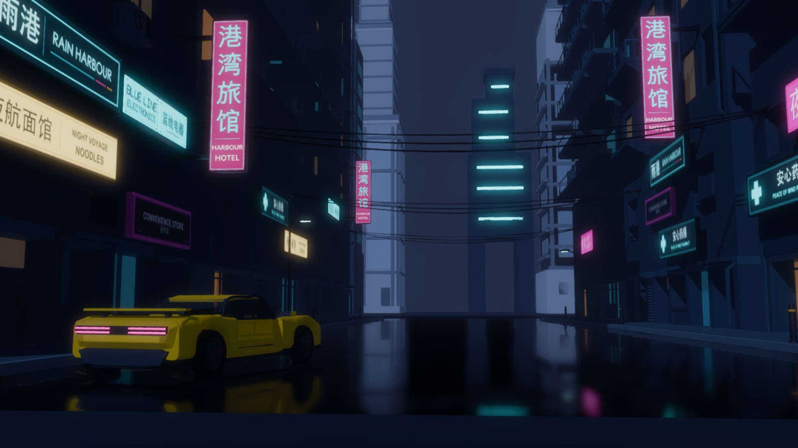
</p>
<p align="center"><sub>Left: a concept picture, the requester's own. Right: <a href="../../examples/worlds/rain-harbour/">Rain Harbour</a>,
the level made from it in Hermes, zero-shot, running in Godot 4.7: 21 constructs placed 50 times, every sign in real
English and Chinese, a hero car whose doors open. The level is the export as it comes (<code>--wire none</code>); the
night (glow, fog, reflections on a glossy road) is a few lines of Godot setup.</sub></p>

On this page:

1. [A construct is not a generated mesh](#1-a-construct-is-not-a-generated-mesh): what you get, prop by prop, with
   the FJ62, the VW T1 Samba, the Vespa, KESTREL and AURIC.
2. [A whole level from one picture](#2-a-whole-level-from-one-picture-rain-harbour): Rain Harbour, measured in
   Godot.
3. [Your models, not stock models](#3-your-models-not-stock-models): where they come from, and what they cannot do.
4. [From the request to the engine](#4-from-the-request-to-the-engine): the prompt, the export, Godot, Unity and
   Unreal, changes and re-exports.

Every number on this page was measured on Construct 1.3 with the commands shown (an Apple M2 Pro, Godot 4.7.2,
Blender 5.2), or is quoted from the page it links to. In the commands, `construct` is short for
`python3 construct_hologram/cli.py` in a checkout of Construct.

## 1. A construct is not a generated mesh

A text-to-mesh or image-to-3D generator usually hands back one surface: a fused mesh with a baked texture, at
whatever scale it came out, made again differently each time you ask. A construct is a description first: a scene
of named parts, each with a shape, a size in metres, a place, a source and a certainty, plus the joints that move
them. Construct checks that description and builds everything from it, the hologram page and the 3D files alike.

| | A generated mesh, usually | A construct |
| --- | --- | --- |
| What arrives | one surface, or a few | named parts: the FJ62 has 214, AURIC 185, the T1 Samba 255, KESTREL 256 |
| Size | whatever scale it came out at | metres, from published facts where they exist (the FJ62's 2.73 m wheelbase) or designed and marked so |
| Moving parts | none; doors are painted on | doors, lids, cowls, a steering column, as hinges, turns, slides and lifts, with their angles and travel |
| Asking again | a different model | the same scene builds the same file, byte for byte |
| Knowing what is true | nothing says | every part says how it is known: measured, traced, seen in a photo, designed (press **P**) |
| Changing one thing | edit the triangles by hand, or generate again | change that part in the scene and rebuild; every other part stays as it was |
| In the engine | a mesh to tidy up | merged draw calls, a collider per part, or rigid bodies with their hinges, in one command |

What a generator does better, and Construct does not try to: organic shapes, painted textures, characters. More on
that in [What it cannot do](#what-it-cannot-do).

### Named parts at real sizes: the FJ62

[The Toyota Land Cruiser FJ62](../../examples/toyota-land-cruiser-fj62/) is 214 named parts (`tyre-front`,
`dropgate-panel`, `bumper-rear`, `mirror-head`…) built from a 60-series blueprint scaled to the documented wheelbase,
and from photographs. Its facts carry their sources: wheelbase 2.73 m, length 4.75 m, width 1.8 m, verified from
published specifications; tyre diameter 0.79 m, measured on the blueprint against that wheelbase and marked
*inferred*. Its parts: 138 traced from the blueprint, 4 with their size verified and their shape traced, 72 inferred.

Every part keeps that record in the export. In the glTF it is the node's `extras.construct` (id, role, certainty,
source, basis); in Godot, the node's metadata. AURIC's left door skin, in Rain Harbour's map:

```gdscript
var skin = level.find_child("hero-car_left-door-skin")
print(skin.get_meta("extras")["construct"]["certainty"])   # "inferred", with its basis: "hero-car/vehicle-envelope"
```

<p align="center">
  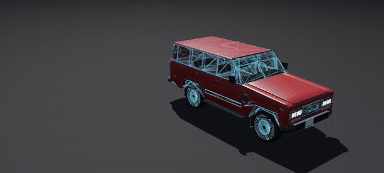
</p>
<p align="center"><sub>The FJ62 in Godot, exported with <code>--pieces</code>: every piece a rigid body with convex shapes,
knocked apart onto the floor.</sub></p>

### One checked description, rebuilt the same every time

The scene is data, and `construct check` validates, compiles and audits it before anything is built: what floats,
what pokes through, what is too small to see. The same scene always builds the same thing. Exported twice, AURIC's
game file came out byte for byte the same (`shasum` of both: `5c0f5f8b…`). Your level's props do not drift between
builds, and a diff of the scene is a diff of the model.

### Joints that work

A construct's moving parts are articulations: a hinge, a turn, a slide or a lift, with a pivot, an axis, an amount
and an order. A joint can ride on another (the T1's sunroof panels slide back, then the stack lifts). Every export
carries them as pivot nodes and an animation: `open` plays every joint in its order groups (1.5 s each), `open:<id>`
plays one, and `idle` loops periodic motion (a spinning reel, a pendulum).

| Construct | Its joints |
| --- | --- |
| [Toyota Land Cruiser FJ62](../../examples/toyota-land-cruiser-fj62/) | the drop-gate, a hinge, 85° |
| [Volkswagen T1 Samba](../../examples/volkswagen-t1-samba/) | nine: two cab doors (18°), two cargo doors (15°), the engine lid (70°), three panels of the folding sunroof that slide back (1.08, 0.72 and 0.36 m) and the folded stack that lifts (4 cm) |
| [Vespa GS 150](../../examples/vespa-gs150/) | six: the handlebar steers (24°), the stand folds (78°), each side cowl lifts off (0.23 and 0.19 m) and then turns away (110°) |
| [KESTREL](../../examples/kestrel/), an invented ice tug | six: four cradle arms that release (32°) and two radiator wings that fold (78°) |
| [AURIC](https://rtmandreyev.github.io/construct/worlds/rain-harbour/constructs/auric/), Rain Harbour's hero car | two gull-wing doors, each a hinge along the roof line that lifts 65° and carries 16 parts (skin, glass, mirror, lining, handle, latch) |

With `--pieces glued`, each joint becomes a body of its own on its hinge in Godot, once
[`construct_joints.gd`](../../hosts/godot/construct_joints.gd) connects it (a HingeJoint3D or SliderJoint3D per
joint, with its limits; a chain of joints, one Generic6DOFJoint3D). Measured in Godot 4.7.2 headless, each glued
file dropped on a floor and run for 240 physics frames, the test Construct's own suite runs:

| Glued export | Bodies | Joints connected | What happened |
| --- | ---: | ---: | --- |
| FJ62 | 2 | 1 | the body settled within 1.6 cm; the drop-gate fell open on its hinge to 86.6° (its 85°, on a soft limit) |
| T1 Samba | 10 | 9 | joints inside joints kept: each sunroof panel is one body on its chain (slide, then lift); nothing moved past its own travel |
| Vespa GS 150 | 5 | 4 | each cowl is one body on a chain (lift, then turn) |
| AURIC | 3 | 2 | the car settled within 1.8 cm; the doors stay shut until pushed |

<p align="center">
  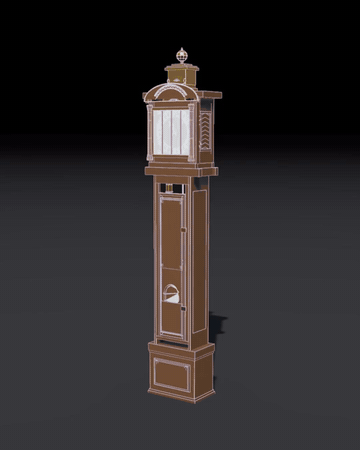
  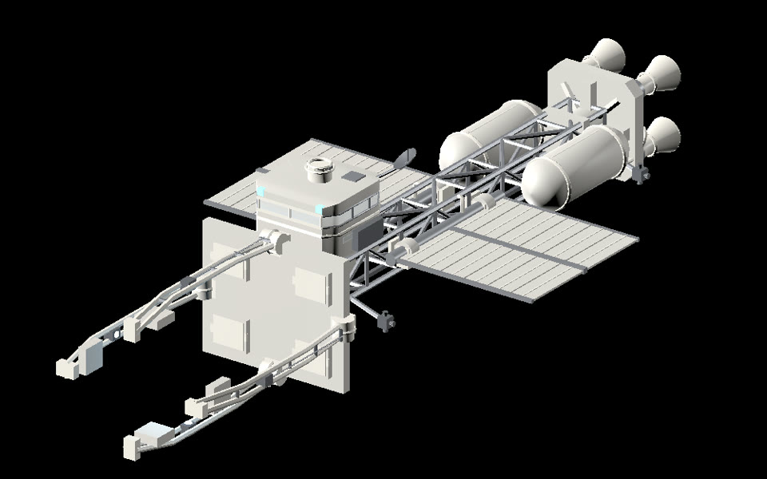
</p>
<p align="center"><sub>Tompion's clock glued in Godot 4.7, its doors on their hinges and its pendulum on the
<code>idle</code> animation (<a href="../END-TO-END.md#7-in-a-game-engine">how</a>), and KESTREL in Godot, with the project
its agent wrote around it: <code>set_cradle_open(0…1)</code>, <code>set_radiators_folded(0…1)</code>, blinking
spotlights on the arms and a docking transform (<a href="invent-from-what-exists.md#7-joints-in-godot">how</a>).</sub></p>

<p align="center"></p>
<p align="center"><sub>The T1 Samba assembling in its construct; its doors, engine lid and folding sunroof are the
joints above.</sub></p>

### A record of how each part is known

Press **P** on any construct and each part is coloured by how it is known. For a game this tells you which sizes to
trust when something must fit (a doorway, a character's reach, a vehicle in a garage):

| Construct | How its parts are known |
| --- | --- |
| FJ62 | 138 traced from the blueprint, 4 sized from published specifications and traced, 72 designed |
| T1 Samba | 141 sized from published facts and traced from a blueprint, 114 designed |
| Vespa GS 150 | 52 seen in the owner's photos and checked against published sizes, 104 seen, 3 described ([how](your-vehicle.md)) |
| KESTREL | all 256 designed, from the reasoning of real spacecraft studies, and marked so |
| AURIC | 178 designed, 7 generated decoration (yellow inlays and the tail surround, drawn from artwork); its 4.4 m length, 2.8 m wheelbase and 0.34 m wheels are design choices, marked *inferred* |

### Editable by part

The scene is the model, so you change the scene, not the triangles. In Hermes, `construct_edit` changes a part by its
id (move, rotate, resize, set fields, add or remove parts), each step validated and written only when nothing breaks,
with the diff. From a checkout, edit `scene.json` and run `construct check`.

Tried here on a copy of AURIC: its two door hinges set from 65° to 80° (`"amount": 80` on each articulation), checked
(no errors), exported glued again. The doors' joints in the new file read 80, and nothing else changed.

When you ask an agent for more detail, ask it to keep what your game already names. KESTREL's second version kept all
256 parts with their names, places and sizes and added 242 (`v2-…`), so every script and animation that names a part
kept working ([how](invent-from-what-exists.md#6-more-detail-every-part-kept)).

### Game-ready options

One scene, several kinds of file. Measured on the FJ62 and AURIC:

| You want | Options | The FJ62 | AURIC |
| --- | --- | --- | --- |
| everything, named | (none) | 214 parts, 30,526 triangles, about 300 mesh surfaces, 1.7 MB | 185 parts |
| few draw calls | `--merge --wire seams --materials map.json` | 36,686 triangles in 22 surfaces, 1.3 MB; the drop-gate still opens | 64,450 triangles, 2.3 MB with colliders |
| collisions | `--colliders` | 93 box colliders (`<part>-convcolonly`), each moving with its joint | 185 box colliders |
| a prop that holds together | `--pieces glued` | 2 bodies | 3 bodies |
| a prop that breaks apart | `--pieces` | 49 rigid bodies with convex shapes, made to settle rather than burst | |

What else is in every file:

- **Units and axes:** metres, Y up, the front towards +Z.
- **Merging:** `--merge` folds everything that does not move into one mesh per material; doors and lids keep their own
  nodes and animations.
- **The design lines:** `--wire seams` turns door seams, creases and outlines into thin dark tubes (engines drop plain
  lines); `--wire none` leaves them out.
- **Texture coordinates:** a box projection in metres on every surface, enough to tile a material on a part, and for
  an engine to generate lightmap coordinates on import.
- **Glass:** a part named for its glazing (glass, window, windscreen) gets a glass material, with a translucent base
  colour Godot shows.
- **Godot's name rules:** a part whose id Godot would read as an import instruction (`steering-wheel` would become a
  VehicleWheel3D) is renamed `steering-wheel-part`, its real id kept in the metadata.
- **Formats:** `.glb`, `.obj` (in quads, to model over), and through Blender `.fbx` (Unity, Unreal, Maya), `.usd` and
  `.usdz` (Omniverse, Houdini, Apple's Reality tools).
- **Budgets:** a construct exports up to 200,000 triangles, a world up to 2,000,000.

The full option list is in [3D export](../EXPORT.md), and bodies, colliders and joints are in [Godot](../GODOT.md).

### A finish map

Colour is yours, kept beside the scene in a small material map, never inside it: part ids or patterns, a colour and
a finish (`paint`, `chrome`, `brushed`, `rubber`, `plastic`, `wood`, `glass`, `light`), the first rule that matches a
part winning. KESTREL's map is 16 rules: `water-tank-*` gold foil, `radiator-panel-*` radiator black,
`floodlight-lens-*` lit, whatever no rule names thermal white ([the map](../../examples/kestrel/maps/finish.json)).
The Vespa's, the T1's and AURIC's are beside their scenes. A world merges each construct's own map under its
placement's id.

<p align="center">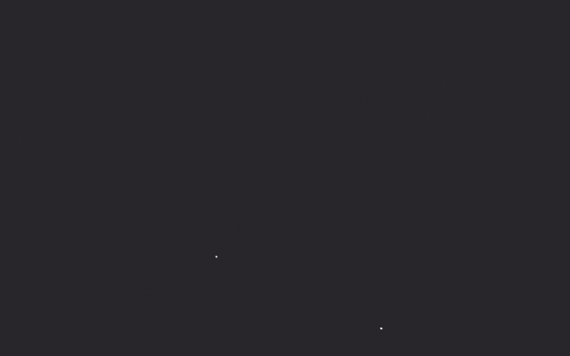</p>
<p align="center"><sub>The Vespa's export with its finish map, in Blender: the same parts, from light to plain to
finished.</sub></p>

### Artwork

Signs, labels and decals are pictures, not modelled letters. Each is a PNG in the construct's `assets/` folder,
recorded with its hash, its rights and its provenance (`generated-decorative` for Rain Harbour's), and placed on a
named part by a slot: the face of NIGHT VOYAGE NOODLES is the part `amber-face`, its artwork
`assets/night-voyage-amber-v2.png` (2560 × 480). Rain Harbour's constructs carry 30 such pictures. Because each sits on
a named part, a game can bind it to that part's face as a texture; Sol's own Godot project for Rain Harbour did
exactly that for its 24 sign faces.

## 2. A whole level from one picture: Rain Harbour

A world places whole constructs at real size, each still itself: its parts, joints and record its own, under its
placement's id. [Rain Harbour](../../examples/worlds/rain-harbour/) is a world made for a game: one concept picture,
one request, and a level came back as 21 constructs placed 50 times. Made by GPT-6.1 Sol in Hermes Desktop with the
Construct plugin, from the morning of 8 November 2026 to three in the morning of the 9th. The follow-up messages were
about the process (finish under Construct's updated round rules, 90 more minutes, judge colour in the solid view), not
the design. [Its page](../../examples/worlds/rain-harbour/README.md) follows the run round by round.

<p align="center">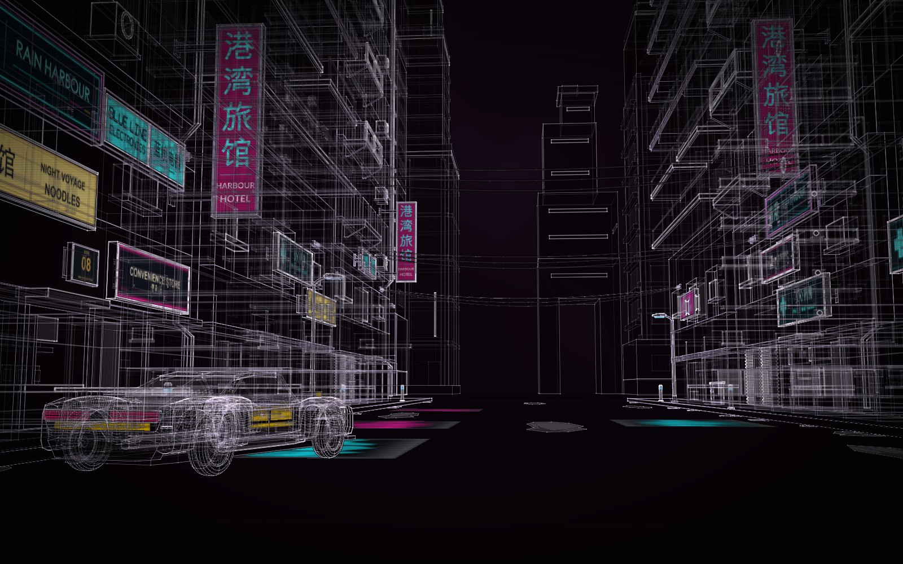</p>
<p align="center">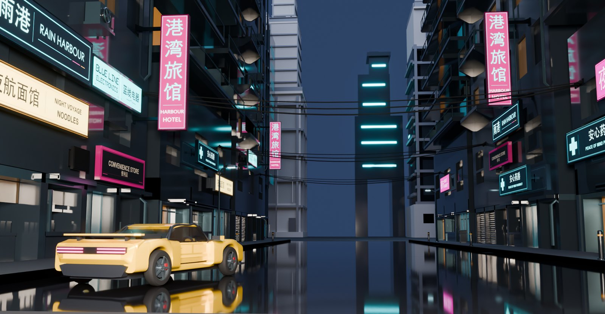</p>
<p align="center"><sub>The view from the picture's viewpoint in lines of light, and the same shot at night in Blender, from the world's
export.</sub></p>

### The plan: each thing once, placed as often as needed

| What | Constructs | Placed |
| --- | ---: | ---: |
| The street: road, pavements, kerbs, drains, wet patches | 1 | 1 |
| Street-front towers: the Service Tower and the Offset Balcony Hotel | 2 | 10 (five each) |
| Skyline towers | 4 | 5 |
| Signs: six businesses, the district's name and a street number | 8 | 19 |
| AURIC, the hero car | 1 | 1 |
| Props: bollard, street lamp, bin, water vending machine, cable span | 5 | 14 |
| **In all** | **21** | **50** |

Every placement is at scale 1. The sizes are designed and marked so, except the street's 60 m, the one number the
request gave: a 14 m carriageway with 3 m pavements and 0.18 m kerbs, the Service Tower 48 m high, the hotel 62 m,
the bollard 0.9 m, the lamp 4.8 m. The world's check passes with six warnings, all where a cable's fixing plate meets
a façade (Construct has no wall mount yet). Its extent: 100 × 84.4 × 160 m.

### Every construct keeps what a prop has

- **Reusable.** The hotel placed five times is one construct, compiled once, in one folder:
  [`constructs/balcony-hotel/`](https://rtmandreyev.github.io/construct/worlds/rain-harbour/constructs/balcony-hotel/). Each of the 21 has its
  own scene, material map and round record, to place in a level of your own.
- **Movable.** A placement is an id, a construct, a position and a turn. Move it on the world's card in Hermes
  (**Arrange**), by asking (`construct_world` op `move`), or by editing `world.json`. Then export again.
- **Animated.** Joints still work inside the world. Every export of it carries `open`,
  `open:hero-car/left-gullwing-open` and `open:hero-car/right-gullwing-open`: in the merged glTF, Godot's
  AnimationPlayer lifts the left door its 65°; in the glued map the doors are bodies of their own on their hinges
  (below).
- **Its own record.** Every part says how it is known across the whole world (press **P**), and each construct keeps
  its critic's verdicts: AURIC 12 rounds, *good*, 23 of 27; the RAIN HARBOUR sign *outstanding*, 27 of 27.

### Real signs

Eight signs, each in English and simplified Chinese that say the same thing, where the picture had letter-noise:

| English | Chinese |
| --- | --- |
| RAIN HARBOUR, the district fascia | 雨港 |
| NIGHT VOYAGE NOODLES | 夜航面馆 |
| HARBOUR HOTEL | 港湾旅馆 |
| BLUE LINE ELECTRONICS | 蓝线电器 |
| PEACE OF MIND PHARMACY | 安心药房 |
| NIGHT MARKET | 夜市 |
| CONVENIENCE STORE | 便利店 |
| RAIN HARBOUR ROAD 08 | 雨港路 08 |

What each Chinese name says, word by word, is on [the world's page](../../examples/worlds/rain-harbour/README.md#the-signs).
Each sign is a construct of four to six parts with its artwork on named faces (above), placed one to three times.

### The hero car

AURIC, an original two-door coupé: 185 named parts, 4.4 m long on a 2.8 m wheelbase, four wheels with tyres, rims,
hubs and brakes, magenta tail lights, a rear wing, two seats and two gull-wing doors on hinges that lift 65°.

<p align="center">
  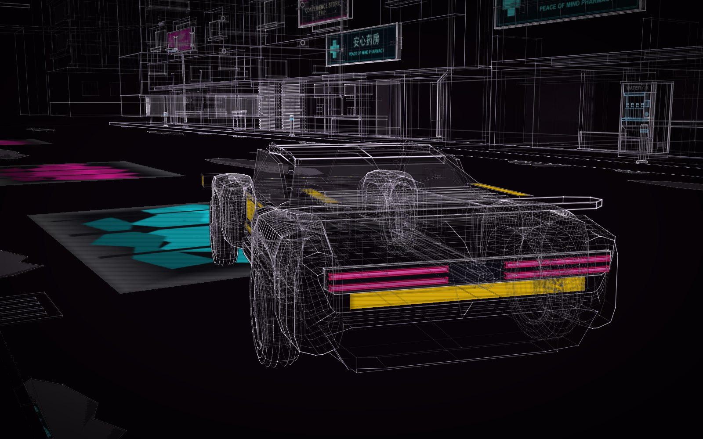
  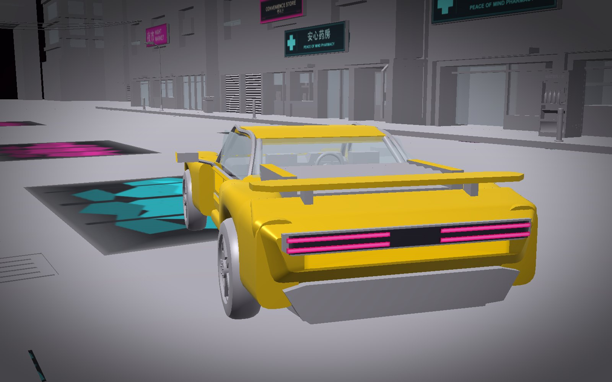
</p>
<p align="center"><sub>AURIC in the light and in the solid view (S).</sub></p>

### Measured: the level as files

From `examples/worlds/rain-harbour/world.json`, on an Apple M2 Pro:

| Export | Command | Time | File | What is in it |
| --- | --- | ---: | ---: | --- |
| Godot map | `--out level.glb --pieces glued` | 19 s | 28.0 MB | 50 placements, 2,081 parts, 164,974 triangles; one static body of 3,235 convex shapes; two door bodies with their hinges; 243 materials; the signs' artwork, 26 images |
| glTF | `--out level.glb` | 8 s | 16.7 MB | the same 2,081 parts as named meshes, 164,974 triangles, the design lines as edges, the 26 images |
| glTF, merged | `--out level.glb --merge --wire seams` | 8 s | 11.5 MB | 175,478 triangles (seams as tubes) in 120 meshes and 327 surfaces, the artwork among them; the car's doors still their own nodes |
| glTF, with colliders | add `--colliders` | 8 s | 18.8 MB | 2,025 box colliders, `<part>-convcolonly` |
| FBX | `--out level.fbx` | 53 s | 10.5 MB | read back into Blender: 2,081 meshes, 164,968 triangles, 217 materials, the doors' animation |
| OBJ | `--out level.obj` | 19 s | 46.8 MB | plain meshes in quads, one object per part, one pose; the 26 images beside the `.mtl` |

### Measured: the map in Godot

Imported into Godot 4.7.2 (8 s headless), connected with `construct_joints.gd`, then run:

- **Structure.** The scene's root holds `rain-harbour-night-street`, one group per placement under it
  (`left-hotel-middle`, `hero-car`, `sign-noodles`…), and each part under its placement. Godot turns the glTF's `/`
  into `_`, so the left door skin is `rain-harbour-night-street/hero-car/hero-car_left-door-skin`. A placement's
  metadata names its construct (`constructs/balcony-hotel/scene.json`), its title and its scale; a part's names its id,
  role, certainty and basis.
- **Bodies.** One static body holds every part that does not move, in every placement: the street, the towers, the
  signs, the props and the car's own body and wheels. The two doors are the only rigid bodies: 2 bodies, 2 hinges.
- **The doors.** At rest they stay shut. Pushed up, each swings about its roof-line hinge and stops at its limit
  (65°, held at 69° on Godot's soft limit).
- **Animations.** The AnimationPlayer has `open` (1.5 s, both doors) and one clip per door
  (`open_hero-car_left-gullwing-open`). In the glued map physics owns the doors, so playing a clip there does not move
  them; push them, or drive the hinge from a script. To play the clips, use an export without `--pieces` (the merged
  glTF, below).

### What it is not

- **Not finished art.** The last critic's open notes are kept on [the world's page](../../examples/worlds/rain-harbour/README.md#still-open):
  the road's wet patches read as "rectangular dark cards" (Construct has no wet or mirror surface), the skyline is
  "a mostly black central void" where the picture has overlapping towers, the hotel boards are more evenly spaced than
  the picture's, the towers' upper faces are nearly bare. Final verdict *good*, 21 of 27, after 12 world rounds.
- **The car is drivable by design, not by script.** Its size, wheelbase and named wheels are a vehicle's, but in the
  map its wheels are fixed parts of the level's static body. To drive it, export AURIC on its own and give it a vehicle
  controller (below).
- **A day of model time.** The constructs' rounds took about 325 minutes of builders' time and 700 of critics', many
  running at once; the world's own 12 rounds, 204 minutes of authoring and 59 of critics.

## 3. Your models, not stock models

A stock model is someone else's object at someone else's scale, with parts you cannot name and doors that do not
open. With Construct you describe the object you need, and an agent researches it, builds it and checks it, from
whatever you have:

| You have | Example | Where it is told |
| --- | --- | --- |
| photos of a real thing | an Eames Lounge Chair from two photos and one message: 52 parts, 5 rounds | [Copy your thing](copy-your-thing.md) |
| a vehicle and its photos | the Vespa GS 150, the owner's own parts told apart from the factory's; it steers, the stand folds, the cowls lift off | [Your vehicle](your-vehicle.md) |
| a brief and real studies to borrow from | KESTREL, a 120 m ice tug designed from NASA's space-tug study, the ISS truss and turning radiators; six joints, a Godot project | [New things from real ones](invent-from-what-exists.md) |
| a concept picture | Rain Harbour: a 60 m street, its towers, its signs and a hero car | [the world's page](../../examples/worlds/rain-harbour/) |
| a documented system | a software synthesizer turned into a 61-key instrument with 44 capability groups mapped to controls | [Documentation to product](documentation-to-product.md) |
| an archetype and a seed | `construct params vehicle --seed 3` draws a seeded wedge (4.03 m long, wheelbase 2.32 m), the same seed the same car; a 10-part blockout to start from | [Archetypes](../ARCHETYPES.md) |

The examples are Apache-2.0, like Construct: take them apart and build on them. A real product's name and design may
still be its maker's; an invented one, like KESTREL or AURIC, is yours to use.

### What it cannot do

| Limit | What it means for a game |
| --- | --- |
| **Blockout-plus to finished prop** | Shapes come from Construct's vocabulary: boxes, cylinders, lathes, lofts, tubes, extrusions (AURIC: 66 boxes, 30 cylinders, 28 extrusions, 23 tubes, 21 lofts…). Good for a level's props, a vehicle, a building, previs, kitbashing; not a sculpted hero asset |
| **No painted textures** | Colour comes from a material map per part; texture coordinates are a box projection, not an unwrap. Artwork (signs, labels) are pictures on named faces, not painted UVs |
| **No levels of detail** | Construct writes none. Godot generates them on import (Import, Meshes, Generate LODs, on by default); other engines have their own tools |
| **No characters** | Joints are mechanical (hinges, turns, slides, lifts); there is no skinned rig, and nothing organic that bends |
| **Fixed wheels** | A car's wheels are named parts, ready for your controller, not engine wheels. Sol's Godot project for Rain Harbour found them by name and put each under a steering pivot and a spinning pivot ([how](../../examples/worlds/rain-harbour/README.md#into-other-tools)) |
| **Designed sizes** | Sizes read from a picture are designed, not surveyed, and each part says so. Real objects get published sizes where they exist; measure before anything has to fit |
| **Masses** | in proportion to each piece's size, not real |
| **Time** | a chair takes half an hour to an hour in the apps, a car an hour or two; a world from a picture, most of a day |

## 4. From the request to the engine

### Step 1: ask

Rain Harbour's request, word for word, with the concept picture attached. Use it as a model for your own:

> Make a Construct world from this concept picture: a game level, a rain-soaked cyberpunk street at night.
> Masterpiece quality: it should be usable in a game as it comes out, and good enough to show in a video.
>
> What to build:
> - One street block, about 60 m of street with its pavements, kerbs and drains, the buildings on both sides and
>   the skyline behind them. Real sizes throughout, built as separate pieces a level designer can reuse: a building
>   used twice is one construct placed twice.
> - The buildings are stacked, layered towers with balconies, overhangs, air-conditioning units, pipes and the
>   cables slung across the street between them.
> - The neon signs carry the picture's look, its colours and placement, but every sign must say something real and
>   readable, never the AI letter-noise in the picture. Invent a coherent district and write the signs for it: shop
>   names, a noodle bar, a hotel, a pharmacy, a street number, in English and real Chinese characters that mean what
>   they say. Six to ten different signs.
> - ONE car only: the yellow car in the front left, the hero car. Design it as a real drivable game vehicle, the
>   size of a real sports car, with doors that open, wheels, and its own tail lights. Leave out the three other cars
>   and any people.
> - Street props that make the scene readable: bins, a vending machine, bollards, a street lamp, puddle-level
>   details where they are cheap.
>
> How to make it: plan the pieces first and tell me the plan (how many constructs, which are reused) before
> building. Do not wait for my reply after the plan: state it, then go straight on and build everything. Build each
> missing construct in masterpiece mode in its own subagent, with a critic each round. Then judge the whole world
> against the picture and fix what it finds.
>
> Views for the video: the picture's own shot (low, looking down the street), the hero car close, under the signs,
> and the skyline. Say what is designed and what was inferred from the picture.

What made it work, and what to add for a game ([all eight lessons](../../examples/worlds/rain-harbour/README.md#how-to-write-a-request-like-this)):

- **Ask for reuse in so many words:** "a building used twice is one construct placed twice" gave 21 constructs for
  50 placements.
- **Say what the picture gets wrong:** the letter-noise became eight readable businesses; the left-out cars and people
  stayed out through every round.
- **Give the numbers you know, and only those:** the 60 m street is the only supplied fact; everything else is
  designed and labelled so.
- **Say what "drivable" means to you.** If you want to drive the car, ask for the controller and a game project too.
- **Say where colour is judged:** "judge colour in the solid view". The light view keeps Construct's house palette.
- **Budget the time:** twelve world rounds took 204 minutes of authoring; the default ceiling is 120 minutes. Ask for
  more at the start, or extend a stopped run with `rounds extend 90`.

For a single prop, the shape of [KESTREL's brief](invent-from-what-exists.md#how-to-write-the-brief) works: what it
is for, what to learn from, the size and frame ("metres; Y up; the bow towards +Z"), what must be there, what moves,
rules for your pipeline ("no text in the geometry", "nothing random from run to run"), and what to deliver ("a glTF
for Godot, NOTES.md with the sizes and the docking port").

A world from a picture needs Hermes with `delegation.max_spawn_depth: 2` (an orchestrator subagent per construct);
say "fast" for one pass each, much quicker and cheaper. [Worlds, step by step](worlds-walkthrough.md#7-a-world-from-a-picture-in-masterpiece-mode)
has the setup.

### Step 2: export

| Engine | In Hermes Desktop (the card's **Export…**) | From a checkout |
| --- | --- | --- |
| **Godot** | **Godot game map** (glued, with colliders) | `construct export world.json --out level.glb --pieces glued` |
| **Godot, a prop** | **Godot game map** | `construct export scene.json --out car.glb --pieces glued` (holds together), `--pieces` (breaks apart), or `--merge --wire seams --colliders` (few draw calls, box colliders) |
| **Unity** | **glTF** (with the glTFast package) or **FBX** | `--out level.glb --merge --wire seams --colliders`, or `--out level.fbx` |
| **Unreal** | **glTF** or **FBX** | the same |
| **Blender** | **glTF** | the `.glb`, or `world.json` itself with the [Construct add-on](../../hosts/blender/README.md) |

How the physics differs:

- **Glued** (`--pieces glued`): one body for everything that stays put, one more for each hinged or sliding part,
  its joint (the body it hangs on, pivot, axis, travel) in the node's metadata. A building's or a world's fixed body is
  static; a vehicle's is a rigid body. The collision shapes are each piece's own convex shapes, so with glued pieces
  `--colliders` adds nothing.
- **Loose** (`--pieces`): every piece a rigid body; interlocked parts (a rim in its tyre) are one assembly. Meant
  for break-apart and assembly mechanics on a prop.
- **Colliders** (`--colliders`): a StaticBody3D with a box per part around its surfaces, the box moving with its
  joint.
- **Unity and Unreal** do not read the glTF physics extensions (`OMI_physics_body`, `OMI_physics_shape`). They get the
  named parts and the `open` animation; the `<part>-convcolonly` boxes arrive as ordinary meshes, to turn into
  colliders by hand. Neither is tested here. Godot 4.7 is.

### Step 3: in Godot

Drop the `.glb` and [`construct_joints.gd`](../../hosts/godot/construct_joints.gd) into the project (`res://`) and put
the level in a scene. Which way the doors move depends on the export.

The glued map: physics, the doors on hinges.

```gdscript
const ConstructJoints = preload("res://construct_joints.gd")

func _ready():
    ConstructJoints.connect_joints($Level)   # a HingeJoint3D or SliderJoint3D per joint, with its limits
    var lobby = $Level.find_child("left-hotel-middle_r9-lobby-door-leaf")   # any part, by its name

func lift_left_door():                       # call each physics frame for about a second; the hinge stops it at its limit
    var door = $Level.find_children("*left-gullwing-open", "RigidBody3D")[0]
    var axis = door.get_meta("extras")["construct"]["joint"]["axis"]
    door.apply_torque(Vector3(axis[0], axis[1], axis[2]) * 4000.0)
```

The merged glTF (`--merge --wire seams --colliders`): the doors are animated, the boxes are static colliders.

```gdscript
func _ready():
    $Level.find_child("AnimationPlayer").play("open_hero-car_left-gullwing-open")   # or "open" for every joint
```

Both were run in Godot 4.7.2: pushed for one second, the glued door lifted to its limit and stayed; the merged file's
clip turned the door 65°.

To drive AURIC, take it out of the level's static body: export it on its own
(`construct export examples/worlds/rain-harbour/constructs/auric/scene.json --out auric.glb --merge --wire seams
--materials examples/worlds/rain-harbour/constructs/auric/scene.materials.json`), place it where the world puts
`hero-car` (x 4.4, z −25, turned −16°), and give it your controller. Sol's project did it as an arcade car: a
`CharacterBody3D` with one 1.94 × 1.06 × 4.3 m box, the wheels found by part name (`left-front-wheel-rim`,
`left-front-rubber-tyre`) and hung under steering and spinning pivots, the exported `open` animation played forwards
or backwards for the doors when the car is stopped. That project is described on
[the world's page](../../examples/worlds/rain-harbour/README.md#into-other-tools) and is not shipped.

### Step 4: change the level, and export again

Any change is a change to `world.json` or to a construct's scene. The export is the same command again, and the same
scene always gives the same file.

- **Move things.** On the world's card in Hermes Desktop, **Arrange**: click a construct and drag it onto any floor,
  roof or pavement, **Shift**-drag or **Q / E** to turn it, **Lift / Lower** for what hangs, **Duplicate**, **Remove**.
  **Save** checks the level (overlaps, collisions, what stands where a door opens, what stands on nothing), saves and
  rebuilds it without calling a model. **Undo last change** steps back. By asking, the agent uses `construct_world` op
  `move` or `remove`. By hand, change a placement's `at` (metres) or `yaw` (degrees) and run `construct check
  world.json`.

<p align="center">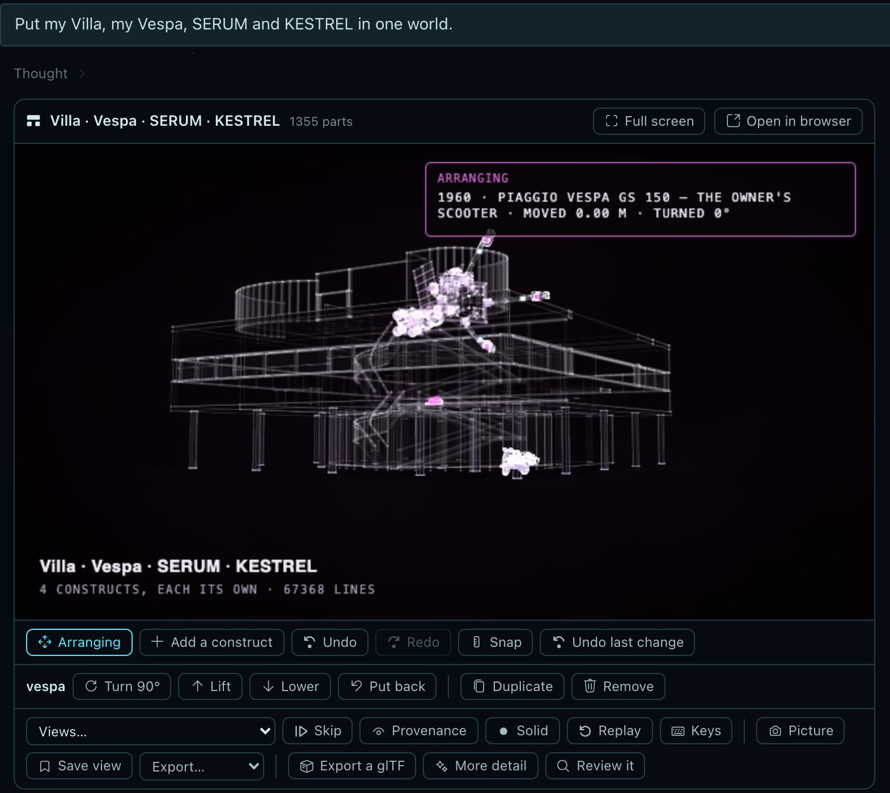</p>

- **Place your own props.** On the card, **Add a construct** opens the library (your own constructs, the ones the
  plugin ships, the gallery) and puts the one you pick on a floor it fits on, or on clear ground in front, ready to drag. By asking, the agent
  uses `construct_world` op `place`, several at once with one check. By hand, add a placement: on a part's top with
  `on`, by a scene's path or a gallery name:

  ```json
  {"id": "bin-left-back", "construct": "constructs/street-bin/scene.json", "on": "street/sidewalk-right", "at": [8.8, 0, 12.0], "yaw": 270},
  {"id": "fj62", "construct": "toyota-land-cruiser-fj62", "at": [-4.0, 0, 10.0], "yaw": 180}
  ```

  Tried on a copy of Rain Harbour: both placed, checked (52 placements, 2,320 parts), with the same six cable warnings
  and nothing new.

<p align="center">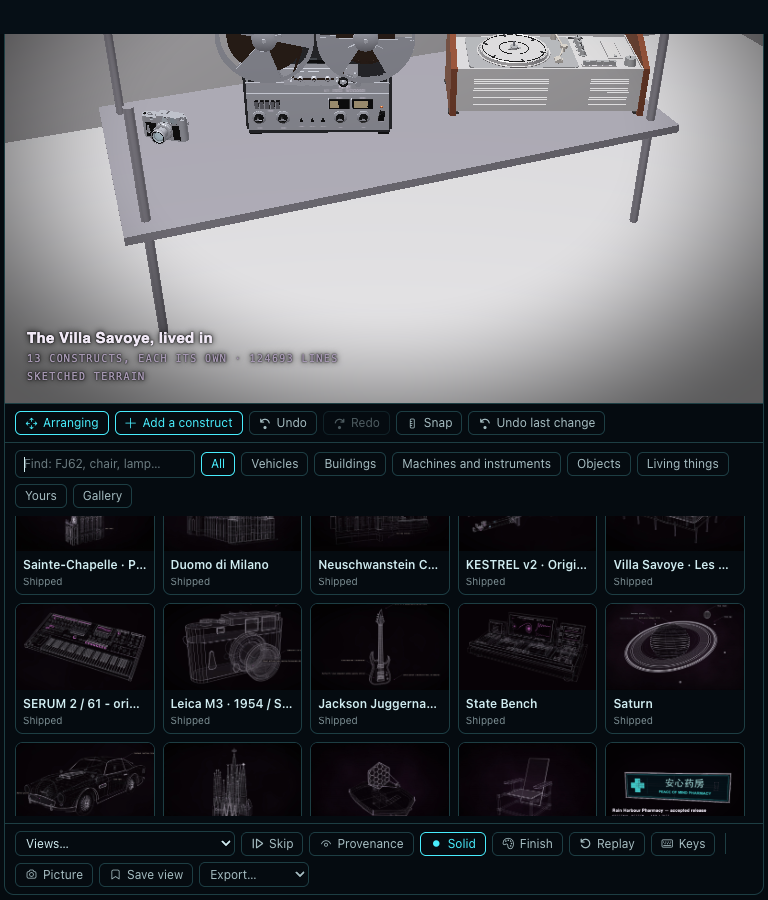</p>

- **Improve one construct, and bring it back.** A world places whole constructs; it does not merge them. Improve the
  construct in its own project (`construct_edit`, or more masterpiece rounds: "more detail on the hotel's upper
  floors, keep every part's name"), then `construct_world` op `refresh` copies it in again as it is now, checks the
  world and rebuilds it; a check that fails leaves the old copy. From a checkout the world points at
  `constructs/<name>/scene.json`, so changing that scene changes every placement of it at the next build or export.

## Good to know

- **Each construct is a project of its own.** Rain Harbour's `constructs/` folder holds 21 of them, 914 named parts in
  all; take one into another level without the rest.
- **The light view is the house palette.** Construct's own page draws every construct in its lines-of-light palette;
  a part's own colour shows in the solid view (S) and in every export.
- **Shared worlds fetch nothing silently.** A world in Hermes that places a gallery construct the plugin does not ship
  downloads its scene from Construct's GitHub release only after you approve it.
- **In the apps, too:** a single construct can be made from the Claude or ChatGPT app with no terminal
  ([how](in-the-apps.md)); worlds are made in Hermes, or by hand as a `world.json`.

## Go deeper

- [Rain Harbour](../../examples/worlds/rain-harbour/README.md): the request, the plan, every construct's rounds, the
  world's rounds, what is still open
- [Godot](../GODOT.md): glued and loose pieces, colliders, names, what was measured
- [3D export](../EXPORT.md): every option, the material map, what is in the file
- [Worlds](../WORLDS.md): placements, the world's audit, `construct_world`, limits
- [Worlds, step by step](worlds-walkthrough.md): opening, arranging, asking for and exporting a world in Hermes
- [New things from real ones](invent-from-what-exists.md): KESTREL from its brief to Godot
- [Into Blender](3d-artists.md): the add-on, finishes, a whole world at dusk
