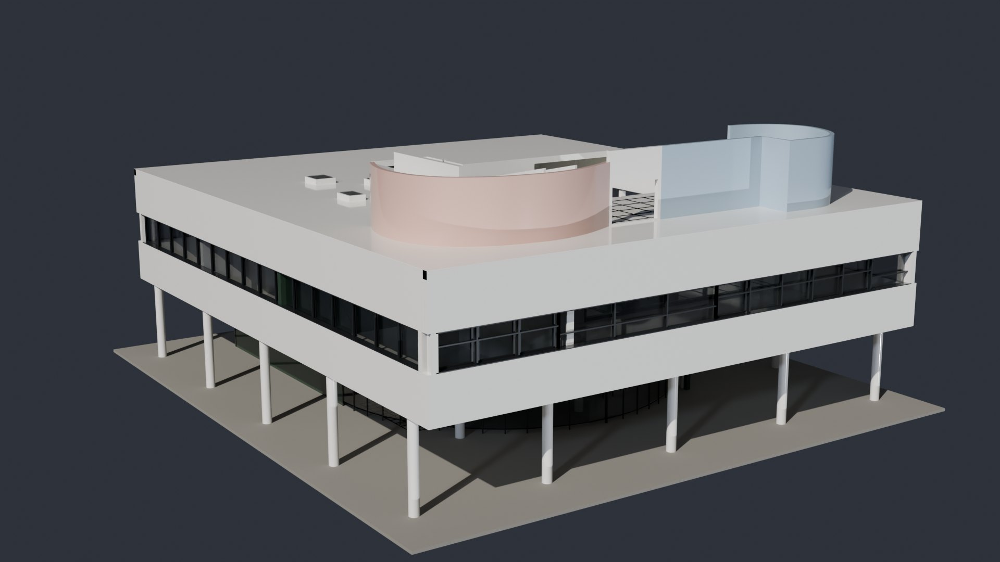
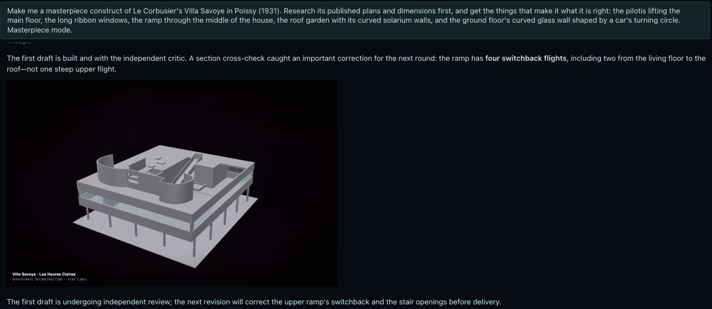
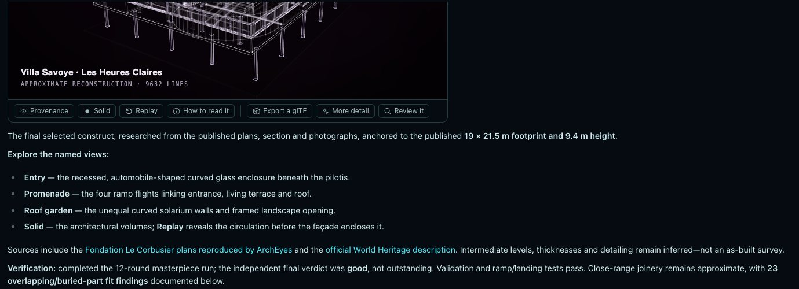
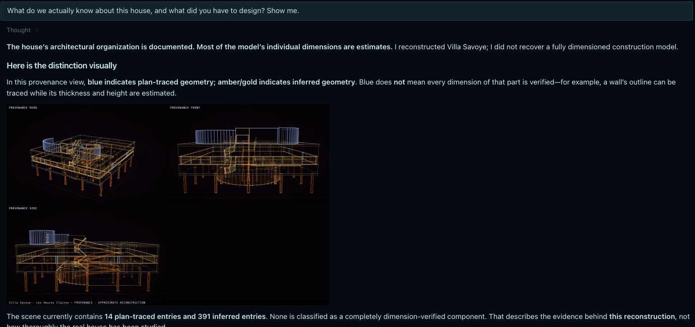
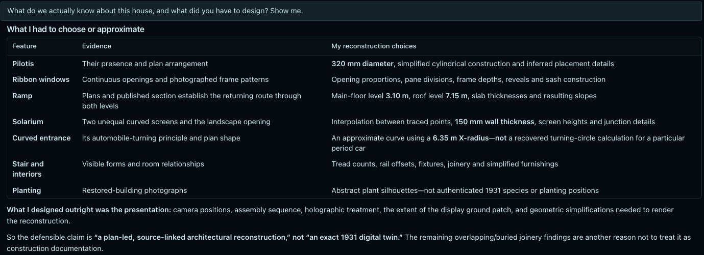
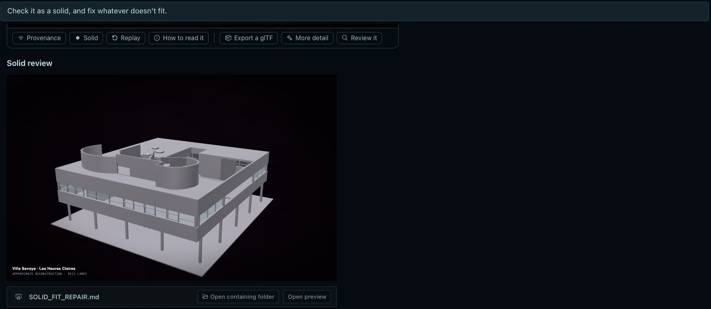
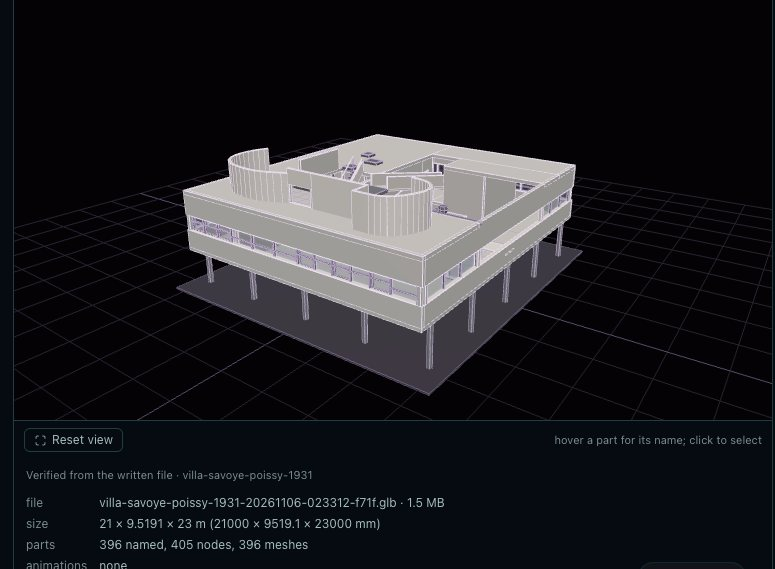
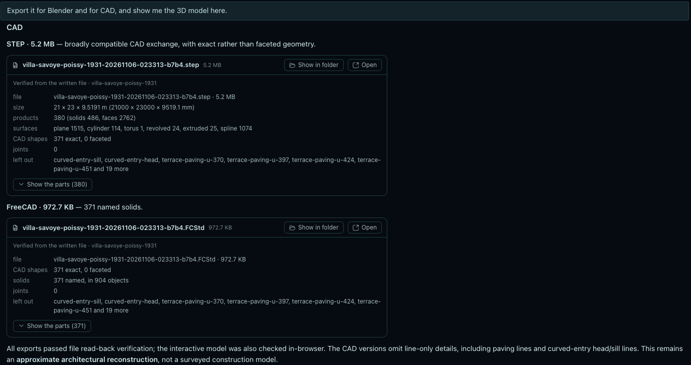
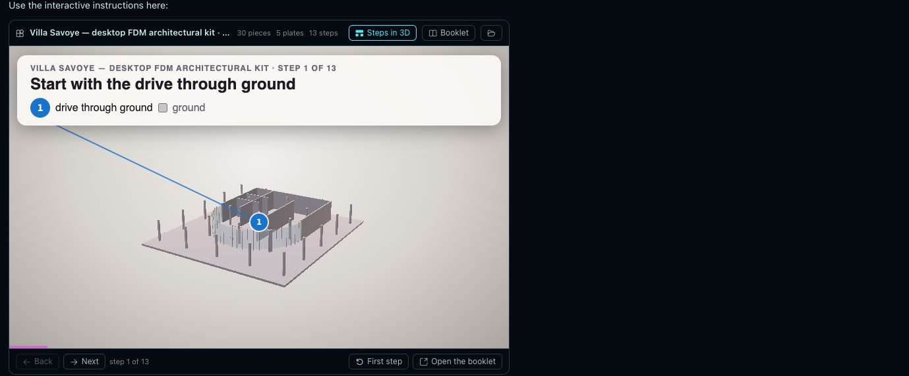
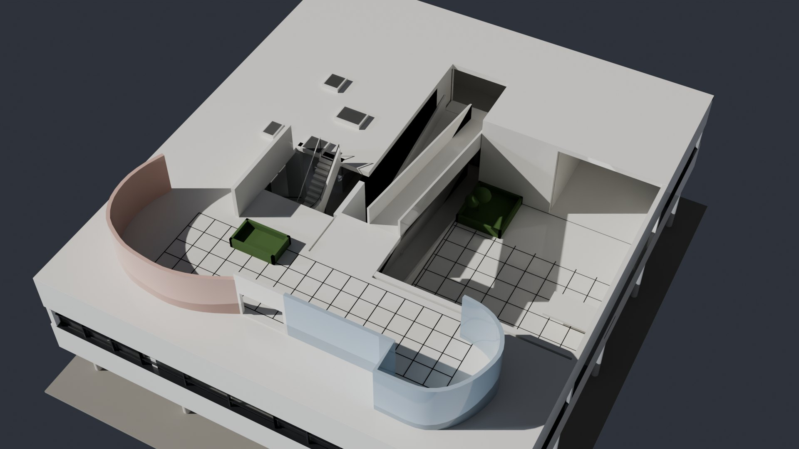

# Villa Savoye in Hermes, step by step

Construct is a native plugin for [Hermes Agent](https://github.com/NousResearch/hermes-agent). You ask in plain
words; Hermes researches the thing, writes the description and builds it, and the construct appears live in the
chat with its own controls. Everything it becomes stays in the chat too: the 3D model turning with its parts, the
exact shapes of a CAD file, a kit stepping through in 3D, a film. This page follows the final test of Construct 1.2,
GPT-6.1 Sol in Hermes Desktop asked in five plain requests: Le Corbusier's Villa Savoye, from the request to a
printable kit.

<p align="center">
  <a href="https://rtmandreyev.github.io/construct/examples/villa-savoye/"></a>
  <a href="../../examples/villa-savoye/"></a>
</p>
<p align="center"><sub>Villa Savoye, built by GPT-6.1 Sol in Hermes in masterpiece mode
(<a href="https://rtmandreyev.github.io/construct/examples/villa-savoye/">open it</a>), and the same scene finished in Blender.
The construct, its record and its kit are in the gallery: <a href="../../examples/villa-savoye/">Villa Savoye, made in Hermes</a>.</sub></p>

## Set it up

```bash
hermes plugins install rtmandreyev/construct#hermes/construct
hermes plugins enable construct
```

Then restart the gateway and turn the Desktop half on in **Capabilities → Plugins**. It needs Hermes 0.22 or newer
and nothing else: Construct is plain Python and runs in Hermes's own interpreter. A Chromium-family browser (review
images), ffmpeg (films), FreeCAD (CAD) and Blender are used when they are on the machine and never installed.
[What the plugin does and touches](../../hosts/hermes/construct/README.md)

## Villa Savoye, step by step

| | |
| --- | --- |
| Hermes | 0.22.7, Hermes Desktop on macOS, the Construct plugin of 1.2.0 before its last fixes ([below](#what-the-test-found)) |
| Model | GPT-6.1 Sol, reasoning effort high, for the author and for every critic |
| The build | masterpiece mode, 12 rounds in 2 h 25 min: 59.8 minutes of authoring, 76.2 of critics |
| After it | a question, a fit repair, three exports, a kit and a film, in about an hour more |

Five requests, typed as they are below; nothing else was said to it. The first three were one conversation. The
exports, the kit and the film were a second, opened after the plugin was restarted with fixes: Hermes found the
project by its name and carried on.

### 1. The ask

> Make me a masterpiece construct of Le Corbusier's Villa Savoye in Poissy (1931). Research its published plans and
> dimensions first, and get the things that make it what it is right: the pilotis lifting the main floor, the long
> ribbon windows, the ramp through the middle of the house, the roof garden with its curved solarium walls, and the
> ground floor's curved glass wall shaped by a car's turning circle. Masterpiece mode.

The request does two things worth copying: it asks for research before geometry, and it names what makes the house
itself, so the rounds have something to be judged against. A building was chosen on purpose: detailed, well
published and not curved everywhere, so the test is the workflow, not the model's limits.

### 2. Research

Sol found the plans of the three levels (© Fondation Le Corbusier, as reproduced by ArchEyes), a section, the World
Heritage description, the published overall sizes (21.50 × 19.00 × 9.40 m) and the 4.75 m structural module, and
cites each in the scene by URL. It aligned the plans by their outer prism and scaled them to the published 19 m and
21.5 m, and wrote down what that does not give it: storey heights, thicknesses, glazing, treads, furniture.
[Its research notes](../../examples/villa-savoye/run/RESEARCH.md)

Two corrections came from reading the sources against each other. The section showed the ramp in **four** flights,
two to the living floor and two to the roof, not one long upper run; and a photograph published as the "rear"
façade turned out to show the terrace side, so the run remapped the photograph rather than moving correct geometry
to match it.

<p align="center"></p>
<p align="center"><sub>The first draft, under its first independent review; the four-flight correction is already on its way into round 2.</sub></p>

### 3. Twelve rounds

In masterpiece mode each round is judged by a critic that stands apart: a separate Hermes subagent given a sealed
packet holding only the renders, the references and the request, never the author's reasoning. It scores nine
criteria, compares the round with the best so far, and names what is wrong. All twelve rounds beat the one before;
the run stopped at its 12-round cap. What the critics asked for, and got:

- **Round 2:** the four ramp flights; the stair cut through the floors instead of standing in them; the two
  solarium screens at unequal heights, as in the photographs.
- **Rounds 3–5:** the terrace's open aperture told apart from the glazed salon; the roof raised from an inferred
  6.70 m to 7.15 m after comparing section and photographs, the solarium shortened to keep the published 9.40 m.
- **Rounds 6–8:** a generic spiral stair replaced by the house's U-shaped one, with its winders, sloping parapets and
  the separate tubular handrails standing off them.
- **Rounds 9–12:** the façade's bands calibrated to the photographs; the courtyard's table and planters; the solarium
  curves sampled twice as finely, which is what won round 12.

The last verdict was *good*, not outstanding, and the run says so; the critic's remaining asks (the interiors behind
the envelope, the stair's floor tiles) are listed as open in its record. [Every round](../../examples/villa-savoye/run/rounds.md)

<p align="center"></p>
<p align="center"><sub>The construct in the chat, with its own controls, and the summary: sources, named views and an honest verdict.</sub></p>

### 4. "What do we actually know?"

> What do we actually know about this house, and what did you have to design? Show me.

Sol answered with the construct's provenance: blue for what was traced from the plans, amber for what was inferred,
and a table of every choice it made: the pilotis' 320 mm diameter, the floor and roof levels, the solarium's 150 mm
walls, a 6.35 m curve for the entrance that is *not* a recovered turning-circle calculation for a period car. Its
own summary: "a plan-led, source-linked architectural reconstruction, not an exact 1931 digital twin".

<p align="center"></p>
<p align="center"></p>
<p align="center"><sub>Provenance, shown and then told: what the plans fix and what was chosen.</sub></p>

### 5. Check it as a solid

> Check it as a solid, and fix whatever doesn't fit.

`check --fit` voxelises the solid and names parts that poke into each other, float or are buried. At 200 cells
along the longest side it found 23. Sol fixed them part by part (ribbon rails consolidated into single profiles,
partition ends trimmed to the glazing, sashes seated on their reveals, the salon's tracks set on the threshold) and
checked again at three resolutions:

| Cells along the longest side | Before | After |
| --- | ---: | ---: |
| 200 | 23 | 4 |
| 400 | 27 | 6 |
| 600 | 20 | 2 |

The two left at the finest grid are joined guardrail assemblies, posts meeting their rails, and are disclosed
rather than filtered out. Sol also wrote its own check: 63 coordinate tests on the compiled geometry, and 107
parts confirmed unchanged (the pilotis, the floors, the solarium, the ramps). The judged round-12 scene was kept
beside the repaired one. [The repair](../../examples/villa-savoye/run/SOLID_FIT_REPAIR.md)

<p align="center"></p>

### 6. Exports, read back

> Export it for Blender and for CAD, and show me the 3D model here.

Every export is read back from the written file and summarised in the chat, so what the agent says it made is
checked against what it made: the glTF's 396 named parts, the STEP file's 380 products and 371 exact CAD shapes, the
FreeCAD document's 371 named solids, and the parts each left out (lines without a surface, such as the paving joints).
The glTF turns in the chat's 3D viewer; hover a part for its name.

<p align="center"></p>
<p align="center"></p>
<p align="center"><sub>The glTF in Hermes's chat, and the CAD files read back.</sub></p>

### 7. A kit and a film

> Now make Villa Savoye a model kit I can print on a desktop printer, and a short film of it assembling.

A house at 1:115 on a desktop printer needs more than a scale: Sol made a print copy of the scene (a base reinforced
downwards, treads and parapets thick enough to print, planters seated on their plates) and a plan of how the pieces
group and in what order, and kept the researched scene untouched. The kit: 30 pieces on 5 plates, 13 steps,
182.6 × 200 × 83.9 mm, glue-fit, with a booklet and a 3D guide. It wrote the kit's README for whoever prints it,
and said plainly that nobody has printed it. The film runs 15 seconds. [Open the kit's 3D guide](https://rtmandreyev.github.io/construct/examples/villa-savoye/kit/assembly.html)

<p align="center"></p>

### 8. Finished in Blender

The glTF opens in Blender as it is; with Construct's Blender add-on the construct comes in with its build, joints
and finish on sliders. A material map gives each group of parts its material: here white render, dark steel frames,
the ground floor's dark green and the solarium's rose and pale blue ([maps/finish.json](../../examples/villa-savoye/maps/finish.json),
written for this page). [Into Blender](3d-artists.md)

<p align="center"></p>
<p align="center"><sub>From above: the ramp rising through the house, the courtyard and the roof garden.</sub></p>

## What the test found

The test was of the plugin as much as of the house, and it found four things to fix before 1.2.0 shipped, all fixed:

- A kit written with problems to look at was reported as "construct kit failed"; it is now *finished, with problems
  to fix*, with the problems listed.
- The 3D viewer's header counted CAD shapes (371) instead of named parts (396).
- A kit's 3D steps showed two step bars, the kit's own and the card's.
- Once, Sol imported Construct's own Python from the plugin's folder to measure the scene instead of asking the
  tools; the skill now says which tools answer fit and measurement questions.

## Good to know

- **A reconstruction, not a survey.** The plan outlines are traced and the overall sizes published; storey heights,
  thicknesses, glazing, treads and furniture are inferred, and **P** shows which is which.
- **Ask what you would ask a person.** "What do we actually know?", "check it as a solid", "show me the 3D model
  here" are the whole interface. The tools, the review images and the critic rounds are Hermes's business.
- **Long work runs in the background.** Films, kits and large builds run as jobs with their progress in the chat,
  so a long build never times out a turn.
- **It is not a CAD replacement.** Construct describes a thing and checks the description; the STEP and FreeCAD
  files are where a designer takes it further.
- **Le Corbusier's architecture is his and the Fondation Le Corbusier's.** This is an independent reconstruction from
  public references; the scene cites them and includes none of their images.
