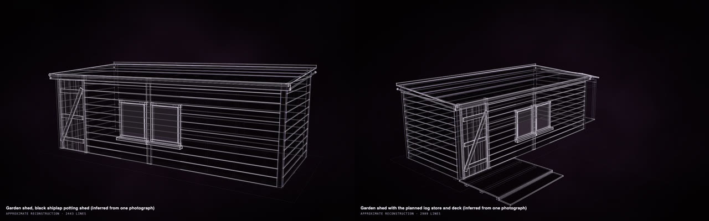
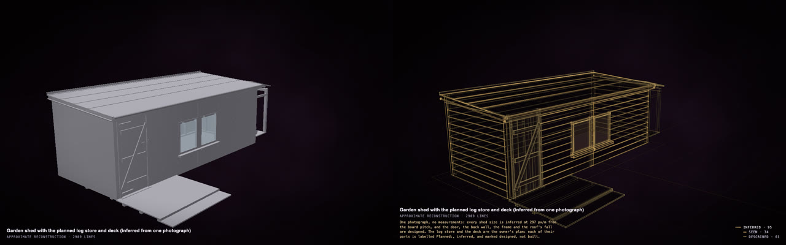
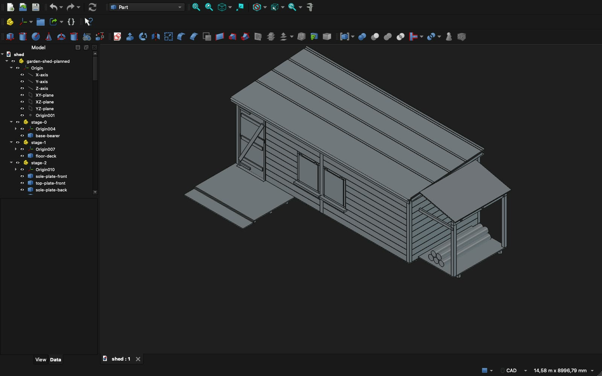

# Try a change to your home or garden on a copy first

Make your shed, room, garage or garden into a model, then add the change you have in mind (a deck, shelves, an
extension, a new layout). You can see it, turn it, measure it and send it to whoever will build it, before anything
is built. You need no terminal: the Claude app or the ChatGPT app does the work ([how to set it up](in-the-apps.md)).

A garden shed from one photo and no measurements (left), and the same shed with a planned log store and deck
(right). <a href="https://rtmandreyev.github.io/construct/examples/garden-shed/">Open the shed</a> · <a href="https://rtmandreyev.github.io/construct/examples/garden-shed-planned/">open the plan</a>.

## Our example, start to finish

**The photo.** One photograph, standing in for an owner's own, and no measurements at all:

Acabashi, CC BY-SA 4.0, Wikimedia Commons

**The message** (sent to an agent, DeepSeek V4.1 Flash through Hermes; the same words work in the apps):

> Using the construct skill, make a masterpiece construct of my garden shed from my one photo, refs/photo-1.jpg (refs/SOURCES.md says where it comes from: record it as a source with its credit). Then a second version with the change I am planning. Masterpiece mode.
>
> - I have no measurements. Estimate its size from what is in the photo (a shed door is usually about 1.8 to 1.9 m tall; a window, the cladding boards and the plant pots also give a scale), and mark every size as inferred from the photo, saying how you estimated it.
> - Model it as separate, named parts a builder would recognise: the base and bearers, the floor, the wall frames and the cladding boards, the door with its hinges and latch, the window and its frame, the roof boards, the roofing felt, the fascias and corner trims, and anything else the photo shows.
> - The door opens on its hinges (an articulation).
> - Say how each part is known, its size and its shape separately, as the skill describes.
> - Check it until clean, including `construct check --fit`, so every part rests on what holds it and nothing pokes through.
> - Run the masterpiece rounds with an independent critic on the shed (scene.json), as the skill describes, until one of the skill's stop rules ends them. Do not stop earlier on your own. Record the critic's verdict.
> - Then write scene-planned.json: the same shed with what I plan to add, a lean-to log store on one side and a small timber deck in front of the door with a step. Size them to fit the shed, give every new part the label prefix "Planned:" and certainty inferred with a note that it is designed, not built. Check it until clean, including `--fit`, and review it once.
> - Work only in this folder.

**What came back.** A shed of 81 named parts a builder would recognise (bearers, floor, wall frames, cladding,
the ledged door on its hinges, the window, the roof boards and felt), every size estimated from the door, the
window and the boards in the photo, and marked as such. Twelve rounds, each judged by an independent critic.
Then the plan: a lean-to log store and a deck with a step, sized to fit the shed, every new part labelled
*Planned* and marked as designed, not built. Press **P** on the plan and the new parts show apart from the shed
that is there:

## Take it further: CAD for whoever builds it

Ask, in the same chat: *"Give me a STEP file of the planned version."* STEP opens in any CAD program; with
[FreeCAD](https://www.freecad.org) (free) installed, ask for *"a FreeCAD file"* too. Here is the plan in FreeCAD:
the parts that have surfaces as true solids with their names, grouped in the order
they are built.

A builder, a joiner or a friend with CAD can measure it, change it and draw from it. Other things to ask for:

- *"Make the deck a metre deeper"*, *"move the log store to the other side"*, *"try it with a pitched roof."*
- *"List the planned parts with their sizes."*
- *"Make it a model kit at 1:20"* for a model of your garden.

## Do it with your own home or garden

**Gather:**

- **Photos** from every side you can reach; one is enough to start, as above.
- **A few measurements:** the length of a wall, the height of a door. Each one makes every other size better.
- **Plans or drawings,** if you have them (a floor plan, a plot plan): add them to the folder.

**Send** (after the [one-time setup](in-the-apps.md)), with your photos in a folder such as `my-shed`:

> Read skills/construct/SKILL.md in this folder and use the Construct skill to make a masterpiece construct of my
> **[shed, room, garage]** from the photos in **my-shed/**. **[What you measured]**. Then a second version with
> what I am planning: **[a lean-to log store on one side and a small deck in front of the door]**, every new part
> labelled "Planned". Masterpiece mode. Save them as **my-shed/shed.html** and **my-shed/shed-planned.html**, and
> give me a STEP file of the planned version.

## Good to know

- **A planning model, not a survey.** A model from photos is good for seeing, deciding and explaining, not for
  ordering materials or for planning permission. What was measured and what was estimated is marked (press **P**),
  and whoever builds it measures first.
- **Inside and out.** A room works the same way, from photos of its walls and a floor plan.
- [Everything else to know about the apps →](in-the-apps.md) · [Show someone what you mean →](show-what-you-mean.md)
