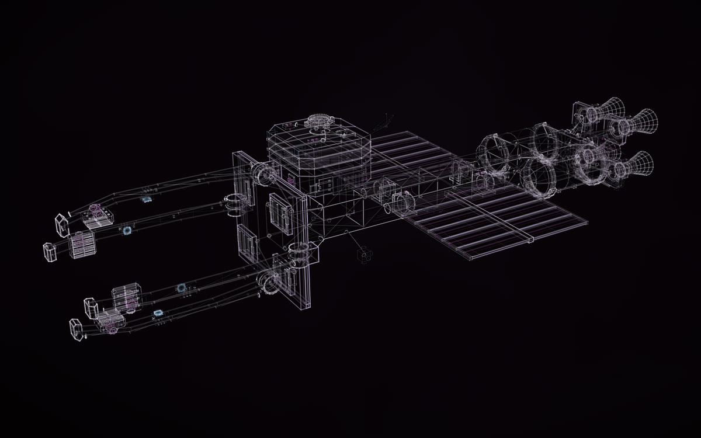
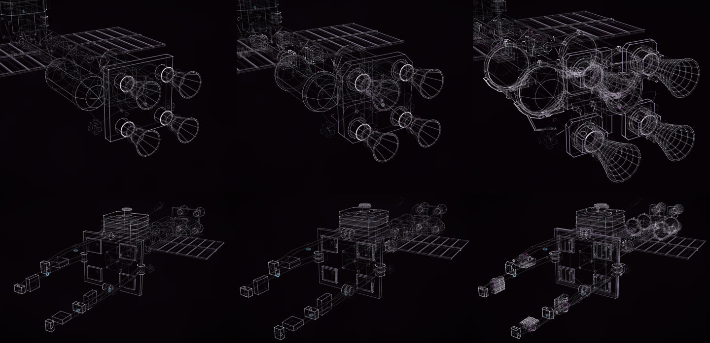
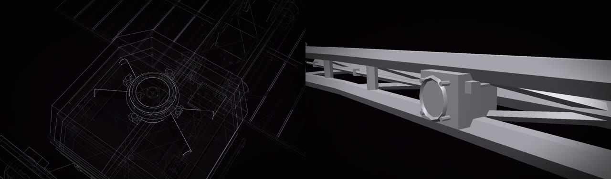
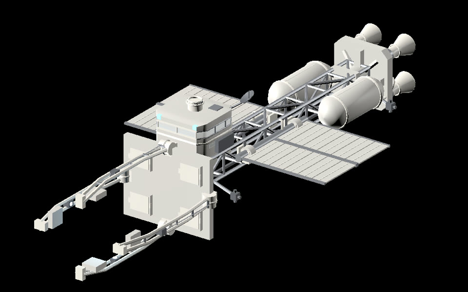
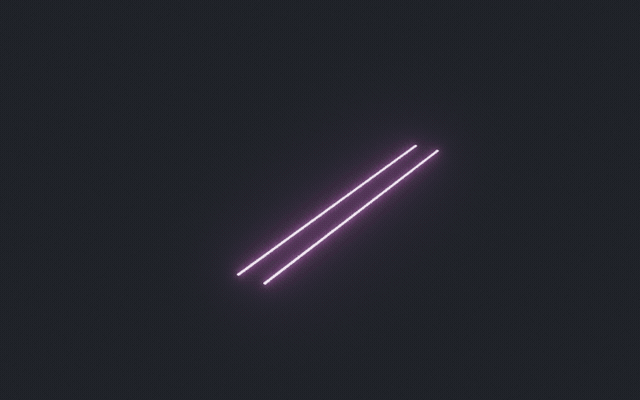
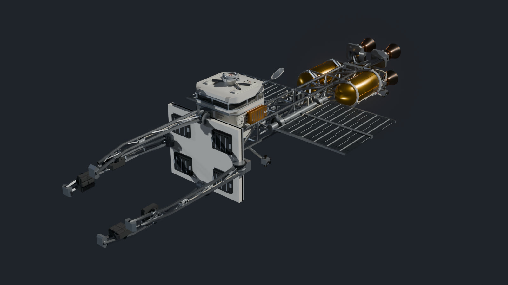
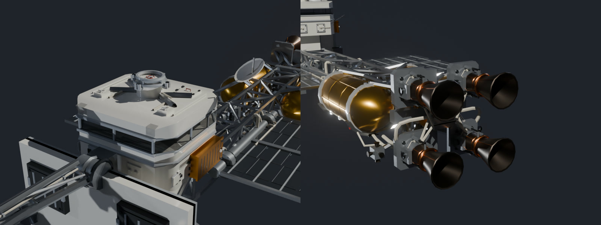

# New things from real ones

A ship, a vehicle, a creature or an artefact that does not exist, designed from things that do: for a game, a film,
a Blender scene or a story. Construct builds it as a construct you can turn and replay, and as a 3D model with
named parts and working joints for Blender, Godot, Unity or Unreal. The trick is the brief: name the real designs
to borrow from, the sizes, what must be there, and what may be invented. This page follows one design, KESTREL, from
its brief to a model in Godot.

  
  

KESTREL, an invented ice tug about 120 m long, made by GPT-6.1 Sol in Codex in masterpiece mode
(<a href="https://rtmandreyev.github.io/construct/examples/kestrel/">open it</a>), and the same ship made more detailed with
every part kept (<a href="https://rtmandreyev.github.io/construct/examples/kestrel-v2/">open it</a>). Apache-2.0, like every
example: take them apart, reuse them, build on them.

## Who it is for

- **Game developers:** props and vehicles with real sizes, named parts and working joints (doors, legs, arms,
  wings), in glTF for Godot, Unity or Unreal ([into a game engine](game-developers.md)).
- **Filmmakers:** an object that assembles across a piece of music, as a video, or drawn in your own three.js scene
  with `construct_hologram/film/construct-three.js` ([film mode](film-and-motion.md)).
- **Blender artists:** a model to light, finish and render, or to model over ([into Blender](3d-artists.md)).
- **Writers and worldbuilders:** a design that holds together, with its sizes written down, so a story can rely on it.

## KESTREL, step by step

KESTREL was made by GPT-6.1 Sol (high reasoning effort) in Codex, the copy inside the ChatGPT app for macOS, with
Construct installed as a project skill. Four briefs, four sessions, on one day. The briefs, the agent and the
record of every round are in the example's [README](../../examples/kestrel/README.md).

### 1. The brief

The whole of it, as sent (it began as this page's invented example; then it was run):

> Using the construct skill, make a masterpiece construct of KESTREL, an ice tug for my game: a crewed tug that
> pushes blocks of water ice from a planet's rings to a refinery. Masterpiece mode.
>
> - Lay it out the way real spacecraft studies would: a pusher with the crew at the opposite end from the engines,
>   a long truss between them, radiators edge-on to the engines, the cargo held in a cradle the tug pushes.
>   Borrow reasoning from NASA's space tug studies and the ISS truss and radiators; copy nothing.
> - About 120 m long with an empty cradle; metres; Y up; the bow towards +Z; origin at the cradle's centre.
> - It must have: a two-deck crew cab with a wide window band; a docking port on the cab's roof; a cradle of four
>   arms that close around a block; two radiator wings; a cluster of four engines; floodlights on the cradle arms.
> - Design whatever else it needs to work (propellant tanks, attitude thrusters, antennas), and give every part a
>   job.
> - The cradle arms open and close, and the radiator wings fold (joints). The floodlights blink slowly (motion).
> - No text or labels in the geometry. Use tone slots, not fixed colours. Nothing random from run to run.
> - Deliver the construct, a glTF for Godot, a 16-second review film, and NOTES.md with the sizes, the frame and
>   where the docking port is (its centre and its axis).

What each line does is in [How to write the brief](#how-to-write-the-brief) below. The short version: the job
and the scene it has to carry, what to learn from, the size and frame, the features that must be there, freedom to
design the rest with a job for every part, what moves, rules for your pipeline, and what to hand back.

### 2. Research and reasoning

The agent looked up the three things the brief named and cites them in the scene, each with its link:

- **NASA's reusable Space Tug study,** [NASA-CR-114938](https://ntrs.nasa.gov/citations/19710011980), *Spacecraft
  concepts and systems design* (1971). It downloaded a 342 MB scan of the report, but its notes record the full
  report as unavailable in the run and rest on the catalogue record alone. What it took is a principle, not a
  shape: crew, service and propulsion as separable functions.
- **The International Space Station's truss,** NASA's
  [Integrated Truss Structure diagram](https://www.nasa.gov/image-article/integrated-truss-structure-diagram/)
  (2018): a structure that carries attachment points and utility runs. KESTREL's spine is a 74 m compression truss
  with raceways, coolant trunks and an inspection rail; it is not the ISS cross-truss.
- **Turning radiators,** [Thermal Radiator Pointing for International Space Station](https://ntrs.nasa.gov/citations/20000032541)
  (NTRS 20000032541, 1999), its abstract: heat rejection governed by which way the panels face. KESTREL's two wings lie in planes
  that contain the thrust axis, so the engines see only their edges, and they fold about that axis.

From that reasoning, the design: a pusher. Four engines feed a common thrust collector; the spine carries the load
forward to a platen that spreads it over brittle ice; four arms hold the block against sideways motion. The
two-deck cab sits at the far end from the drives, raised above the spine to see over the cargo. Two water tanks
sit near the engines (water is the reaction mass the refinery refills); thruster stations sit far apart for
leverage; the joints carry geared drives and locks, because a fixed-length rod cannot follow a hinge. Its notes are
as plain about what was *not* worked out: no thrust, mass, power, radiation shielding or journey time is claimed.

What the brief fixed is in the scene as facts from the request (120 m, four arms, four engines, two decks, two
wings). Everything else is designed: press **P** and every part says so.

### 3. The first build

In 28 minutes: 254 named parts, each with a job (`PARTS.md` lists them), six joints (four arms that release by 32°,
two wings that fold by 78°), the floodlights' 4.8-second blink, and the docking port where NOTES.md says it is:
its mating plane centred at (0, 18, −25) m, its axis straight up.

### 4. Masterpiece rounds

The first run took four rounds and stopped with every one of the critic's nine criteria at 3. Each round the
critic, a fresh model that never saw the authoring, judged the new version on its own and then against the best so
far without knowing which was which:

- **Round 1.** The cab "reads as a stack of similarly weighted horizontal loops"; the aft frame is "one flat
  rectangular plate with four simple nozzle attachments"; the radiator roots "look like thin attachment lines".
- **Round 2,** kept: an inset window frame with mullions, a four-way docking collar, a chamfered engine frame with
  a layered thrust yoke, geared knuckles with separate coolant returns at the wing roots. The critic then found
  the closer hero cut off the lowest arm, and that the build brought cab, arms, wings and engines in all at once.
- **Round 3,** kept: the framing restored, and eight readable stages: spine, load frames, cradle, cab, tanks,
  engines, radiators, lights.
- **Round 4,** kept: inset, replaceable contact faces on the platen; bearing brackets that clear the wings' sweep.
  Every criterion at 3: stop.

Then the owner asked for more: keep going "as many rounds as it takes" (the third brief in the
[README](../../examples/kestrel/README.md)). A fresh, stricter critic re-judged round 4 unchanged, gave it 23 of 27
and reopened two defects: the arms "terminate in plain block pads" with no readable drive or lock, and the platen,
the lower cab and the roof were "large empty rectangles". Rounds 6 to 13 followed, each kept:

The engines (top) and the cradle at rounds 1, 4 and 13. Round 13's engine view is closer: the run
reframed its close-ups as the detail grew.

- **The arms:** triangulated three-chord beams, then shaped ice shoes with pinned carriers, three chamfered pressure
  lands with drainage channels, and braking keepers.
- **The engines:** curved hollow bells on stepped gimbal drums, trim rams, paired supply and return lines, and four
  separate gimbal pads in place of the common thrust wall, so the load path shows.
- **The wings:** separate supply and return lines meeting rotary unions on their axes, with U-bends that fold with
  the panels.
- **The tanks:** wide straps in saddles tied to the spine by A-frame legs, then valve manifolds and, in round 13, a
  service header and isolation valve that visibly meet the engine feed. Every criterion at 3 again: stop, after 13
  rounds (32.6 minutes of the agent's own work, 49.8 of the critics').

The record keeps two things a reader should know. Before round 8 the agent reset two defects' "no progress"
counters, with its reason written down: the recorder counted every attempt that left a defect open, the skill
counts attempts that made no progress, and the critic had described progress. In round 12 the first critic opened
the defect ledger before its comparison; that judgement was set aside, and a fresh critic judged the same version.
One defect stayed open as a limit of Construct, not of the ship: the viewer's subtitle says GENERIC
RECONSTRUCTION, though KESTREL is an original design.

### 5. The result

[KESTREL](https://rtmandreyev.github.io/construct/examples/kestrel/): 256 named parts, 639 copies with the repeats
and mirrors, 16,281 lines; checked clean (no errors; the warnings are fasteners and jets too small to see whole at
the hero framing, kept for the close-ups and the 3D model).

### 6. More detail, every part kept

Designs for games and films change, and whatever already names a part (an animation, an engine scene, a script)
should keep working. So the fourth brief asked for detail on a strict rule:

> Make the final KESTREL (KESTREL-final/) more detailed for close-ups. Keep every part's name, place and size; add
> detail as new parts. Masterpiece mode. Put the new version in KESTREL-final-v2/ beside it, with the same
> deliverables (construct, glTF for Godot, NOTES.md), and say how many parts were kept and how many added.

[KESTREL, more detailed](https://rtmandreyev.github.io/construct/examples/kestrel-v2/): all 256 parts unchanged and in
their order, 242 added (`v2-…`), 498 in all. The size, origin, docking port and joints are the same; the new
hardware on the arms and wings rides their hinges. Six rounds: the critic asked for the plain aft face of the cab,
the bare wing roots and the blank engine mounts; round 3 lost (one close-up cropped to a fragment, the floodlight's open frames almost black) and was
reverted; round 6 stopped with every criterion at 3. The session took about 50 minutes. A scene this size needs a Construct newer than
1.1.1, which allowed 256 parts; this one allows 1,024.

Two of the second version's close-up views: the roof dock, and a floodlight seen as a solid (<b>S</b>).

### 7. Joints in Godot

Each version came with a glTF for Godot: the parts by name, the `open` animation and one `open:<joint>` clip per
joint (Godot names them `open_cradle-release-port` and so on), and empty `DockingPort` and `CradleCentre` nodes.
The agent added a small Godot 4 project of its own around it: a controller with `set_cradle_open(0…1)` and
`set_radiators_folded(0…1)`, four real spotlights on the arms that blink on the same 4.8-second cycle, and a
`docking_transform()` for whatever docks on the roof. It checked the project headless: six hinge groups moving 104
nodes, opened and returned, the lights following the arms.

The first build's glTF in Godot.

The same from Construct itself, with no project to write: `construct export scene.json --out kestrel.glb` for the
parts and clips, or `--pieces glued` for a body that stays put with the arms and wings as hinged bodies, connected
by [`construct_joints.gd`](../../hosts/godot/construct_joints.gd) ([Godot](../GODOT.md)).

### 8. Everything it handed back

For each version: the construct (`construct.html`), the scene, the glTF (`.glb`, and `.gltf` with `.bin`), the
Godot project, a 16-second silent review film (assembly, the arms releasing, the wings folding and returning),
`NOTES.md` (sizes, the frame, the docking port, the joints, the reasoning, what is not claimed), `PARTS.md` (the job
of every part) and the review stills the critics judged. The scenes are in this repository; build the rest from
them with the commands in the [README](../../examples/kestrel/README.md#build-it).

## Take it further: a finish in Blender

The construct shows KESTREL in light, and Godot shows it as a grey solid. For a finished ship, ask in the same
chat: *"Give me a file for Blender: a working ship, not a showpiece. Off-white thermal panels on the cab and the
platen, dark radiator panels, a bare aluminium truss, gold foil on the water tanks, copper coils on the engines,
tinted glass in the window band, and the floodlights lit."* It writes a finish map
([the one used here](../../examples/kestrel/maps/finish.json)) and a `.glb` that Blender and most 3D programs open.
With the [Construct add-on for Blender](../../hosts/blender/README.md) it builds itself in light, turns plain, then
takes its finish:

The map works by part name, and the first rule that matches a part wins: `water-tank-*` is gold
foil, `radiator-panel-*` radiator black, `spine-*` and the arms' chords bare aluminium, `engine-nozzle-*` burnt
metal, `floodlight-lens-*` light, and whatever no rule names is thermal white. Sixteen rules cover both versions:
the second version's `v2-…` parts are in it too (the bells' cooling lines in copper, the valve handwheels and the
dock's hatch wheel in safety red, the window seals as rubber).

The second version, with the same map: the whole ship, the cab and its dock, the engines.
Rendered in Cycles with a key light, a fill and a rim; the map is all the colour there is.

The same from a checkout, with no chat: `construct export scene.json --out kestrel.glb --materials
maps/finish.json`, or, in Blender, **File → Import → Construct** with the map as the material map. Then change the
copy, never the design: *"show it in the refinery's livery, orange and grey"*, *"with the cradle open and the wings
folded"*.

## How to write the brief

KESTREL's brief follows a pattern that works for anything invented:

1. **What it is and what it is for,** in one line: its job in your world, and the scene it has to carry
   ("a crewed tug that pushes blocks of water ice from a planet's rings to a refinery").
2. **What to learn from.** Name real designs, studies or living things. Ask the agent to follow their reasoning
   (why the crew is far from the engines, why the radiators turn edge-on), not to copy their look.
3. **Size, units and frame:** "about 120 m long; metres; Y up; the bow towards +Z". Then it fits your scene and
   your other constructs without rescaling.
4. **What must be there:** the features your story or game needs, counted. Everything else is the agent's to
   design. What you fix this way is kept in the scene as your facts.
5. **What may be invented,** and how: "design whatever else it needs to work"; "give every part a job".
6. **What it must fit:** another construct's NOTES and the exact place they meet (a docking port's centre and axis,
   a hangar's door). KESTREL's NOTES give its port, so a shuttle can be briefed to dock on it.
7. **What moves:** doors, legs, arms, wings as joints; slow life as motions (a light blinks, a body breathes).
8. **Rules for your pipeline:** no text in the model (you add your own labels), tone slots so the palette is yours
   to set, nothing random from run to run.
9. **What to deliver:** the construct, a glTF for Blender or your engine, a short review film, and notes of the
   sizes and anchor points.
10. **Masterpiece mode,** so an independent critic judges every round and only better versions are kept.

The same pattern works for something grown rather than built: name the living structures to learn from (a
radiolarian's skeleton, the inside of a bone) and what must look unlike any machine or animal.

## Change it without breaking it

Ask for the next version in a way that keeps the first: *"Keep every part's name, place and size; add detail as new
parts."* KESTREL kept all 256 of its parts and added 242. Every scene, animation and engine setup that names a part
keeps working, because the parts it names are still there.

## Into your tools

- **Blender:** the [Construct add-on](../../hosts/blender/README.md) builds it in Blender, from light to a plain
  model, and a finish map paints it ([3D export](../EXPORT.md)).
- **Godot, Unity, Unreal:** one glTF with named parts and working joints ([Godot](../GODOT.md)).
- **Film:** `construct video` assembles it across a track ([film mode](../FILM.md)), and
  `construct_hologram/film/construct-three.js` draws it in your own three.js scene, building with the music.
- **A model kit or a print** of your design: [3D printing and kits](../PRINTING.md).

## Good to know

- **A design, not an engineering study.** The layout follows real reasoning, but nobody has checked that it would
  fly. Press **P**: every part says it is designed.
- **Where this sits.** Inventing from requirements is the far end of what Construct does, the end with the most
  design freedom; [documentation → product](documentation-to-product.md#the-design-freedom-continuum) places it
  beside reconstruction, replacement parts and the rest.
- **Your design is yours.** What you make with Construct is yours. KESTREL is Apache-2.0, like the other examples.
- **The scene records the brief.** Its sources and facts keep what you asked for. To share a design but keep the
  brief private, share the page and pictures, and ask the agent to leave the brief out of the copy you share.
- **In the apps, too:** all of this works from the Claude or ChatGPT app with no terminal ([how](in-the-apps.md)).
