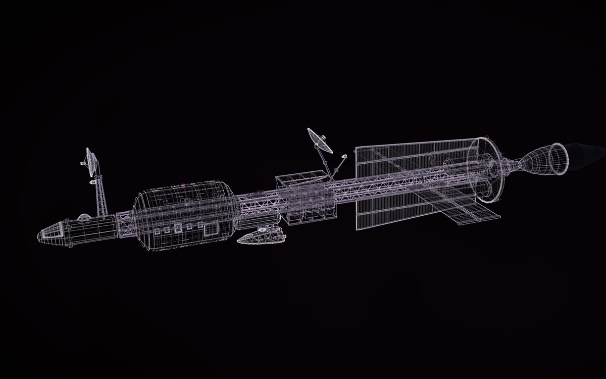
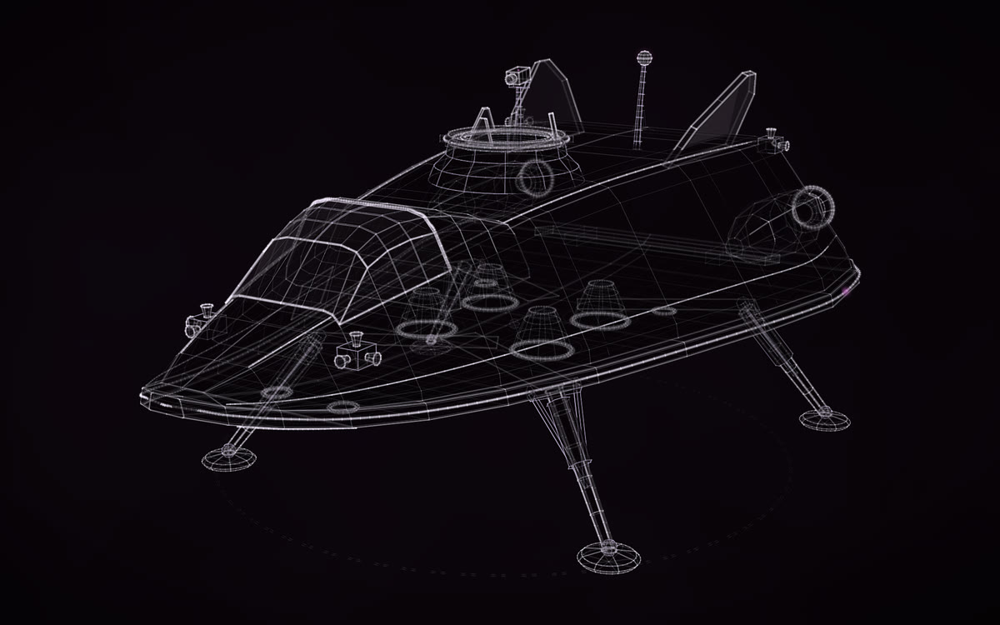
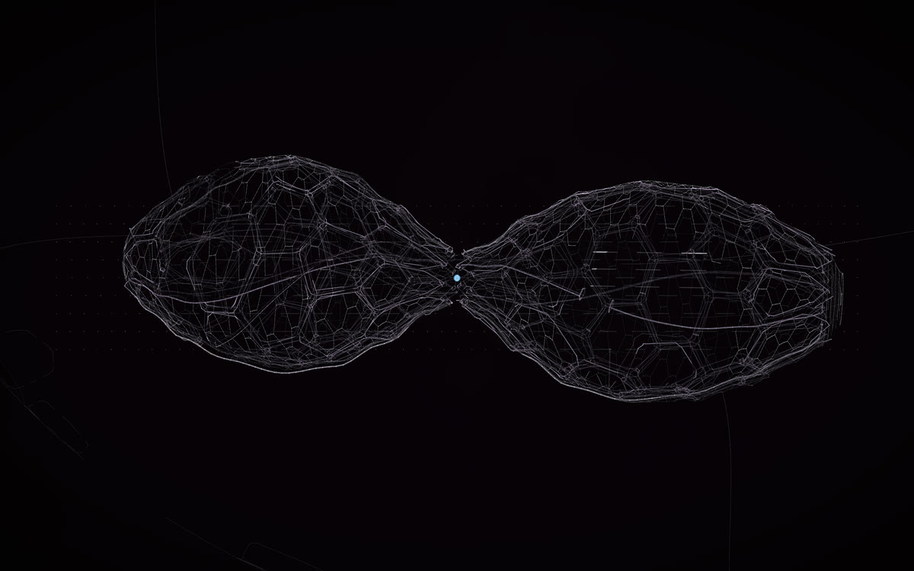
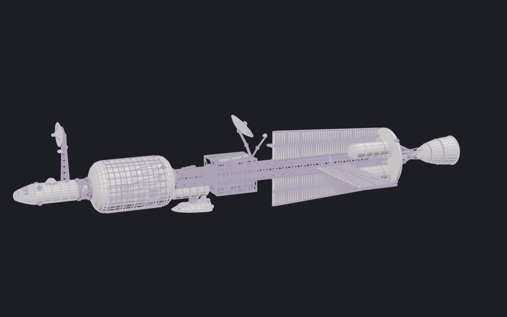
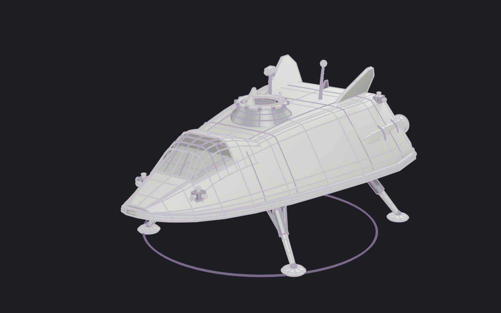

# New things from real ones

A ship, a vehicle, a creature or an artefact that does not exist, designed from things that do: for a game, a film,
a Blender scene or a story. Construct builds it as a construct you can turn and replay, and as a 3D model with
named parts and working joints for Blender, Godot, Unity or Unreal. It also makes a film of it assembling to music.
The trick is the brief: name the real designs to borrow from, the sizes, what must be there, and what may be
invented.

  
  
  

  
  

Made for the author's visual album film: a survey ship, the lander built to fit it, and an alien object, as
constructs (top) and as Blender models (below). <a href="https://rtmandreyev.github.io/construct/#worlds">Open them</a>.
All rights reserved: they are here to look at, not to reuse.

## Who it is for

- **Game developers:** props and vehicles with real sizes, named parts and working joints (doors, legs, dishes),
  in glTF for Godot, Unity or Unreal ([into a game engine](game-developers.md)).
- **Filmmakers:** an object that assembles across a piece of music, as a video, or drawn in your own three.js scene
  with `construct_hologram/film/construct-three.js` ([film mode](film-and-motion.md)).
- **Blender artists:** a model to light, finish and render, or to model over ([into Blender](3d-artists.md)).
- **Writers and worldbuilders:** a design that holds together, with its sizes written down, so a story can rely on it.

## What we made

Three constructs for one film, each showing one way to start from what exists:

- **[ARGUS](https://rtmandreyev.github.io/construct/examples/argus/), from real studies.** A 180 m survey ship
  laid out like NASA's nuclear-thermal transfer-ship studies: the crew at the bow, as far from the reactor as the
  structure allows, the reactor aft behind a shadow shield, the propellant and radiators inside the shield's
  shadow. The truss, cupola and arrays follow the International Space Station's. Nothing is copied; the layout
  follows the same reasoning. Built by Claude Opus 5.5, then made more detailed by GPT-6.1 Sol with every part
  kept where it was.
- **[Lander 2](https://rtmandreyev.github.io/construct/examples/lander-2/), made to fit.** The ship's crewed
  lander: a wedge lifting body on a heat-shield belly, four folding legs, a glazed flight deck and a docking collar
  on its back. The ship was built around it: ARGUS carries the lander's own construct, placed so its collar meets
  the ship's docking port, so the two always match. The legs fold as joints; the same model flies stowed and lands
  deployed.
- **[Object 001](https://rtmandreyev.github.io/construct/examples/object-001/), from nature.** An alien object
  that resembles nothing you know. It is built from structures that do exist: two porous lobes grown like the inside of
  a bone, almost mirrored across a pinched waist, one half slightly out of true.

Press **P** on any of them: every part is designed, none measured, because none of it exists. The features the brief
asked for are kept as facts, so you can tell what was asked for from what the model invented.

## How to write the brief

The full briefs behind these three stay private, but they all follow one pattern. Here it is, then an invented
brief that follows it.

1. **What it is and what it is for,** in one line: its job in your world, and the scene it has to carry.
2. **What to learn from.** Name real designs, studies or living things. Ask the agent to follow their reasoning
   (why the crew is far from the reactor, why the legs fold there), not to copy their look.
3. **Size, units and frame:** "about 120 m long; metres; Y up; nose towards +Z". Then it fits your scene and your
   other constructs without rescaling.
4. **What must be there:** the features your story or game needs, numbered. Everything else is the agent's to
   design.
5. **What may be invented,** and how: "design what is missing so that it would work"; "nothing decorative without
   a job".
6. **What it must fit:** another construct's file and the exact place it meets this one (a docking port's centre and
   axis, a hangar's door).
7. **What moves:** doors, legs, dishes, arrays, as joints; slow life as motions (a beacon blinks, a body breathes).
8. **Rules for your pipeline:** no text in the model (you add your own labels), the palette yours to set, nothing
   random from run to run.
9. **What to deliver:** the construct, a glTF for Blender or your engine, a short review film, and notes of the
   sizes and anchor points.
10. **Masterpiece mode,** so an independent critic judges every round and only better versions are kept.

**An invented brief, for illustration** (not one used for these examples):

> Using the construct skill, make a masterpiece construct of KESTREL, an ice tug for my game: a crewed tug that
> pushes blocks of water ice from a planet's rings to a refinery. Masterpiece mode.
>
> - Lay it out the way real spacecraft studies would: a pusher with the crew at the opposite end from the engines,
>   a long truss between them, radiators edge-on to the engines, the cargo held in a cradle the tug pushes.
>   Borrow reasoning from NASA's space tug studies and the ISS truss and radiators; copy nothing.
> - About 120 m long with an empty cradle; metres; Y up; the bow towards +Z; origin at the cradle's centre.
> - It must have: a two-deck crew cab with a wide window band; a docking port on the cab's roof; a cradle of four
>   arms that close around a block; two radiator wings; a cluster of four engines; floodlights on the cradle arms.
> - Design whatever else it needs to work (propellant tanks, attitude thrusters, antennas), and give every part a
>   job.
> - The cradle arms open and close, and the radiator wings fold (joints). The floodlights blink slowly (motion).
> - No text or labels in the geometry. Use tone slots, not fixed colours. Nothing random from run to run.
> - Deliver the construct, a glTF for Godot, a 16-second review film, and NOTES.md with the sizes, the frame and
>   where the docking port is (its centre and its axis).

**Then something that fits it:** a second brief names the first construct and its NOTES:

> Make a masterpiece construct of KESTREL's tender, a six-seat shuttle that docks on the tug's roof. Its docking
> collar must meet KESTREL's port at the centre and axis given in kestrel/NOTES.md, so the two fit as built...

**And something that does not exist at all,** from nature rather than machines:

> Make a masterpiece construct of an alien seed, 30 m across, grown, not built: a shell of hexagonal plates like a
> radiolarian's skeleton, opening along three seams; one seam is not quite where symmetry would put it. Its
> surface breathes slowly (motion). Nothing in it should look like a machine or an animal.

## Change it without breaking it

A design for a film or a game changes. Ask for the next version in a way that keeps the first:

> Make KESTREL more detailed for close-ups. Keep every part's name, place and size; add detail as new parts.

Every scene, animation and engine setup that names a part keeps working, because the parts it names are still there.
ARGUS's second version kept all 189 of its first version's parts and added 60.

## Into your tools

- **Blender:** the [Construct add-on](../../hosts/blender/README.md) builds it in Blender, from light to a plain
  model, and a finish map paints it ([3D export](../EXPORT.md)).
- **Godot, Unity, Unreal:** one glTF with named parts and working joints ([Godot](../GODOT.md)).
- **Film:** `construct video` assembles it across a track ([film mode](../FILM.md)), and
  `construct_hologram/film/construct-three.js` draws it in your own three.js scene, building with the music.
- **A model kit or a print** of your design: [3D printing and kits](../PRINTING.md).

## Good to know

- **A design, not an engineering study.** The layout follows real reasoning, but nobody has checked that it would
  fly. Press **P**: every part says it is designed.
- **Your design is yours.** What you make with Construct is yours. These three are the author's, made for a film,
  and all rights are reserved: please make your own rather than reuse them.
- **The scene records the brief.** Its sources and facts keep what you asked for. To share a design but keep the
  brief private, share the page and pictures, and ask the agent to leave the brief out of the copy you share.
- **In the apps, too:** all of this works from the Claude or ChatGPT app with no terminal ([how](in-the-apps.md)).
