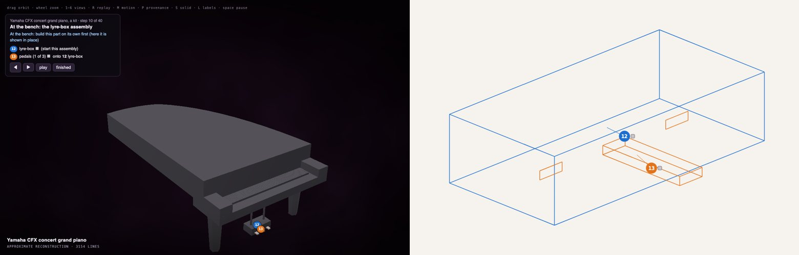
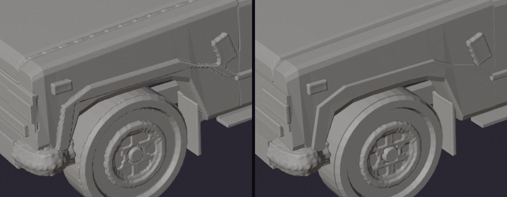

# Construct for makers

Anything you can describe can be printed, made into a model kit, or opened in CAD. The construct knows its real sizes
and its parts, so a print comes out at a true scale and a kit comes apart where a kit designer would cut it.

<p align="center"></p>
<p align="center"><sub>The Yamaha CFX as a 1:12 kit: step 10 in 3D (left) and in the paper booklet (right). The pedal lyre is built at the bench, each new piece in its own colour, before it goes on the piano.</sub></p>

## What you can do

- **Print it.** One checked, watertight print at the largest size your printer takes (`--printers` compares five
  printer classes), or `--exact`: the construct's own solids, with thin parts given true walls, for the finest detail.
- **Make it a kit.** Pieces on numbered plates (clear plastic on its own plates), glued in the order a kit designer
  would: sub-assemblies built at the bench, the shell after the interior, doors hung last. A booklet on paper and the
  same steps in 3D, each step's pieces dropping into place in their paint.
- **Open it in CAD.** True CAD shapes in FreeCAD with its joints, and STEP for any CAD program.
- **Refine before you print.** `construct check --fit` names the parts that poke through others or hide inside them,
  so you, or your agent, can fix them part by part. Press **S** to see the result.

<p align="center"></p>
<p align="center"><sub>The same FJ62 print, voxels (left) and exact (right).</sub></p>

## Try it

```sh
construct print scene.json --printers                                   # how large on each printer, what survives
construct print scene.json --out model.3mf --printer desktop --fit --exact
construct kit scene.json --scale 16 --printer large --out kit/          # kit/booklet.html, kit/assembly.html, plates
construct freecad scene.json --out model.FCStd --step model.step
```

Open the 3MF in PrusaSlicer (or any slicer that reads its part table), and the booklet in a browser.

## Honest about kits

A kit is made from the construct's own geometry, so it is only as buildable as the construct: parts that do not quite
meet come out as slivers or loose pieces, and the check names them. Pieces are glued, without pins or hinge pins. A
first kit of a gallery construct is a good start; for a kit you would really build, run a kit critic and a plan
(`construct kit --critic`) and fix the fit the critic asks for.

## Go deeper

- [3D printing and kits](../PRINTING.md)
- [FreeCAD and STEP](../FREECAD.md)
- [Refining the solid](../../construct_hologram/skill/references/review.md#refining-the-solid)
