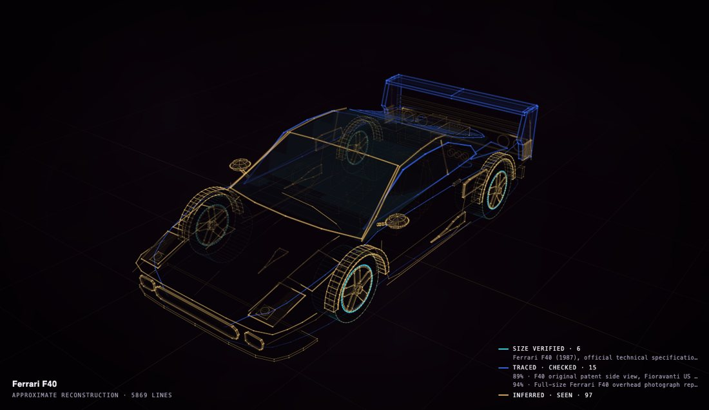

# Construct for museums and archives

A reconstruction that says how each part is known, so a visitor can tell evidence from design. A part's size and its
shape are judged apart, and every guess is shown in a shade of how firmly it is held.

The Ferrari F40 in the provenance view (<b>P</b>): size verified in cyan, traced from drawings in blue, guesses in amber, deeper the more firmly they are held. The sources are listed under the legend.

## What a construct can say about each part

| colour | meaning |
| --- | --- |
| white | verified: its size and its shape |
| cyan | its size verified (a published dimension), its shape traced or inferred |
| violet | its shape verified (a drawing, a measurement, a dataset) |
| blue | traced from an orthographic drawing; strong blue once a silhouette comparison with it passed |
| amber, pale to deep | inferred: designed, described in a document, seen in a picture, or seen and checked |
| magenta, dotted | decorative |

Labels come only from facts; the caption says APPROXIMATE or GENERIC when it is, and ORIGINAL DESIGN for a new
design. A construct can carry a note on its evidence, shown in the provenance view.

## Try it

Open any construct in the [gallery](https://rtmandreyev.github.io/construct/) and press **P**, or open it with
`?mode=provenance`. Saturn is a good one: its rings come from published measurements, its cloud bands are designed.

## Go deeper

- [The Measured Light style](../STYLE.md): the provenance view and its colours
- [In a classroom and a museum](../CLASSROOM.md): a run in a museum
- [The scene contract](../../CONTRACT.md): how certainty, sources and facts are written
