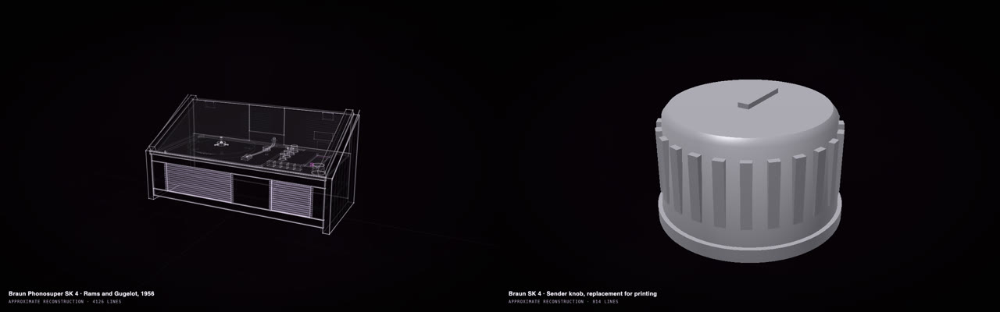

# Make a part that is missing or broken

A knob, a bracket, a cover or a clip, drawn to the thing it belongs to and ready to print or to send to someone with
a printer or CAD.

A Braun SK 4 from three photos, and a replacement for its missing control knob, 35 mm across, ready to print.
DeepSeek V4.1 Flash, masterpiece mode. <a href="https://rtmandreyev.github.io/construct/examples/braun-sk4/">Open the SK 4</a>.

## What to gather

- **Photos** of the thing, and of a part like the missing one if there is another (the knob beside it).
- **What it is:** the maker and model.
- **A measurement of what the part fits onto**, if you can (the shaft a knob goes on). If you can't, the part says
  which sizes are designed to fit, so you can measure before printing.

## The message

Set up the app once ([Construct in the Claude or ChatGPT app](in-the-apps.md)), put your photos in a folder (here
`my-radio`) and send:

> Read skills/construct/SKILL.md in this folder and use the Construct skill to make a masterpiece construct of my
> **[maker, model]** from the photos in **my-radio/**. One **[control knob]** is missing. Then make the replacement
> as its own construct at real size, modelled to print, and say how each size is known. Give me a print file and a
> STEP file of it. Save everything in **my-radio/**.

## Then

- *"The shaft is 6 mm across the flat: make the hole fit it."*
- *"Make the print file for a 0.4 mm nozzle"*, *"print two."*

Measure what the part fits onto before you print it for good: a first print in cheap plastic is the best test.
[Everything the apps can do, and what to know →](in-the-apps.md)
