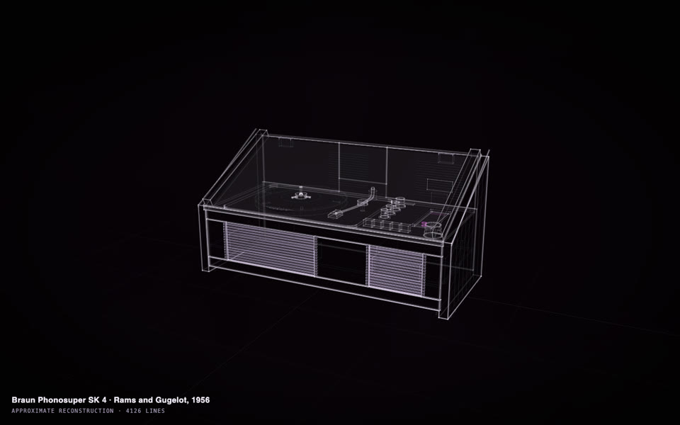
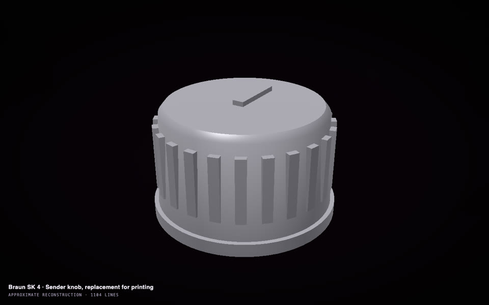
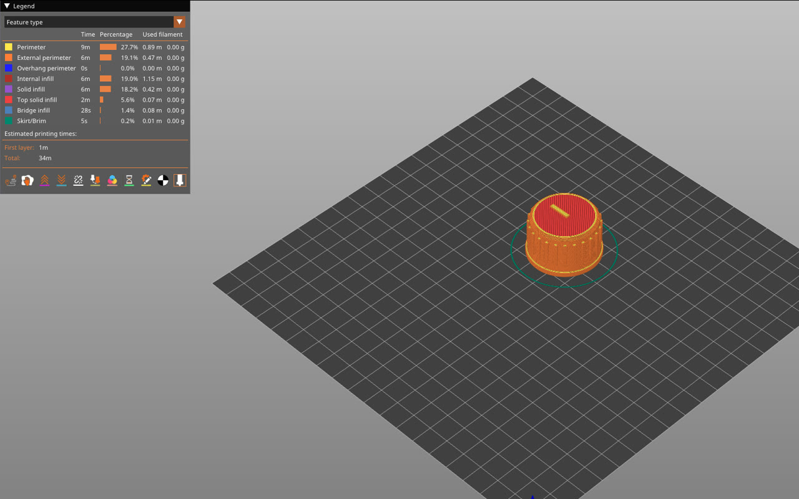

# Make a part that is missing or broken

A knob, a bracket, a cover or a clip, drawn to the thing it belongs to and ready to print, or to send to someone with
a printer or CAD. No terminal: the Claude app or the ChatGPT app does the work ([how to set it up](in-the-apps.md)).

  
  

A Braun SK 4 from three photos (<a href="https://rtmandreyev.github.io/construct/examples/braun-sk4/">open it</a>), and a replacement for its missing control knob,
35 mm across (<a href="https://rtmandreyev.github.io/construct/examples/braun-sk4-knob/">open the knob</a>).

## Our example, start to finish

**The photos.** Three photographs, standing in for an owner's own:

  
  
  

Alf van Beem, CC0 · With Associates, CC BY-SA 2.0 · Andy Armstrong, CC BY-SA 2.0 (Wikimedia Commons)

**The message** (sent to an agent, DeepSeek V4.1 Flash through Hermes; the same words work in the apps):

> Using the construct skill, make a masterpiece construct of my Braun SK 4 radio-phonograph (Dieter Rams and Hans Gugelot, 1956). One control knob on mine is missing, and I want to print a replacement. Masterpiece mode.
>
> - My photos are in refs/ (three views; refs/SOURCES.md says where each comes from: record each as a source with its credit). Research the SK 4's published dimensions and construction, each recorded as a fact with its source.
> - Model it as separate, named parts a restorer would recognise: the white-painted steel body, the two wooden side panels, the clear acrylic lid, the turntable platter and spindle, the tonearm and its rest, the control panel with its knobs and push-buttons, the radio dial, the speaker grille slots, the feet.
> - The lid opens on its hinge (an articulation); the platter turns (idle life).
> - Say how each part is known, its size and its shape separately, as the skill describes.
> - Check it until clean, including `construct check --fit`, so every part rests on what holds it and nothing pokes through.
> - Run the masterpiece rounds with an independent critic on the SK 4 (scene.json), as the skill describes, until one of the skill's stop rules ends them. Do not stop earlier on your own. Record the critic's verdict.
> - Then write knob.json: the replacement for the large control knob as its own construct at real size, modelled to be printed: the knob body, its grip, the indicator line, the bore for the shaft with its flat. Say how each size is known: from published sizes, from my photos, or designed to fit (mark the shaft bore as designed, since I will measure my shaft before printing). Check it until clean, including `--fit`, and review it once.
> - Work only in this folder.

**What came back.** The SK 4 in 153 named parts (body, side panels, lid on its hinge, platter, tonearm, controls,
grille slots), its overall size from published records and its shapes read from the photos; twelve rounds, the critic's
verdict *good*. Then the knob as its own construct at real size: a 35 mm skirt, a fluted body, the indicator bar,
and the bore for the shaft with its flat, the bore marked as designed to fit.

## The print file

Ask, in the same chat: *"Give me a print file of the knob at real size."* It writes a `.3mf` file, which your 3D
printer's own software (a *slicer*, such as PrusaSlicer, Bambu Studio or Cura) opens and turns into instructions for
the printer. Here it is in PrusaSlicer: one solid part, about 34 minutes and 7.4 cm³ of filament, about 9 g of
plastic (PLA).

**Check before printing.** Open the file in your slicer and look at the hole for the shaft from below. In this
example the first print file had it closed, for two reasons: the skirt under the knob was drawn as a solid disc, and
the outline of the knob's body stopped at the top of the hole instead of running back down its wall, so the body was
not one closed solid. Both were fixed before printing. If yours is closed, send:

> The hole for the shaft has to be open from the bottom, through the skirt: make the skirt a ring, and make the
> body's outline run down the hole's wall so the body is one closed solid. Then give me the print file again.

Other things to ask for:

- *"The shaft is 6 mm across, 4.5 mm across the flat: make the bore fit it, with 0.2 mm to spare."*
- *"Give me a STEP file of the knob"*, for anyone who works in CAD, or to send to a print service.
- *"Print it in two halves"*, *"make the grip deeper."*

## Do it with your own part

**Gather:**

- **Photos** of the thing, and of a part like the missing one if there is another (the other knob, the bracket on
  the other side).
- **What it is:** the maker and model.
- **A measurement of what the part fits onto,** if you can (the shaft a knob goes on, the holes a bracket screws
  into). If you can't, the part says which sizes are designed to fit, so you can measure before printing.

**Send** (after the [one-time setup](in-the-apps.md)), with your photos in a folder such as `my-radio`:

> Read skills/construct/SKILL.md in this folder and use the Construct skill to make a masterpiece construct of my
> **[maker, model]** from the photos in **my-radio/**. One **[control knob]** is missing. Then make the replacement
> as its own construct at real size, modelled to print, and say how each size is known. Give me a print file and a
> STEP file of it. Save everything in **my-radio/**.

## Good to know

- **Print a test first,** in cheap plastic, and try it on: fit is the one thing a model from photos cannot promise.
- **Sizes that matter:** press **P** on the part, and measure the ones marked *designed* or *inferred* yourself.
- [Everything else to know about the apps →](in-the-apps.md)
