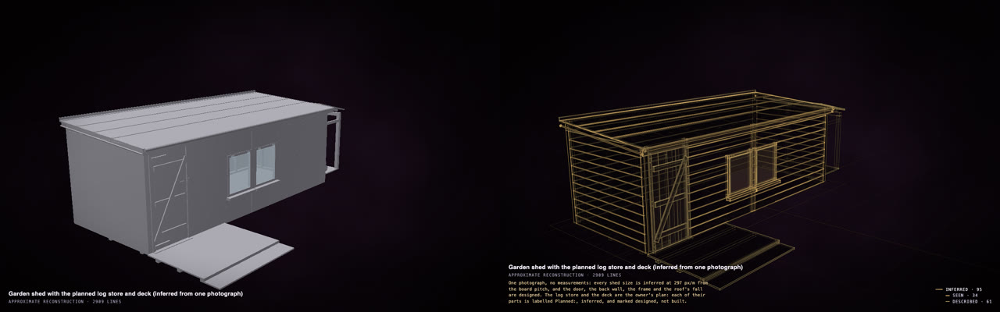
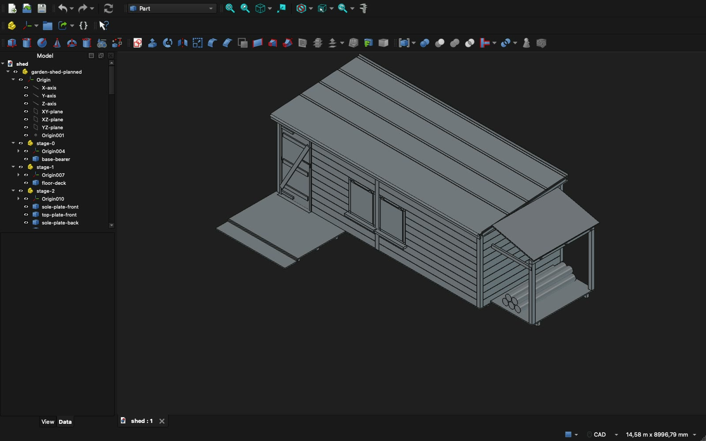

# Show someone what you mean

An idea about a real thing, turned into a model another person can turn, measure and build from: for a builder, a
joiner, a fabricator, a designer or a friend with CAD, with a file for their own tools. No terminal: the Claude app
or the ChatGPT app does the work ([how to set it up](in-the-apps.md)).

A planned change to a shed, as a solid (left) and with <b>P</b> (right): what is planned shows as designed, not
built, so nobody takes the idea for what is there. <a href="https://rtmandreyev.github.io/construct/examples/garden-shed-planned/">Open it</a>.

## How it goes

1. **A model of the thing as it is,** from your photos: [your home or garden](home-and-garden.md),
   [something you own](copy-your-thing.md), [your vehicle](your-vehicle.md).
2. **Your idea, in the same chat,** in plain words with the sizes you know:
   *"Add a lean-to log store on the left, 1.2 m deep, and a deck in front of the door with one step. Label every
   new part 'Planned'."*
3. **What the other person uses:**

| They work with | Ask for | They open it in |
| --- | --- | --- |
| a browser (anyone) | *"the page"* (the `.html`) | any browser: turn it, press **P** to see what is planned |
| CAD (builders, engineers, fabricators) | *"a STEP file of the planned version"* | FreeCAD, Fusion, SolidWorks, Onshape, any CAD |
| 3D (designers, renderers) | *"a file for Blender"* (a `.glb`) | Blender, SketchUp, most 3D programs |
| a 3D printer | *"a print file, 20 cm long"* (a `.3mf`) | any slicer |

The STEP file of the shed above, in FreeCAD: every part named and grouped in the order it is built, the planned
log store and deck among them.

## Good to know

- **Send the page and the file together,** and say it is a model from photos: the person who builds it measures
  first. The page shows, part by part, what was measured and what was estimated.
- **Change it together.** They can ask for changes too: *"make the deck 20 cm lower"*, and the page and the file
  come back new.
- [Everything else to know about the apps →](in-the-apps.md)
