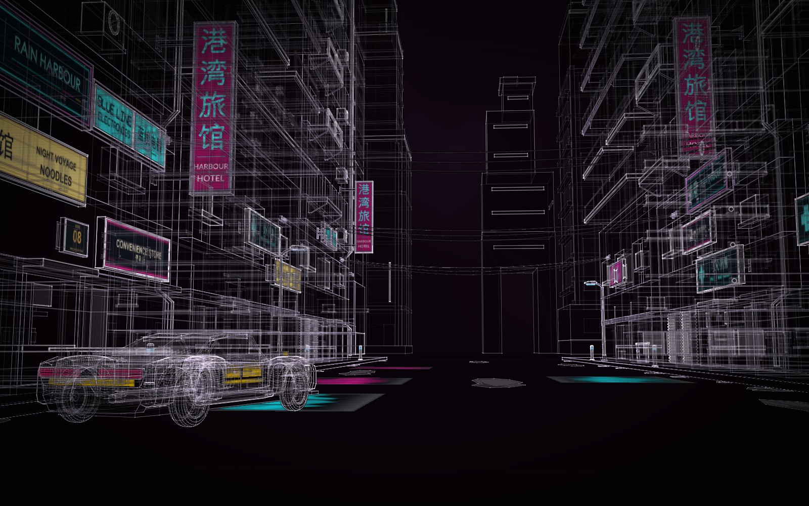
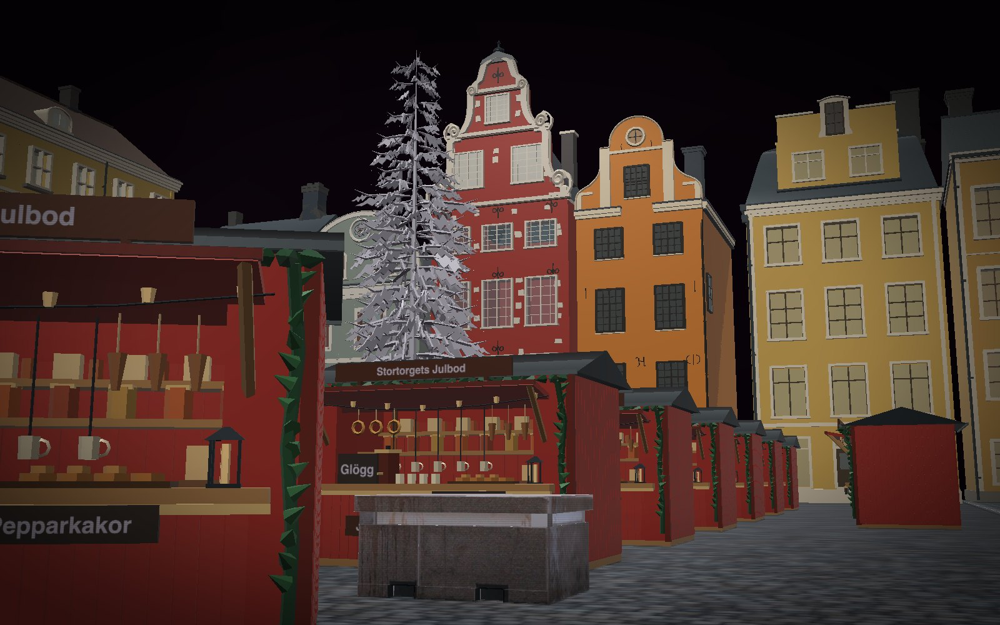
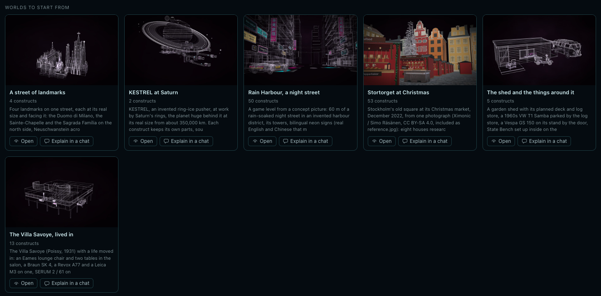
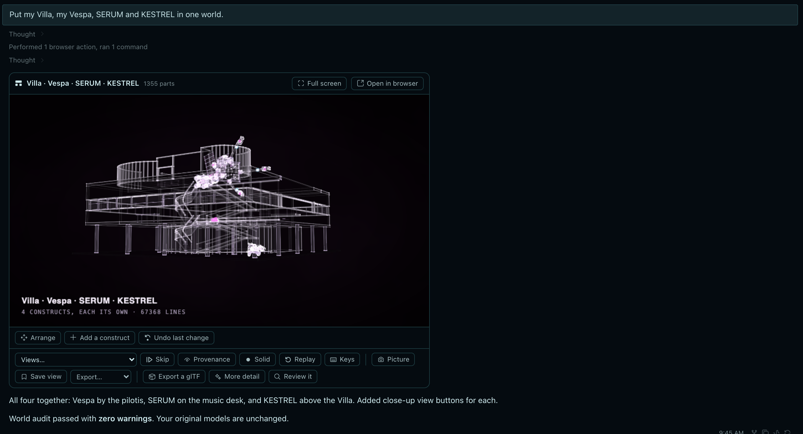
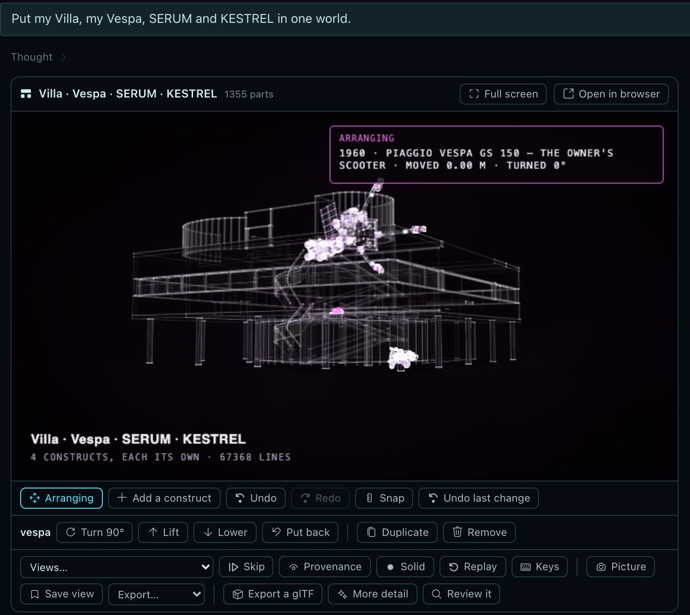
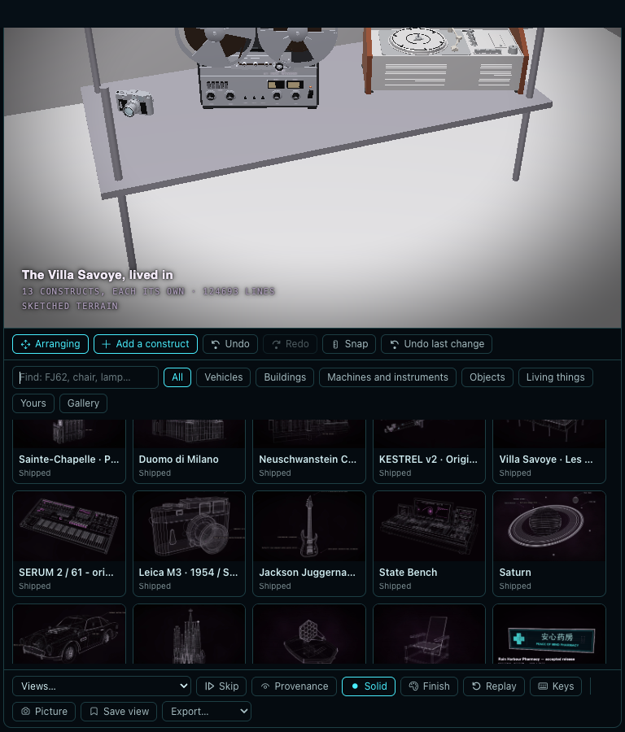
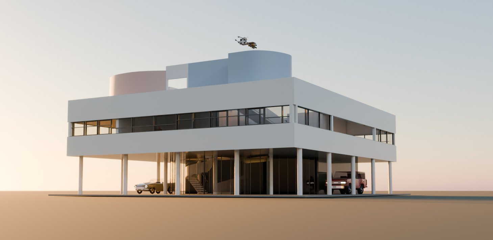

# Worlds in Hermes, step by step

A construct is one thing understood: its parts at their real sizes, how each is known, how it opens. A **world** puts
whole constructs together in one place: your Vespa under your house, a synthesizer on its table, a ship far off in
the sky; or a street, a market square, a game level. Each construct keeps its own parts, record and
joints, and the world checks what overlaps, what runs into the house it stands in, and what stands where a door opens.

This page walks through worlds in Hermes Desktop, from opening one that ships to making one from a picture. It ends
with two worlds made from a single picture each, in masterpiece mode:
[Rain Harbour](../../examples/worlds/rain-harbour/) (a game level from a concept picture) and
[Stortorget](../../examples/worlds/stortorget/) (a real square in Stockholm from a photograph).

<p align="center">
  
  
</p>
<p align="center"><sub>Rain Harbour and Stortorget, each made in Hermes from one picture.</sub></p>

## Set it up

```bash
hermes plugins install rtmandreyev/construct#hermes/construct
hermes plugins enable construct
```

Restart the gateway and turn the Desktop half on in **Capabilities → Plugins**. Worlds need nothing more.
[What the plugin does and touches](../../hosts/hermes/construct/README.md)

## 1. Open a world that ships

**Constructs → Worlds** lists your worlds and the ones that ship: [the shed](https://rtmandreyev.github.io/construct/worlds/the-shed/) with the Samba and the Vespa;
[the Villa Savoye lived in](https://rtmandreyev.github.io/construct/worlds/villa-savoye-lived-in/); [a street of landmarks](https://rtmandreyev.github.io/construct/worlds/a-street-of-landmarks/); [KESTREL at Saturn](https://rtmandreyev.github.io/construct/worlds/kestrel-at-saturn/);
[Rain Harbour](https://rtmandreyev.github.io/construct/worlds/rain-harbour/); [Stortorget](https://rtmandreyev.github.io/construct/worlds/stortorget/). Each also opens in a browser from the gallery. Open one and it builds live in
the chat, assembling piece by piece.

<p align="center"></p>

<p align="center"></p>
<p align="center"><sub>The Villa Savoye, lived in, as it ships, opened from the Worlds tab: Solid (S), the Salon view.</sub></p>

- **Views…** on the card lists the world's views: the whole, the views the world names ("by the door", "the car
  close"), and each placement.
- **Provenance** (P) colours every part by how it is known, across the whole world: traced from plans, measured,
  seen in photos, designed.
- **Solid** (S) shows it as a solid in its own colours. The light view keeps the house palette, so this is where a
  red house reads red.
- **Keys** (?) lists every key: fly with the arrows, double-click a part to focus on it, F skips the assembly.

## 2. Arrange it by hand

**Arrange** on the card turns the world into a table you can move things on, without calling a model:

- click a construct, then drag it onto anything: the ground, a floor, a table, a roof. What stands on it goes with
  it;
- **Shift**-drag or **Q / E** turn it 15° (Shift: 1°); **Turn 90°**; the arrows nudge it; **Lift / Lower** (Page Up /
  Down) for what hangs or flies; **Snap** keeps to a quarter-metre grid and 15° turns;
- **Duplicate** places another beside it; **Remove** takes it out; **Put back** undoes the moves since you last
  saved.

**Save** checks the world with your moves (overlaps, collisions, what stands on nothing), saves it and rebuilds it.
The world's log marks the moves as yours. **Undo last change** steps back one save.

<p align="center"></p>

## 3. Add a construct

**Add a construct** opens the library: your own constructs, the ones that ship and the gallery, with their pictures.
Pick one and it lands at its real size on a floor it fits on, or on clear ground in front, chosen and ready to drag
where it belongs. A construct's own card has **Place in a world** for the same thing from the other side.

<p align="center"></p>

## 4. Colour it, keep it tidy

**Finish** on the card: click a part in the solid view, pick its colour and what it is made of, for its whole material
(a car's paint, every panel of it), every part of its kind (all four tyres) or that part alone, then **Save colour**.
A repainted material says so in its name in exports (*Repainted by hand (was Freeborn Red)*). The repaint is written into that world's own copy of the
construct without calling a model. Your own construct and your other worlds are not touched, and **Undo last change**
puts it back. Exports and the Blender add-on take the new colour.

On the Worlds page, **More…** on a world:

- **Move to → A new folder** makes a folder of your own (My game, Client work); worlds go in and out of folders,
  and the ones that ship stay apart under *Worlds to start from*;
- **Archive** puts a world out of the way, folded under *Archived*, and nothing is deleted;
- **Delete for good**, on an archived world only, removes it and its builds after asking once more. The same goes
  for constructs on the Constructs page.

Each world and construct keeps its newest six builds by itself; **Keep only the newest**, above its Builds list,
clears the rest whenever you like.

## 5. Ask for one

A world can be asked for in plain words. Hermes uses `construct_world`: it makes the world, places each construct
on its surface (several at once), reads the world's warnings and fixes them, names the views, and shows each change
live.

> Put my Eames chair in the Villa's salon facing the terrace, my Revox, Braun and Leica on a table, the FJ62 and the DB5
> under the pilotis, and KESTREL far off over the roof.

Hermes finds the constructs by name in your projects, the ones that ship and the gallery (a gallery construct is
downloaded from Construct's own GitHub release, after you approve it in Hermes's prompt). It places them at real
size: KESTREL, 120 m long, hangs a kilometre and a half off over the roof, at the size it would look from there.

## 6. Take it elsewhere

**Picture** saves a still of the current view. The **Export** menu writes the whole world as one file, each placement
a named group, every joint working:

| Export | For |
| --- | --- |
| glTF (.glb) | Blender, Unity, Unreal, Godot, three.js |
| Godot game map | one static body with colliders for what stays put; every hinged or sliding part (doors, lids, hatches) moves on its own joint |
| FBX | Unity, Unreal, Maya (through Blender, if it is on the machine) |
| USDZ / USD | Reality Composer, Quick Look, Omniverse, Houdini (through Blender) |
| OBJ | plain meshes for other tools |

In Blender, the Construct add-on imports a `world.json` or the `.glb` with its build, metal and finish sliders.

<p align="center"></p>

## 7. A world from a picture, in masterpiece mode

Attach a picture (a photo of a real place, a concept painting, a sketch) and ask for a world from it. A world is made
to be used as it is, so every construct made for it is made to a masterpiece's standard unless you say **fast**.

What a good request says, from the two below:

- **what the picture is** and what to build from it: the buildings, the props, the signs, the ground;
- **what to leave out** (people, the other cars, a container);
- **that the words are real:** signs in a real language that mean what they say, never letter-noise copied from a
  generated picture;
- **the views you want**, for a film or a level: the view from where the picture was taken, a close-up, a high view;
- **say the plan, then go on:** Hermes states the plan and its cost and starts without waiting.

What happens:

1. **The plan.** Hermes lists what the picture holds and what exists already, and decides the constructs worth
   making: each distinct thing once, placed as often as needed (one market stall placed 41 times).
2. **The constructs.** Each new construct is built by its own subagent, in masterpiece rounds: a build, a packet of
   review pictures, a fresh critic, a recorded verdict, the fixes, until the stop rules (12 rounds; two in a row that
   do not beat the best; two hours of the builder's own time). The hero pieces get the full loop; small repeated
   props a shorter one. Several builders run at once.
3. **The world.** The constructs are placed at real size, then the world itself runs masterpiece rounds against the
   picture: one fresh critic a round judges the world's views beside the picture, and a round that loses puts the
   world and its constructs back. If a run stops at its time ceiling while still improving, you can give it more:
   `rounds extend 90`.
4. **The hand-over.** The world in the chat, live; what the last critic still found, word for word; what is
   documented and what is inferred.

Plan for a long run: each world below took most of a day of model time.

### Two worlds made this way

| | [Rain Harbour](../../examples/worlds/rain-harbour/) | [Stortorget](../../examples/worlds/stortorget/) |
| --- | --- | --- |
| From | a concept picture of a cyberpunk street | a photograph of Stockholm's old square at its Christmas market |
| For | a game level | a film set |
| Constructs | 21, placed 50 times | 13, placed 53 times (one stall, 41 times) |
| World rounds | 12 (the cap), final verdict good | 12 (the cap), final verdict improve (good at rounds 9 and 10) |
| Made by | GPT-6.1 Sol in Hermes | GPT-6.1 Sol in Hermes |

Each page has the request word for word, the plan, every construct's rounds, the world's rounds, what the last
critic still found, and what is documented against what is designed.

## Limits worth knowing

- A world places whole constructs; it does not merge them. To change a construct, change it in its own project, then
  `construct_world` op `refresh` brings the new version into the world.
- There is no wet or mirror surface yet, and nothing mounts on a wall: a cable fixed to a façade touches it, and the
  world says so.
- The light view keeps Construct's house palette for every construct, so colour is judged in the solid view.
- Sizes from a picture are designed, not surveyed, and each part says so: press **P**.

[Worlds, the reference](../WORLDS.md) · [What's new in 1.3](../NEW-IN-1.3.md)
