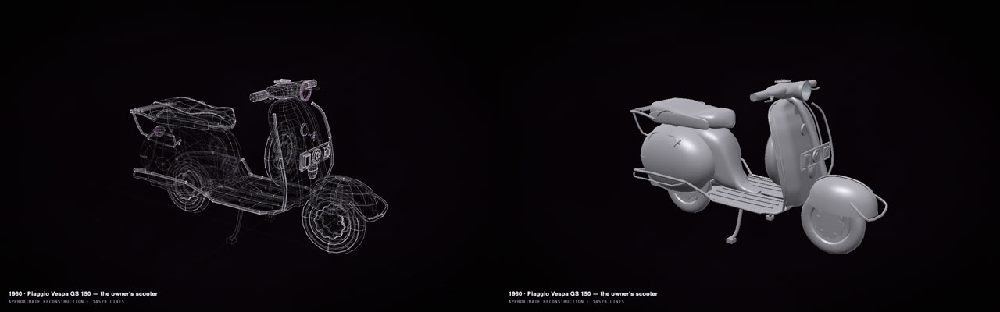
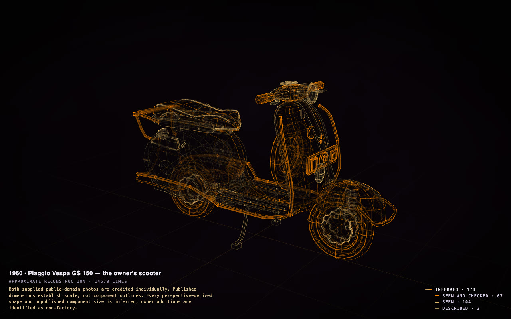

# Customise or restore your vehicle

Your car, bike or scooter from its published sizes and your photos, with your own parts told apart from the
factory's: try a colour or wheels on the copy first, plan a restoration, render it, or make a model of it. No
terminal: the Claude app or the ChatGPT app does the work ([how to set it up](in-the-apps.md)).

A 1960 Vespa GS 150 from two photos and one message. <a href="https://rtmandreyev.github.io/construct/examples/vespa-gs150/">Open it</a>: press <b>L</b> for the labels,
and the owner's parts say <i>MINE, not factory</i>.

## Our example, start to finish

**The photos.** Two photographs of one scooter, standing in for an owner's own:

  
  

Both public domain, Wikimedia Commons

**The message** (sent to an agent, GPT-6.1 Sol through Hermes; the same words work in the apps):

> Using the construct skill, make a masterpiece construct of my 1960 Vespa GS 150 scooter (Piaggio). Masterpiece mode.
>
> - My photos are in refs/ (two views of my scooter, front left and rear right; refs/SOURCES.md says where each comes from: record each as a source with its credit). Research the GS 150's published dimensions and specifications (length, width, height, wheelbase, wheel size, engine), each recorded as a fact with its source.
> - Model it as separate, named parts a restorer would recognise: the pressed-steel monocoque body, the legshield, the floorboards and runners, the two side cowls (engine side and spare-wheel side), the front mudguard, the fork and front suspension, the handlebar with its headlamp and speedometer, the horn cover, the dual seat, the wheels and tyres, the engine, the exhaust, the rear light, the stand.
> - Mine is not stock: it has whitewall tyres, chrome protection bars, a rear rack, badges on the legshield and a spare wheel. Model each as its own part and say in its label that it is mine, not the factory's, so a restorer can tell stock from mine.
> - The handlebar steers and the stand folds up (articulations); the side cowls lift off (an articulation each).
> - Say how each part is known, its size and its shape separately, as the skill describes.
> - Check it until clean, including `construct check --fit`, so every part rests on what holds it and nothing pokes through: I want to print it as a model kit later, so parts must sit on each other properly.
> - Run the masterpiece rounds with an independent critic, as the skill describes, until one of the skill's stop rules ends them. Do not stop earlier on your own. Record the critic's verdict.
> - Work only in this folder and write the scene as scene.json here.

**What came back.** The scooter in 174 named parts a restorer would recognise, and the scooter's own story kept
straight: its whitewalls, chrome bars, rear rack, spare wheel and badges are separate parts labelled as the owner's,
not the factory's. The cowls lift off, the handlebar steers, the stand folds. Twelve rounds, each judged by an
independent critic, about an hour and a half in all. Press **P**: every part is a reading, in shades of how firmly
it is held (67 seen in the photos and checked against the published sizes, 104 seen, 3 described), and the
construct's own note says that the published dimensions set the scale, not the outlines.

## Take it further: try a finish in Blender

Ask, in the same chat: *"Give me a file for Blender: silver paint, chrome bars and rack, whitewall tyres, a white
seat with blue piping."* It writes a finish map ([the one used here](../../examples/vespa-gs150/maps/finish.json))
and a `.glb` that Blender and most 3D programs open. With the [Construct add-on for Blender](../../hosts/blender/README.md)
it builds itself, turns plain, then takes its finish:

Then try something else on the copy, never on the scooter: *"show it in two-tone cream and red"*, *"without the
rack and bars, as it left the factory"*, *"with the spare wheel on the front."*

Other things to ask for:

- *"Make it a model kit at 1:12"* ([a kit of your own](a-kit-of-your-own.md)). This Vespa's kit: [in 3D](https://rtmandreyev.github.io/construct/examples/vespa-gs150/kit/assembly.html),
  [the booklet](https://rtmandreyev.github.io/construct/examples/vespa-gs150/kit/booklet.html), [the plates to print](https://github.com/rtmandreyev/construct/releases/latest/download/construct-kit-vespa-gs150.zip).
- *"Give me a STEP file of the legshield"*, for a panel beater or a fabricator, measured first.
- *"List my parts that are not the factory's"*, for a restoration back to stock.

## Do it with your own vehicle

**Gather:**

- **Photos** from every side: front, back, both sides and the three-quarters. Engine and interior too, if you want
  them modelled.
- **What it is,** exactly: the maker, the model, the year, the version. The app looks up the published sizes.
- **What is yours, not the factory's:** wheels, racks, badges, paint, anything changed.

**Send** (after the [one-time setup](in-the-apps.md)), with your photos in a folder such as `my-scooter`:

> Read skills/construct/SKILL.md in this folder and use the Construct skill to make a masterpiece construct of my
> **[maker, model, year]** from the photos in **my-scooter/**. Research its published dimensions. Mine is not
> stock: **[it has whitewall tyres, a rear rack and badges]**: model each as its own part and say it is mine, not
> the factory's. Masterpiece mode. Save it as **my-scooter/my-scooter.html**.

Cars and bikes are the hardest things to make: use the strongest model your app offers (GPT-6.1 Sol or Claude Opus
5.5 class), and expect an hour or two.

## Good to know

- **A reference model, not a measurement.** Bodywork is read from photos; before you make or order a part, measure
  the real one.
- [Everything else to know about the apps →](in-the-apps.md)
