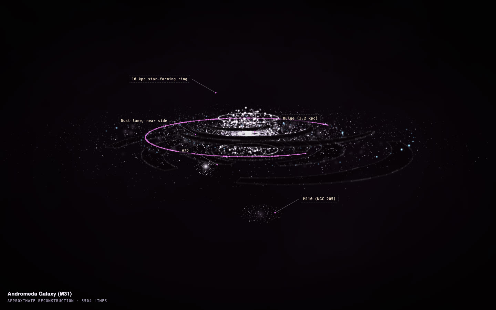

# Andromeda Galaxy (M31)

[](https://rtmandreyev.github.io/construct/examples/andromeda-galaxy/)

**Made by** DeepSeek · masterpiece mode, through Hermes (last round self-reviewed) · with Construct 0.2.1. Its last round was self-reviewed, not judged by the critic: the host's limit on helper agents ended the critic rounds early.

[Open the live construct](https://rtmandreyev.github.io/construct/examples/andromeda-galaxy/) (drag to orbit, R replays the assembly, L shows labels) ·
[scene.json](scene.json)

**Reproduces with Construct 0.2.1.** `check` passes (1 warning: critic-stale),
and the 0.2.1 compiler builds the identical page. Its hero still differs only by the random idle shimmer playing at the moment of capture, so the original hero is shown. Its `critic-stale` warning is honest: the critic's last verdict was for an earlier version of the scene.

```sh
python3 construct_hologram/cli.py build examples/andromeda-galaxy/scene.json --out out/andromeda-galaxy
```
