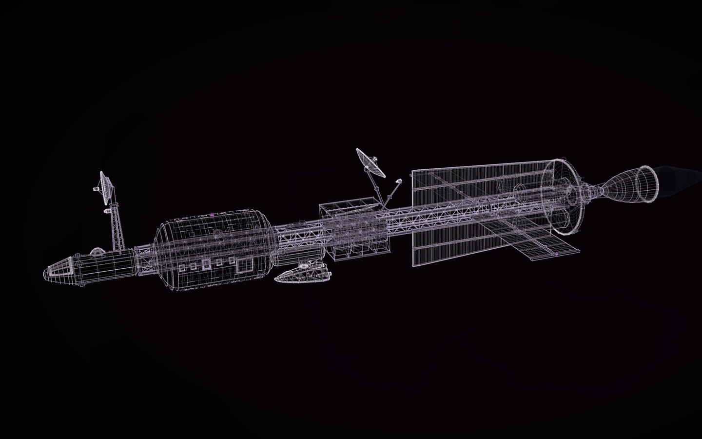
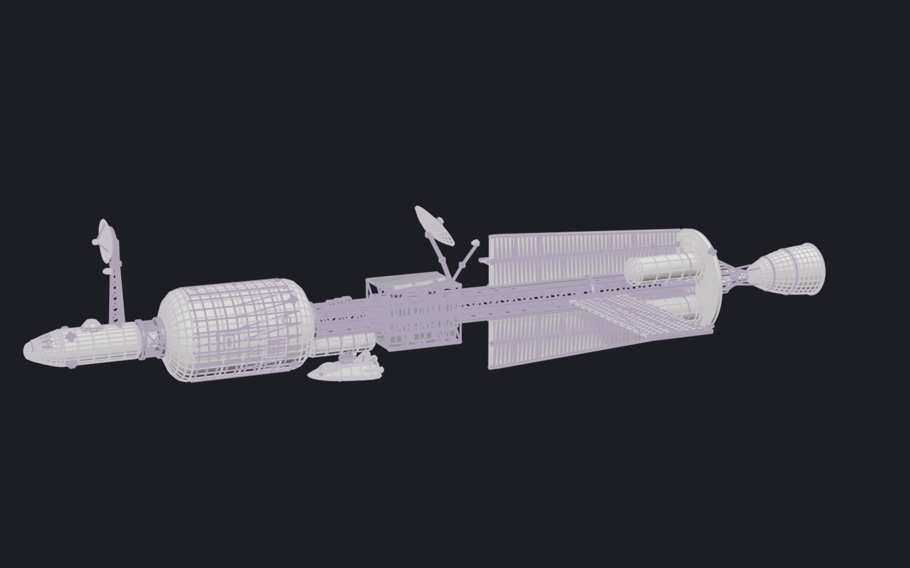

# ARGUS (DSV-312)

**masterpiece · Claude Opus 5.5, then GPT-6.1 Sol**

A 180 m deep-space survey ship laid out like NASA's nuclear-thermal transfer-ship studies: the crew at the bow, the reactor aft behind a shadow shield, the radiators inside its shadow; ISS-style truss, cupola and arrays. Lander 2 rides docked at its port.

[Open the live construct](https://rtmandreyev.github.io/construct/examples/argus/): drag to orbit, R replays the assembly, P shows every part as
designed (none is measured: it does not exist), S shows it as a solid.

The film's Blender model of the first version, rendered in a plain studio.

Made for the author's visual album film. How to design something like it, with a brief of your own:
[New things from real ones](../../docs/for/invent-from-what-exists.md).

**Not published:** the scene and the brief it was made from. **Rights:** all rights reserved, to view only;
not under Construct's Apache-2.0 licence ([LICENSE](LICENSE)).
