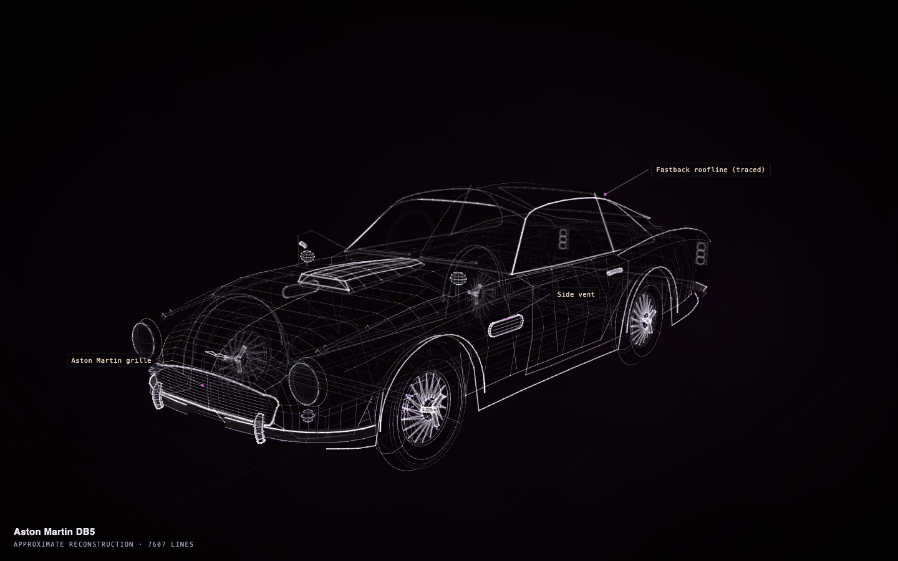

# Aston Martin DB5

[](https://rtmandreyev.github.io/construct/examples/aston-martin-db5/)

**Made by** Claude Opus · masterpiece rounds, round 5 · with a Construct 0.2.1 development build.

[Open the live construct](https://rtmandreyev.github.io/construct/examples/aston-martin-db5/) (drag to orbit, R replays the assembly, L shows labels) ·
[scene.json](scene.json)

**Reproduces with Construct 0.2.1.** `check` passes (5 warnings: bare-surface),
and the 0.2.1 compiler renders this hero pixel for pixel as the build that made it did. Its `bare-surface` warnings come from a later craft rule (main surfaces keep a faint contour); the scene predates it and is shown as it was made.

```sh
python3 construct_hologram/cli.py build examples/aston-martin-db5/scene.json --out out/aston-martin-db5
```
