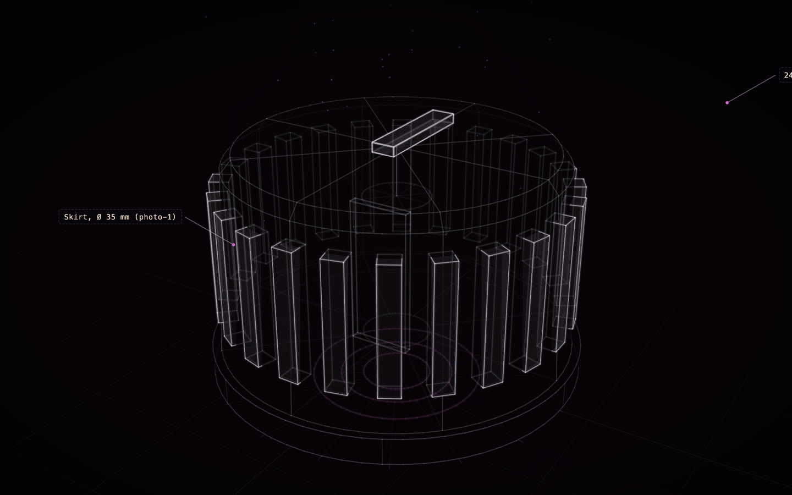

# Braun SK 4: a replacement knob

[](https://rtmandreyev.github.io/construct/examples/braun-sk4-knob/)

**fast · DeepSeek V4.1 Flash**, made after the [masterpiece SK 4](../braun-sk4/) and reviewed once

[Open the live construct](https://rtmandreyev.github.io/construct/examples/braun-sk4-knob/): drag to orbit, P shows how each part is known, S shows it as a
solid. The scene: [scene.json](scene.json).

The control knob missing from a [Braun SK 4](../braun-sk4/), as its own construct at real size and modelled to
print: a 35 mm skirt, a fluted body, an indicator bar and a bore for the shaft with its flat. The outside is read
from three photographs of the radio; the bore is marked as designed to fit, so measure your shaft before printing.
Made by DeepSeek V4.1 Flash through Hermes, after the SK 4 itself. Two things were fixed by hand before printing,
both found by opening the print in a slicer: the skirt under the knob was a solid disc that closed the bore, and the
body's turned outline stopped at the top of the bore instead of running back down its wall, so the body was not a
closed solid. Fixed, it prints as one solid knob with an open bore in about 34 minutes, 7.4 cm³ of filament.
[Make the part →](../../docs/for/replace-a-part.md)

Print it, or open it in CAD, from a checkout of Construct:

```sh
python3 construct_hologram/cli.py print examples/braun-sk4-knob/scene.json --out knob.3mf --size 35   # 1:1
python3 construct_hologram/cli.py freecad examples/braun-sk4-knob/scene.json --out knob.FCStd --step knob.step
```
