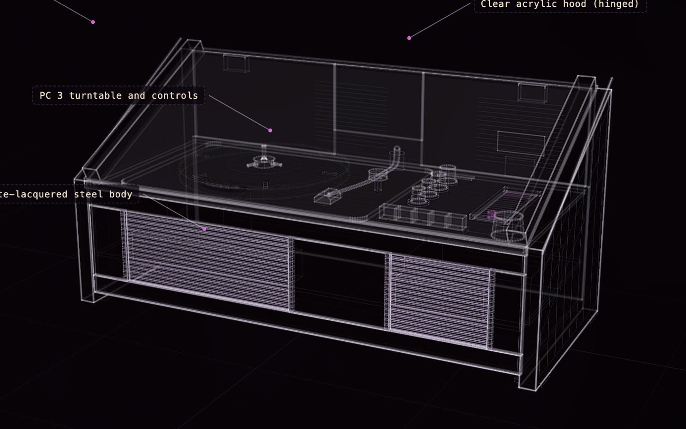

# Braun SK 4

[](https://rtmandreyev.github.io/construct/examples/braun-sk4/)

**masterpiece · DeepSeek V4.1 Flash**

[Open the live construct](https://rtmandreyev.github.io/construct/examples/braun-sk4/): drag to orbit, R replays the assembly, L shows labels, P shows how each part
is known, S shows it as a solid. The scene it was built from: [scene.json](scene.json) and its replacement knob: [braun-sk4-knob](../braun-sk4-knob/).

The Braun SK 4 radio-phonograph (Dieter Rams and Hans Gugelot, 1956), from three photographs and its published
sizes, in twelve masterpiece rounds through Hermes, each judged by an independent critic. Beside it,
[its replacement knob](../braun-sk4-knob/): the missing control knob at real size, modelled to print. [Make the part →](../../docs/for/replace-a-part.md)

The photographs, from Wikimedia Commons, stood in for an owner's own (they are not in this repository):
[front, lid closed](https://commons.wikimedia.org/wiki/File:1956_Braun_Phonosuper_SK4_Schneewittchensarg.JPG) by
Alf van Beem (CC0), [lid open](https://commons.wikimedia.org/wiki/File:Braun_SK_4.1.jpg) by With Associates
(CC BY-SA 2.0) and [three-quarter](https://commons.wikimedia.org/wiki/File:Pinakothek_der_Moderne._Record_Player_(6786756466).jpg)
by Andy Armstrong (CC BY-SA 2.0).

Build it yourself from a checkout of Construct:

```sh
python3 construct_hologram/cli.py build examples/braun-sk4/scene.json --out out/braun-sk4
python3 construct_hologram/cli.py print examples/braun-sk4-knob/scene.json --out knob.3mf --size 35   # the knob, 1:1
```
