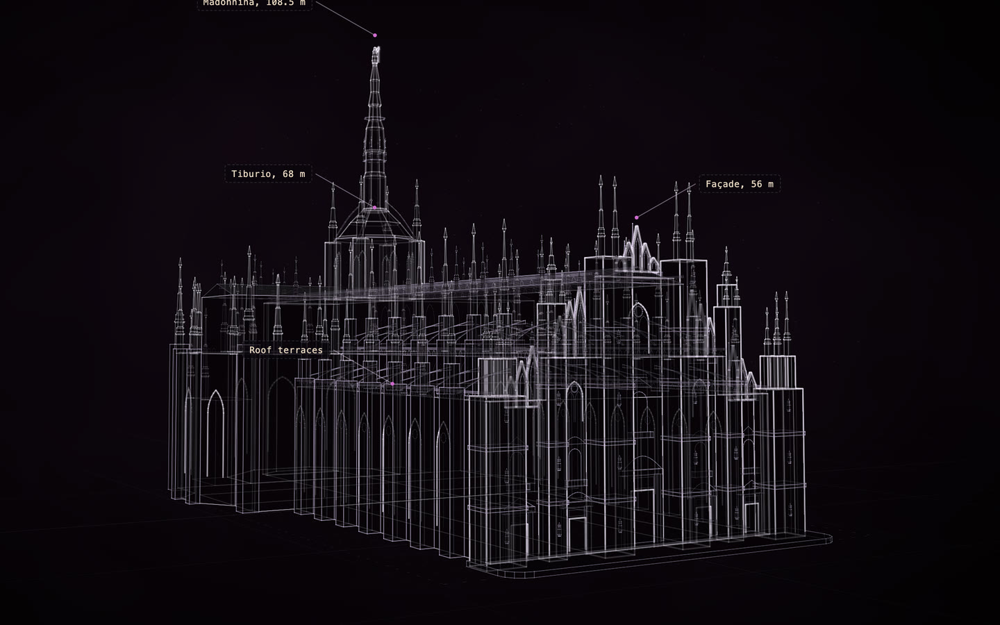

# Duomo di Milano

[](https://rtmandreyev.github.io/construct/examples/duomo-di-milano/)

**masterpiece · Claude Opus 5.5**

[Open the live construct](https://rtmandreyev.github.io/construct/examples/duomo-di-milano/): drag to orbit, R replays the assembly, L shows
labels. The scene it was built from: [scene.json](scene.json).

**Revised after the run.** The Madonnina, her arm and her lance were drawn as data, in the palette's pink accent, so
the great spire ended in a pink tip. She is the cathedral's own gilded statue, not a measurement, and is now drawn in
the building's light, brighter than the stone. An independent critic judged the revised scene; its answer is recorded
in the scene.

Build it yourself from a checkout of Construct:

```sh
python3 construct_hologram/cli.py build examples/duomo-di-milano/scene.json --out out/duomo-di-milano
```
