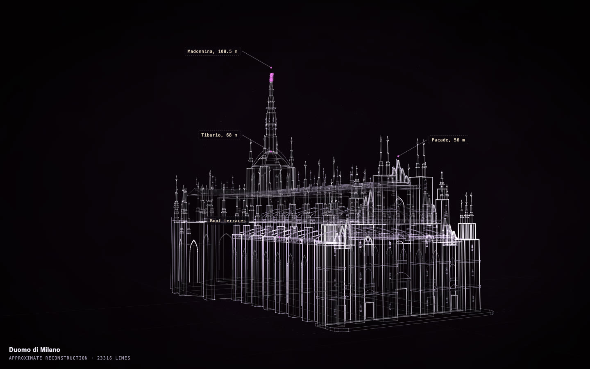

# Duomo di Milano

[](https://rtmandreyev.github.io/construct/examples/duomo-di-milano/)

**masterpiece · Claude Opus**

[Open the live construct](https://rtmandreyev.github.io/construct/examples/duomo-di-milano/): drag to orbit, R replays the assembly, L shows
labels. The scene it was built from: [scene.json](scene.json).

Build it yourself from a checkout of Construct:

```sh
python3 construct_hologram/cli.py build examples/duomo-di-milano/scene.json --out out/duomo-di-milano
```
