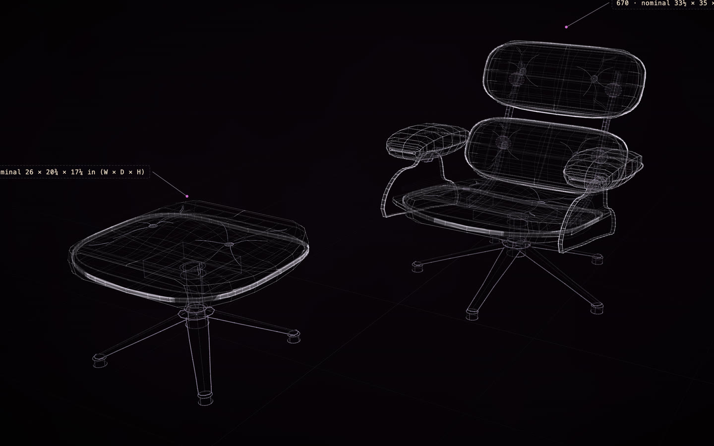

# Eames Lounge Chair, from the ChatGPT app

[](https://rtmandreyev.github.io/construct/examples/eames-lounge-chair-chatgpt/)

**masterpiece · GPT-6.1 Sol, in the ChatGPT app (Codex), no terminal**

[Open the live construct](https://rtmandreyev.github.io/construct/examples/eames-lounge-chair-chatgpt/): drag to orbit, R replays the assembly, P shows how each part is known, S shows it as
a solid. The scene it was built from: [scene.json](scene.json).

The same two photographs and the same request as [the Claude app's chair](../eames-lounge-chair/), made in the
ChatGPT app's Codex, which installed the Construct skill itself from its zip. Twelve masterpiece rounds, each judged
by an independent critic, about an hour in all; the run stopped at the 12-round cap with round 11 the best.
[Copy your thing →](../../docs/for/copy-your-thing.md)

The photographs, from Wikimedia Commons, stood in for an owner's own (they are not in this repository):
[Eames Lounge Chair - side](https://commons.wikimedia.org/wiki/File:Eames_Lounge_Chair_-_side.jpg) by Casey Marshall
(CC BY 2.0) and [lounge chair 670, 1956](https://commons.wikimedia.org/wiki/File:Ngv_design,_charles_eames_and_herman_miller,_lounge_chair_670,_1956.JPG)
by sailko (CC BY 2.5).

Build it yourself from a checkout of Construct:

```sh
python3 construct_hologram/cli.py build examples/eames-lounge-chair-chatgpt/scene.json --out out/eames-lounge-chair-chatgpt
```
