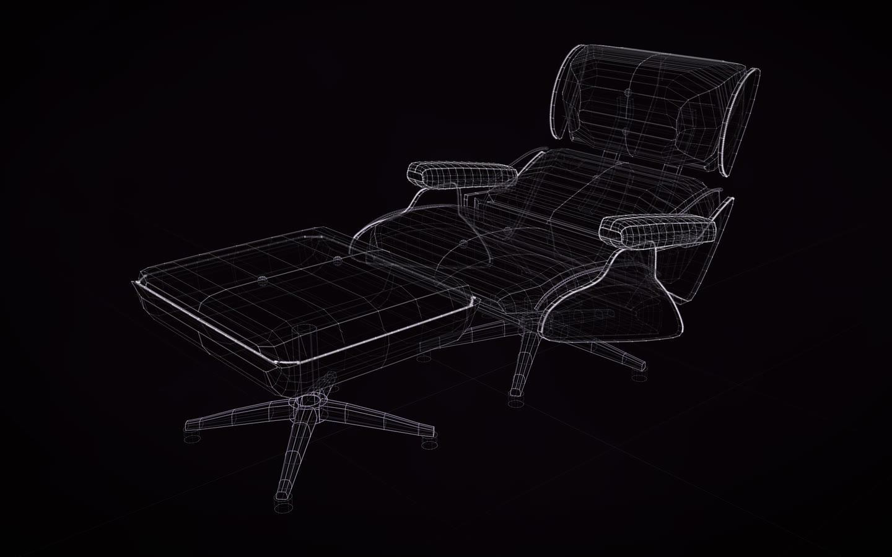

# Eames Lounge Chair and Ottoman

[](https://rtmandreyev.github.io/construct/examples/eames-lounge-chair/)

**masterpiece · Claude Opus 5.5, in the Claude app (Cowork), no terminal**

[Open the live construct](https://rtmandreyev.github.io/construct/examples/eames-lounge-chair/): drag to orbit, R replays the assembly, L shows labels, P shows how each part
is known, S shows it as a solid. The scene it was built from: [scene.json](scene.json).

The Eames Lounge Chair (670) and Ottoman (671), Charles and Ray Eames for Herman Miller, made the way anyone with the
Claude app can: two photographs and one message, in Cowork, with the Construct skill read from its folder. Five
masterpiece rounds, each judged by an independent critic; the run stopped when two rounds in a row did not beat
round 3. The sizes are the maker's published ones; the shells, cushions and base are read from the photographs and
say so. [Copy your thing →](../../docs/for/copy-your-thing.md)

The photographs, from Wikimedia Commons, stood in for an owner's own (they are not in this repository):
[Eames Lounge Chair - side](https://commons.wikimedia.org/wiki/File:Eames_Lounge_Chair_-_side.jpg) by Casey Marshall
(CC BY 2.0) and [lounge chair 670, 1956](https://commons.wikimedia.org/wiki/File:Ngv_design,_charles_eames_and_herman_miller,_lounge_chair_670,_1956.JPG)
by sailko (CC BY 2.5).

**Revised after the run.** In the solid view the leather did not meet the wood. The headrest cushion stood 5 to 7 cm
in front of its shell, and the back cushion floated over a hollow up to 22 cm deep in its shell. The headrest cushion
now sits on its shell (moved 4.7 cm back with its buttons and pleats, its underside following the shell's face) and
the back cushion's underside follows its shell down; the seating surfaces stay where they were. The back keeps the
run's proportions: a deep shell under a nearly level cushion, flatter than a real 670's reclined back, which a new
round would have to redraw. An independent critic judged the revised scene; its answer is recorded in the scene.

Build it yourself from a checkout of Construct:

```sh
python3 construct_hologram/cli.py build examples/eames-lounge-chair/scene.json --out out/eames-lounge-chair
```
