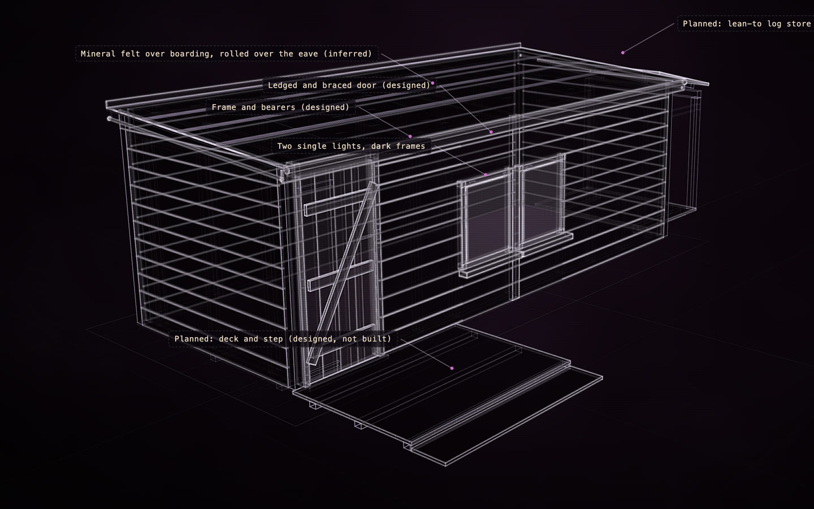

# A garden shed, with a planned change

[](https://rtmandreyev.github.io/construct/examples/garden-shed-planned/)

**fast · DeepSeek V4.1 Flash**, made after the [masterpiece shed](../garden-shed/) and reviewed once. The plan was
added to the masterpiece shed's scene, so its record still carries that shed's tier and its twelve rounds; the
planned change itself had one review, the agent's own (self-reviewed)

[Open the live construct](https://rtmandreyev.github.io/construct/examples/garden-shed-planned/): drag to orbit, P shows how each part is known (the planned
parts as designed, not built), S shows it as a solid. The scene: [scene.json](scene.json).

The [garden shed](../garden-shed/) from one photograph, with what its owner plans to add: a lean-to log store on one
side and a small deck with a step in front of the door. Every new part is labelled "Planned" and marked as designed,
so nobody takes the idea for what is there. [Try it on a copy →](../../docs/for/home-and-garden.md) ·
[Show someone what you mean →](../../docs/for/show-what-you-mean.md)

Build it, or open it in CAD, from a checkout of Construct:

```sh
python3 construct_hologram/cli.py build examples/garden-shed-planned/scene.json --out out/garden-shed-planned
python3 construct_hologram/cli.py freecad examples/garden-shed-planned/scene.json --out shed.FCStd --step shed.step
```
