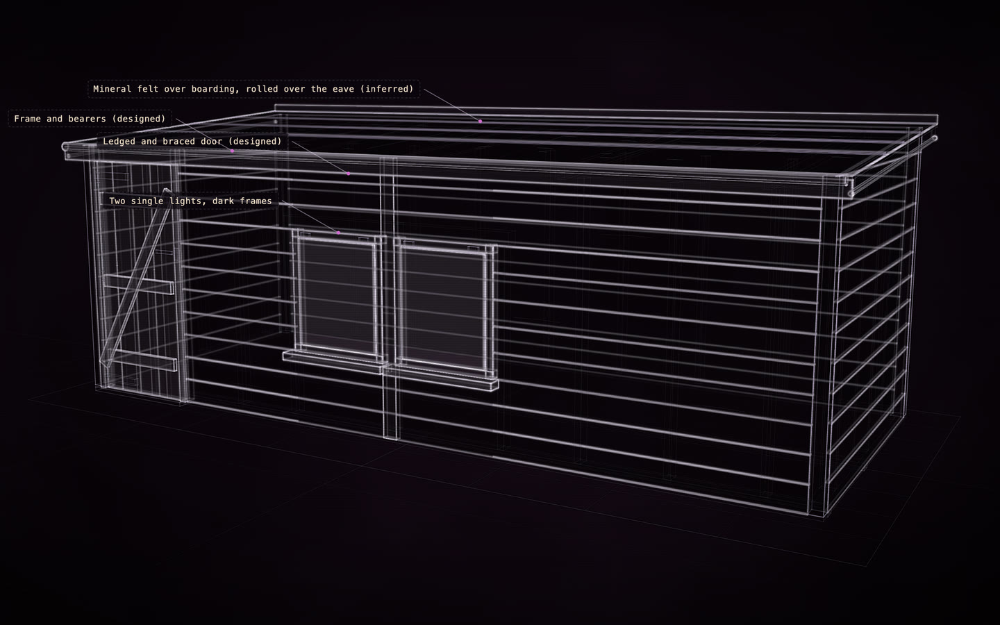

# A garden shed

[](https://rtmandreyev.github.io/construct/examples/garden-shed/)

**masterpiece · DeepSeek V4.1 Flash**

[Open the live construct](https://rtmandreyev.github.io/construct/examples/garden-shed/): drag to orbit, R replays the assembly, L shows labels, P shows how each part
is known, S shows it as a solid. The scene it was built from: [scene.json](scene.json) and the planned change: [garden-shed-planned](../garden-shed-planned/).

A black shiplap garden shed from one photograph and no measurements: every size estimated from what the photo
shows (the door, the window, the boards) and marked as inferred, in twelve masterpiece rounds through Hermes, each
judged by an independent critic. Beside it, [the planned version](../garden-shed-planned/): the same shed with what its
owner plans to add, a lean-to log store and a small deck with a step, every new part labelled "Planned" and marked
as designed, not built. [Try it on a copy →](../../docs/for/home-and-garden.md)

The photograph, from Wikimedia Commons, stood in for an owner's own (it is not in this repository):
[Garden shed at Harlow Museum & Walled Gardens](https://commons.wikimedia.org/wiki/File:Garden_shed_at_Harlow_Museum_%26_Walled_Gardens,_Essex_01.jpg)
by Acabashi (CC BY-SA 4.0).

Build it yourself from a checkout of Construct:

```sh
python3 construct_hologram/cli.py build examples/garden-shed/scene.json --out out/garden-shed
python3 construct_hologram/cli.py build examples/garden-shed-planned/scene.json --out out/garden-shed-planned
```
