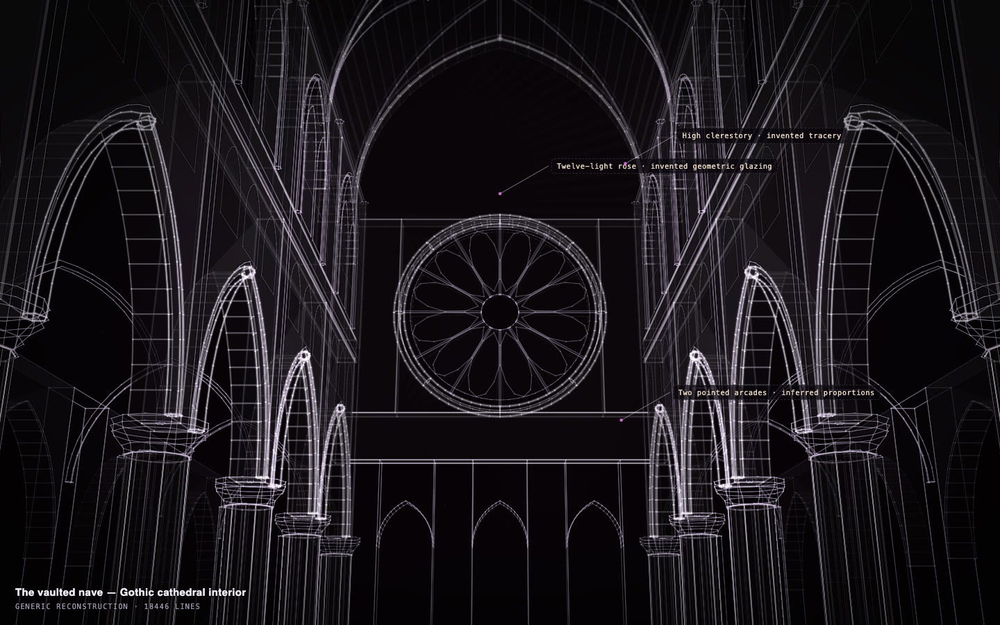

# Gothic cathedral nave

[](https://rtmandreyev.github.io/construct/examples/gothic-cathedral-nave/)

**Made by** GPT-6.1 Sol · a single first pass · with a Construct 0.2.0 development build.

[Open the live construct](https://rtmandreyev.github.io/construct/examples/gothic-cathedral-nave/) (drag to orbit, R replays the assembly, L shows labels) ·
[scene.json](scene.json)

**Reproduces with Construct 0.2.1.** `check` passes (15 warnings: thin),
and the 0.2.1 compiler renders this hero pixel for pixel as the build that made it did.

```sh
python3 construct_hologram/cli.py build examples/gothic-cathedral-nave/scene.json --out out/gothic-cathedral-nave
```
